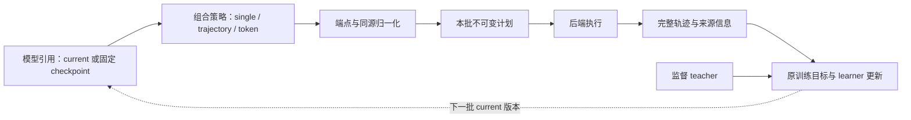

# Rollout 统一模型来源与组合语义

更新日期：2026-10-31。本文定义统一模型引用与组合契约。实现按[统一接口实施计划](2026-10-31-Rollout统一接口实施计划.md)推进；冻结实验保持原代码与原配置。当前可用范围见[目录入口](README.md)，开发与执行目录见[工作区说明](workspaces.md)。

目标是从现有 `examples/mirroropd/run_math_opd_ablation_fsdp2.sh` 启动训练，通过少量 rollout 配置选择模型来源与组合方式。研究队列、基准脚本和自动失败恢复不应成为普通启动的前置操作。

## 1. 模型来源与组合方式正交

Rollout 回答两个独立问题：使用哪份模型状态，以及如何用这些模型生成轨迹。单模型、逐轨迹混合和逐 token 融合都引用同一类模型来源，不把位置固定称为 student/teacher。

| 层次     | 负责内容                                                      | 不负责内容                       |
| -------- | ------------------------------------------------------------- | -------------------------------- |
| 模型引用 | current learner 的本批版本，或固定 checkpoint 的完整身份      | 组合系数、采样策略、训练目标     |
| 组合策略 | single、trajectory mixture、token mixture；两侧引用与右侧权重 | GPU 数量、后端、权重文件搬运     |
| 本批计划 | 固定版本、系数、配额、请求身份、随机流和活跃来源              | 决定 learner loss 或监督 teacher |
| 执行层   | 按计划准备、生成、收齐、释放；实现后端和资源选择              | 改写来源、采样分布或成功更新计数 |

职责结构如下：



生成用模型和监督 teacher 是不同角色。可以由 A、B 生成前缀，仍由既有监督 teacher Q 提供目标，更新 learner C；选择生成来源不能暗中把 Q 改成 B。

## 2. 统一模型引用

公开接口采用下列引用形式。新运行只使用这一套字段；历史字段不自动转换。

| 输入引用                       | 含义                                       | 解析后的绑定                    |
| ------------------------------ | ------------------------------------------ | ------------------------------- |
| `{kind: current}`              | 当前 learner，生成开始前固定本批版本       | 动态 actor 身份＋已应用更新版本 |
| `{kind: initial}`              | 本次训练原始初始化模型；恢复后仍指原始模型 | 固定 checkpoint                 |
| `{kind: teacher}`              | 便捷引用既有监督 teacher 的固定 checkpoint | 固定 checkpoint                 |
| `{kind: checkpoint, ref: ...}` | 指定模型资产 ID 或完整本地 checkpoint      | 固定 checkpoint                 |

真正需要执行层处理的是 current 与 checkpoint 两类绑定。initial、teacher 是明确的便捷引用，不是额外的生命周期类型。监督配置有多个 teacher 时，不猜测 `teacher` 指哪一个，应要求显式 checkpoint 引用。

`ref` 复用既有模型资产解析方式，不再创建另一套 rollout 专用模型注册表。Checkpoint 应包含加载所需的配置、tokenizer 和权重；单个裸 tensor 字典不自动构成完整模型。

固定引用在启动时解析并记录内容身份与稳定位置，不能每轮重新解析会变化的 latest 别名。恢复时应核对原始 initial 身份，不能用恢复 checkpoint 的当前参数替代；缺少原始身份信息时应明确报错。Current 的路径只描述初始化来源，真正身份还包含 actor 版本；路径相同不代表 current 和 initial 是同一个可变实例。Actor 更新不得污染任何固定绑定。

同源折叠依据完整绑定身份：两个相同 current 引用在同一批绑定到相同版本，或两个固定引用解析为同一份配置、token-ID 映射与权重。Current 与 initial 即使起点参数相同，也不能据此永久合并生命周期。

## 3. 三种策略使用相同引用

### 3.1 Single

只使用一个引用生成完整响应：

```yaml
rollout_policy:
  mode: single
  model: {kind: current}
```

固定 A 则将 `model` 改为 `{kind: checkpoint, ref: /models/A}`；固定初始模型使用 `{kind: initial}`。模型角色变化不需要另一套执行入口。

### 3.2 Trajectory mixture，也就是 batch fusion

同一个全局 batch 内，一部分完整轨迹来自左模型，另一部分来自右模型；每条响应从开始到结束只由其选定来源生成。

```yaml
rollout_policy:
  mode: trajectory_mixture
  left: {kind: current}
  right: {kind: checkpoint, ref: /models/B}
  right_weight: 0.5
```

两个固定模型只需替换左引用：

```yaml
rollout_policy:
  mode: trajectory_mixture
  left: {kind: checkpoint, ref: /models/A}
  right: {kind: checkpoint, ref: /models/B}
  right_weight: 0.5
```

设有效响应请求数为 $N$，右侧权重为 $\alpha$。沿用全局配额规则：

$$
N_R=\lfloor \alpha N+0.5\rfloor,\qquad N_L=N-N_R.
$$

先按稳定请求身份分配来源，再交给执行层；不按哪个模型更快返回来决定配额。记录请求权重 $\alpha$ 与实际比例 $N_R/N$。这保证全局 batch 配额，不承诺每道题的多次响应都恰好按该比例拆分。

这里不采用“整批随机选择一个模型”，也不在每个 token 重新选择轨迹来源。两个来源可以分阶段执行，最终仍合成一个完整训练 batch。

### 3.3 Token mixture

两个模型消费相同的真实 token 历史，组合分布后只采样一次，新 token 同时成为两侧下一步的历史。

```yaml
rollout_policy:
  mode: token_mixture
  left: {kind: current}
  right: {kind: checkpoint, ref: /models/B}
  right_weight: 0.5
  fusion_space: probability
```

两个固定模型的写法与 trajectory mixture 相同，只改变 `mode`；两侧都可以是固定 A/B，也可以是一侧 current、另一侧固定模型。Current 放在右侧也有清楚的含义，不要求用户手动交换模型和系数。

`fusion_space` 保留现有两个值：

| 值            | 含义                                                |
| ------------- | --------------------------------------------------- |
| `probability` | 概率 p 的算术混合                                   |
| `logit`       | logits 的线性组合，分布上等价于 log-prob 的几何混合 |

在共同合法支持上，令两侧分布为 $p_L,p_R$。温度和截断之前：

$$
p_{\mathrm{prob}}=(1-\alpha)p_L+\alpha p_R,
$$

$$
p_{\mathrm{logit}}(v)=
\frac{p_L(v)^{1-\alpha}p_R(v)^\alpha}
{\sum_u p_L(u)^{1-\alpha}p_R(u)^\alpha}.
$$

几何形式按内部点 $0<\alpha<1$ 理解；端点直接定义为相应单模型，避免把零概率的 $0^0$ 当作实现规则。先混合，再使用一套公共温度、过滤、停止协议和一次采样。开启这些后处理后，最终分布应按后处理结果解释，不能仍无条件称为原始概率的算术平均。

`right_weight` 可以是标量，也可以沿用明确的常数/线性规则。时钟必须指定为已完成 outer 或成功应用的 optimizer updates；系数在全局生成批开始时解析，批内固定，reuse 不重新解释已经生成的数据。缺少所需时钟时应报错，不猜测进度。若左侧是 initial，衰减到 0 后仍是 initial，不会自动变成 current。

## 4. 端点应自动归一化成单模型

用户不需要为了 $\alpha=0/1$ 再手动切换 mode。每批解析系数之后，计划层应产生以下规范化结果：

| 请求策略                               | 本批有效策略                                     |
| -------------------------------------- | ------------------------------------------------ |
| 任一二元 mixture，$\alpha=0$           | `single(left)`                                   |
| 任一二元 mixture，$\alpha=1$           | `single(right)`                                  |
| 两侧为同一规范化绑定                   | 一个执行来源；保留原请求策略的记录               |
| trajectory mixture 的整数配额某侧为 0  | 本批只执行非空来源，仍记录原 $\alpha$ 和实际配额 |
| token mixture，$0<\alpha<1$ 且两侧不同 | 两侧均参与逐 token 融合                          |

只折叠精确端点，不用任意 epsilon 把很小的非零权重改成 0。

“自动归一化”包含执行语义：无须为不活跃的 rollout 来源加载权重、创建 KV 或执行 forward。未来 schedule 会启用的模型可以提前做元数据预检，但不应仅为检查而占用其 GPU 权重和 KV。活跃来源仍须与训练的 token-ID、采样和停止协议兼容。

这只约束生成阶段。即使 rollout 变成纯 current，训练 loss 仍可能需要监督 teacher；不能因 $\alpha=0$ 就删除监督计算。

如果 alpha 后续变化，应先结束当前批，再建立新的活跃来源与版本状态；不能在请求中途改变来源。保留 requested policy、resolved policy、折叠原因、原始系数和实际配额，避免日志把用户请求和执行结果混为一项。不同执行形状下不承诺自然生成逐 bit 相同，但必须保持规定的分布、合法支持、随机流身份和实际 behavior log-prob 语义。

### 左右对称不能破坏整数配额

执行器可以在内部将 current 映射到自己支持的槽位，但不能因此重新计算 batch 配额。例如 $N=3,\alpha=0.5$ 时，右侧应有 2 条、左侧 1 条；交换槽位后重新用 $1-\alpha$ 做四舍五入，可能错误地把左侧也分到 2 条。

因此先在声明的 left/right 上固定配额、请求和 seed，再映射到执行器槽位。Token 权重转换与 trajectory 的整数路由分别处理。

## 5. 典型需求都使用同一套组合

| 需求                            | 引用和策略                               |
| ------------------------------- | ---------------------------------------- |
| 当前 student rollout            | single(current)                          |
| 初始 student rollout            | single(initial)                          |
| 指定 A 的权重生成               | single(checkpoint A)                     |
| current 与固定 B 逐 token 融合  | token_mixture(current, B)                |
| 固定 A 与固定 B 逐 token 融合   | token_mixture(A, B)                      |
| current 与固定 B 组成同一 batch | trajectory_mixture(current, B)           |
| 固定 A 与固定 B 组成同一 batch  | trajectory_mixture(A, B)                 |
| A 在左、current 在右            | 同一接口，alpha 始终表示右侧权重         |
| initial 与监督 teacher          | 两个便捷引用解析成固定 checkpoint 后组合 |

首轮统一继续沿用单轮文本与一致的 token-ID 映射，不隐式引入跨 tokenizer 重分词。Token mixture 必须在定义一致的合法支持上组合分布；trajectory mixture 的异词表转换需要另外定义。

首轮统一只需要 single 与二元组合，不引入任意嵌套策略图、多个动态 learner 或任意 N 模型融合。某个模型组合能被语义表达，不等于每个后端已经支持它；模型族、tokenizer、结构和容量限制仍须显式报告。

## 6. 实现与迁移

计划层使用 `ModelRef`，启动时解析为 current 或固定 checkpoint，运行时保留声明的槽位。Native vLLM 的权重接收器仍定向更新内部第一组件；当 current 在右侧时，只转换组件顺序与 token 融合权重，不重新计算 batch 配额。两侧固定时不执行 actor refit。HF 参考后端使用同一份绑定。

单模型、端点、同源或空配额计划只准备相应活跃来源。token 内部点使用组合引擎；batch mixture 逐来源收集并统一发布原始全局 batch。运行记录包含 `requested_mode`、`resolved_mode`、`normalization`、`bindings` 和实际请求来源。

非默认策略启动时对模型配置、tokenizer 与权重内容建立 SHA-256 身份记录，随手动 checkpoint 保存 `rollout_state.json`。恢复时要求原始绑定和策略一致；缺少该记录的历史 checkpoint 使用原冻结代码恢复。固定路径在启动时解析，不能在运行中替换文件。

旧 `source/student/model_path/teacher_model_path/teacher_weight` 字段会明确报错。维护中的启动脚本同步迁移；历史报告读取工具可以解释原始记录，但不会把旧字段传入训练运行时。迁移表见[实施计划](2026-10-31-Rollout统一接口实施计划.md#配置迁移)，日常命令见[启动说明](usage.md)。

## 7. 验证与后续边界

已执行与待执行的检查统一记录在[实施计划](2026-10-31-Rollout统一接口实施计划.md)，不根据接口可表达范围推断所有模型组合都已验收。模型族、相同 token-ID 映射、原生后端版本与资源限制继续生效。

本轮完成接口和正常训练生命周期；自动失败重试、具体性能参数、缓存策略、CUDA graph 和拓扑优化另行安排。历史设计与数值依据见[原可组合方案](2026-10-28-可组合Rollout策略架构与实现方案.md)、[原验收计划](2026-10-28-Rollout双融合实现细节与验收计划.md)和[vLLM 后端方案](2026-10-28-vLLM双模型融合重构与优化方案.md)。
