# 八卡调度备选与模型扩展

符号遵循[统一约定](../../theory/符号约定.md)；代码字段、论文原名与历史数据键保留原样。

公共配方已经采用 S3 共享八卡；其当前实现与完整调度图只在[运行与架构](2026-10-22-共享八卡运行与架构.md)维护。本文保留 S0–S6 及 A0–A3 的选择依据、备选调度图和规模预算。历史 4+4 实测值见[4+4 基线测量](../../archive/2026-10-23-历史八卡与One-Shot运行对照.md#4-八卡历史与one-shot对照)，源码和 PR 的证据截至 2026-10-20，见[上游实现与论文基线](../../literature/infra/2026-10-21-上游实现与论文基线.md)。图中的卡数均指同一台机器的 8 张物理卡，`k` 表示 student 策略版本。CPU verifier、TransferQueue（TQ）、driver 和指标聚合不另外占 GPU。

同步方案每次用当前版本生成一个 batch，再更新一次；按频率保存 checkpoint、验证，完成后继续取训练数据。图中的“权重同步”是 actor→推理服务传参，不表示每步落盘 checkpoint。验证均使用指定 student checkpoint；teacher 不参与评分。除算法替代外，验证预算沿用[训练配方](../../settings/训练设置.md)。

图中的“advantage”表示数学依赖，不是把 driver 的 `adv` timer 当作蒸馏 advantage 计算位置。当前 `k1 + PG` 在 `distillation_loss()` 内使用此次 student forward 的 `model_output["log_probs"]` 计算概率差并 `detach()`；此前的 `old_log_prob` 是独立字段，不能替代这个 current-policy 项。具体实现见 [losses.py](../../../../../verl/trainer/distillation/losses.py)。

## S0：固定 4+4，同步执行

已运行。Student 训练和推理复用前一组 4 卡，另外 4 卡是独立 teacher 推理池。不同回答的生成、CPU verifier 与 teacher 打分能重叠，但整个 batch 未齐就不进入 actor 更新。

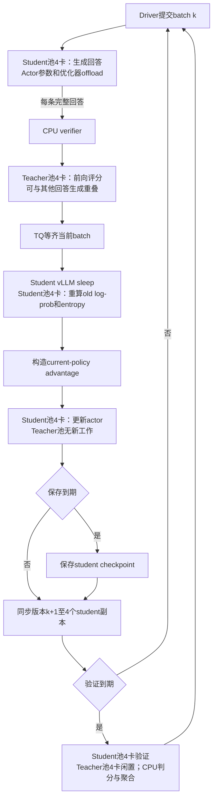

保存与验证是独立条件。后面的备选方案图为拓扑示意，将部分保存/验证边界合并；当前可执行路径的精确 hook 顺序以[运行与架构](2026-10-22-共享八卡运行与架构.md)为准。

资源池简单、两种推理可以并行，teacher 较大或评分吞吐接近生成吞吐时有合理性。当前小 teacher 的专用四卡利用不足，验证完全不使用这组卡，是需要改变的地方。给 teacher 更多 KV 预留不会改变角色归属。

## S1：固定 7+1 或 6+2，调整比例

`standalone` 的独立池机制支持调整比例，Hope 已直连公共配方，不再额外强制 4+4。Teacher 能放在 1 卡时可尝试 student 7、teacher 1；teacher 需要 TP2 或更高评分吞吐时可尝试 6+2。下面用 $G_{\rm student}+G_{\rm teacher}=8$ 表示二者。

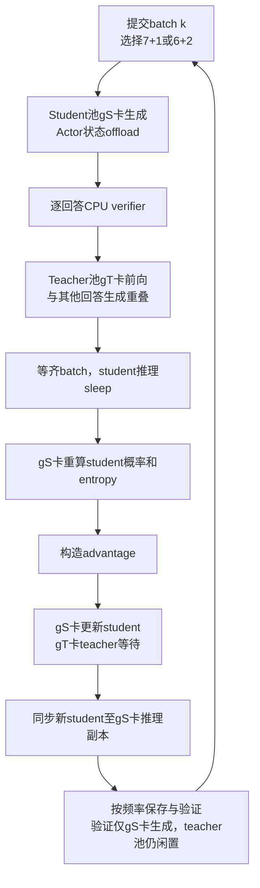

这条路径减少 teacher 专用预留，保留严格同步。它不能让验证使用所有 8 卡。Teacher 1 卡是否足够，应比较请求排队和评分服务时间；不能由四卡的平均 GPU busy 直接推断。

当前入口要求 train batch 和 mini-batch 可被 student GPU 数整除，64 不能被 7 或 6 整除。例如 7+1 用 112/112、6+2 用 96/96 可以满足该检查，但会改变每次更新的数据量。它们只能作为带 batch 变化的实验；若必须保留 batch64，S3 或保留 actor DP4 的 S5 更合适。训练 worker 的`train_mini_batch()`也检查 mini-batch 对 DP 的整除，V1 补齐分发 batch 不能消除该断言。FSDP 并非理论上只能使用二的幂次 rank 数，限制来自当前批处理和入口约束。

## S2：训练保持 4+4，仅验证借用 teacher 四卡

待实现。训练阶段完全沿用 S0；验证边界让 teacher sleep，并在其 GPU 上提供额外 student 推理服务。保留 GPU 内的 teacher 原权重或 CPU 副本，以便验证结束恢复固定 teacher，不能将 teacher 永久替换成 student。

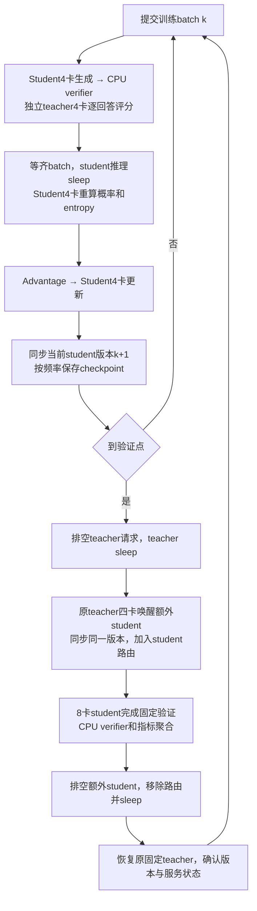

底层 COLOCATED vLLM 副本已有 sleep/wake，仍需上层资源预算、当前 student 权重传输和额外副本的路由管理。Ray 原 reservation 不会因为 sleep 而自动消失，新增 student 应挂在预先规划的同池资源上，不能再申请一组独占四卡。

当前 sync checkpoint manager 使用 naive backend；若额外副本位于另一池，必须核对跨池传参支持，不能假定四副本同步自动覆盖。验证前确认八副本同一版本，退出时先排空并移除额外路由，再恢复固定 teacher。

收益条件是相同验证的节省大于借卡、传权重和恢复耗时。它是验证的独立工程方案，不改善训练时 actor 仍只用 4 卡的情况。当前已采用 S3；只有确需保留独立 teacher 且主要改善验证时，再评估 S2 的额外工程成本，避免维护重复切换逻辑。

## S3：同步共享八卡，分阶段运行冻结 teacher

**已实现，为公共配方默认模式。** 当前边界是单机 V1 sync、actor/teacher 同一 DP world size 的 FSDP2、student TP1 副本，默认各阶段共用八卡。完整训练、同步和验证顺序见[共享训练调度](2026-10-22-共享八卡运行与架构.md#共享训练调度)。Teacher 在 `_balance_batch()` 之后、old-log-prob 重算之前评分，成功卸载后才能进入 actor 路径。

Teacher/student 使用不同 TP/CP 分组是未来扩展，当前配置校验会拒绝这些组合。不能将下文的大模型容量建议理解成已经支持对应并行配置。Verifier 仍用于诊断和验证，训练 loss 没使用 task reward 不等于可以删除它。

NeMo RL 共置蒸馏和本地 One-Shot-OPD 提供了生命周期参考；本地 One-Shot 的 loss、trainer 和数据协议与本项目不同，只提取 frozen forward 和资源管理。verl #7058 在调研快照中是相关未合并补丁，其 V1 teacher 共置路径依赖 Megatron；本仓独立实现了 FSDP2 接入，未直接复制该 PR 配置。

共享池让 GPU 在不同阶段有工作，不要求 teacher 在 student 更新时也运行。它失去当前部分生成/评分重叠，增加显式 teacher 前向与切换，需要比较：

$$
\mathsf t_{S3}=\mathsf t_{G,8}+\mathsf t_{Q,8}+\mathsf t_{O,8}+\mathsf t_{U,8}+\mathsf t_{W,8}+\mathsf t_S,
\qquad
\mathsf t_{S0}=\mathsf t_{GQ,\mathrm{overlap},4+4}+\mathsf t_{O,4}+\mathsf t_{U,4}+\mathsf t_{W,4}.
$$

$\mathsf t_G,\mathsf t_Q,\mathsf t_O,\mathsf t_U,\mathsf t_W,\mathsf t_S$ 分别是生成、teacher 评分、student 重算概率、更新、权重同步和额外切换的墙钟时间。$\mathsf t_{GQ,\mathrm{overlap}}$ 包含 CPU verifier、排队和 TQ。不能把现有 gen timer 除以二当作 $\mathsf t_{G,8}$。

## S4：同卡双推理常驻，显存允许时并行

待设计的备选。每张卡上同时保留 student 与 teacher 推理服务，student 生成完成一条就由 teacher 打分，不必等待整批再唤醒 teacher。Actor 更新前仍需排空推理，释放或卸载相应 cache/参数；更新结束同步 student。

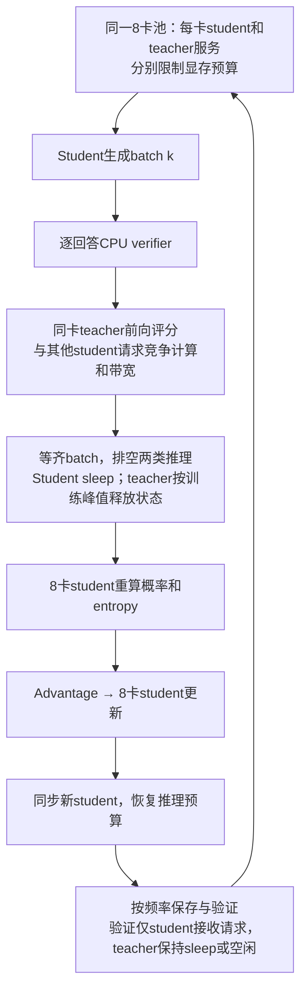

这与 S3 的分时共置不同：S4 争取生成/评分重叠，付出推理阶段同时容纳两套工作集和计算干扰的代价。小模型权重可能容易共存，但长验证 KV、graph/workspace 和 actor all-gather 峰值仍需独立计算。Ray 的 0.5 GPU 不是 50% 算力隔离；vLLM `gpu_memory_utilization` 也不表示算力配额。

历史 verl 共置工作曾讨论过同时驻留与分时切换；当前主线未提供这一完整 student/teacher 调度开关。#7307 共享的是多个 teacher，不能当作 S4 已实现。对于当前小 teacher，额外复杂度和 SM/带宽干扰尚无测量收益，优先级低于 S3。

## S5：动态异步，4 hybrid + 3 rollout + 1 teacher

当前 V1 已有主要动态借卡组件；本项目未做此拓扑的 GPU 试验。4 张 hybrid 是 student actor 与可借出的 student 推理副本，3 张专门生成，1 张专门 teacher。等待可训练样本时最多有 7 张 student 生成卡；actor 更新时 3 张生成卡仍可服务后续请求。

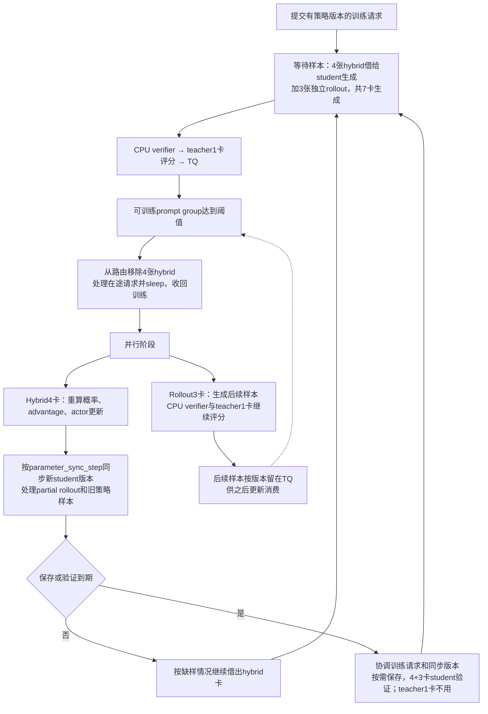

图中的并行分支表示能够重叠的工作，不能理解为每次更新都强制等待全部后续生成结束。更新所用 batch 与后续生产队列通过策略版本和 replay buffer 隔离。验证时哪些 hybrid 卡可以唤醒取决于当前切换状态，但当前 `on_validate_begin()` 已有唤醒并注册 hybrid 的路径；它仍不会借用 teacher 的最后 1 卡。

Actor DP4 可保留 batch64。关键字段为 `trainer.v1.trainer_mode=separate_async`、`trainer.v1.separate_async.hybrid_rollout.enable_switch=True`、`parameter_sync_step=1`，以及独立 rollout 3 卡、teacher 1 卡。权重 backend 需使用支持 separate_async 的方式，例如 nccl，当前 naive 不支持。

`parameter_sync_step=1` 不会消除异步旧策略数据。应检查 rollout/当前策略差异、staleness、partial rollout、IS、丢弃率和质量。Teacher 变大后可把候选改成 4+2+2；总量仍为 8，而且 teacher TP 必须与该池匹配。异步跨池停机/验证协调属于验收内容，不能由训练中存在动态 add/remove 直接视为正确。

## S6：固定三池异步，例如 3 actor + 4 rollout + 1 teacher

保留专用生产者和消费者，适合各阶段持续有足够工作、切换成本相对较高的情况。相同框架也可使用 4+2+2 等整数分配。3+4+1 的当前 batch64 整除约束要另外处理，4+2+2 可保留 actor DP4。

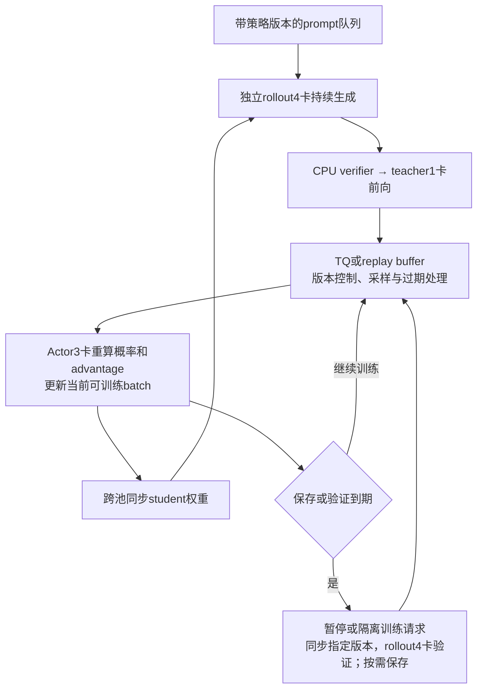

原生纯分池模式不自动借用 actor 或 teacher 卡来验证；额外借用必须明确实现。NeMo RL 的异步 MOPD 采用此类分池思想，但其公开参考是 24 卡，不能直接拿来当作本图八卡比例已经验证过的证据。Lightning OPD 的在线对照代码也使用固定三池，但“分池”本身不证明训练主循环异步，必须检查调用顺序。

固定三池减少模型切换，允许跨 batch 重叠，同时减少每个角色的容量。在总共 8 卡和当前小 batch 下，可能使训练或生成池过小；当前不作为首选。

## A0：Semi-OPD，固定初始 student 回答与 teacher 缓存

算法替代，不能作为严格同步 OPD 的系统优化。每阶段可以独占这 8 卡，离线数据准备只做一次。下图是可在八卡实现的阶段结构；论文未公开逐模型的实际 GPU 布局。

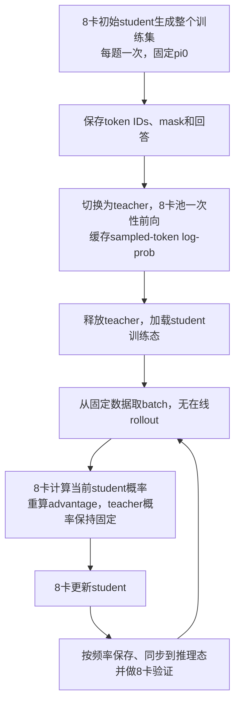

它省去训练循环中的 teacher 和在线生成，还改变了状态/回答的采样分布。不能冻结 student 概率后一直使用原来的 advantage；当前 student 概率仍需随参数更新。论文中与我们同名模型对的结果和成本比较条件只在[论文设置](../../literature/infra/2026-10-21-上游实现与论文基线.md#论文-261011291-的设置与比较边界)记录。

## A1：Lightning OPD，SFT 初始化后离线蒸馏

作者代码公开。相对 A0，它强调先使用同一个 teacher 生成 SFT 数据并完成 student SFT，再生成 student 回答、缓存 teacher 概率。若从现有 instruction/student checkpoint 出发，也必须单独记录省略或替换 SFT 的实验差异。

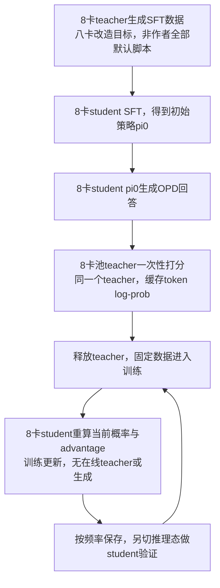

作者公开 Lightning 8B 配置将 actor 设为 8、rollout 设为 0。在线 OPD 对照则为 actor2+rollout4+teacher2。离线训练脚本没有提供与我们相同的全八卡在线验证生命周期；上图验证部分是本项目需要补齐的目标，不应宣称直接运行该脚本就自动得到完整八卡验证。其 SFT 启动脚本默认多节点，也需要在当前八卡约束下重新配置。

## A2：FastOPD，训练只使用短 reasoning prefix

算法/数据预算替代。2610.11291 中的 FastOPD 是 reasoning-prefix 蒸馏，不是另一个同名 VLA 部署工作。Relay-OPD 的公开对照将训练 response 上限改为 4096，再调用标准 OPD；其底层仍是固定 4+4。

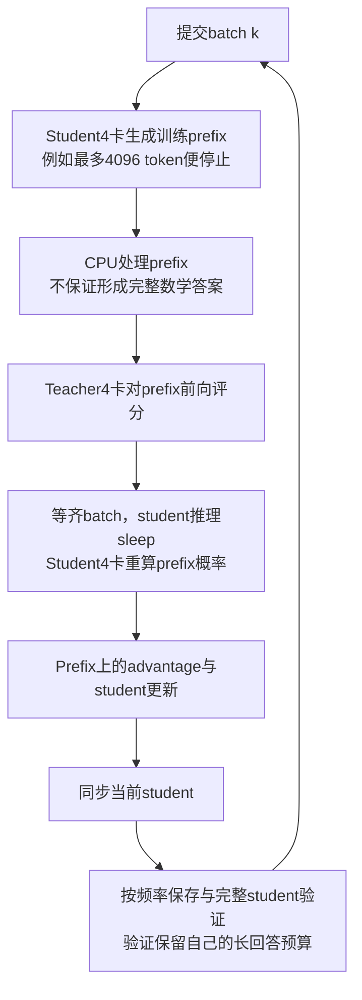

它通过减少训练生成与监督长度节省工作量，不能写成固定轨迹预算下的调度提速。是否减少训练长度是另一项算法试验，不作为当前基础设施方案的验收前提。作者专门发布代码与第三方实现的证据边界见研究文档。

## A3：SKD / Relay-OPD，teacher 介入生成

两者都有公开代码，改变生成分布。SKD 接受符合条件的 student draft token，拒绝后由 teacher 替换；Relay-OPD 根据 reflection/divergence 条件让 teacher 接管若干段再交回 student。下面对应 Relay 仓库的四卡 hybrid 加四卡评分池实现；Google 原始 SKD 的框架另见研究文档。

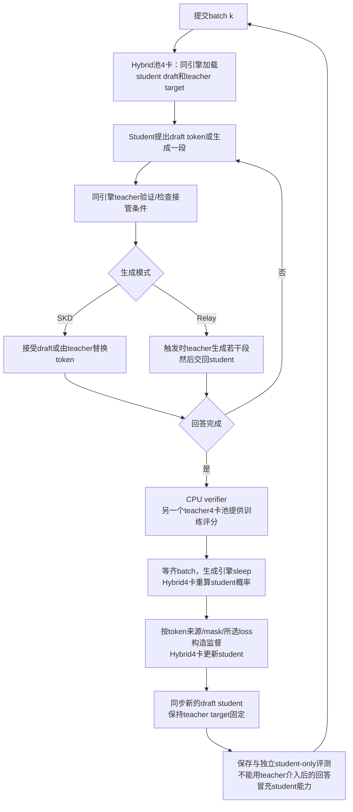

生成池里已经有一份 teacher target，独立 teacher 池又提供评分；不能把“总共 4+4”理解成四卡只有 student、另四卡只有 teacher。该实现修改 vLLM 内部 speculative 路径并固定 0.21.0；我们当前是 0.25.1，不适合为了提高 GPU busy 直接替换整套后端。

SKD 对照默认 top-k forward KL，Relay 有自己的 token 来源与 loss 处理；都不等价于当前纯 student sampled-token `k1 + PG`。Teacher 在生成时更忙也不意味着同等模型质量目标下成本更低，应比较包括双模型加载、评分和完整 student 评测的总 GPU 小时。

## 八卡内的模型规模与显存边界

### 分时共置与同时常驻的容量条件

令 $M_{\rm weights,S},M_{\rm weights,T}$ 为相应并行布局下每卡权重，$M_{\rm KV,S},M_{\rm KV,T}$ 为 KV，$M_{\rm act,S}$ 为 student 训练激活，$M_{\rm train,S}$ 为参数/梯度/优化器的训练状态，$M_{\rm work}$ 为各阶段额外工作区、graph 和通信缓冲。同步分时共置的基本条件是各阶段分别满足每卡 80GB 设备的实际可用容量：

$$
\max\left(M_{\rm weights,S}+M_{\rm KV,S}+M_{\rm work,G},\ M_{\rm weights,T}+M_{\rm KV,T}+M_{\rm work,Q},\ M_{\rm train,S}+M_{\rm act,S}+M_{\rm work,U},\ M_{\rm work,refit}\right)<\mathsf M_{\mathrm{available}}.
$$

FSDP teacher 批评分的 $M_{\rm KV,T}$ 可以为零，因为完整序列前向通常关闭 generation cache；其激活与输出工作区应计入 $M_{\rm work,Q}$。$M_{\rm work,refit}$ 必须包含同步期间同时存在的参数副本，不能只取稳定阶段峰值。

同时常驻推理至少还要满足：

$$
M_{\rm weights,S}+M_{\rm KV,S}+M_{\rm weights,T}+M_{\rm KV,T}+M_{\rm work,GQ}<\mathsf M_{\mathrm{available}}.
$$

还需分别验证 actor 更新与 refit 峰值。这解释了为什么 S3 比 S4 更能适应 teacher 或 student 变大，但并不自动说明 S3 的墙钟一定更短。

### 参数量的最低预算

下表只计算参数/典型训练状态，不含激活、KV、复制峰值和 workspace。参数量按十亿参数近似，BF16 权重为 2 bytes/parameter；示意全参 AdamW 训练状态按 16 bytes/parameter 估计。实际实现 dtype/分片/offload 以测量为准。

| 模型标称参数 | BF16 全权重 GiB | 权重均匀分片至 8 卡 GiB/卡 | 典型训练状态均匀分片至 8 卡 GiB/卡 |
| --- | --: | --: | --: |
| 当前实际 1.777B | 3.31 | 0.41 | 3.31 |
| 8B | 14.90 | 1.86 | 14.90 |
| 14B | 26.08 | 3.26 | 26.08 |
| 32B | 59.60 | 7.45 | 59.60 |
| 70B | 130.39 | 16.30 | 130.39 |
| 235B | 437.72 | 54.72 | 437.72 |

70B BF16 teacher 的完整权重一张卡放不下，TP2 的权重约 65.2 GiB/卡也只留下较小的其他工作集空间；TP4/8 或 FSDP8 前向是否合适要按上下文和吞吐测量。70B 全参 student 的 16-byte 训练状态即使平均到 8 卡也超过单卡容量，需 CPU offload、不同状态布局或改变训练方案，调度本身不能消除这些字节。

16-byte 是示意预算；若 BF16 参数/梯度与 FP32 两个 moment 构成 12-byte 布局，70B 训练状态仍约 782GiB。实际 dtype、master copy 与分片应逐后端核对。表中的均匀八卡权重是一份模型分片；TP4×DP2 有两个副本，其单卡权重应除以 4。235B teacher 纯权重均分 8 卡约 54.72GiB/卡，仍需核对 MoE 布局、激活、输出头与通信空间，不能因参数能容纳就判定长序列前向可运行。

CPU offload 同时受主机内存容量和搬运时间限制。Teacher 权重、student 参数/优化器副本、加载时暂存与数据 worker 都占 CPU 内存；不能只看单个 driver 的 RSS。对 MoE，权重容量取全部参数，FLOPs 才参考激活参数，不能按“30B-A3B 只有 3B”安排权重。

### 当前 GQA 架构的 KV 预算

当前两模型为 28 层、KV heads=2、head dimension=128、BF16。每 token 的 KV 为：

$$
b_{\rm KV/token}=2\times28\times2\times128\times2=28672\ \mathrm{bytes}=28\ \mathrm{KiB}.
$$

一个 TP1 副本的理论 KV：16×6300 token 约 2.69 GiB，16×11265 约 4.81 GiB，32×35841 约 30.63 GiB，64×35840约61.25GiB。本机vLLM显存比例0.5时KV池约35.36GiB，短子集并发64无抢占不代表64条最长验证序列能同时驻留。还要加权重、block rounding、workspace 和 graph。同一批 64 条回答在旧 4 副本上平均约 16 条，在当前 8 副本上平均约 8 条；显存容量提高不意味着单卡 decode batch 更大。

未来模型的 KV heads、层数和 head dimension 改变时必须重算。TP 能否有效分片 KV 还取决于 KV head 数及复制规则；当前 Qwen2 attention heads=12，不能假设任意 TP=8 合法。FSDP8 训练和 8 个 TP1 推理副本不要求 attention heads 能被 8 整除。

设一次切换必须搬运$B_{\rm bytes}$字节、整机实测有效带宽为$v_{\rm bytes}$，搬运时间的理想下界为：

$$
\mathsf t_{\mathrm{transfer}}\ge B_{\rm bytes}/v_{\rm bytes}.
$$

不能把每卡标称带宽相加当作整机持续带宽。固定 teacher 可设计为保留不可变 CPU 副本，只丢弃 GPU 副本以避免回传，但这是待实现的优化，不能假定所有 offload 后端已如此执行。

### 规模变化后的选择

| 八卡内的模型组合 | 优先评估 | 需要改变的部分 |
| --- | --- | --- |
| 当前 1.5B→1.5B | 已实现的 S3，对照 S0 | 保留 batch64 和 student TP1 副本；验收完整训练及验证成本 |
| Student1.5–8B，teacher14–32B | S3，对照 S1/S0 | Teacher 按显存与评分吞吐选 FSDP8 或 TP2/4；不能直接将大 teacher 压到 1 卡 |
| Student1.5–8B，teacher70B 级 | 先测 teacher 独占 8 卡前向的可容纳性，再评估 S3 | 主机内存/切换成本、teacher 并行、长序列输出分块；常驻分池会明显挤压 student 资源 |
| Student14–32B，teacher 也较大 | S3 先解决分阶段容量，分池按实测比较 | Student 训练分片、激活重算、必要 CP/TP，生成副本数随 TP 增大而减少 |
| Student 全参状态连 8 卡也放不下 | 先解决模型/优化器容量 | CPU offload 或重新选择训练设置；不能承诺只改调度即可完成 |

表中除当前配置外均为容量与调度的判断方向；需要 TP/CP、MoE 或不同 rank 分组时，必须扩展并验证现有共享实现，不能只改模型路径。不是给定参数量一定可运行的保证。相同 32B 在不同词表、KV 结构、上下文和 micro-batch 下有不同峰值。

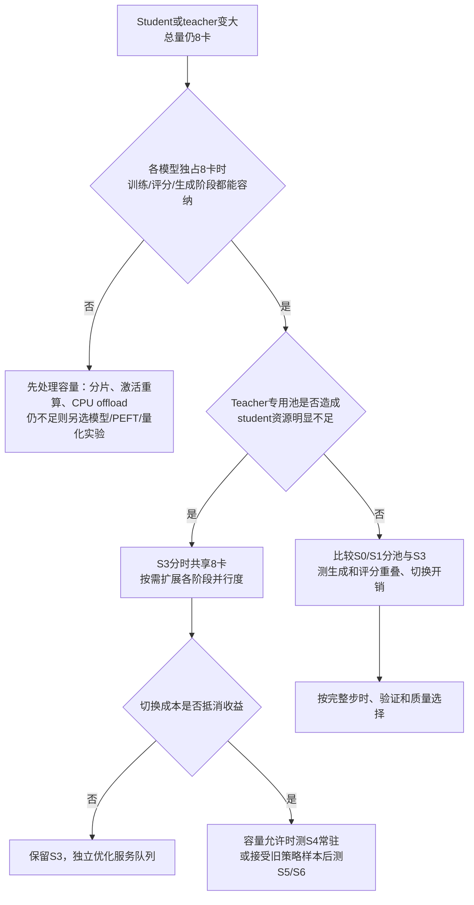

更换不同模型家族还要核对 token 协议：sampled-token 监督要求两边对同一 token ID 的语义兼容。不同 vocab/tokenizer 不能直接交换 student IDs 并视作同一 token 的概率。若需跨 tokenizer 对齐，应另列算法与数据接口工作；GPU 容量可容纳不代表蒸馏协议兼容。
