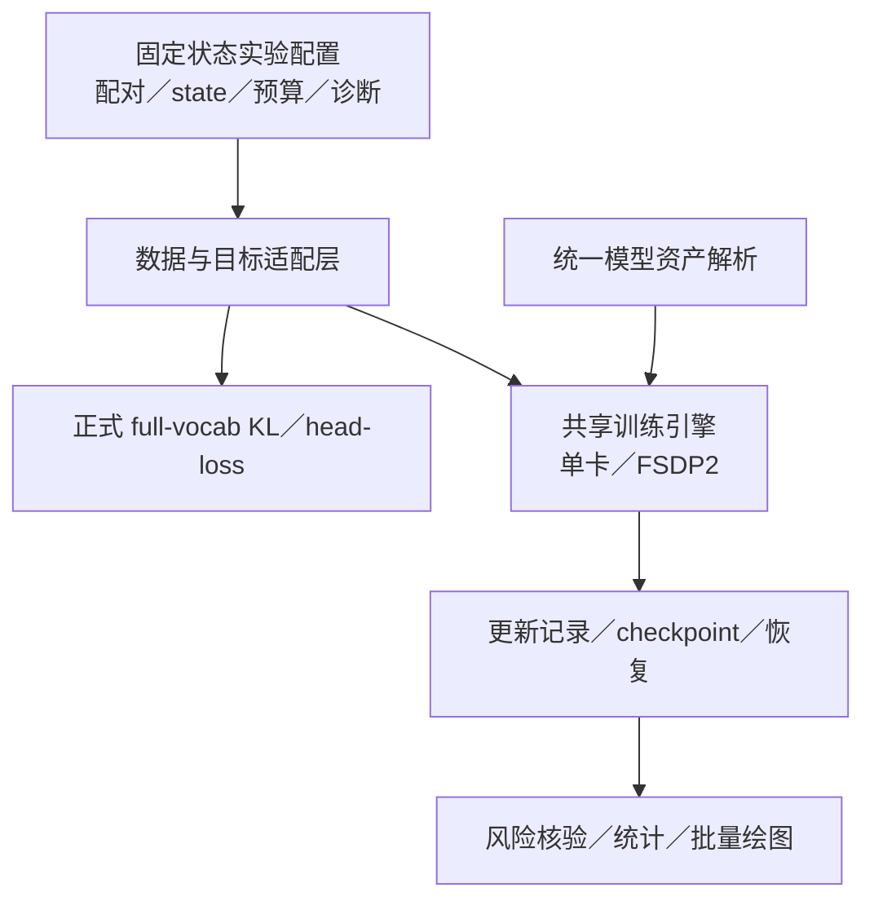

# 统一模型资产与正式引擎集成维护方案

模型资产统一使用仓库同级的 `model/`，原始模型按不可变身份归档，训练权重按实验实例归档。固定状态教师迁移实验仍保留题池、配对、输入模式和诊断设计；底层 KL、模型 head 适配、优化器和多卡执行逐步接入 MirrorOPD-verl 的正式实现。

资产迁移与正式引擎集成是两个独立交付：前者改变文件位置和当前入口，后者需要验证数值与执行行为。历史实验的权重、数据、优化预算与观测结果不因迁移改变。

## 模型资产目录合同

设 `WORK` 为仓库所在工作区。本机为 `/mnt/tidalfs-bdsz01/dataset/llm_dataset/zkn_data/fht_data`。源码 checkout 和 worktree 都通过明确的工作区配置读取同一份资产，不在每个 worktree 中复制模型。

```text
WORK/
├── MirrorOPD-verl/                       # main checkout
├── MirrorOPD-verl-fixed-state-engine/    # 建议的独立开发 worktree
└── model/
    ├── hub/<组织--仓库>/<revision>/<subfolder>/
    ├── checkpoints/<原 derived 相对路径>/
    └── registry.json
```

`hub/` 下使用实体文件目录，不依赖旧位置的软链接。模型身份包含 repo、完整 revision 和可选 subfolder；同一仓库的 SFT step80／step640 是两个独立模型身份。目录名或模型简称不能代替完整身份。缺少可证明上游 commit 的本地变体使用 `content-<完整文件清单 SHA256>`，保留来源限制，不把它改写成未经核对的 Hub revision。

`checkpoints/` 保存我们训练得到的权重，原实验相对路径保留以区分 run、arm 和 step。teacher hidden、轨迹银行、逐题指标与评测回答仍由各自缓存或运行目录管理；它们不是原始模型，不混入 `hub/`。研究侧独立 Adam/RNG 恢复记录继续保留原运行身份。

源码中的 `examples/mirroropd/assets/model_registry.json` 保存可版本管理的模型身份、别名和相对 WORK 位置；本机 `model/registry.json` 保存实际绝对位置与迁移回执入口。具体迁移计划、journal、文件摘要和来源记录位于 `model/migrations/<migration-id>/`，不记录凭据。迁移清单承担旧位置到新位置的对应关系，完成后旧位置不保留目录、软链接或其他兼容入口。应用侧通过统一资产解析接口找到新位置，不以文件系统别名维持旧行为。

## 迁移与证据

2026-10-30 的本机迁移覆盖 48 个原始模型身份、研究侧 179 个训练权重目录，并补充归档主 checkout 历史 outputs 下 17 个模型／checkpoint 入口。计划与完整校验结果位于 [迁移计划](../../../../../../model/migrations/2026-10-30-model-assets/plan.json) 和 [联合迁移验证](../../../../../../model/migrations/2026-10-30-model-assets/complete-verification.json) 和 [正式训练资产明细](../../../../../../model/migrations/2026-10-30-model-assets/production-verification.json)；数量按资产身份与目录计，不等于正文科学比较的模型数。

迁移以完整清单为依据：模型身份、源目录、目标目录、权重文件大小与摘要、重复文件处理以及引用消费者。旧目录同名不等于权重相同；不同来源仓库也不能仅因模型名称或张量形状相同而合并。

当前脚本、配置、公开命令和本地模型卡链接使用新位置。冻结的原始日志、当时解析配置、来源附件和数据哈希保留原文，它们描述当时实际发生的运行。读取这些历史记录时，应通过资产清单投影出当前位置；需要生成新视图时同时保留原始来源摘要，不能改写原文件后继续宣称原哈希有效。

历史 control/source 和 batch entry 的源码由原摘要冻结，保留用于审计。它们可能硬编码已退役路径，不能声称可直接原样再执行。重新执行使用更新后的当前代码和新 attempt，记录新的源码身份；不修改旧 worker 的 source_files 摘要来伪装原运行。

固定状态训练的恢复还需核对实际权重身份、参数顺序、Adam step 与 RNG。路径迁移不构成重新训练，也不能把只有权重的 checkpoint 升格为完整恢复点。迁移后复用原始模型或 checkpoint 的任务，需要先验证资产解析和文件清单，再执行原有数值或恢复验收。

### 正式训练 checkpoint 的归档

当前正式训练 wrapper 使用 `CHECKPOINT_DIR` 显式管理模型输出，默认指向 `model/checkpoints/production/<run-relative>/checkpoints`；`RUN_DIR` 继续保存日志、验证和 Hydra 记录。只有 wrapper 改变默认资产位置，verl 通用 trainer 的自定义存储能力仍保留。具体运行合同见[共享运行方式](2026-10-22-共享八卡运行与架构.md#通用运行合同)。

主 checkout 中已结束的正式训练资产归入 `model/checkpoints/production/<原 outputs 相对路径>/`，只迁移模型或完整 checkpoint 子树，原 outputs 的指标、配置和日志目录保持原位。模板覆盖的本地模型视图独立归档，不能因共享基础权重而丢掉其 generation config 或 tokenizer 设置。

FSDP checkpoint 按完整恢复单元迁移，保留 model／optim／extra_state 分片、相关 HF 配置，以及存在的数据／trainer 状态文件；不将其当作只有 HF 权重的推理导出。warm-checkpoint 中的模型、Adam、scheduler 同样整体保留。是否可以精确恢复仍由原恢复合同和内容检查决定，搬目录本身不构成恢复验收。

其他 worktree 中仍有活动 owner 的资产不因当前 checkout 的历史归档而移动。历史日志保留当时记录的位置，当前读者通过注册表投影；重新执行采用更新后的源码和新 attempt。

## 正式引擎的复用边界

研究层负责决定实验内容：student/teacher 配对、状态来源、冻结题池、batch/reuse 预算、输入模式与输出面板。共享执行层负责计算与持久性，不在研究层维护第二套同义 KL 或 optimizer。

| 保留在实验入口                     | 接入正式共享实现                   |
| ---------------------------------- | ---------------------------------- |
| 题目、S0／teacher state 与前缀协议 | 模型加载、tokenizer 与 head 适配   |
| 教师谱系和输入条件                 | full-vocab KL 与梯度计算           |
| 独立题目预算和更新顺序             | 单卡／FSDP2 执行、精度和 optimizer |
| teacher-copy、跨批影响和遗忘面板   | checkpoint、恢复、通用更新记录     |
| 逐题结果与图谱                     | 统一资产解析与内容身份             |



正式 KL 已提供多个计算后端，见 [full_vocab.py](../../../../../verl/trainer/distillation/full_vocab.py)。FSDP head 适配必须经过 module 调用边界，保留 all-gather 和 backward hooks；不能直接取分片 head 权重后在外部执行未受管理的投影。接口和生命周期见 [full-vocab 架构](../architecture/full-vocab.md)。

当前研究使用固定 `batch×H` 分母，而正式训练通过统一 loss context 处理归一化。接入时要传递显式的目标归一化合同，不静默切换到有效 token 均值。原生词表 KL、teacher 额外支持以及共享支持条件 KL 也要作为明确条件保留。

## 分阶段实现与验收

1. 统一资产解析与现有单卡入口，验证当前命令、模型身份、权重清单和缓存消费者。
2. 为冻结 token／teacher hidden 提供正式数据适配，保持当前 batch 顺序、支持集与固定分母。
3. 将研究 KL 接到正式后端，比较 loss、完整参数梯度、head/embedding 共享参数累积及一次更新结果。
4. 接入共享 optimizer、更新记录和 checkpoint，验证连续训练与恢复后的轨迹；不把历史无 Adam 的权重当作连续恢复点。
5. 扩展 FSDP2 等多卡后端，验证全局归一化、padding／packing、精度和 EOS 行为。
6. 在数值通过后优化 kernel、评分 batch、缓存和调度，用完整实验的 GPU 小时与已核验分支吞吐评估收益。

验收从 CPU 合同与小张量参考开始，再进入独立的真实模型数值与资源检查，最后运行预先选定的科学对照。测试不能替代真实模型数值验收，也不能用更换状态银行后的结果冒充旧协议的实现等价。

## Git 与 worktree 维护

branch 与 worktree 一起使用：`feat/fixed-state-engine` 是建议的短期集成分支，`WORK/MirrorOPD-verl-fixed-state-engine` 是建议的独立工作目录。worktree 共享同一仓库的 Git 对象和引用，但具有独立的工作目录与 index；分支承载提交历史。[^git-worktree]

2026-10-30 只读核对时，本地 main 为 `fe3005a1`，相对当前本地记录的 `origin/main` 领先 22 个提交；这一计数没有联网 fetch，不代表远端实时状态。它已经包含研究与绘图改动，因此集成基线应从完成本轮迁移并 review 后的本地 main 选择，不从较旧的 origin 记录重新起步。现有 main 上有其他未提交研究文档，创建集成环境时保留这些工作，不通过 reset 或 stash 腾空目录。

| 引用                      | 职责                        | 同步方向                               |
| ------------------------- | --------------------------- | -------------------------------------- |
| `upstream`                | 原版 verl 来源              | 经现有维护与验收流程进入 main          |
| `origin/main`／本地 main  | 我们的 MirrorOPD-verl 主线  | 接收已验收的来源更新与功能 PR          |
| `feat/fixed-state-engine` | 固定状态实验正式引擎集成    | 定期合入 main，阶段功能经 PR 回到 main |
| 私有短期 topic 分支       | 单项接口、kernel 或恢复改造 | 完成后进入集成分支或直接进入 main      |

不要把 upstream/main 直接合入集成分支绕过主线维护。共享集成分支通过 merge 合入 main 的更新，保留已用于运行的提交身份；尚未共享的私有小分支可以 rebase 整理。分阶段 PR 缩短分叉时间，完整集成后回收临时分支，不长期维护另一套 studies trainer。merge 的操作与冲突处理遵循 Git 的现有语义。[^git-merge]

正式训练能力只在 `verl/` 保留一份实现；实验层保留声明、数据适配、验收与报告。Git 分支用来隔离开发，不能代替清晰的模块边界。

### 独立开发环境

模型、数据与日志位于共享 WORK，worktree 只放源码和配置。显式设置以下环境可避免相邻 checkout 推断出不同的资产根目录：

```bash
export MIRROROPD_WORKSPACE=/mnt/tidalfs-bdsz01/dataset/llm_dataset/zkn_data/fht_data
export MODEL_ROOT="$MIRROROPD_WORKSPACE/model"
```

依赖不变时可以复用锁定的运行环境；涉及依赖变更时使用独立 venv。editable install 必须明确对应源码位置，避免一个共享环境始终导入另一个 worktree 的包。执行前核对 Python 路径与关键包 `__file__`，worker 继续使用冻结源码而非实时 main。

每次运行记录 Git SHA、未提交源码快照摘要、模型身份、银行身份、科学协议、后端与依赖版本。源码目录名不参与模型内容身份；迁移路径也不改变权重身份。涉及数值的后端变更仍需重新验收。

### 同步和冲突处理

建议对该仓库局部启用 `rerere` 以记录重复冲突的解决方式，并保留人工 review；它复用的是已有冲突解决记录，不证明科学语义正确。[^git-rerere] 维护流程可以在 review 后使用 `git config --local rerere.enabled true`，不修改全局配置。

本页给出可 review 的维护方案。本轮不切换当前 main，不创建正式引擎集成 worktree，也不执行 fetch／push。后续确认基线后再创建分支和工作树，网络 Git 操作沿用工作区 SSH 激活约定。

### 参考文献

[^git-worktree]: Git contributors. git-worktree Documentation. [git-worktree](https://git-scm.com/docs/git-worktree).

[^git-merge]: Git contributors. git-merge Documentation. [git-merge](https://git-scm.com/docs/git-merge).

[^git-rerere]: Git contributors. git-rerere Documentation. [git-rerere](https://git-scm.com/docs/git-rerere).
