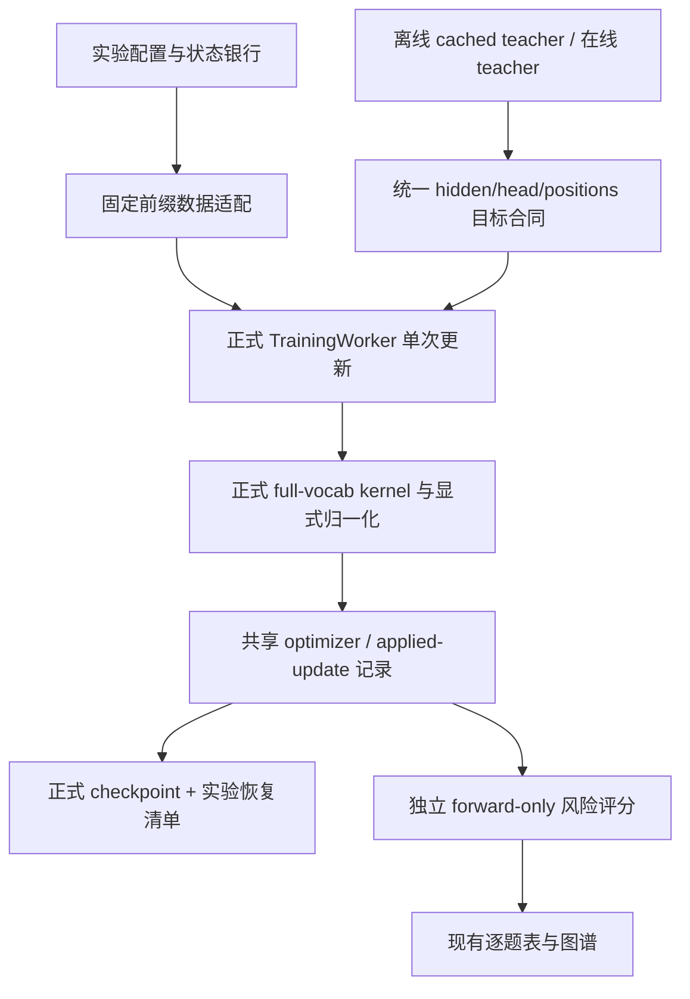

# 固定状态实验正式引擎迁移代码走读与评审

本页记录固定状态教师迁移实验接入 MirrorOPD-verl 正式引擎前的源码走读、阻塞项与分功能实施计划。目标是复用正式 worker、KL、优化器与 checkpoint，将当前研究循环退为验收参考；实验配对、题池、输入条件和分析保留为薄前端。当前没有实现新的训练功能，也没有运行 GPU 训练。

开发工作树为 `WORK/MirrorOPD-verl-fixed-state-engine`，分支 `feat/fixed-state-engine`，从本地 main 的 `fe3005a1` 创建；资产迁移基线已独立提交为 `0b8d0981`。main 上其他未提交研究文档未搬入该分支，模型和实验缓存仍使用共享 WORK。资产与分支合同见[维护方案](2026-10-30-统一模型资产与正式引擎集成维护方案.md)。

走读覆盖 25 个关键源码文件及其调用点；[来源清单](data/fixed-state-engine-review-20261031/source-manifest.json)记录实际代码 SHA256。[CPU 探针](data/fixed-state-engine-review-20261031/cpu-probes.py)和[结果](data/fixed-state-engine-review-20261031/cpu-probes.json)核验了 Llama 拒绝路径、共享支持限制、原生 teacher-extra 修正、无梯度评分的额外计算及 next-token 位置。静态走读不是整仓 correctness 证明；未执行 CUDA kernel 性能测量或真实模型迁移验收。

## 当前两条执行链

研究入口经 `fixed_transfer.__main__ → runner → training.train`，调用 `hf_models.hidden → hf_rkl.backward`，由研究循环直接执行 AdamW、同步评分和 HF 权重导出。固定题池、连续 reuse、缓存目标及每 16 更新评分都在这一循环中。

正式接口经 `TrainingWorker.train_batch → engine.train_batch → forward_backward_batch → FSDPEngineWithLMHead._full_vocab_output → full_vocab_objective_result → distillation_loss/LossContext`，再执行正式 optimizer step 和更新记录。它已具备分片、梯度累积、checkpoint、稳定 KL 和 hidden 传输，迁移不需要复制这些实现，也不必强制启动完整在线 PPO／reward／rollout 链。



初版驱动应逐次调用 [TrainingWorker.train_batch](../../../../../verl/workers/engine_workers.py)，明确控制 A→T、每批连续 16 次更新。`train_mini_batch` 的默认 iterator／epochs 行为需要单独验收；不能把 20 批各 reuse16 改成整池循环 16 个 epoch。

## 优先评审发现

P1 表示接入或扩大并发前必须处理的语义／正确性阻塞；P2 表示恢复可靠性、性能或观测问题。标为“现有合同差异”的项目不意味着正式在线训练现在错误。

| 优先级与性质             | 证据与触发条件                                                                                                                       | 迁移要求                                                                                                              |
| ------------------------ | ------------------------------------------------------------------------------------------------------------------------------------ | --------------------------------------------------------------------------------------------------------------------- |
| P1，接口缺口             | `models/transformers/full_vocab.py:11` 与 `distillation/hidden.py:22` 都只接受 Qwen 家族，Llama 学生和 teacher head 分别被拒绝       | 模型与 frozen-head 两侧统一能力验收；首批支持 Qwen2／Qwen3／Llama，保留 bias-free、shape 与 tied 权重检查             |
| P1，分母合同差异         | 研究 `spec.py:85` 使用 B×H；正式 `transformer_impl.py:773–781` 无条件以 loss_mask 全局求和并覆盖 batch_num_tokens                    | 新增独立 objective denominator，默认 valid-token mean 不变；fixed-budget 不能靠预填 batch_num_tokens 或修改 mask 实现 |
| P1，精度合同差异         | 正式 `transformer_impl.py:1303,1328` 让 head dtype 跟随 hidden；FSDP 还可能先将参数舍入。研究 `hf_rkl.py:17,29` 使用 F32 hidden/head | 命名且可验收的研究兼容 profile，区分 master、执行参数、autocast、head operands、输出／累积精度                        |
| P1，支持集缺口           | `full_vocab.py:311` 拒绝 student 词表更大；`:257–278` 已正确提供 teacher-extra 原生修正                                              | 保留原生支持修正，另加显式 shared-conditional 支持；语义 token 映射在加载阶段验收                                     |
| P1，缓存身份缺陷         | `training.py:319` 绑定 execution/profile，但 `training_jobs:565` 与 `runner.finished:171` 只按 science 子集接受旧完成记录            | 统一完成条件，区分历史结果读取与“当前实现已运行”；变更实现不能静默跳过训练                                            |
| P1，资源互斥缺陷         | `resources.py:70` 锁单个分组文件；当前 front2 与 front4 配置使用不同 inode，却覆盖重叠 GPU                                           | 使用统一物理 GPU 所有权，原子申请整组设备，避免重叠 ledger 同时获租                                                   |
| P1，位置／EOS 合同差异   | 研究 hidden 输入内部使用 prompt+response[:-1]；正式 `padding.py:34` 根据完整 input 与 response mask 计算预测位置                     | 传完整 prompt+response 和真实 mask，生成逐题 prediction positions；raw vocab KL 显式禁用 EOS coarsening               |
| P1，评分接口缺口         | `hidden_io.py:32` 用 train 标志读缓存；`transformer_impl.py:1847` 在该路径清空 model_output，单设 return_model_output 无效           | 独立 cached-target score API，返回逐题 sum/count 和请求的诊断，不通过训练标志模拟评测                                 |
| P2，已复现的评分性能缺陷 | `PrecomputedKL.forward:211–240` 在 no_grad 下仍分配并累加 dh/dw；Triton weighted_rows 已有 gradient=False 能力                       | forward-only 提供仅 rows／statistics 的分支，禁止构造完整 head gradient                                               |
| P2，缓存完整性缺陷       | `training.cache_teacher:58` 和 job required_files 只检查逐题文件，遗漏 head.pt                                                       | head 与 hidden 分片进入同一完整 manifest；缺文件时应修复或明确失败                                                    |
| P2，外部依赖与快照风险   | `runner.queue:217` 只等成功 marker；生产者失败可无限等待。源码冻结逐目录复制，缺完整快照证明                                         | 依赖具有 pending/failed/cancelled 状态；源码快照绑定 commit、dirty patch 与文件清单                                   |

当前资源配置的重叠集合与锁文件见[资源布局快照](data/fixed-state-engine-review-20261031/resource-layout.json)。这是潜在并发冲突的配置证据，不表示当前已发生双重占用。

源码：[研究训练](../../../research/studies/fixed_transfer/training.py)、[研究 spec](../../../research/studies/fixed_transfer/spec.py)、[调度器](../../../research/studies/fixed_transfer/runner.py)、[资源租约](../../../research/runtime/resources.py)、[正式模型适配](../../../../../verl/models/transformers/full_vocab.py)、[teacher head](../../../../../verl/trainer/distillation/hidden.py)、[FSDP 引擎](../../../../../verl/workers/engine/fsdp/transformer_impl.py)、[LossContext](../../../../../verl/workers/utils/loss_context.py)、[KL kernel](../../../../../verl/trainer/distillation/full_vocab.py)、[hidden I/O](../../../../../verl/trainer/distillation/hidden_io.py)。

### 分母与精度的具体影响

如果同一批累计 KL 为 12、有效位置为 6、B=2、H=4，正式有效 token 均值为 2，固定预算均值为 1.5。两者梯度尺度不同，梯度裁剪与 Adam 的 epsilon／状态也使其不能被解释成自然抵消。正式引擎当前会重算分母，因此仅在数据适配器预填 B×H 不会生效。

现有 `bf16_fp32` profile 也不能直接替代旧研究执行：它会将 embedding、线性输出和部分中间结果提升为 F32；旧研究是普通 HF backbone BF16 autocast 加 F32 head。BF16 operands 产生 F32 输出，也不能恢复已经舍入的 head 参数。应保留既有正式 profile，新增明确的兼容合同，并用真实模型的完整梯度和连续 Adam 更新核验。

### 已有能力应保留

原生 teacher 额外词表修正、稳定近零 KL 算法、root/head FSDP 调用钩子、tied Parameter 共用、统一 UpdateResult 与 checkpoint manager 都应复用。当前未发现 tied 权重累积的直接错误。为得到 F32 head 而创建第二份可训练权重，会破坏共享参数语义；在 FSDP 外直接访问 shard 做投影，也会绕过必要的 all-gather／backward hooks。

正式 [precision.py](../../../../../verl/models/transformers/precision.py) 已有精度基础设施，[linear.py](../../../../../verl/utils/linear.py) 已有低精度 operands／FP32 输出支持；应在原模块扩展，不在研究目录再实现一套。

## 按功能拆分的迁移设计

下列名称描述拟新增／扩展的合同，不表示已有这些类。优先使用不可变 dataclass 与现有 TensorDict／nested tensor，不为单一实现引入通用插件框架。

| 功能           | 目前来源                                        | 目标与复用                                                                    | 必须保留的语义                                                                                |
| -------------- | ----------------------------------------------- | ----------------------------------------------------------------------------- | --------------------------------------------------------------------------------------------- |
| 资产与运行身份 | assets、Model、scientific_inputs、source.freeze | 复用已迁移资产 resolver，增加明确 run／backend／source identity               | 模型身份不随物理位置变；结果复用不冒充新实现验收                                              |
| 题池与状态银行 | fixed_transfer/data.py                          | CorpusManifest＋TrajectoryBank，实验前端负责题目和 state producer             | question_id 与 trajectory_id 分开；实际 prompt token、producer、模式、seed、EOS、cap 均有身份 |
| 批次计划       | Study.training_group、continuation              | OrderedBatchSchedule＋cursor，由薄驱动调用正式单次更新                        | 每批连续 reuse；默认不循环题目，attempt 与 applied update 分开                                |
| 批数据转换     | hf_models.hidden、required_rows                 | FixedPrefixBatch → 正式 TensorDict／jagged 输入                               | next-token shift、mask、positions、逐题来源与 teacher 对齐                                    |
| 模型与 head    | hf_models、共享参数审计                         | 扩展正式模型适配与 FrozenTeacherHead                                          | Qwen／Llama 能力检查、bias-free、别名一致性、tied 参数只一份                                  |
| teacher target | teacher hidden/head 磁盘缓存                    | TeacherTargetProvider，共享 hidden/head/positions payload；复用 HiddenBatchIO | teacher 与银行身份都匹配；同样的 positions 不代表同样目标                                     |
| 目标与归一化   | hf_rkl.head_vjp 与固定 denominator              | 正式 full_vocab＋ReductionSpec＋SupportSpec                                   | native-extra、shared conditional、fixed budget、EOS policy 分开声明                           |
| 更新与精度     | 手写 AdamW／clip／HF autocast                   | 正式 TrainingWorker、optimizer builder 与命名数值 profile                     | LR／betas／eps／weight decay／clip／dropout／FA2 条件均显式；按成功更新计数或 fail-fast       |
| checkpoint     | training_state、HF export                       | 正式 checkpoint manager＋薄实验 envelope                                      | 权重、Adam／RNG、银行、schedule cursor、world size、执行合同完整匹配                          |
| 风险评分       | hf_rkl.score、同步 score_steps                  | 独立 forward-only scorer＋ReadoutPolicy，独立 infer batch                     | 逐题 sum、observed count、budget count、绝对位置段、面板身份                                  |
| 批量执行       | runner／batch／资源分组锁                       | 保留薄任务 DAG，统一资源与 artifact 状态                                      | 缓存命中、失败传播、重试与源码实例可追溯，禁止覆盖旧科学 attempt                              |
| 统计与绘图     | analysis、figure pipeline                       | 继续消费稳定的结果表，后端更换时不重写历史观测                                | update 前后时刻、状态来源、实际预算和分母明确                                                 |

### 数据、题池与长响应

当前 `prepare` 固定 640 题银行／630 题任务评测，continuation 固定最多 20 批、按字母取模。它们是现有协议限制，不是既有结果错误。新题池应使用显式批次 ID 列表与唯一 question digest，保存实际访问 cursor；不把“新 rollout”当作“新题目”。保持 batch16／reuse16 时，640 与 1280 更新分别需要 640 与 1280 道独立题，不能在 A–T 上循环后改名为扩大训练。

S0、teacher rollout、后续 fresh-student rollout 应是不同 producer。teacher-state 面板按实际 producer／teacher 分别标识；相同题目不等于相同前缀，不能直接合并为共同 state 分布。迁移首版读取并复用当前已经冻结的 S0 token，不重新生成银行。固定 initial-student 权重并不等于固定采样结果，不能把另一次 rollout 当作原银行；后续 producer 是独立的新协议能力。

约 7k 的完整 teacher log-prob 缓存不能沿用：batch16、长度 7000、词表 151936、FP32 约占 63.4 GiB，尚未计 student、Adam 与激活。teacher provider 默认保存较小 hidden；训练复用正式 streaming／recompute／fused 路径，按有界 token／词表块计算目标。

### 更新、恢复与状态写入

正式 worker 已区分 attempted／applied／skipped，研究循环当前遇非有限梯度直接失败。新驱动必须选择明确的失败策略；不能在 skipped update 后仍推进成功更新预算和 batch cursor。初版科学 preset 建议 fail-fast，保留原证据。

正式 checkpoint manager 已保存模型、optimizer、scheduler、RNG／scaler。研究只需补银行、批次计划、cursor、applied 更新数和数值合同的 envelope。既有无 Adam 的权重只可 warm-start，不能作连续恢复点；原两卡按层划分切到 FSDP2，也不是同一个可声称位级连续的执行布局。

每步日志改为追加记录及小进度回执，复用现有 JSONL 尾行恢复能力；不继续每步重写完整 training.json 数组。checkpoint policy 分为仅指标、最终权重、完整可恢复三种 preset，完整旧实验继续由旧回执解释。

### 评分与图谱

当前 score_steps 强制所有 reuse 边界评分，即使提高 score_interval 也不能减少该部分；评分还沿用训练 microbatch。正式 worker 已有独立 infer microbatch／token budget，应在新 scorer 使用。详细面板、轻量探针与最终读出由 ReadoutPolicy 显式安排，不在迁移时偷偷降低旧基线的观测覆盖。

正式位置统计按每条实际响应的相对 decile，研究图按 H 的绝对 early／middle／late；正式 token mean 也不等于 fixed-H 风险。新结果必须保存逐题原始 sum、有效数与预算数，再派生图表。RKL、JS、TV、熵和支持质量按请求在共享投影中计算，不为绘图存储全词表 logits。

## 分阶段提交与验收

| 阶段 | 交付                                                  | 放行条件                                                                     |
| ---- | ----------------------------------------------------- | ---------------------------------------------------------------------------- |
| 0    | worktree、资产基线、源码／运行身份、统一 GPU 互斥     | main 其他工作不变；缓存 identity 和重叠租约有反例测试                        |
| 1    | 固定前缀 batch、分母、支持集、EOS 合同                | CPU 对齐变长、早停、空 local shard、DP／microbatch 累积及 token positions    |
| 2    | Qwen／Llama adapter 与兼容精度 profile                | tiny model 的 forward／完整梯度，tied／untied、单别名／冲突别名均验证        |
| 3    | 正式单次更新 driver，共用 KL／optimizer／UpdateResult | 同 bank 的 S0 与 teacher-copy 点比较 loss、全参数梯度、clip 和连续 Adam 状态 |
| 4    | 独立无梯度 scorer、ReadoutPolicy 与统一结果           | no_grad 无梯度累积；逐题统计和当前图谱数值合同对齐                           |
| 5    | 正式 checkpoint＋严格 envelope                        | 保存前后下一次更新及 Adam／RNG／cursor 一致；错误银行／执行合同明确拒绝      |
| 6    | 单卡与两卡批量队列，独立阶段 profiling                | 至少两批 32 更新验证换批、旧批和留出；通过后代表分支 320 更新回归            |
| 7    | 无重复扩题、teacher states、7k／更长 valid            | 新协议版本，独立银行与容量验收，不与旧协议曲线混为同条件                     |

先 world-size1，再两卡 FSDP2，保留 batch16；当前 worker 要求 global minibatch 可被 DP size 整除，所以不能将 batch16 直接均分给 6 个 DP rank。六张物理卡适合多个单卡／两卡分支并行，或经明示预算设计后再选择其他 DP 布局。

性能验收独立记录 load、bank、target cache、numerical gate、update、score、checkpoint／export、I/O 与队列等待。已有阶段日志只支持指出成本分布，不能承诺尚未测量的加速倍数。kernel 对照应包括独立 FP64 reference；旧 F32 简单 KL 也不是近零残差的绝对真值。

## 本轮可复现检查与边界

```bash
export MIRROROPD_WORKSPACE=/mnt/tidalfs-bdsz01/dataset/llm_dataset/zkn_data/fht_data
export MODEL_ROOT="$MIRROROPD_WORKSPACE/model"
cd "$MIRROROPD_WORKSPACE/MirrorOPD-verl-fixed-state-engine"
PYTHONPATH="$PWD" /root/.local/share/mirroropd/venvs/profile-cu128/bin/python examples/mirroropd/docs/infra/training/data/fixed-state-engine-review-20261031/cpu-probes.py
```

CPU 探针显示：两处 Llama 路径被明确拒绝；student 输出支持更大被拒绝；teacher-extra 的 native KL 与参考一致；no_grad precompute 仍进行了 hidden/head 两次梯度累积。完整输入的两个预测位置为 [2,3]，提前截断输入后变为 [1,2]。这些是当前代码行为证据，不代表已修复这些项目。

本轮交付是独立工作树、可审查的资产基线与迁移设计。训练功能仍处于 review；未执行真实 GPU 等价验收，未启动新科学实验。工作树的依赖环境与源码定位应按维护方案设置，不能从共享 editable install 意外导入 main。
