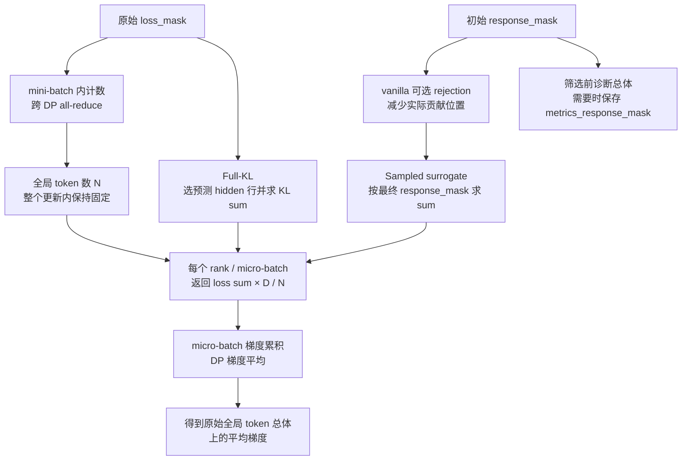

# 样本身份、张量布局与归一化

本页定义从 TQ 到目标函数的数据约定。Teacher 的执行顺序见[教师评分](teacher.md)，指标的归约方式见[指标系统](metrics.md)。

## 字段来源、布局与消费者

以下形状按一条样本描述：prompt 长度为 $P$，response 长度为 $L$，完整长度 $N=P+L$，mask 选中的有效预测行数为 $n$。TQ/worker 通常以 jagged NestedTensor 保存变长样本；`[N]` 不表示所有样本都被 padding 到同一个长度。

| 字段 | 单样本布局 | 生产者 | 消费者与生命周期 |
| --- | --- | --- | --- |
| `prompts/responses` | `[P]`、`[L]` token IDs | AgentLoop | teacher/actor 输入与 response 切片；本轮固定 |
| `input_ids/position_ids` | 完整输入 `[N]` | AgentLoop TQ postprocess | 师生 backbone；本轮固定 |
| `loss_mask` | response target `[L]` | postprocess 初始赋为 `response_mask` | 全局分母；所有 full-vocab 目标选行 |
| `response_mask` | response target `[L]` | AgentLoop，vanilla correction 可改写 | sampled loss 实际应用位置 |
| `rollout_log_probs` | response target `[L]`，FP32 | vLLM 返回，经 `AgentLoopOutput.as_dict` 存储 | behavior；显式 sampled 与 sampled MDPO 必需；full-vocab 入口关闭收集 |
| `teacher_ids/teacher_logprobs` | 完整预测位置 `[N,1]` | shared teacher scorer | sampled 教师监督；本轮固定 |
| `old_log_probs` | response target `[L]` | Legacy 由 Trainer 评分；sampled MDPO eta<1 由 worker scope 评分；bypass 仅用于 legacy | vanilla 分母、旧模式诊断或 MDPO 冻结 q；本轮固定 |
| `advantages/returns` | response target `[L]` | Trainer 的通用 advantage 步骤 | 任务 PPO；当前纯 OPD 最终目标不使用 |
| `teacher_hidden/teacher_positions` | `[n,d_t]`、`[n]` | full-vocab teacher engine | actor 按样本读取；本轮固定 |
| `anchor_hidden/anchor_positions/anchor_version` | `[n,d_s]`、`[n]`、调用标识 | actor 调用开始时的 no-grad capture，经 TQ 保存 | full MDPO eta<1 与所有 BPO；版本和位置均需匹配 |
| `engine.mirror_anchor_head` | `[V_s,d_s]` | wrapped head callback 内独立复制 | 调用级 holder，未注册为模型参数，不进入 TQ/checkpoint |
| `mirror_objective_sum/mirror_count` | 未除 eta 的标量 sum/有效行数 | full objective dispatcher | loss 层只除一次 eta，再沿用全局分母 |
| `mirror_statistics` | 各诊断的未除 eta 标量 sum | engine 汇总 `token_diagnostics` | loss 层构造全局 ratio 观测；当前没有诊断位置桶 |
| `mirror_position_sums/counts` | `[10]`，原始 objective sum / 有效 token count | engine 按 response 相对位置分桶 | loss 层对 sums 除 eta；不进入反传 |
| `sample_keys/sample_partition` | 样本身份/partition metadata | TQ bridge | shuffle 后定位 hidden；不参与数值计算 |
| `model_output['log_probs']` | 完整预测位置，packed/nested | 每次 student forward | sampled loss；该次 forward 的计算图 |
| `full_kl_sum/full_kl_count` | 标量 sum/有效行数 | Full-KL head 回调 | 训练归一化与原始 KL 观测 |

`teacher_ids` 保持通用教师输出协议；当前 sampled k1 loss 使用已对齐的 `teacher_logprobs`，不再按 `teacher_ids` 做一次 gather。当前 student 与 teacher 的 sampled log-prob 都已由各自 forward 按下一 token target 取出。

Sampled 路径的 OPD advantage 是 loss 内部临时张量，不写回 TQ 的任务 `advantages`。所有 mirror 设置都不创建任务 advantage；MDPO eta=1（包括 sampled）也不准备 q，其余设置按 spec 准备 q，详见[两套 advantage 的消费者](training-loop.md#两套-advantage-的消费者)。

## 样本身份

[transferqueue_utils.py](../../../../verl/utils/transferqueue_utils.py) 在 `retain_sample_identity=True` 时保留 `sample_keys/sample_partition`。如果 dispatch 把 key 转成全局索引，bridge 会先查回原始 key。身份与样本一起经过 shuffle 和 micro-batch 切分；读取 teacher hidden 时不能假设师生拥有相同的切分边界。

[HiddenBatchIO](../../../../verl/trainer/distillation/hidden_io.py) 优先读取通用字段，只在自身入口兼容 `full_vocab_keys/full_vocab_partition`。新生产者使用通用字段。身份负责定位样本，`teacher_positions` 则负责验证该样本内部的预测位置，二者不能互相替代。

例如 teacher 顺序为 `[A,B,C]`，actor shuffle 后是 `[C,A,B]`，读取顺序必须按当前 batch 的 key 变为 `[hidden_C,hidden_A,hidden_B]`。仅校验行数不够：两个等长样本可以拥有相同位置数组，却对应完全不同的前缀。Key 保证取对样本，位置数组保证同一样本内取对 state。

## 两种布局与预测坐标

| 数据 | 布局 | 转换入口 |
| --- | --- | --- |
| Engine 产生的 log-prob、teacher 预测概率 | 完整输入序列的预测位置 | [no_padding_2_padding](../../../../verl/workers/utils/padding.py) |
| behavior、anchor、response mask | 已对齐 response target | [as_padded_response](../../../../verl/workers/utils/padding.py) |
| Full-KL hidden | 选中的预测 state 行 | [prediction_positions](../../../../verl/workers/utils/padding.py) |
| 位置诊断坐标 | 原始 response 内的 target 下标 | [response_target_coordinates](../../../../verl/workers/utils/padding.py) |

令一条输入长度为 $N$，mask 长度为 $M$，其中有效 mask 下标为 $j$。预测 state 下标为：

$$
i=j+N-M-1.
$$

再以 response 长度 $L$ 换算 target 下标：

$$
r=i+1-(N-L).
$$

例如 prompt 长度 3、response 长度 3，mask 为 `[1,0,1]`，预测 state 下标是 `[2,4]`，response target 坐标是 `[0,2]`。中间被 mask 的位置保留空洞。已经 response-aligned 的 behavior 或 anchor 只能补 padding，不能再次按完整序列切片或 shift。

对应到完整 token 序列，可以逐列检查 shift：

| 完整输入位置 | 0 | 1 | 2 | 3 | 4 | 5 |
| --- | --- | --- | --- | --- | --- | --- |
| 输入 token | `p0` | `p1` | `p2` | `r0` | `r1` | `r2` |
| 此位置预测 target | `p1` | `p2` | `r0` | `r1` | `r2` | dummy |
| 对应 response 坐标 | — | — | 0 | 1 | 2 | — |
| 本例 loss 是否使用 | 否 | 否 | 是 | 否 | 是 | 否 |

[no_padding_2_padding](../../../../verl/workers/utils/padding.py) 按每条样本的 prompt/response 长度取 `[P-1:P+L-1]`，再补齐 response 长度。它不是按有效 mask 行压紧，因此中间无效 target 仍占据原位置，最终由 loss mask 排除。Trainer 将 anchor 写回 TQ 时使用 [response_from_nested](../../../../verl/workers/utils/padding.py) 完成同一次 shift。

Full-KL 仅提取选中的 hidden 行。对多样本拼接输入，`packed` 下标还需加上该样本前面的完整输入长度之和；TQ 保存的 `teacher_positions` 仍是各样本局部下标，与当时的 packed 顺序无关。实际生成的 EOS 若位于有效 response mask 内，就作为普通 target 参与训练；它与完整序列末端无后继的 dummy 不同。

`prediction_positions` 的定义位于公共 padding 模块；`trainer/distillation/hidden.py` 只保留历史导入兼容。

## 三种 mask 与分母

下图以 `token-mean` 为例，把训练分母与实际贡献分开：原始 `loss_mask` 决定分母，sampled 的 `response_mask` 决定哪些 loss 项参与求和。可选 rejection 属于 vanilla correction 路径；显式 sampled 禁止外部 RS，Full-KL 直接按 `loss_mask` 选行。

| 字段 | 负责的语义 |
| --- | --- |
| `loss_mask` | 原始训练资格及全局 token 归一化总体；Full-KL 也据此选择预测行 |
| `response_mask` | 当前目标实际应用的位置；拒绝采样可以减少它 |
| `metrics_response_mask` | 筛选前的诊断总体 |

[FSDPEngine.forward_backward_batch](../../../../verl/workers/engine/fsdp/transformer_impl.py) 在切 micro-batch 前，对 `loss_mask` 求和并跨 DP 归约，写入 `batch_num_tokens` 和 `dp_size`。训练时原始全局有效 token 为零会报错；某个 rank 局部为空可以参与计算。

[LossContext.from_batch](../../../../verl/workers/utils/loss_context.py) 读取调用级分母和缩放信息。它不会根据筛选后的 mask 重建分母。`aggregate` 委托已有聚合函数；Full-KL 的 token sum 通过 `normalize_token_sum` 归一化。若 DP 大小为 $D$，原始全局 token 数为 $N$，当前 rank 的 loss sum 为 $S_r$，局部返回：

$$
\ell_r=\frac{D}{N}S_r.
$$

上式直接对应 Full-KL endpoint。对 full MDPO/BPO，如果 $S_r^{\mathrm{raw}}$ 是 kernel 返回的未除 eta 的 sum，则局部训练标量为 $DS_r^{\mathrm{raw}}/(N\eta)$；sampled MDPO 在 `aggregate` 后同样只除一次 eta。DP 梯度平均后得到相应全局 token-mean 梯度。Frozen q/T 不接收梯度，日志 numerator 也不乘 DP 大小。显式 sequence 分母同样保留配置的全局 batch 数，包括零贡献序列。

若 rank $r$ 有多个 micro-batch，其 token loss sum 为 $S_{r,k}$，梯度累积与 DP 平均为：

$$
\frac1D\sum_r\sum_k\nabla\left(\frac{D}{N}S_{r,k}\right)
=\nabla\left(\frac{\sum_{r,k}S_{r,k}}{N}\right).
$$

因此无需再除 micro-batch 数、rank 局部 token 数或 `ppo_epochs`。每次 mini-batch update 使用自己的全局分母；增加 epochs 会实际执行更多次更新，而不是将同一次 loss 的分母增大。对不等长数据先算各 micro-batch 均值再平均，会改变长短序列的权重。

拒绝采样后被拒绝 token 是原总体中的零贡献。例如原来 6 个 token，保留 3 个，保留位置的单位 loss 得到均值 $3/6$，而不是 $3/3$。全部被拒绝但原总体非空时可以产生零 loss；这本身不等于跳过 optimizer，动量或 weight decay 仍可能改变参数。

这里的拒绝筛选对应既有 vanilla correction 路径；显式 sampled 校验禁止外部 RS，Full-KL 主链跳过 correction。所有 full-vocab 目标的选行依据都是 `loss_mask`，不能通过只改 `response_mask` 来改变它们的训练位置。

### 其他 sampled 聚合模式

公共配方、Full-KL 与所有 mirror 设置使用 `token-mean`。只有 legacy sampled 可沿用 [agg_loss](../../../../verl/trainer/ppo/core_algos.py) 的其他模式。设全局序列数为 $B_g$、序列 $i$ 的有效 token 数为 $L_i$、token loss 为 $\ell_{it}$、mask 为 $m_{it}$，下表给出 DP 平均后的目标；空序列贡献为零。

| 模式 | 全局聚合目标 |
| --- | --- |
| `token-mean` | $\sum_{i,t}m_{it}\ell_{it}/N$，$N$ 为原始 `loss_mask` 的全局总数 |
| `token-sum` | $\sum_{i,t}m_{it}\ell_{it}$ |
| `seq-mean-token-sum` | $\sum_i\sum_t m_{it}\ell_{it}/B_g$ |
| `seq-mean-token-mean` | $\sum_i[\sum_t m_{it}\ell_{it}/(L_i+10^{-8})]/B_g$ |
| `seq-mean-token-sum-norm` | sequence token-sum 再除 `loss_scale_factor` |

`seq-mean-token-sum-norm` 未提供固定 `loss_scale_factor` 时回退当前 padded response 宽度；需要跨不同 micro-batch 布局保持统一尺度时，应显式配置该值。`seq-mean-token-mean` 的序列内长度来自实际应用 mask，而调用级序列分母仍是传入的全局 batch 数。这与 token-mean 保留原始 token 总体的规则要分开阅读。

## 配置兼容边界

[LossContext.bind_legacy_config](../../../../verl/workers/utils/loss_context.py) 为旧 policy loss 构造浅复制配置，只替换调用级 `global_batch_info`，原配置不随 batch 修改。新增目标直接接收上下文即可，不应将运行时分母塞进共享静态配置。

## 验证入口

[test_loss_context_on_cpu.py](../../../../tests/trainer/distillation/test_loss_context_on_cpu.py) 验证配置隔离与分母；[test_rejection_denominator_on_cpu.py](../../../../tests/trainer/ppo/v1/test_rejection_denominator_on_cpu.py) 使用真实 TQ/Trainer 发布路径及两 rank 归约验证拒绝采样总体。Full-KL 的不等长输入、空 rank、mask 空洞和位置计数由[四卡集成测试](../../../../tests/special_distributed/test_full_vocab_fsdp2.py)覆盖。
