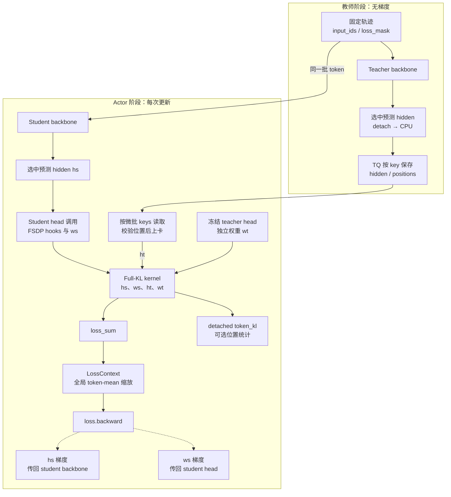

# Full-vocab 数据流与目标算子

Full-vocab reverse KL（下称 Full-KL）在 student rollout 得到的固定前缀上，对 student 的完整输出词表求条件反向 KL。Teacher 提供每个前缀的 hidden，actor 更新时使用冻结 teacher head 恢复教师分布，再与当前 student 分布比较。轨迹来自 student，KL 的动作求和覆盖全部输出行；无需再由单个 sampled token 估计这个动作期望。

本文沿实际 head-loss 路径展开。公共训练循环见[训练循环](training-loop.md)，与 sampled current-IS 的关系见[梯度推导](sampled-opd.md#与-full-kl-的梯度关系)。

## 统一目标分派

[full_vocab_objective_result](../../../../verl/trainer/distillation/full_vocab.py) 是 full-vocab 的统一数值入口，返回未除 eta 的 `loss_sum`、detached `token_objective` 和可选命名诊断。MDPO eta=1 直接调用原 `full_reverse_kl_result`；MDPO eta<1 与 BPO 在 q/T 分块投影后构造 b，再执行各自的行归约，共用 precompute 的 hidden/head 梯度累计。最终 loss 层统一除 eta 和应用 LossContext。

| 设置 | q 数据 | 目标权重与归约 | Backend |
| --- | --- | --- | --- |
| MDPO eta=1，普通 Full-KL | 不需要 | 当前 p 加权 $\mathrm{KL}(p\Vert T)$ | 保留全部原 backend |
| MDPO eta<1 | 冻结 hidden/head | 当前 p 加权 mirror residual | dense / precompute / precompute_fused |
| BPO，包括 eta=1 | 冻结 hidden/head | q 加权中心化 logits residual 方差 | dense / precompute / precompute_fused |

BPO 的 loss/VJP 无需 student softmax，KL 诊断按需增加归一化。所有 q/T 输入冻结，只有当前学生 hidden/head 参与反传。Anchor scope、版本校验、支持集和精确目标见[统一实现说明](../mirror-descent/实现方案.md#kernels)。下文展开原教师 endpoint 的底层算子；这部分仍是统一执行链路的直接分支。

一般融合的 `precompute_fused` 现已融合 weighted target，并让 MDPO 直接计算 $\mathbb E_p[z-b]-\operatorname{LSE}(z)$。诊断复用分块统计量，不重算 loss/VJP；teacher KL 使用完整 teacher 支持上的 log T。BPO 关闭诊断时仍沿 q 加权方差路径，不生成 student softmax。PyTorch 回退也复用 log p/p 计算 teacher KL。H800 固定输入速度与显存数据、启用方式和仍未优化的部分统一维护在[实现方案第 8.5 节](../mirror-descent/实现方案.md#85-已完成的数值层优化与实测)，不将数值层加速当作整轮吞吐结论。

## 接口与运行约束

[full_reverse_kl_result](../../../../verl/trainer/distillation/full_vocab.py) 返回 [FullKLResult](../../../../verl/trainer/distillation/full_vocab.py)：可反传的 `loss_sum` 以及可选、detached 的 `token_kl`。兼容入口 `full_reverse_kl` 只返回前者。Kernel 不承担分布式通信、训练归一化、TQ 读取或日志命名。

设一个 micro-batch 中选出的有效预测行数为 $n$：

| 参数 | 形状 | 来源 | 是否参与 student 反传 |
| --- | --- | --- | --- |
| `hs` | `[n, d_s]` | 当前 student backbone 的选中行 | 是 |
| `ws` | `[V_s, d_s]` | 当前 student LM head | 是 |
| `ht` | `[n, d_t]` | TQ 中的冻结 teacher hidden | 否 |
| `wt` | `[V_t, d_t]` | 独立加载的冻结 teacher head | 否 |

师生 hidden 宽度可以不同；前缀与 token ID 必须对齐，且 $V_t\ge V_s$。Tokenizer 的 token→ID 词表相同，不要求模型 head 的总行数相同：head 可以包含 tokenizer 常规词表之外的额外输出行。

| 约束 | 执行检查的位置 |
| --- | --- |
| `use_policy_gradient=False`、`use_task_rewards=False`、`policy_loss_mode=vanilla`、`advantage_source=current`，两个 clamp 为 `null` | [DistillationLossConfig](../../../../verl/workers/config/distillation.py) |
| `execution_mode=shared_sync`、V1 sync、单节点、FSDP2、无 ref/critic，师生轮流使用同池 | [DistillationConfig.validate_shared_sync](../../../../verl/workers/config/distillation.py) |
| Dense Qwen2/Qwen3、无 bias 的 student head | [install_full_vocab_adapter](../../../../verl/models/transformers/full_vocab.py) |
| Dense Qwen2/Qwen3 safetensors teacher head | [FrozenTeacherHead](../../../../verl/trainer/distillation/hidden.py) |
| 温度为 1，无 entropy、sum-pi-squared 或 score-centering 计算 | [FSDPEngineWithLMHead._full_vocab_output](../../../../verl/workers/engine/fsdp/transformer_impl.py) |
| `loss_agg_mode=token-mean` | [distillation_loss](../../../../verl/trainer/distillation/losses.py) |

这些检查分布在配置解析、模型构建与运行时，不能把 Hydra 配置解析成功视为全部通过。`use_fused_kernels=False` 是通用模型 forward 路径的限制，与下面专用 `precompute_fused` KL backend 是不同开关。

## 从教师 hidden 到 student head

以下 endpoint 图中实线表示前向数据流，虚线表示 student 的反向梯度。上下两阶段按顺序执行：教师 payload 写入完成且 teacher 卸载后，actor 才开始更新。冻结 teacher head 是 actor 单独加载的副本。

### 教师只发布有效预测行

[PPOTrainer._compute_shared_teacher_log_probs](../../../../verl/trainer/ppo/v1/trainer_base.py) 根据静态目标元数据选择 hidden payload。[SharedTeacherScorer.score](../../../../verl/trainer/distillation/shared_teacher.py) 将 teacher 上卡，以 `full_vocab_teacher=True` 调用 `infer_batch`；worker 不计算 loss，也不计算普通 sampled log-prob。

[FSDPEngineWithLMHead._full_vocab_output](../../../../verl/workers/engine/fsdp/transformer_impl.py) 用 `prediction_positions(input_ids, loss_mask)` 同时得到每条序列的局部预测下标与拼接序列的 packed 下标。Teacher backbone 仍看到完整的 prompt+response，随后只取 mask 有效 target 对应的预测 hidden 行。Teacher 的 LM head 在这个 forward 中不执行完整投影。

例如 `prompt=[p0,p1,p2], response=[r0,r1,r2], loss_mask=[1,0,1]`，只保存预测 `r0,r2` 的 hidden，即完整序列位置 `[2,4]`，每条样本 payload 为 `teacher_hidden[2,d_t]`、`teacher_positions=[2,4]`。Mask 空洞不会改变 token 上下文，也不会被当成更短的 response。

选中 hidden 立即 detach、转到 CPU，按样本拆分并由 [HiddenBatchIO.publish](../../../../verl/trainer/distillation/hidden_io.py) 写入 TQ。Worker 返回轻量 `teacher_payload_ready` 标记，避免在整轮推理结果中继续持有所有 hidden。Actor 阶段仍需等全部 teacher futures 完成及 teacher 成功卸载。

### 按 actor micro-batch 读取

[PPOTrainer._update_actor](../../../../verl/trainer/ppo/v1/trainer_base.py) 只把 `input_ids/position_ids/loss_mask/response_mask/prompts/responses` 交给普通 bridge，同时设置 `retain_sample_identity=True`。`sample_keys/sample_partition` 随数据进入 worker，并跟随 shuffle、mini-batch 和 micro-batch 切分移动。

[HiddenBatchIO.__iter__](../../../../verl/trainer/distillation/hidden_io.py) 在 actor micro-batch 执行前按这些 key 取回 `teacher_hidden/teacher_positions`，结束后从 micro-batch 容器移除 payload。Student engine 校验保存的每条位置数组与当前 `loss_mask` 推导的位置完全一致。Teacher 与 actor 可以采用不同的动态分批边界，不能用“第几个 teacher micro-batch”匹配 student。

每次 reuse 都读取冻结 teacher hidden，重新计算 student backbone。Teacher hidden 来自当前完整前缀的 teacher forward，只有 student hidden 随 optimizer 更新。

### Head adapter 与 FSDP hooks

[full_vocab_forward](../../../../verl/models/transformers/full_vocab.py) 在收到回调时直接调用 `model.model` backbone，将最后层 hidden 与 `lm_head` 交给 engine；未提供回调时仍调用原始 forward。这样避免先产生整个输入序列的 `[tokens,V]` logits，再从中挑选 response。

Actor 选中 `hs` 后通过 `head(selected, full_vocab_callback=compute)` 调用包装后的 head。[full_vocab_head_forward](../../../../verl/models/transformers/full_vocab.py) 再将 hidden 与 `self.weight` 交给 kernel。必须经过 head module 的调用边界，才能触发 FSDP2 all-gather/backward hooks；在外层直接取分片 head weight 做矩阵乘法会破坏这个协议。

Kernel 返回 `loss_sum`，engine 附上有效行数 `full_kl_count`，可用时将 detached `token_kl` 转为位置统计。最终 `distillation_loss` 使用 `LossContext.normalize_token_sum` 得到训练标量，随后普通 engine 调用 `loss.backward()`、梯度裁剪和 optimizer。Full-KL 使用的是同一套 student optimizer，backbone 与 head 都更新。

## 冻结 head 与 IO 生命周期

[FrozenTeacherHead](../../../../verl/trainer/distillation/hidden.py) 从 teacher checkpoint 单独读取输出权重；tied head 读取 `model.embed_tokens.weight`，否则读取 `lm_head.weight`。CPU 副本长期保留，第一次 actor KL 计算时创建与 student hidden 的 device/dtype 匹配的 GPU 缓存。每个 actor rank 持有完整 teacher head；它没有注册到 student module，不进入 optimizer、student checkpoint 或 rollout 权重同步。

[ActorRolloutRefWorker.update_actor](../../../../verl/workers/engine_workers.py) 在整个 mini-batch/epochs 迭代结束后通过 `finally` 释放 teacher head 的 GPU 引用。同一次 actor 调用内部可以复用该缓存。Teacher scorer 只管理 teacher 模型驻留，不能在 actor 更新前释放 actor 自己拥有的 head。

| 开关 | 实际重叠的工作 | 没有改变的边界 |
| --- | --- | --- |
| `full_vocab.async_write` | 上一个 teacher micro-batch 的 CPU→TQ 写与后续 teacher 计算 | D2H 在提交写之前执行；提交下一笔写之前等待上一笔，正常退出 flush 最后一笔 |
| `full_vocab.prefetch` | 下一 actor micro-batch 的 TQ→CPU 读与当前 actor 计算 | payload 随 `micro_batch.to(device)` 上卡，没有专用 CUDA H2D stream |

两者使用单线程 executor，限制待处理 IO 数量；不会使 teacher 和 student backbone 同时在 GPU 上执行。详细异常与卸载行为见[教师评分顺序](teacher.md#评分顺序)。

Hidden 运输规模约为有效预测行数乘 $d_t$，避免跨阶段传递有效行数乘 $V_t$ 的 logits。Actor 阶段仍需容纳当前 student 激活、完整冻结 teacher head、KL 临时块与 student 梯度；不能仅按 hidden payload 大小估计训练显存。

## 梯度与精度

### 条件 KL 与 logit 梯度

以下先取相同输出支持。对某个固定前缀，令 student logits 为 $z_v$，teacher logits 为 $u_v$，$p_v=\operatorname{softmax}(z)_v$、$T_v=\operatorname{softmax}(u)_v$。目标为：

$$
K=\sum_v p_v(\log p_v-\log T_v).
$$

由 $\partial p_v/\partial z_j=p_v(\mathbf1_{v=j}-p_j)$ 和 $\sum_v\partial p_v/\partial z_j=0$：

$$
\begin{aligned}
\frac{\partial K}{\partial z_j}
&=\sum_v\frac{\partial p_v}{\partial z_j}(\log p_v-\log T_v+1)\\
&=p_j\left(\log\frac{p_j}{T_j}-\sum_v p_v\log\frac{p_v}{T_v}\right)\\
&=p_j\left(\log\frac{p_j}{T_j}-K\right).
\end{aligned}
$$

代码还使用等价的 logit-gap 表达。设 $g=\sum_v p_v(z_v-u_v)$、$Z_p=\sum_v e^{z_v}$、$Z_T=\sum_v e^{u_v}$，则：

$$
K=g-\log Z_p+\log Z_T,\qquad
\frac{\partial K}{\partial z_v}=p_v(z_v-u_v-g).
$$

[RecomputedKL](../../../../verl/trainer/distillation/full_vocab.py) 保存 `log_zp/mean_gap`，backward 重新计算 logit 块，正是使用后一表达式。对矩阵 $Z_s=H_sW_s^\top$，记 $G=\partial\sum_iK_i/\partial Z_s$，则：

$$
\frac{\partial L}{\partial H_s}=GW_s,\qquad
\frac{\partial L}{\partial W_s}=G^\top H_s.
$$

Hidden 梯度继续传入 student backbone，head 梯度由 FSDP 处理。Teacher hidden/head 已 detach，没有对应训练梯度。全局归一化的上游标量会同时缩放这两路梯度。

### Precompute 的前反向分工

[PrecomputedKL](../../../../verl/trainer/distillation/full_vocab.py) 在自定义 autograd forward 内按 token 块执行以下工作：计算师生 logits → log-softmax 与逐行 KL → 计算 $G$ → 累积 `dh/dw` → 释放当前块 logits/VJP 临时量。Forward 最后保存的是 `dh/dw`，返回可微 token sum 和不可微行诊断。

Backward 只将缓存梯度乘上上游标量，并传回 `hs/ws`；它没有提前执行 optimizer，也没有提前完成 backbone backward。`precompute_fused` 共用这套累积与 backward，只替换每个 token 块的行归约实现。自定义 backward 使用 `once_differentiable`，只保证一阶梯度，不能据此做二阶优化。

### 生产精度

CUDA BF16 hidden/head 的投影由 [project](../../../../verl/trainer/distillation/full_vocab.py) 使用 BF16 输入、FP32 输出；该路径的 log-softmax、KL 与行统计在 FP32 中计算。Precompute 的 `dh/dw` 用 FP32 缓冲累计，保存前转换回输入 dtype；logit VJP 也会转换为 hidden dtype 再参与梯度 GEMM。普通 CUDA BF16 投影的 autograd 兼容入口是 [ProjectionFP32](../../../../verl/trainer/distillation/full_vocab.py)。

因此 FP32 loss 不表示 backbone、投影输入和所有梯度存储都是 FP32。CPU BF16 等回退路径也不自动具有 CUDA `out_dtype=float32` 的性质。理论上 KL 非负，浮点误差下很小的负值应按[精度研究](../research/2026-10-24-KL精度误差模型与诊断接口走读.md)分析；生产 Full-KL 没有用 loss clamp 把它强行截为零。

## Backend 与输出支持

### Backend 的实际工作分配

| Backend | Forward | Backward 与保存内容 |
| --- | --- | --- |
| `dense` | 所有选中行的完整 logits 与普通 autograd | 保留普通计算图；适合小规模数值参考 |
| `recompute` | 按 token 块投影整个词表，保存每行 KL、student log-normalizer、mean gap | 保存 hidden/head 和行统计，按块重算 logits/VJP |
| `streaming` | token、vocab 双重分块，在线累计归一化常数和 gap | 保存 hidden/head 和行统计；按 token/vocab 块重算 |
| `cached` | 双重分块投影到当前 token 块的两个 FP32 logits 缓冲，再分块归约 | 仍复用 `RecomputedKL.backward`；logits 缓冲不跨 forward/backward 保留 |
| `precompute` | token 块投影整个词表，普通行计算，预先累计 `dh/dw` | 保存 `dh/dw`，backward 只施加上游缩放 |
| `precompute_fused` | CUDA BF16 时以 Triton 融合行计算，其余条件回退普通行计算 | 与 `precompute` 相同 |
| `liger` | 调用外部 `LigerFusedLinearJSD(jsd_beta=1, temperature=1)` 并转换成 token sum | 使用外部实现；当前不提供 `token_kl` |

`cached` 的缓存旨在避免 forward 归约重复投影，不是缓存 logits 供 backward 直接使用。Precompute 主路径的最大 logits 块仍是 `[token_chunk,V_s]`，`vocab_chunk_size` 不会把它变成 `[token_chunk,vocab_chunk]`；该参数控制 streaming/cached 的词表分块及额外 teacher 支持修正。`recompute` 的主体前反向都使用整词表宽度。

所有 backend 都给出同一数学条件 KL，浮点运算次序、临时显存和计算量不同。除 `liger` 外，本地后端均暴露 detached 行值供位置统计复用；`token_kl=None` 表示缺少这项能力，不表示 KL 为零。全局位置日志不会为此另做一次投影。

### 教师多出的输出行

当 $V_t>V_s$，令 $S=\{0,\ldots,V_s-1\}$，student 在 $S$ 外的概率为零。只把 teacher head 截到 $S$ 后重新 softmax，会得到 $T_S$，它与完整 teacher $T$ 的关系为：

$$
T(v)=T_S(v)\frac{Z_{T,S}}{Z_T},\qquad v\in S.
$$

因此：

$$
D_{KL}(p\Vert T)
=D_{KL}(p\Vert T_S)+\log\frac{Z_T}{Z_{T,S}}.
$$

[teacher_support_correction](../../../../verl/trainer/distillation/full_vocab.py) 分块计算公共支持与额外支持的 log-normalizer，用 `softplus(log_Z_extra-log_Z_shared)` 得到修正，再补到标量和逐行 KL。固定前缀下修正与 student 参数无关，原先 equal-support backend 的 VJP 可以继续使用。$V_t<V_s$ 则明确报错。

这里处理的是按相同 token ID 排列的 head 行数差异；代码没有实现任意 tokenizer 词表之间的语义映射。

### 默认值与空行

[统一入口](../../run_math_opd_ablation_fsdp2.sh) 的 `custom --method full_kl` 默认使用 precompute、token_chunk_size=512、vocab_chunk_size=8192，异步写与预取关闭；编号 full 预设保持异步写与预取开启。Python 数值 API 的默认 backend 仍为 recompute；不要把数值函数默认值或历史脚本默认值当作当前训练入口默认。

某个 rank 没有有效预测行时，kernel 返回 `hs.sum()*0 + ws.sum()*0`，保留 student 两路梯度连接，让它参与同一次分布式更新。整个 mini-batch 的全局有效 token 数为零则由 engine 拒绝训练。有效 token mask 和 DP 缩放见[数据与归一化](data-and-loss.md#三种-mask-与分母)。

## 验证入口

新增 weighted target 与 BPO 的 CPU/CUDA/FSDP/真实短训练证据见[验收结果](../mirror-descent/实现方案.md#validation)，未覆盖范围见[验证缺口](../mirror-descent/实现方案.md#remaining-validation)。下表保留原 Full-KL 基础设施的验证入口。

| 检查对象 | 测试入口 |
| --- | --- |
| 不同 backend 的 KL 与 hidden/head VJP、额外 teacher 支持 | [test_full_vocab_on_cpu.py](../../../../tests/trainer/distillation/test_full_vocab_on_cpu.py) |
| Qwen adapter、正常 forward 回退与 head 回调 | [test_full_vocab_adapter_on_cpu.py](../../../../tests/trainer/distillation/test_full_vocab_adapter_on_cpu.py) |
| 行值到相对 response 位置诊断 | [test_full_vocab_position_on_cpu.py](../../../../tests/trainer/distillation/test_full_vocab_position_on_cpu.py) |
| 真实 FSDP2 分片、head 更新、不等长/空 rank、checkpoint 与下一次更新等价 | [test_full_vocab_fsdp2.py](../../../../tests/special_distributed/test_full_vocab_fsdp2.py) |

CPU 数学测试不等同于 CUDA BF16/Triton 精度验收。已有 GPU 证据见[主分支四卡验收](../refactoring/2026-10-25-主分支四卡验收.md)，性能测量从 [profile](../infra/profile/README.md)进入。
