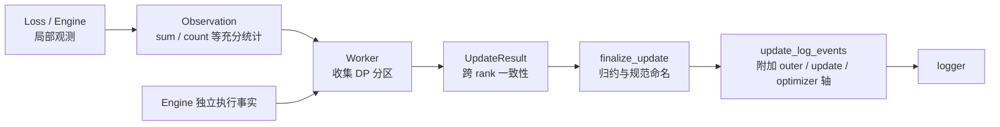

# 指标观测、位置分桶与更新出口

本页解释数据怎样变成指标，字段含义和命名仍以[当前指标字典](../experiments/metrics/指标字典.md)为准。更新计数和恢复见[进度与 checkpoint](progress-checkpoint.md)。

## 从局部观测到日志

[Observation](../../../../verl/utils/metric/observations.py) 保存可合并统计。均值先合并 numerator/denominator 再相除，不能平均 token 数不同的 micro-batch 或 rank 的均值。训练 loss 的梯度缩放与原始诊断统计是不同对象，见[归一化](data-and-loss.md#三种-mask-与分母)。

[TrainingWorker._postprocess_output](../../../../verl/workers/engine_workers.py) 汇集分区观测与独立更新事实。[finalize_update](../../../../verl/workers/update_records.py) 在每次更新内归约、调用 `canonical_name` 统一命名，拆出 update 记录和 outer 指标。它保留旧 Metric 及旧 worker 表示的适配边界。

逐 update loss 描述产生该次梯度的 forward。不能跨多个 update 求平均后仍标成某一次 optimizer 的观测。`update_log_events` 附加显式坐标；旧 worker 只提供 batch totals 时，以 batch 范围字段保留，不伪装成逐次观测。

## 相对位置统计

公共模块 [position.py](../../../../verl/utils/metric/position.py) 接收任意逐 token 标量，不依赖 teacher、student 或 KL。调用者先选择有效 token，并提供它在原始 response 中的零基坐标 $r$ 与长度 $L$。十分桶编号为：

$$
b=\left\lfloor 10\frac{r+1/2}{L}\right\rfloor.
$$

[relative_position_bins](../../../../verl/utils/metric/position.py) 计算桶；[position_statistics](../../../../verl/utils/metric/position.py) 累积 detached FP64 sum 和 token count；[position_observations](../../../../verl/utils/metric/position.py) 在调用者指定的 namespace 下产生 `sum/token_count/mean`。空桶保持缺测语义，不填零均值；公共统计保留非有限观测，日志边界另记录非有限状态并过滤不适合写出的数值。

前 30% 的均值可从前三桶重建：

$$
\bar x_{<30\%}=\frac{S_0+S_1+S_2}{N_0+N_1+N_2}.
$$

只有分母非零时才有均值。桶均值不能直接相加，也不能从 sum/count 反推出分位数、最大值或方差。Mask 空洞保留原坐标，不能先压紧有效 token 再重新编号。

Full-KL 的调用者负责预测 state→response target 的换算、业务 namespace 及行值接入。当前生产自动接入的是 Full-KL；entropy、NLL、advantage 或 clip 指示量需要各自显式接入。

## 非有限值、缺测与执行事实

[finite_metrics](../../../../verl/utils/metric/schema.py) 负责日志边界的数值过滤；[finalize_update](../../../../verl/workers/update_records.py) 在此前记录 loss 和梯度范数的非有限状态。缺失观测不等于零，有限梯度也不等于更新已执行；执行事实来自 engine。

当前 raw response 指标接入由 Trainer 按已验证策略选择。不能将未验证的 CP/TP 分片当作完整 response 统计，也不能把其他后端已有 legacy 指标消失解释为零。

## 验证入口

[test_position_metrics_on_cpu.py](../../../../tests/utils/test_position_metrics_on_cpu.py) 验证短序列、空桶、mask 空洞和不同分区；[test_update_records_on_cpu.py](../../../../tests/workers/test_update_records_on_cpu.py) 验证事实与记录出口；[test_policy_metrics_pipeline_on_cpu.py](../../../../tests/workers/test_policy_metrics_pipeline_on_cpu.py) 验证更新粒度。真实分桶重建结果见[四卡验收](../refactoring/2026-10-25-主分支四卡验收.md)。

## 采集频率与验收证据

训练分位数由 `trainer.metrics_quantile_interval` 控制；评测重采样由 `trainer.eval_metrics_resamples` 控制。完整日志与 Console 展示分别处理，不通过删除原始字段来限制面板数量。条件功能在实际启用后产生对应观测。

字段定义和比较口径统一由[实验指标](../experiments/metrics/README.md)维护。2026-10-22 的 policy-v3 实现、E3 与 IS/RS 验收、旧字段映射和设计背景归入[指标工程档案](../archive/README.md#指标系统历史)，其数值只描述当时的代码和测试范围。
