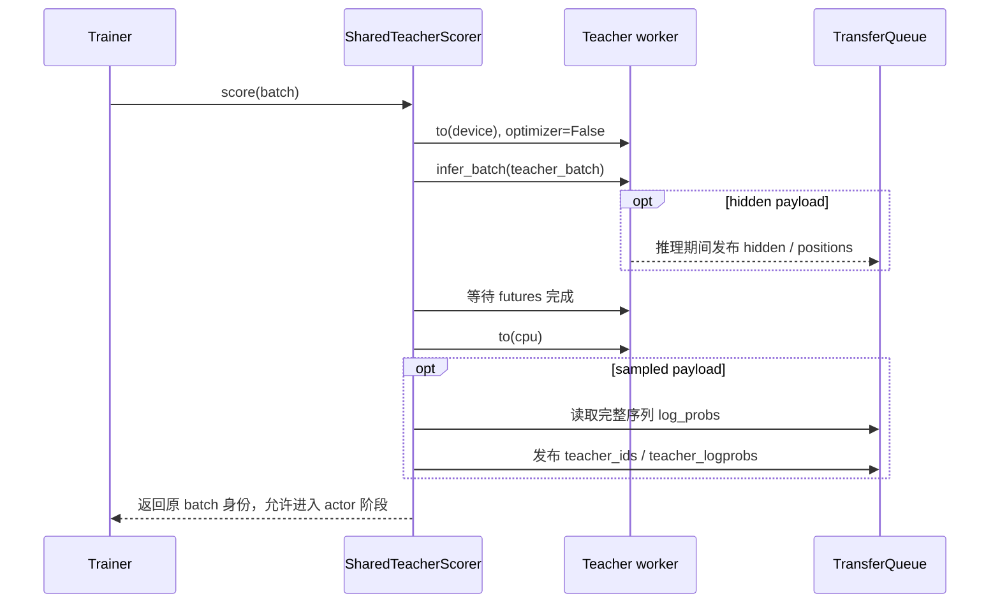

# 教师评分与资源生命周期

教师在 student 生成的完整 token 序列上提供冻结监督。本文负责教师阶段的资源协议；hidden 的跨阶段读取和 student 持有的冻结 head 见 [Full-vocab](full-vocab.md)。

## 两种执行方式

| 方式 | 入口 | 职责 |
| --- | --- | --- |
| `shared_sync` | [SharedTeacherScorer](../../../../verl/trainer/distillation/shared_teacher.py) | 师生共用资源池，teacher 与 actor 分阶段执行 |
| `standalone` | [teacher_manager.py](../../../../verl/experimental/teacher_loop/teacher_manager.py) | 既有独立教师服务与请求路径 |

[PPOTrainer._make_shared_teacher_config](../../../../verl/trainer/ppo/v1/trainer_base.py) 创建独立 teacher 模型配置，校验 tokenizer 协议；`_compute_shared_teacher_log_probs` 是调用协调器的薄入口。Teacher 采用 forward-only engine，没有 optimizer；推理在无梯度上下文中执行。共享路径的配置约束由 [DistillationConfig.validate_shared_sync](../../../../verl/workers/config/distillation.py) 负责。

## 评分顺序

[SharedTeacherScorer.score](../../../../verl/trainer/distillation/shared_teacher.py) 创建独立 `KVBatchMeta`，沿用样本 keys 和 partition，只选择 `input_ids`、`position_ids`、`loss_mask` 等教师需要的字段。临时 metadata 不复用为 actor 的执行配置。

Hidden 数据在 worker 推理过程中发布，但 actor 的阶段边界仍是 futures 完成且教师成功卸载之后。Teacher 评分异常时尽力卸载并保留主异常；正常评分后的卸载失败也会阻止返回。这个清理协议不承诺 NCCL/rank 故障自动恢复。

## 输入与 sampled 输出协议

Teacher 消费 student 原始 `input_ids`，不使用教师 chat template 重新编码。初始化要求 token-to-ID 对齐和相关特殊 token 一致；输出 head 的额外词表行由 Full-KL 单独处理。

FSDP 的位置 `i` 已对应下一个 token `x[i+1]` 的 log-prob。协调器只替换最后一项 dummy，并生成同样对齐的 `teacher_ids`；不会把概率再左移一次。每条完整序列的输出末维为 1，IDs 使用 int32，log-prob 转为 FP32；有效预测概率必须有限。

例如 `[p0,p1,r0,r1]` 的监督 targets 是 `[p1,r0,r1,dummy]`。Response target `r0` 对应预测位置 1。模型预测布局与 response 布局的转换由[公共布局工具](data-and-loss.md#两种布局与预测坐标)处理。

## 资源所有权

教师 scorer 只管理 teacher backbone 的阶段性驻留。Student engine 的 `FrozenTeacherHead` 由 actor worker 在 `update_actor` 的 `finally` 中释放 GPU 缓存，不能交给 scorer 提前释放。教师标签和 hidden 保存在 TQ 中，按原样本身份被复用；Trainer 在本轮结束时清理。

## 验证入口

[test_shared_teacher_on_cpu.py](../../../../tests/trainer/ppo/v1/test_shared_teacher_on_cpu.py) 覆盖配置、协议和清理；[test_shared_teacher_fsdp2.py](../../../../tests/special_distributed/test_shared_teacher_fsdp2.py) 覆盖真实 FSDP2 teacher/actor 切换与重复更新。运行命令继续维护在[共享运行说明](../infra/2026-10-22-共享八卡运行与架构.md#启动与配置)。
