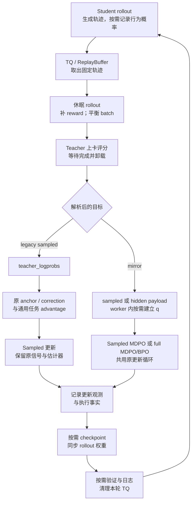
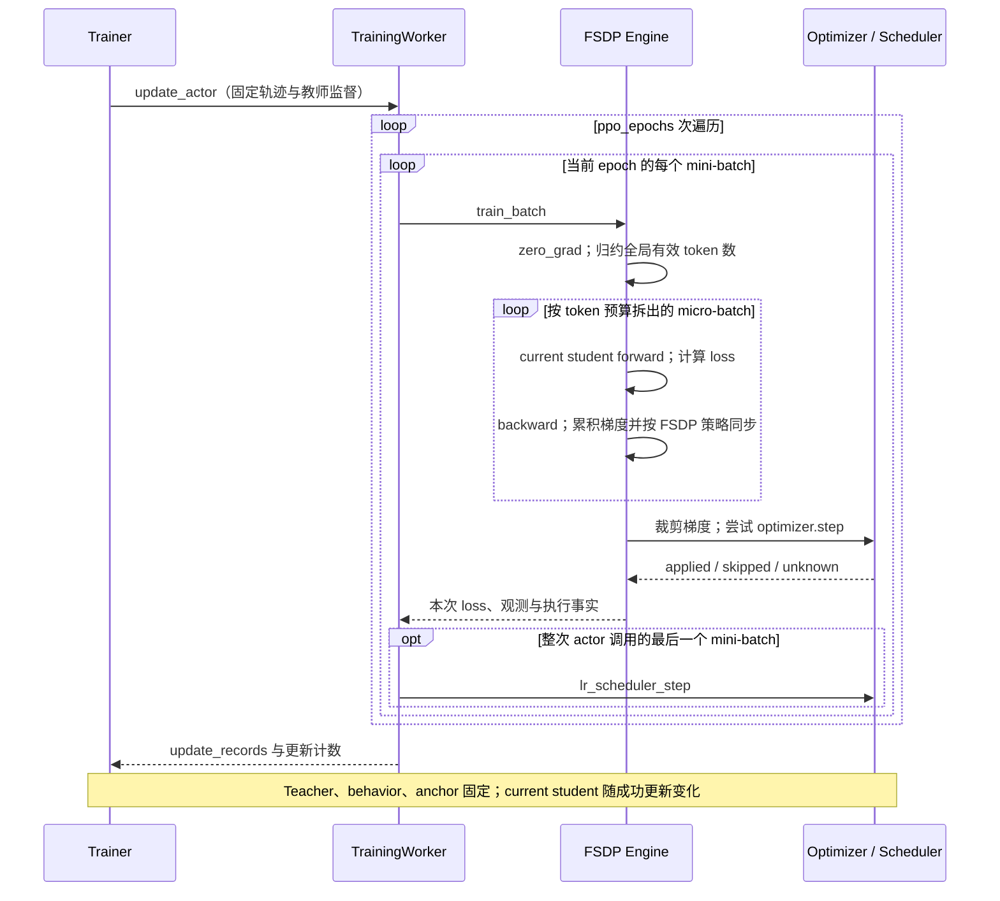

# 训练循环与配置入口

本文沿当前 V1 shared-sync 单教师路径，追踪一批 prompt 从数据集到参数更新的全过程。Legacy sampled、sampled MDPO 与 full-vocab KL/MDPO/BPO 共用 rollout、TQ、worker、optimizer 和 checkpoint；分流点是目标解析、教师 payload、可选 anchor 和 actor loss。相对上游的新增位置见[改动地图](upstream-changes.md)，张量字段见[数据与归一化](data-and-loss.md)。

## 配置入口

[统一实验入口](../../run_math_opd_ablation_fsdp2.sh) 用 E 编号选择包含默认算法的完整预设，`custom` 使用公共默认；`--method` 可覆盖为 sampled、Full-KL、MDPO 或 BPO。环境、方法选项与末尾 Hydra 参数按优先级覆盖。算法设置只由 [\_distillation_args.sh](../../launchers/_distillation_args.sh) 构造，公共 launcher 管理数据、资源、teacher、optimizer 和运行记录。Math 只保留统一训练入口，预设和参数合并由标准库 [math_experiment.py](../../launchers/math_experiment.py) 负责。E44–E47 已登记完整 Full-KL/MDPO/BPO 对照，可直接调用编号；模型、预算、验证和保存设置见[正式对照表](../训练配方.md#mirror-comparison)。E 编号及自动名称表示预设来源，覆盖后的真实设置以 `resolved_config.yaml` 为准，当前尚未实现对所有覆盖项的自动衍生标记。

| 配置层 | 决定的行为 | 核对入口 |
| --- | --- | --- |
| `distillation.execution_mode` | 共享 FSDP teacher 或独立服务 | [DistillationConfig](../../../../verl/workers/config/distillation.py) |
| `distillation.distillation_loss.loss_mode` | 新命令使用 `k1` 或 `mirror`；旧 `full_reverse_kl` 配置仍可解析 | [resolve_distillation_spec](../../../../verl/workers/config/distillation_spec.py) |
| `distillation.distillation_loss.mirror` | objective、estimator、kappa/eta，推导 payload 与 anchor 需求 | [目标与支持矩阵](../mirror-descent/实现方案.md#settings) |
| `distillation.distillation_loss.policy_loss_mode` | `vanilla/reinforce/token_is/token_ppo` | [DistillationLossConfig](../../../../verl/workers/config/distillation.py) |
| `distillation.distillation_loss.advantage_source` | sampled 使用 current 或冻结 rollout 信号 | [Sampled OPD](sampled-opd.md#显式-sampled-分支) |
| `data.train_batch_size`、`rollout.n` | 每轮 prompt 数、每个 prompt 的 response 数 | [批次和更新预算](#从一次-actor-调用到实际更新) |
| `actor.ppo_mini_batch_size`、`actor.ppo_epochs` | 每次更新的规模、同批数据复用次数 | [TrainingWorker.train_mini_batch](../../../../verl/workers/engine_workers.py) |
| `actor.ppo_max_token_len_per_gpu` | actor 每个 micro-batch 的动态 token 预算 | [FSDPEngine.forward_backward_batch](../../../../verl/workers/engine/fsdp/transformer_impl.py) |
| `distillation.shared_teacher.infer_max_token_len_per_gpu` | teacher forward 的独立 token 预算 | [教师生命周期](teacher.md) |
| `rollout.log_prob_max_token_len_per_gpu` | actor engine 的无梯度评分预算，也用于 mirror anchor | [anchor 准备](teacher.md#anchor-准备与模型驻留) |
| `distillation.distillation_loss.full_vocab.token_chunk_size` | head-loss 内部每块有效预测行数 | [Full-vocab](full-vocab.md#precompute-的前反向分工) |

表中 `actor` 和 `rollout` 分别缩写 `actor_rollout_ref.actor` 与 `actor_rollout_ref.rollout`。vLLM 的调度预算、teacher/anchor 的无梯度评分预算、actor 的 forward/backward 预算，以及 head-loss 的 token chunk 具有不同消费者。前几项按输入序列工作量分批，head chunk 处理的是选中的有效预测行；它们都不直接决定 optimizer 更新次数。

公共 launcher 的 sampled 默认是 `k1 + use_policy_gradient=True + policy_loss_mode=vanilla + advantage_source=current`，`use_task_rewards=False`，两个 clamp 为 `null`。Full-KL 入口设置 `use_policy_gradient=False`、`policy_loss_mode=vanilla`，关闭 rollout log-prob 收集与 actor entropy 计算。Full-KL 中这个 `vanilla` 值只是兼容字段，执行时按 resolved spec 进入 head-loss endpoint；full BPO/MDPO 也不调用 sampled vanilla loss；sampled MDPO 使用自己的 token-IS 分支。

默认预算和实验预设仍由[训练配方](../训练配方.md)维护。只看单个 dataclass 的默认值无法还原实验：公共 launcher 已覆盖通用默认，预设和末尾 Hydra 参数还可继续覆盖。可在仓库根目录检查最终命令：

```bash
DRY_RUN=1 bash examples/mirroropd/run_math_opd_ablation_fsdp2.sh custom --method sampled
DRY_RUN=1 bash examples/mirroropd/run_math_opd_ablation_fsdp2.sh custom --method sampled --policy-loss token_is --advantage current
DRY_RUN=1 bash examples/mirroropd/run_math_opd_ablation_fsdp2.sh E13
DRY_RUN=1 bash examples/mirroropd/run_math_opd_ablation_fsdp2.sh E45
CONFIG_ONLY=1 bash examples/mirroropd/run_math_opd_ablation_fsdp2.sh E46
```

`DRY_RUN` 只打印命令，不做完整配置验收。`CONFIG_ONLY=1` 会调用原生 Python 解析 Hydra 配置；实际 worker、模型和运行时校验仍在后续阶段执行。

## 初始化与 loss 注册

[main_ppo.py](../../../../verl/trainer/main_ppo.py) 选择 V1 TaskRunner，创建 Trainer 和 AgentLoop。沿 [PPOTrainer._setup](../../../../verl/trainer/ppo/v1/trainer_base.py) 阅读初始化时，应跟踪以下依赖顺序：

1. 校验显式 sampled 配置和 shared-sync 资源约束，初始化 tokenizer、dataloader。
2. 构造独立 teacher 模型配置，核对师生 token-to-ID 词表；teacher 不复用 student 的模型配置缓存。
3. 在同一资源池注册 actor/rollout 与 teacher worker。Actor 初始化训练模型、optimizer、scheduler；teacher `reset()` 初始化 forward-only engine 并卸载参数。
4. Shared-sync 不建立独立 teacher server manager；rollout 使用 student vLLM 副本，teacher 评分由 Trainer 后续触发。
5. 恢复 checkpoint 后，[PPOTrainerSync.on_init_end](../../../../verl/trainer/ppo/v1/trainer_sync.py) 将 student 参数同步到 rollout。

[ActorRolloutRefWorker.init_model](../../../../verl/workers/engine_workers.py) 在启用蒸馏时将 `partial(distillation_ppo_loss, config=actor_config, distillation_config=...)` 设为 actor 的 loss。Full-vocab 设置还会在模型初始化前启用 head adapter，初始化后调用 `configure_full_vocab` 加载独立冻结 teacher head 并保存解析后的目标 spec。后续 micro-batch forward 通过同一 loss 回调返回可反传标量。

[DistillationLossSettings](../../../../verl/workers/config/distillation_spec.py) 声明目标别名、payload 和派生 anchor 需求，不执行张量计算。Mirror 通过 resolver 解析，不为每个方法/估计器组合再注册一个独立模式。计算函数由 [register_distillation_loss](../../../../verl/trainer/distillation/losses.py) 注册。Full-KL 的 registry 函数刻意报错，防止误走 sampled estimator；真正的 Full-KL 数值在 head 回调中产生。

## 从数据集到 TQ

[SingleTurnAgentLoop.run](../../../../verl/experimental/agent_loop/single_turn_agent_loop.py) 从 `raw_prompt` 构造 student 的 Continuous Token prompt，向 vLLM 提交生成请求，再合并原始输出 token、response mask 和采样时 log-prob。验证请求可以使用独立 `max_tokens`，训练仍使用训练 response 预算。

[AgentLoopOutput.as_dict](../../../../verl/experimental/agent_loop/agent_loop.py) 将 `response_logprobs` 转为 FP32 `rollout_log_probs`，将 verifier 的标量分数放在 `rm_scores` 的末个 response 位置。[AgentLoopWorkerTQ._agent_loop_postprocess](../../../../verl/trainer/ppo/v1/agent_loop_tq.py) 拼接 `input_ids = prompts + responses`，生成 `position_ids`，初始令 `loss_mask = response_mask`，将结果写入 TQ。

TQ key 为 `{uid}_{session_id}_{index}`：`uid` 标识 prompt，`session_id` 区分同一 prompt 的多次采样，`index` 区分 agent 的多个输出。当前 shared-sync 限制单轮文本 agent；通用 key 格式仍保留这些维度。训练和验证分别写入 `train`、`val` partition。

Shared-sync 下 agent 没有独立 teacher client，postprocess 中的通用 teacher 调用不会完成共享教师评分。真正的教师阶段发生在 Trainer 取出训练 batch、休眠 rollout 并平衡 DP 工作量之后。Teacher 直接消费这一批 student token；特殊 token 与停止协议见[教师输入协议](teacher.md#输入与-sampled-输出协议)。

## 从采样到更新

下图按 shared-sync 的实际阶段区分 legacy sampled 与 mirror。Teacher 评分包含等待输出和卸载，只有该阶段完成后才进入 student 计算；图中 actor 更新可以包含多个 mini-batch 和多次 reuse。



[PPOTrainer.fit](../../../../verl/trainer/ppo/v1/trainer_base.py) 管理 outer step；`step` 按 `parameter_sync_step` 调用 `_step_once`。Shared-sync 要求该值为 1。一次 [PPOTrainer._step_once](../../../../verl/trainer/ppo/v1/trainer_base.py) 的实际顺序如下：

| 阶段 | Sampled OPD | Full-vocab KL |
| --- | --- | --- |
| 取样 | `ReplayBuffer.sample` 等待并返回可训练样本 metadata | 相同 |
| 释放生成资源 | `on_sample_end` 休眠 vLLM 副本，丢弃驻留权重与 KV cache | 相同 |
| Reward 与分发 | 必要时完成 colocated reward，随后 `_balance_batch` | 相同 |
| 教师评分 | teacher forward 得到已生成动作的 log-prob，发布 `teacher_ids/teacher_logprobs` | teacher backbone 得到有效预测位置的 `teacher_hidden/teacher_positions` |
| 更新前 anchor | `_compute_old_log_prob` 重算 `old_log_probs`；bypass 时直接复制 rollout 概率 | 跳过 |
| 通用 advantage | `_compute_advantage` 计算任务奖励对应的 `advantages/returns`，可执行既有 rollout correction | 跳过 |
| Actor | `_update_actor` 传入 sampled 字段及调用元数据 | 仅传小字段与样本 key，hidden 按 micro-batch 读取 |

通用 Trainer 的 ref/critic 分支仍存在，当前 shared-sync 校验禁止启用。显式 sampled 的非 vanilla 模式也禁止外部 rollout IS/RS 与 bypass；表中的可选 correction 是 vanilla 兼容路径的能力。

Mirror 设置跳过 Trainer 的 `_compute_old_log_prob` 与 `_compute_advantage`。`update_actor` 内先由 `anchor_scope` 按需评分整批，再执行所有 epochs/mini-batches：MDPO eta=1 不准备 q，sampled MDPO eta<1 保存动作 scalar，full MDPO eta<1 和所有 BPO 保存 hidden/head。Teacher 仍由前面的共享教师阶段产生。上述表中的 Full-KL 专指 eta=1 endpoint，不能用它的“跳过 anchor”规则解释一般 full-vocab 目标。

### 两套 advantage 的消费者

`algorithm.adv_estimator=grpo` 控制 Trainer 写入 TQ 的任务 `advantages`。蒸馏优势则在 actor 的 `distillation_loss` 内，由 teacher 与 current/rollout 概率构造。当前 shared-sync 的 `use_task_rewards=False`，因此 GRPO 分数不进入最终 OPD 更新。

[distillation_ppo_loss](../../../../verl/trainer/distillation/losses.py) 对显式 sampled 及所有 mirror 设置直接跳过通用 `ppo_loss`。Legacy vanilla 为兼容现有流程仍调用通用 `ppo_loss`，随后将该项和其指标丢弃，仅保留蒸馏 loss。判断训练目标应看最终返回标量，不能根据 TQ 中存在 `rm_scores/advantages` 或日志中存在 verifier 得分来推断混合了任务奖励。

纯蒸馏时该函数使用的系数固定为 1；`distillation_loss_coef` 仅在 `use_task_rewards=True` 的混合目标中生效。Shared-sync 当前禁止该混合目标。

## 从一次 actor 调用到实际更新

调用链是 [PPOTrainer._update_actor](../../../../verl/trainer/ppo/v1/trainer_base.py) → [ActorRolloutRefWorker.update_actor](../../../../verl/workers/engine_workers.py) → [TrainingWorker.train_mini_batch](../../../../verl/workers/engine_workers.py) → `TrainingWorker.train_batch` → [BaseEngine.train_batch](../../../../verl/workers/engine/base.py)。

设每轮取 $B$ 个 prompt，每个 prompt 生成 $n$ 条轨迹，配置 `ppo_mini_batch_size=M`、`ppo_epochs=E`。Trainer 实际传给 worker 的全局 mini-batch 大小为 $Mn$。在轨迹完整、batch 整除且没有额外 padding 的情况下：

$$
\text{每轮轨迹数}=Bn,\qquad
\text{每轮 optimizer 尝试数}=E\frac{Bn}{Mn}=E\frac{B}{M}.
$$

DP 大小为 $D$ 时，每个 rank 的 mini-batch 大小为 $Mn/D$。例如 `B=64,n=1,M=16,E=4,D=4`，每轮共有 16 次更新尝试，每次各 rank 处理 4 条序列。公共 launcher 默认 `M=B,n=1`，因而每轮尝试数就是 `PPO_EPOCHS`。失败轨迹填充等特殊情况应以 worker 实际记录为准。

| 粒度 | 执行动作 | 参数是否变化 |
| --- | --- | --- |
| Outer step | 一次取样、teacher 评分、actor 调用及收尾 | 内部可有多次更新 |
| Mini-batch update | 清梯度、累计所有 micro-batch 梯度、裁剪并尝试 optimizer step | 成功执行时变化 |
| Micro-batch | 一部分序列的 forward/backward | 此阶段仅累积梯度 |
| `ppo_epochs` | 遍历同一批固定轨迹多次 | 每次 mini-batch 更新后 current student 改变 |

Engine 在拆 micro-batch 前归约该次 mini-batch 的全局有效 token 数；每个 micro-batch 都使用同一个分母，见[归一化推导](data-and-loss.md#三种-mask-与分母)。动态切分按输入 token 工作量安排，分母按有效 response loss token 统计，这两个数量用途不同。

Full-vocab 的 `token_chunk_size` 进一步拆分一个 micro-batch 内的 head-loss 运算，不改变轨迹或更新次数。`vocab_chunk_size` 只在支持词表分块或额外 teacher 支持修正的 backend 中生效；一般 MDPO/BPO 的 precompute 工作区仍为 `[token_chunk,V]`。

Teacher 标签、behavior 和存在的 anchor 在整个 actor 调用中冻结；每次更新重新计算 student forward。增加 `ppo_epochs` 不会触发新的 rollout 或 teacher backbone，也不会重新估计 anchor。各目标在这种复用下的梯度区别见[Sampled OPD](sampled-opd.md#与-full-kl-的梯度关系)。

[TrainingWorker.train_mini_batch](../../../../verl/workers/engine_workers.py) 用一个 train context 包住所有 epochs 和 mini-batches；内层 `train_batch` 设置 `disable_auto_offload=True`。因此多次 reuse 共用一次训练驻留。需要 mirror anchor 时，之前的 infer context 与这里的 train context 仍分开，存在一次额外卸载/加载，见[模型驻留](teacher.md#anchor-准备与模型驻留)。

下面展开一次 `update_actor` 中的训练部分；可选 anchor 已在此前准备完成。每个 mini-batch 重新确定全局分母，只有其全部 micro-batch 完成后才尝试更新参数。



`TrainingWorker.train_mini_batch` 仅在迭代器最后一个 mini-batch 设置 `update_lr_scheduler=True`，由 `TrainingWorker.train_batch` 在该次 engine 更新尝试后推进 scheduler。上例为 16 次尝试、1 次 scheduler 调用；即使最后一次 optimizer 因非有限梯度跳过，也不会因此取消这次 scheduler 调用。更新事实见[进度与 checkpoint](progress-checkpoint.md)。

## 收尾、replay 与恢复

Actor 返回逐 update 观测与 optimizer 执行事实，Trainer 更新计数并写出更新日志。`fit` 随后按以下顺序收尾：按需保存 checkpoint → [PPOTrainerSync.on_step_end](../../../../verl/trainer/ppo/v1/trainer_sync.py) 同步新 student 权重 → 按需验证 → 计算 outer 指标和导出生成结果 → 清理本轮 TQ keys → 写 outer 日志。

Teacher 参数不进入 rollout 同步。Full-vocab 的冻结 teacher head GPU 缓存已在 actor `update_actor` 的 `finally` 中释放；mirror 的 anchor holder 及调用级字段也由 scope 清理。TQ 中 teacher/anchor 的标签或 hidden 则随本轮样本 keys 在 outer step 清理。

ReplayBuffer 管理候选轨迹和可采样状态，`ppo_epochs` 管理已取出数据的内部复用。Shared-sync 的 `parameter_sync_step=1` 使新一轮生成使用本轮同步后的 student；不能把通用异步 Trainer 的 stale-data 能力直接归到这条路径。Checkpoint 的参数、scheduler、绝对更新计数和 inflight prompt 恢复分工见[进度与 checkpoint](progress-checkpoint.md#保存和恢复的分工)。

## 验证入口

调用链与数据队列测试见 [test_pipeline_metrics_on_cpu.py](../../../../tests/trainer/ppo/v1/test_pipeline_metrics_on_cpu.py)、[test_replay_buffer_on_cpu.py](../../../../tests/trainer/ppo/v1/test_replay_buffer_on_cpu.py) 和 [test_reissue_inflight_on_cpu.py](../../../../tests/trainer/ppo/v1/test_reissue_inflight_on_cpu.py)。真实四卡运行的配置、退出结果和更新日志见[验收报告](../refactoring/2026-10-25-主分支四卡验收.md)。这些测试与报告是验证入口，文档更新本身不代表重新执行了 GPU 训练。
