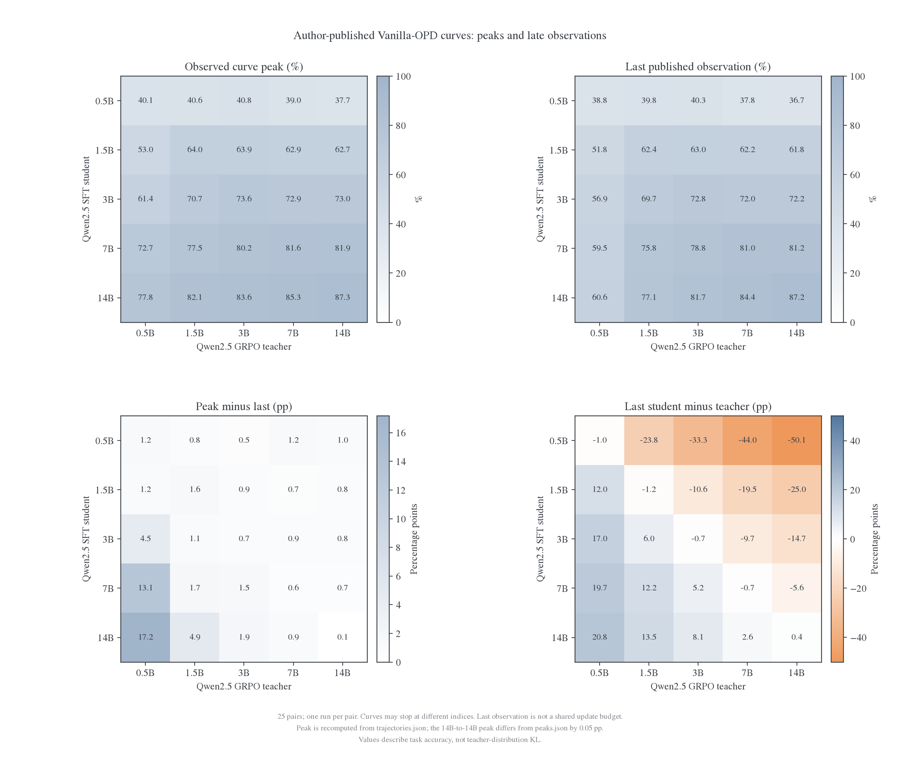
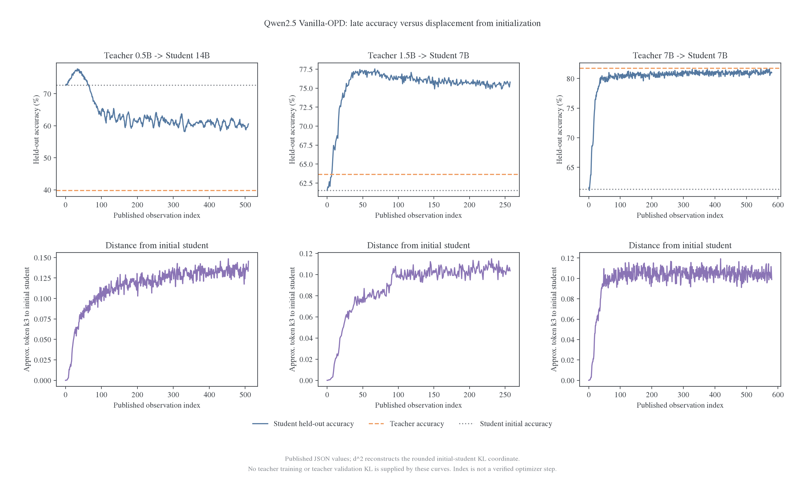
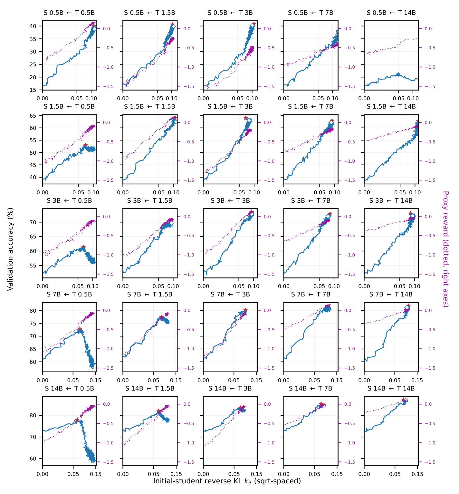

# Vanilla OPD 后期是否完全拟合 teacher：公开数据核查

更新时间：2026-10-31。对象是 Bao 等 2609.32722v1 的外部实验，不是本项目的训练结果。本文整理作者公开的 25 条 Vanilla 曲线、原论文训练 proxy 图及 checkpoint 清单，分别回答：任务成绩怎样变化、对初始化的 KL 怎样变化、teacher 拟合残差是否有直接记录。

**结论：现有公开证据支持部分配对获得明显任务收益、同尺寸组任务成绩接近 teacher，但没有给出“Vanilla OPD 已完全拟合 teacher”的直接 KL 证据。** 已取得的网页曲线包含相对 S0 的 KL 坐标和 held-out acc；teacher-training KL 的原始数值与 teacher-validation KL 未出现在这些公开 JSON 中。[^paper][^project][^curves][^hub]

## 1. 实际取得了什么

| 来源              | 已取得的内容                                            | 用于本次分析的方式             |
| ----------------- | ------------------------------------------------------- | ------------------------------ |
| arXiv v1 PDF／TeX | 协议、KL 定义、附录图 10 的 proxy 曲线                  | 核对参照、评分来源及训练目标   |
| 作者项目页        | 交互图与数据加载脚本                                    | 确认曲线字段含义               |
| trajectories.json | 25 条 Vanilla、17 条 Delta；每条有 d、g、峰值与拟合摘要 | 本文只分析 25 条 Vanilla       |
| peaks.json        | teacher 分数、SFT 汇总及发布峰值表                      | teacher 参考与跨来源对照       |
| law.json          | 完整精度拟合系数及配对摘要                              | 确认配对与 predicted 的来源    |
| HF manifest       | 311 个模型导出条目、选择原因与评价量                    | 区分导出终点与曲线终点         |
| HF 文件清单       | 4040 个文件条目                                         | 检查公开 history／metrics 文件 |

网页 JSON 与作者 GitHub 的固定 commit 7672d2edc36011cfcd2d2b5ea76dd6ee2787a5d0 逐字节一致；checkpoint manifest 固定到 Hub revision 81966d0c38efec752d75e2716eb4b9a4a71a9a6d。来源与哈希见[provenance](sources/scaling-opd-2609.32722v1/late-training/provenance.json)。[^charts-repo][^hub]

作者库中同时有试跑、其他目标及其他 baseline，311 个条目不是 311 个主实验。网页曲线以师生尺寸标识，没有直接附 run ID；本次没有把不同试跑拼入一条曲线。模型权重未下载，训练与验证作业未启动。

## 2. Training KL、validation KL 和 acc 的区别

| 量                          | 两端／来源                                     | 本次可用状态                  | 回答的问题                        |
| --------------------------- | ---------------------------------------------- | ----------------------------- | --------------------------------- |
| 对 S0 的 token-mean k3      | 当前 student 与初始 student；训练 rollout 坐标 | 有 d，可近似还原为 d²         | student 改变了多少                |
| 训练 proxy P                | teacher 诱导的 sampled-token reward            | PDF 图中有曲线；JSON 无逐点 P | 代理目标后期是否继续改善          |
| Teacher-training RKL        | student 与 teacher，在训练访问状态上           | 已取得 JSON 中缺失            | 训练状态上的 teacher 拟合是否趋零 |
| Teacher-validation RKL／FKL | student 与 teacher，在独立留出状态上           | 已取得材料没有对应数值曲线    | teacher 拟合能否泛化              |
| Held-out acc                | 当前 student 独立生成后的答案评分              | 有完整网页曲线                | 任务能力是否提高、保持或回落      |

论文横轴 KL 增大，表示离初始化更远；独立留出 acc 与独立留出 KL 是两种读出。[^paper][^project]

HF 清单的 OPD 条目主要记录 val-core/math_mixture_rlvr/acc/mean@1 等任务指标。其他训练类别还出现 val/loss、val_loss，但没有字段将这些 loss 定义为 student 对 teacher 的 validation KL。[字段清单](data/scaling-opd-late-training-20261031/checkpoint-metric-inventory.csv)保留类别和计数。

## 3. 实验与数据口径

论文使用 Qwen2.5 Base 五个尺寸，经 SFT 形成 student 初始化，再由相应 SFT 权重进行 GRPO 构造 teacher。训练题为 GSM8K／MATH 混合，约 14.8K；评价为相应测试混合，约 6.3K。主 Vanilla 使用 student rollout 与 sampled-token 即时 token 信号，论文报告最多 580 更新、LR1e-6、batch256、最大 rollout2048，每配置单 seed。[^paper]

本次末值严格定义为 **trajectories.json 的最后一项**。文件没有显式 optimizer-step 数组和完整 run ID；虽然网页播放器把数组索引显示成 update，本文仍标“公开记录序号”。曲线长度不同，末值不是统一 580 更新的等预算结果。

数值处理规则：

- 初始值取该条曲线的首项，不用跨 run 的 SFT 平均值替代。
- 峰值取 g 数组最大值，最后值取最后一项。
- d、g 是作者按小数位导出的绘图数据，对 S0 的 k3 由 d² 近似还原。
- CSV 另算最后 50 项与前 50 项均值；这是记录窗口，不冒称固定更新窗口。
- teacher KL 缺失值保留为空，不补零，也不从 acc 反推。

## 4. 同尺寸五组：任务分数接近，分布拟合仍需直接读出

| Teacher → Student | 初始 acc | 曲线峰值 | 最后记录 acc | Teacher acc | 峰值至最后回落 | 最后对 S0 的 KL 近似值 |
| ----------------- | -------: | -------: | -----------: | ----------: | -------------: | ---------------------: |
| 0.5B → 0.5B       |   16.76% |   40.05% |       38.82% |      39.83% |        1.23 pp |                 0.1146 |
| 1.5B → 1.5B       |   39.40% |   64.04% |       62.41% |      63.62% |        1.63 pp |                 0.1086 |
| 3B → 3B           |   52.70% |   73.59% |       72.84% |      73.59% |        0.75 pp |                 0.0925 |
| 7B → 7B           |   61.31% |   81.63% |       80.99% |      81.71% |        0.64 pp |                 0.0989 |
| 14B → 14B         |   72.81% |   87.28% |       87.23% |      86.82% |        0.05 pp |                 0.0928 |

最后一列的参照是 S0，**不是 teacher**。它约为 0.09–0.11，表示 student 已离开初始化；不能拿这一列判断 teacher-KL 是否还剩 0.1。

同尺寸五组最后 acc 与 teacher 的差值分别为 −1.01、−1.21、−0.75、−0.72、+0.41 个百分点。任务层面已相当接近。对于“完整拟合”，还缺训练状态和独立留出状态上的 teacher 距离。

相同准确率可以来自不同的解法与概率分配，数学关系见[正确率与序列／Token KL](../../theory/2026-10-31-正确率与序列及Token-KL的关系.md)。这里没有逐题原始结果来建立误差区间，因此不对这些小差异作显著性判断。

## 5. 跨尺寸与后期回落

| Teacher → Student | 初始 acc | 曲线峰值 | 最后记录 acc | Teacher acc | 峰值至最后回落 | 最后对 S0 的 KL 近似值 |
| ----------------- | -------: | -------: | -----------: | ----------: | -------------: | ---------------------: |
| 0.5B → 14B        |   72.65% |   77.75% |       60.58% |      39.83% |       17.17 pp |                 0.1455 |
| 0.5B → 7B         |   60.91% |   72.65% |       59.52% |      39.83% |       13.13 pp |                 0.1320 |
| 1.5B → 7B         |   61.53% |   77.54% |       75.80% |      63.62% |        1.74 pp |                 0.1035 |
| 14B → 0.5B        |   16.16% |   37.68% |       36.73% |      86.82% |        0.95 pp |                 0.2210 |

其中两条最后记录低于自身初始化：

- 0.5B teacher → 7B student：60.91% → 峰值 72.65% → 最后 59.52%。
- 0.5B teacher → 14B student：72.65% → 峰值 77.75% → 最后 60.58%。

峰值后回落分别为 13.13、17.17 个百分点。最后仍高于小 teacher 的任务分数，但已经丢掉部分甚至全部相对自身初始化的任务收益。论文报告任务回落时 proxy 仍在改善，这与 teacher-training KL 后期上升不是同一个判断。[^paper]

左上为曲线复算峰值，右上为最后记录，左下为峰值到最后的回落，右下为最后 student 与 teacher 的任务分差。不同曲线停止位置不同，图用于展示已公开动态。

上排是 held-out acc，水平线给 teacher 和 student 初始成绩。下排是从 d² 还原的对 S0 的 k3：任务回落时，student 仍可继续离开初始策略。这里没有 teacher-validation KL 曲线。

## 6. 后面的 training KL：原图展示的是 proxy

来源：作者 PDF 图 10，第 23 页；HTML 对应 Figure 12。蓝线读左轴，是 validation accuracy；紫色虚线读右轴，是训练 proxy reward。横轴仍是对初始 student 的 k3，采用平方根间隔。[^paper]

原图还存在显示范围限制。例如 14B teacher→0.5B student 的网页末端 d² 约为 0.221，超出了该行原图的可见横轴范围。因此截图的最右侧可见点不一定是训练终点；本文的 acc 末值统一取网页 JSON。\n\n对于固定前缀和真正从当前 student p 采样的下一 token，

$$
r(a,s)=\log q(a\mid s)-\log p(a\mid s),\qquad
\mathbb E_{a\sim p}[r(a,s)]
=-D_{KL}(p(\cdot\mid s)\Vert q(\cdot\mid s)).
$$

这个关系说明 proxy 与 teacher-RKL 的联系。把实际 logger 曲线逐点换成 KL，还需要采样策略、log-prob 的参数时刻、mask 和归一化。原图部分 proxy 点高于零，而真实条件 KL 非负，因此应保留 sampled proxy 的名称。

原图支持的观察是：许多配对的 proxy 总体上升，任务成绩却可能平台或回落。当前取得的文件没有逐点 proxy 数值和对应 logger 实现；本次保留原图作趋势证据，不估填“最后 teacher KL”，也不以 proxy 接近零判定完全拟合。

## 7. 后面的 validation KL：还缺哪些数据

公开曲线只有 d／g 等字段；checkpoint 清单主要提供用于模型选择的 validation score。已核对资料中没有 teacher 在独立留出前缀上的 RKL／FKL 数值面板，也没有 teacher-copy 误差参考或 teacher-rollout 验证面板。

公开权重使新的测量成为可能：先确定 checkpoint 与 teacher 身份，再固定输入和支持，分别评分 S0、teacher 和 current-student 的留出轨迹。这属于新的复现实验，现有 aggregate acc 不能恢复这些 KL。

附录中的 actor/response_reverse_kl 也不能替代 teacher 验证：按作者描述，它是对初始化的 tokenwise k3 求和，与整条 log-ratio 求和后再计算一次 k3 是不同估计器。匹配采样与终止口径时，逐 token 估计器的累计期望可以连接序列 KL，但有限样本方差与归一化仍需区分。其参照若为 S0，就仍不是 teacher-validation KL。[^paper]

## 8. Checkpoint 与曲线末值的对齐

作者模型卡发布 best 和 final/latest 导出，并记录部分测得最好时刻的权重缺失。[Hub 清单](sources/scaling-opd-2609.32722v1/late-training/author-manifest.json)也包含多个变体和试跑。[^hub]

例如，7B student←1.5B teacher 的 k1-pg 候选 run 有 step67 的 best export，记录 acc 约 77.54%；latest available export 在 step232，记录约 75.01%。网页对应尺寸曲线最后记录是 75.80%。因此，**latest exported weights、last logged evaluation、best observed score 是三种不同终点**。

网页未附直接 run-ID 映射，我们只把尺寸、目标及成绩相符的条目当作对应候选。补测 KL 前还需完成这个身份对齐，不跨试跑拼接记录。

另有一处小差异：14B←14B 的 trajectories.json 最大 g 为 87.28%，peaks.json 给出 87.23%，相差 0.05 个百分点。本文曲线峰值取前者，发布峰值字段另存，没有修改任一来源。见[差异清单](data/scaling-opd-late-training-20261031/discrepancies.json)。

## 9. 全部 25 组可复核表

| Teacher → Student | 初始 acc | 曲线峰值 | 最后记录 acc | Teacher acc | 峰值至最后回落 | 最后对 S0 的 KL 近似值 |
| ----------------- | -------: | -------: | -----------: | ----------: | -------------: | ---------------------: |
| 0.5B → 0.5B       |   16.76% |   40.05% |       38.82% |      39.83% |        1.23 pp |                 0.1146 |
| 1.5B → 0.5B       |   17.28% |   40.58% |       39.82% |      63.62% |        0.76 pp |                 0.1083 |
| 3B → 0.5B         |   16.49% |   40.81% |       40.32% |      73.59% |        0.49 pp |                 0.1009 |
| 7B → 0.5B         |   16.27% |   38.99% |       37.76% |      81.71% |        1.23 pp |                 0.1282 |
| 14B → 0.5B        |   16.16% |   37.68% |       36.73% |      86.82% |        0.95 pp |                 0.2210 |
| 0.5B → 1.5B       |   38.74% |   52.97% |       51.80% |      39.83% |        1.17 pp |                 0.1013 |
| 1.5B → 1.5B       |   39.40% |   64.04% |       62.41% |      63.62% |        1.63 pp |                 0.1086 |
| 3B → 1.5B         |   39.15% |   63.95% |       63.02% |      73.59% |        0.93 pp |                 0.0813 |
| 7B → 1.5B         |   38.93% |   62.87% |       62.18% |      81.71% |        0.69 pp |                 0.0875 |
| 14B → 1.5B        |   38.77% |   62.67% |       61.83% |      86.82% |        0.84 pp |                 0.1170 |
| 0.5B → 3B         |   53.14% |   61.37% |       56.88% |      39.83% |        4.49 pp |                 0.1011 |
| 1.5B → 3B         |   53.17% |   70.74% |       69.65% |      63.62% |        1.09 pp |                 0.0934 |
| 3B → 3B           |   52.70% |   73.59% |       72.84% |      73.59% |        0.75 pp |                 0.0925 |
| 7B → 3B           |   53.20% |   72.88% |       72.01% |      81.71% |        0.87 pp |                 0.0775 |
| 14B → 3B          |   52.89% |   72.99% |       72.15% |      86.82% |        0.84 pp |                 0.0930 |
| 0.5B → 7B         |   60.91% |   72.65% |       59.52% |      39.83% |       13.13 pp |                 0.1320 |
| 1.5B → 7B         |   61.53% |   77.54% |       75.80% |      63.62% |        1.74 pp |                 0.1035 |
| 3B → 7B           |   60.09% |   80.25% |       78.79% |      73.59% |        1.46 pp |                 0.0861 |
| 7B → 7B           |   61.31% |   81.63% |       80.99% |      81.71% |        0.64 pp |                 0.0989 |
| 14B → 7B          |   60.86% |   81.90% |       81.23% |      86.82% |        0.67 pp |                 0.0978 |
| 0.5B → 14B        |   72.65% |   77.75% |       60.58% |      39.83% |       17.17 pp |                 0.1455 |
| 1.5B → 14B        |   72.80% |   82.10% |       77.15% |      63.62% |        4.95 pp |                 0.1022 |
| 3B → 14B          |   72.97% |   83.57% |       81.67% |      73.59% |        1.90 pp |                 0.0834 |
| 7B → 14B          |   73.19% |   85.30% |       84.36% |      81.71% |        0.94 pp |                 0.0839 |
| 14B → 14B         |   72.81% |   87.28% |       87.23% |      86.82% |        0.05 pp |                 0.0928 |

teacher-training KL 和 teacher-validation KL 在 CSV 中留空，并以状态字段解释原因，空白不是零。CSV 还保存记录数、最后 50 项均值、前后窗口变化和峰值来源差异。

## 10. 对完全吸收的判断

| 问题                              | 当前证据                          |
| --------------------------------- | --------------------------------- |
| Vanilla 能否提高任务成绩          | 存在明显正收益，也有后期回落      |
| 同尺寸能否达到接近 teacher 的 acc | 五组峰值接近，末值也相近          |
| 训练状态上的 teacher KL 是否归零  | 缺少公开逐点 KL；proxy 图提供趋势 |
| 独立留出上的 teacher KL 是否归零  | 已核对资料中缺少该面板            |
| 是否完整复制 teacher 生成分布     | 现有数据不足以作此认定            |

对我们最直接的启发是保留训练 teacher 距离、固定留出距离、current-student 行为距离、任务成绩四类读出，并分别标清参照。论文提供了任务收益的配对证据；我们要补的是分布拟合程度及其状态覆盖。

## 11. 数据与复现

- [25 组整理表](data/scaling-opd-late-training-20261031/vanilla-summary.csv)、[汇总](data/scaling-opd-late-training-20261031/summary.json)。
- [处理与绘图脚本](sources/scaling-opd-2609.32722v1/late-training/analyze.py)、[原图提取脚本](sources/scaling-opd-2609.32722v1/late-training/extract_proxy_figure.py)。
- [作者曲线 JSON](sources/scaling-opd-2609.32722v1/late-training/author-trajectories.json)、[峰值 JSON](sources/scaling-opd-2609.32722v1/late-training/author-peaks.json)、[系数与配对 JSON](sources/scaling-opd-2609.32722v1/late-training/author-law.json)。
- [来源哈希](sources/scaling-opd-2609.32722v1/late-training/provenance.json)、[逐文件来源](data/scaling-opd-late-training-20261031/sources.json)、[图 10 来源](data/scaling-opd-late-training-20261031/original-figure-10-source.json)。

原始网页与文件清单位于仓库外 author-data 目录。两张重绘图使用作者发布数值，图 10 保留原始曲线；未补造缺失 KL。

### 参考文献

[^paper]: Bao et al. Scaling Properties of Same-Family On-Policy Distillation. arXiv:2609.32722v1, 2026. [PDF](https://arxiv.org/pdf/2609.32722v1)。§3–4、附录 B/F/I/K；PDF 图 10。

[^project]: Yuntai Bao. Scaling Properties of Same-Family On-Policy Distillation. [作者项目页](https://colored-dye.github.io/blog/2026/opd-scaling/)，访问于 2026-10-31。

[^curves]: 作者发布的 [trajectories.json](https://colored-dye.github.io/assets/json/2026-09-30-opd-scaling/trajectories.json) 与 [peaks.json](https://colored-dye.github.io/assets/json/2026-09-30-opd-scaling/peaks.json)。本页末值与回落由这些公开数值复算。

[^charts-repo]: colored-dye/colored-dye.github.io. [固定版本数据目录](https://github.com/colored-dye/colored-dye.github.io/tree/7672d2edc36011cfcd2d2b5ea76dd6ee2787a5d0/assets/json/2026-09-30-opd-scaling)。网页 JS 说明其数据来自论文分析 CSV 的导出。

[^hub]: colored-dye/OPD-scaling-checkpoints. [模型卡](https://huggingface.co/colored-dye/OPD-scaling-checkpoints)、[固定 revision manifest](https://huggingface.co/colored-dye/OPD-scaling-checkpoints/resolve/81966d0c38efec752d75e2716eb4b9a4a71a9a6d/manifest.json)。本次只读取元数据。
