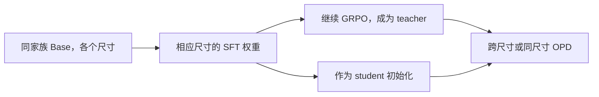
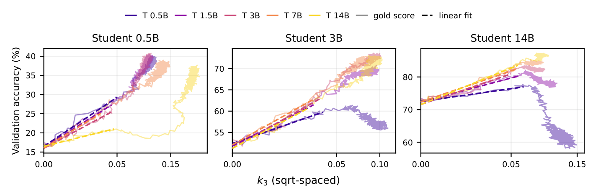
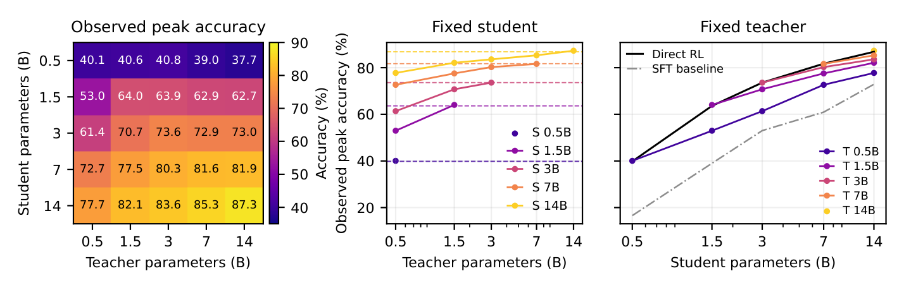
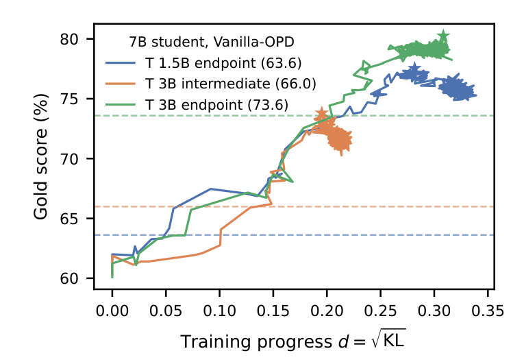
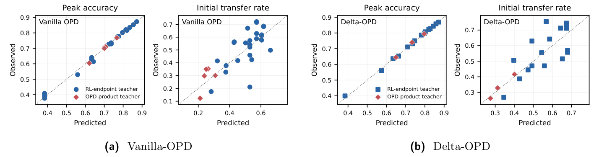
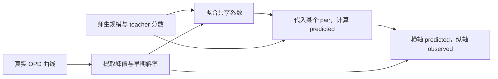
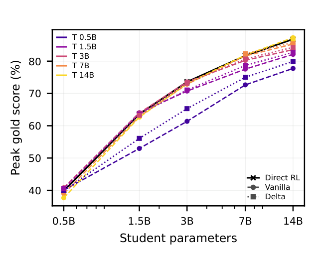
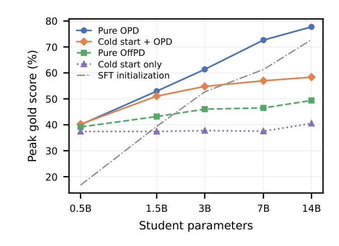
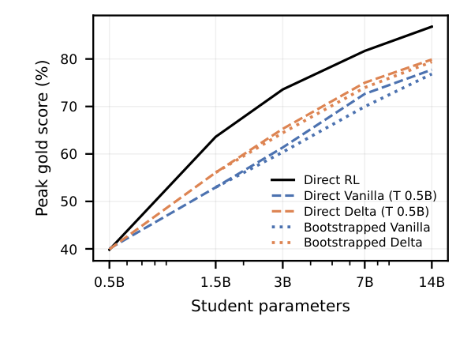

# 同家族 OPD 缩放规律：2609.32722 精读与实验启发

更新时间：2026-10-31。论文：Bao et al., _Scaling Properties of Same-Family On-Policy Distillation_，arXiv:2609.32722v1，2026-09-26。本文固定核对该版本的 35 页 PDF 与 LaTeX 源文件，讨论它的研究问题、图表证据、指标定义和对我们实验的启发。论文结果按原文页码和图表引用；数学推导列出假设，构造例单独标明，不计入论文或本项目的真实实验结果。[^paper]

这篇论文的主问题是：能否根据 teacher／student 的规模和 teacher 的任务水平，预测 OPD 的任务收益及其演化。它没有直接检验任意 teacher 的完整条件分布能否被 student 学到。阅读时，应一直区分任务收益、相对初始化的策略位移、对 teacher 的拟合残差。

## 1. 阅读地图、图号与材料

| 想回答的问题                         | 本文位置          | 论文位置            |
| ------------------------------------ | ----------------- | ------------------- |
| teacher 和 student 如何构造          | 第 2 节           | §2–3、附录 E        |
| KL 横轴究竟是什么                    | 第 3 节           | Eq. (5)、附录 D/I/K |
| 早期是否有规律                       | 第 4 节，图 2     | RQ1，§4             |
| 尺寸、分数能否预测结果               | 第 5 节，图 4/5/6 | RQ2，§5、附录 H     |
| Delta、冷启动、逐级蒸馏是否有效      | 第 6 节，图 7/8/9 | RQ3，§6             |
| 哪些结论不应外推                     | 第 7 节           | 附录 B/K 与证据边界 |
| 如何用于我们的 R1／Qwen3／Llama 实验 | 第 8 节           | 本项目建议          |

本文图号以 PDF 为准。arXiv HTML 将部分子图／子表额外编号，后续编号发生偏移：PDF 图 6 对应 HTML Figure 8，PDF 图 7/8/9 对应 HTML Figure 9/10/11；PDF 表 3 对应 HTML Table 5。此前聊天里的 HTML 图号应按此对照阅读，不能当成不同实验。

嵌入图片为作者 PDF 的局部渲染，保留原坐标、曲线、图例和数值，不重画数据。图注在中文正文重新解释。来源、页码、裁剪区域、文件哈希见[图片清单](figures/scaling-opd-2609.32722v1/manifest.json)，提取方法见[复现说明](sources/scaling-opd-2609.32722v1/README.md)。正文精选图保存在仓库中，完整论文和 TeX 留在仓库外。

## 2. 实验到底在比较什么

### 2.1 一套受控模型网格

作者选择 Qwen2.5 Base 的五个规模：0.5B、1.5B、3B、7B、14B。先对各模型执行统一流程的 SFT，再从各自 SFT 权重出发进行数学 GRPO，得到 RL teacher；student 从相应规模的 SFT 权重开始。Vanilla-OPD 覆盖全部 25 个组合。[^paper]

这比从互不相关的公开模型中随意挑五个尺寸，更容易研究尺寸方向；但“统一训练流程”不等于所有预训练因素相同。不同规模的架构、预训练数据及计算量仍可能不同。本文使用的 same-base 特指 student 从该尺寸 teacher 的 RL 前身开始，不应自动等同于我们所有“相同尺寸”分支。

三种方向需要分别解释：

- 小教大：小尺寸 RL expert 提供监督，大尺寸 SFT student 已有自己的知识和行为能力。
- 同尺寸：同一 SFT 起点与其 RL 派生 teacher 的直接转移。
- 大教小：更大 RL teacher 的监督向较小 SFT student 转移。

### 2.2 与我们的实现差异

论文用 GSM8K／MATH 的混合训练题，约 14.8K 条；gold score 来自相应混合测试题，约 6.3K 条。OPD 使用 student 自生成轨迹；主方法采用 sampled-token、即时 token 信号的 policy-gradient 风格实现。附录 E 给出 LR1e-6、batch256、最大 rollout2048、最多 580 更新，并说明每配置单 seed。[^paper]

把差异分成四项，才知道哪些结论可直接比较：

| 因素         | 论文主设置                         | 我们现有固定状态实验                  |
| ------------ | ---------------------------------- | ------------------------------------- |
| 轨迹来源     | 更新中的 student                   | 初始 student 的冻结轨迹               |
| 条件动作积分 | sampled-token 估计                 | full-vocab 求和                       |
| 主要任务     | 预测任务峰值与位移坐标下的迁移斜率 | 检查分布拟合残差及其跨状态泛化        |
| 主要横轴     | 相对初始化的位移                   | 更新数，以及固定银行上的 teacher 风险 |

这些条件和我们目前的固定 S0、full-vocab 条件 RKL、H1024、batch16／reuse16 不同。论文的 update、观测 checkpoint、epoch 和本地的真实 optimizer 更新也必须分别核对。不能用论文的 580 或前 30 个观测点直接决定我们应该跑多少次更新。

### 2.3 三个训练目标的概念差异

以下统一用 $p_\theta$ 表示 student，$q$ 表示 RL teacher，$q_{base}$ 表示 teacher 的 RL 前身，$p_0$ 表示 student 初始化。

Vanilla 的即时 token 信号由 teacher 与当前 student 的对数概率差产生。Delta 则使用 teacher 后训练前后的对数概率差，并约束 student 相对自身初始化的偏移。OffPD 使用 teacher 生成的回答做似然学习。[^paper]

把两类即时信号写清楚，可以避免把 Delta 误解成另一个 teacher-RKL：

$$
a_t^{V}=\log q(y_t\mid s_t)-\log p_\theta(y_t\mid s_t),
\qquad
a_t^{\Delta}=\log q(y_t\mid s_t)-\log q_{base}(y_t\mid s_t).
$$

Delta 还包含 student 对 $p_0$ 的 KL 约束；后训练前后相同的部分在对数比中抵消，但这不意味着能将模型知识无歧义地拆成两个独立模块。[^paper]

这三个目标分别强调不同的东西。拟合 teacher 终点会同时接触它的原有分布和后训练改变；teacher 的前后差分更直接表达某次训练使哪些 token 相对更受偏好；teacher 回答的似然学习又改变了前缀来源。它们可以作为不同的能力转移方法，但不能各自以自己的 training loss 宣称“更完整地复制了 teacher”。外部 fidelity 指标必须统一。

## 3. KL 横轴的含义：先分清参照与统计权重

### 3.1 Gold score 是谁的分数

这里的 gold score 是**当前 student 在留出数学题上的正确率**。可写为

$$
G_{\mathrm{gold}}(\theta)
=\mathbb E_{x\sim D_{\mathrm{held}},\,y\sim p_\theta(\cdot\mid x)}
[\mathbf1\{y\text{答对}x\}].
$$

它不是 teacher 的分数，也不是 teacher 给每个 token 的 log-prob。teacher 信号用于更新 student；独立答案判定用于检查这种更新是否真的改善解题。论文用 $G$ 表示这项任务成绩，“gold”强调它在实验中的评价角色。

这套角色划分沿用奖励模型过优化研究：早期工作用独立 gold RM 检查 proxy 优化，后来的直接对齐工作用裁判胜率，本文则用可验证正确率。不同论文的 gold 不一定是同一种评分器或同一种单位。完整历史见[Gold score 的来源与发展](2026-10-31-Gold-score的来源与奖励过优化研究脉络.md)。

### 3.2 论文衡量的是离初始化多远

作者以相对 $p_0$ 的 token-mean KL 估计建立坐标，并取平方根作为 $d$。主要估计器是 $k_3$，在当前 student 采样的 token 上计算；它不是我们的 teacher-RKL。[^paper]

为了理解这个量，先看一个固定前缀。令 $a\sim p$、$r(a)=q(a)/p(a)$，有

$$
k_3(a)=r(a)-\log r(a)-1.
$$

在共同支持与精确采样下，

$$
\mathbb E_{a\sim p}[k_3(a)]
=\sum_a q(a)-\sum_a p(a)-\mathbb E_{a\sim p}\log\frac{q(a)}{p(a)}
=D_{KL}(p\Vert q).
$$

这里把 $q$ 换成初始 student，就得到“相对初始化的位移”读数。它增长通常表示模型离起点更远，不能解释成拟合 teacher 变差。

| 量              | 指标用途              | 改善方向                        |
| --------------- | --------------------- | ------------------------------- |
| 对 $p_0$ 的 KL  | 描述策略改变幅度      | 没有单独的越大越好或越小越好    |
| 对 $q$ 的 KL    | 描述 teacher 拟合残差 | 在指定 state 分布上通常希望下降 |
| acc／gold score | 描述特定任务上的表现  | 通常希望上升                    |

跨方法比较时，需要标清 KL 的两端、前缀来源、动作支持和分母。尤其冷启动后的 student 已经改变了初始化；若各 run 的 KL 各自相对不同起点，横坐标相同不意味着处在同一个位置。参考模型身份应进入图注。

### 3.3 token 平均与序列累计不是同一指标

对响应 $i$，设累计条件风险为 $K_i$、长度为 $L_i$。以下三种统计量分别是逐响应等权的 token 均值、所有有效 token 等权的均值、逐响应累计风险：

$$
\frac1N\sum_i\frac{K_i}{L_i},\qquad
\frac{\sum_i K_i}{\sum_i L_i},\qquad
\frac1N\sum_i K_i.
$$

第一种让每条响应等权，第二种让长响应占更大权重，第三种保留完整累计量。它们不能互换。论文主文 Eq. (5) 写成逐响应内部归一化，附录 D 的局部几何使用 token-mean population 表达；复现时还应核对日志的实际 reduction，而不是仅凭“token-mean”这个名字假设所有统计权重完全相同。[^paper]

固定前缀处的 $k_3$ 无偏性，也不能未经核对就扩展成“对随机长度响应先除以最终长度，仍等于某个固定时域的序列 KL”。随机终止与归一化会改变估计对象。我们应保留每题累计值、有效 token 数和固定 horizon，明确区分这些口径。

## 4. RQ1：早期迁移是否有可预测结构

来源：作者图 2，PDF 第 4 页。横轴显示 $k_3$ 的数值，但按平方根坐标排布；纵轴为任务正确率。颜色区分 teacher 尺寸，三个面板分别固定 student 尺寸。图中虚线是早期拟合，不是后期实际轨迹。[^paper]

作者用早期观测拟合近似直线，之后区分继续缓慢改善、平台和回落；拟合窗口使用前 30 个观测 checkpoint，而非前 30 次 optimizer 更新。论文还区分离开初始预测带的 transfer endpoint 与任务最高点，它们不是同一个终点。[^paper]

### 4.1 按什么顺序读这张图

先看每个面板内的不同颜色，而不是直接比较三个面板里曲线的视觉陡峭程度。横纵坐标范围不同，不能仅凭斜率外观判断小 student 学得更快。

更重要的是，横轴不是时间。沿着更快增长的 $d$ 走得更远，可能只是参数更新造成更大分布位移；只有结合真实 updates、生成 token 和耗时，才能讨论训练效率。论文中的“迁移速率”应理解成每单位该位移坐标的任务收益。

### 4.2 平方根 KL 与 acc：哪些部分确实有理论保证

先区分三层命题。令 $P$ 是当前策略、$Q$ 是固定参考，二者使用相同 prompt 分布和评分规则。

| 命题                         | 结论                                                  | 需要的条件                                     |
| ---------------------------- | ----------------------------------------------------- | ---------------------------------------------- |
| 任意策略的成绩差             | $\lvert G(P)-G(Q)\rvert\leq\sqrt{D_{KL}(P\Vert Q)/2}$ | 真实序列 KL、$[0,1]$ 评分、共同评价协议        |
| 指定训练路径的局部形状       | $G=G_0+m\sqrt K+O(K)$                                 | 光滑路径、非零 Fisher 位移；$m$ 可正可负或为零 |
| 直接优化真实正确率的最优前沿 | $G_{\max}(K)-G_0=\sqrt{2VK}+O(K)$                     | 足够丰富的策略类、真实正确性目标、小 KL 预算   |

其中 $V$ 是参考策略逐题正确概率的 Bernoulli 方差，再对 prompt 求均值。第一条只给上界，第三条才说明某种最优训练可以达到平方根量级。实际 OPD 优化的是 teacher 代理信号，不保证走在第三条前沿上。

#### 局部直线从哪里来

设 $\theta(\tau)=\theta_0+\tau h+O(\tau^2)$，$F$ 为相应序列分布的局部 Fisher 矩阵，$g=\nabla G(\theta_0)$。KL 在起点一阶为零，成绩变化通常有一阶项：

$$
K=\frac{\tau^2}{2}h^\top Fh+O(\tau^3),\qquad
G-G_0=\tau g^\top h+O(\tau^2).
$$

若 $h^\top Fh>0$，消去 $\tau$：

$$
G(d)=G_0+\underbrace{\frac{g^\top h}{\sqrt{h^\top Fh/2}}}_{m}d+O(d^2),
\qquad d=\sqrt K.
$$

所以平方根坐标有明确的局部几何依据。但正斜率还要求 $g^\top h>0$；几十个 checkpoint 都近似同一条直线，还要求方向、几何与收益对齐相对稳定。若先只改写答案风格，正确总质量不变，线性系数可以为零。

#### token KL 是否能接上这个推导

如果 token KL 是在当前策略的前缀分布上计算，并固定用 $H$ 归一化，那么序列 KL 精确等于 $H$ 倍 token 平均。换横轴只会改变 $\sqrt H$ 的尺度因子。

若按实际响应长度逐条归一化，则还涉及长度与局部风险的协方差。若 state 来自固定 S0，而不是 KL 第一参数对应的当前策略，链式关系也不再自动成立。不能把所有名为 token KL 的字段视为相同对象。

完整证明、最优前沿的构造，以及“同 acc 但 KL 任意大”“局部主要呈二次变化”的反例，见[正确率与序列／Token KL 的关系](../../theory/2026-10-31-正确率与序列及Token-KL的关系.md)。因此，正确率接近是小序列 KL 的一种后果，不是序列 KL 的等价定义。

### 4.3 任务回落、线性区间结束和拟合平台分别是什么

先区分三个事件：gold score 开始下降；曲线偏离早期拟合；teacher 拟合残差停止下降。它们的定义不同，发生时间不必一致。论文用预测带与连续偏离规则定义线性区间的结束，并不是直接找训练 loss 的最低点。[^paper]

任务峰值之后的回落，可能与继续优化 teacher 代理信号有关；但它并不能直接说明某个固定 state 上的 KL 上升。检查时至少要同时画任务成绩、对 teacher 的残差和对 S0 的位移，且标清前缀是否变化。否则“越训越差”可能把不同指标混为一谈。

对未观察到偏离早期规律的轨迹，只能知道其规律持续到了当前预算，这属于右删失信息；不能把最后一个读出当作真实收敛点或真实转折点。

## 5. RQ2：规模与 teacher 能力能预测什么

### 5.1 先看原始 25 格网格

来源：作者图 4，PDF 第 5 页。左图的行是 student 尺寸、列是 teacher 尺寸，格子是各 run 的观测任务峰值。中图固定 student，右图固定 teacher；这些都是任务成绩，不是 KL 残差。[^paper]

作者观察到弱教强可以产生超过 teacher 自身的 student 任务峰值，teacher 继续增大则不总能改善小 student。[^paper]

这里有两个不同的比较基准。超过 teacher 回答“学生是否突破监督者的任务成绩”，超过自己的 S0 才回答“蒸馏是否带来增益”。大 student 的初始化原本就可能强于小 teacher，因此报告时必须同时给 teacher、S0 和训练后 student 三条参考，而不是只强调 student 超过 teacher。

另外，左图是每个 run 的最好观测值。不同 run 可能在不同更新点达到峰值，因此它不是一个固定终点的等预算结果表。我们当前 0–320 的统一终点表不能与这张峰值表直接比较。若借鉴峰值分析，应预先规定 checkpoint 选择与独立确认流程，防止同一留出集反复择优的影响。

### 5.2 缩放公式怎样从实验变成预测

#### 先明确要拟合的两个数

每条训练曲线先被概括为两个不同目标：

- $G_{\mathrm{peak}}$：规定观察预算内，student 在 gold panel 上达到的最高成绩。
- $m$：早期 $G(d)\approx c+md$ 的斜率，单位是“正确率概率／单位平方根 KL 位移”。

第一个描述观测到的任务上限，第二个描述早期每单位策略变化带来的收益。它们都不等于 teacher-KL 的最终残差，也不直接表示每秒或每次更新的效率。

设 $e=1-G_{\mathrm{peak}}$、$e_T=1-G_T^{eff}$，作者使用

$$
e=A\widetilde N_S^{-\alpha}(\widetilde N_T^{eff})^{-\beta}e_T^\zeta,
\qquad
m=B\widetilde N_S^{-\gamma}(\widetilde N_T^{eff})^\delta e_T^{-\xi}.
$$

这里 $\widetilde N_S=N_S/(1\mathrm B)$、$\widetilde N_T^{eff}=\min(N_T,N_S)/(1\mathrm B)$。$G_T^{eff}$ 是与该有效 teacher 对应的任务分数；当实际 teacher 大于 student 时，不能一面封顶尺寸、一面仍任意代入未封顶 teacher 的分数。这个映射依赖论文所构造的同家族 teacher 网格。[^paper]

#### 为什么拟合剩余错误，而不直接让 accuracy 作幂律

若写 $G=AN^\alpha$ 且 $\alpha>0$，无限外推会让 accuracy 超过 1。改为 $1-G=AN^{-\alpha}$，至少在函数形式上表达了“剩余错误随规模减少、成绩趋近 1”的趋势。

这仍不是充分的物理约束：在观测范围外，公式可能给出大于 1 的错误，或遗漏真正存在的误差下限。因此它是有限区间的统计近似，不是对任意参数规模成立的定理。

#### 文中实际使用的系数

下面汇总正文及附录 H 公布的近似值。它们来自数据拟合，不是理论事先给定的常数；不同表保留的小数位数不同，不能把这些显示值当成作者求解器的完整精度。[^paper]

| 峰值错误公式 |  $A$ | $\alpha$ | $\beta$ | $\zeta$ |
| ------------ | ---: | -------: | ------: | ------: |
| Vanilla      | 0.97 |    0.304 |  −0.267 |   0.952 |
| Delta        | 1.02 |    0.336 |  −0.325 |   1.009 |

| 早期速率公式 |   $B$ | $\gamma$ | $\delta$ | $\xi$ |
| ------------ | ----: | -------: | -------: | ----: |
| Vanilla      | 0.116 |    0.189 |   −0.609 | 1.896 |
| Delta        | 0.129 |    0.203 |   −0.725 | 2.010 |

#### 每个指数具体表示什么

对峰值公式取对数：

$$
\log e=\log A-\alpha\log\widetilde N_S
-\beta\log\widetilde N_T^{eff}+\zeta\log e_T.
$$

因此，$-\alpha$、$-\beta$、$\zeta$ 是保持其他协变量不变时的对数弹性。它们作用于**剩余错误**，不能直接读成 accuracy 的百分点变化。

以 Vanilla 的公布系数近似计算：

| 只改变这一项                        | 保持其他项不变时的预测                             | 不能误读成                    |
| ----------------------------------- | -------------------------------------------------- | ----------------------------- |
| student 尺寸翻倍                    | 错误乘 $2^{-0.304}\approx0.810$                    | accuracy 固定增加 19 个百分点 |
| 有效 teacher 尺寸翻倍               | 错误乘 $2^{0.267}\approx1.203$                     | 所有更大 teacher 都更差       |
| teacher 剩余错误从 0.364 降至 0.340 | student 错误乘 $(0.340/0.364)^{0.952}\approx0.937$ | teacher 分数是唯一决定因素    |

teacher 规模变大时通常也会更准确，两项会同时变化。以第二、第三行同时发生为例，规模项约乘 1.203，质量项约乘 0.937，合起来约乘 1.128；模型预测的 student 剩余错误仍上升约 12.8%。这是联合公式可以给出“teacher 分数稍高，但 student 更差”预测的原因，不能把它简化成只看参数量或只看分数。

速率公式同理：$\delta<0$ 表示固定 teacher 分数后，较大有效 teacher 对应较低拟合速率；$-\xi<0$ 则表示 teacher 剩余错误更小时，速率更高。两种解释都受“其他变量固定”和观测范围限制。[^paper]

#### 这些系数怎么得到

先对真实训练曲线提取 $G_{\mathrm{peak}}$ 和 $m$，再把每个师生 pair 的规模和 teacher 分数作为输入，拟合一组共享系数。Vanilla 与 Delta 分别拟合，峰值与斜率也分别拟合，合计四个目标模型。

对数化后，这种乘法形式在系数上具有线性结构；用对数残差做最小二乘是一种可行实现。本文没有重跑原始拟合，也不假设附录未明确的残差权重、数值求解及初始化细节。本文的数值例只是代入已公布系数，不是重新拟合原始实验数据。

拟合采用原始误差还是 log-error，代表不同的误差权重：原始尺度更在意绝对偏差，对数尺度更在意比例偏差。把公式取对数很方便，不等于任意噪声模型下都应该这样优化。

#### 为什么还要比较加法式、常数底噪和其他形式

同一批点可能同时被很多形式拟合。作者在附录 H 比较了乘法式、加权加法式及其他参数化，并用留尺寸误差与 AICc 等诊断选择。还尝试加入可学习的不可约错误项，其拟合落在零边界。[^paper]

这只能说现有数据没有支持额外常数项，不能证明真实误差下限为零。比较 AICc 时也应保持响应量和似然定义一致；对不同变换后的目标直接比较数值，必须处理相应的概率模型。

#### 可识别性：分数与尺寸为什么难以拆开

如果 teacher 越大就必然越高分，那么 $\log N_T$ 和 $\log e_T$ 几乎由同一条关系决定。此时很多不同的 $\beta,\zeta$ 组合都会给出相近预测，单个指数的含义不稳定。

作者加入了由 OPD 链条产生的 teacher，使部分模型的尺寸与分数脱离原来的 RL 终点趋势，帮助区分两项影响。这个思路相当于补充更有信息的实验条件，而不只是往原趋势上再加几个点。[^paper]

需要继续区分：

1. 预测值稳定，不代表每个系数都稳定。
2. 某个指数区间不跨零，不代表参数量具有独立因果作用。
3. 有效 teacher 的尺寸封顶本身是一项建模选择，不是由公式证明出的容量边界。
4. 我们的公开 teacher 来源更杂，不能跳过输入验收和分层，就把同一套指数用于 R1、Qwen3、Llama。

拟合研究如何从学习曲线发展到 compute-optimal、迁移和蒸馏，见[缩放律拟合的历史与方法](2026-10-31-缩放律拟合的历史方法与蒸馏应用.md)。

### 5.3 分数更高，为什么仍可能教得更差

来源：作者图 5，PDF 第 8 页，对应 PDF 表 3。三条线使用同尺寸 student，改变 teacher；虚线给 teacher 自身分数，星号是各自 student 的观测峰值。[^paper]

#### 先看具体发生了什么

| Teacher               | Teacher 自身分数 | 教出的 7B student 观测峰值 |
| --------------------- | ---------------: | -------------------------: |
| 1.5B RL 终点          |            63.6% |                      77.5% |
| 3B RL 中间 checkpoint |            66.0% |                      73.8% |
| 3B RL 终点            |            73.6% |                      80.3% |

这些是原文表 3 的读数，不是我们重跑的结果。3B 中间 teacher 比 1.5B teacher 高 2.4 个百分点，却让 student 峰值低 3.7 个百分点；充分训练后的 3B teacher 又教得更好。[^paper]

由此能直接排除的是“只用 teacher 分数就能排序教学价值”。它没有支持“小 teacher 总比大 teacher 好”，也没有支持“3B 天生比 1.5B 难教”。这里两个 3B checkpoint 的结果本身就说明训练阶段很重要。

#### Teacher 自己答题，与它指导 student，是两个不同的测量

Teacher 分数衡量：

$$
G(q)=\mathbb E_{x,y\sim q}[\mathbf1\{\text{答对}\}].
$$

OPD 的局部监督则发生在 **student 访问的前缀** 上，依据的是 teacher 对这些前缀后各 token 的概率。高 $G(q)$ 只能说明 teacher 沿自己的路径擅长完成任务，没有规定它在 student 路径上给出的更新方向有多好。

可以把两者的差别写成一阶式子。若 teacher $q$ 诱导 student 的更新方向为 $h_q$，小步更新后的任务收益是

$$
G(\theta+\eta h_q)-G(\theta)
=\eta\,\nabla G(\theta)^\top h_q+O(\eta^2).
$$

教学价值取决于这个**与当前 student 任务改进方向的对齐**。teacher 自身的分数并没有决定该内积。两个同分 teacher 可以偏好不同解法、在不同题上犯错，也可能以不同概率支持 student 已有的正确行为。

#### 一个能直接算出的例子

下面是合成的一步任务：$c_1,c_2$ 都正确，$w$ 错误；不是论文实验数据。

| 分布      | 正确动作 $c_1$ | 正确动作 $c_2$ | 错误动作 $w$ | 自身 acc |
| --------- | -------------: | -------------: | -----------: | -------: |
| Student   |           0.60 |           0.01 |         0.39 |     0.61 |
| Teacher A |           0.01 |           0.89 |         0.10 |     0.90 |
| Teacher B |           0.70 |           0.10 |         0.20 |     0.80 |

A 会通过 $c_2$ 答对，但 student 几乎不走 $c_2$；A 还给 student 已会的 $c_1$ 很低概率。RKL 梯度由 student 当前概率加权，可能先压掉 $c_1$，而没有立刻补足 $c_2$。B 的总分较低，却更支持 student 已有的正确动作。

对 softmax logits 直接做负 RKL 梯度更新，可以算出起点处
$dG_A/d\eta\approx-0.3082$，
$dG_B/d\eta\approx+0.0906$。
所以更高分的 A 确实可以给出更差的**局部**任务更新方向。完整公式和有限差分核验见[理论附录第 7 节](../../theory/2026-10-31-正确率与序列及Token-KL的关系.md)。

这个例子只解释“为什么并不矛盾”。它不证明图 5 的真实模型就是这一机制，也不保证 A 的完整训练最终一定更差；后续分布和更新方向会改变。

#### 论文解释到了哪一步

论文的联合缩放拟合把 teacher 分数与规模同时作为变量，在控制分数后的拟合关系中，小 teacher 可能更有效；图 5 是额外的分数接近对照。它们支持教学价值不由 acc 一项决定。[^paper]

但“为什么该 3B 中间 checkpoint 给出更差监督”仍没有被唯一识别：训练阶段、校准、错误类型、支持分布和更新几何都可能参与。仅凭图 5，不能确定是哪一个原因。

对我们的实验，下一步应直接检查这些候选解释：在同一 student 前缀上比较 teacher 的概率质量与 KL，检查旧批／留出的传播，并区分 student 已能解决与尚不能解决的题。这样才能从“高分 teacher 没教好”的现象，走向对具体机制的检验。

### 5.4 Predicted 是什么：公式输出与实际观测的对照

来源：作者图 6，PDF 第 8 页。**Predicted 是已经拟合好的缩放公式输出；Observed 是真实训练曲线提取出的数值。** 它不是另一个 LLM 的答题结果，不是 teacher 分数，也不是下一 token 的概率。[^paper]

#### 一个点如何生成

对每个 pair $i$：

1. 从实验曲线读取实际峰值 $G_{\mathrm{peak},i}$，并拟合实际早期斜率 $m_i$。
2. 用一组 pair 的这些观测量拟合共享系数，例如 $\widehat A,\widehat\alpha,\widehat\beta,\widehat\zeta$。
3. 将 pair $i$ 的 $N_S,N_T,G_T^{eff}$ 代入公式，得到
   $\widehat G_{\mathrm{peak},i}=1-\widehat e_i$ 或 $\widehat m_i$。
4. 在图上画 $(\widehat G_{\mathrm{peak},i},G_{\mathrm{peak},i})$ 或 $(\widehat m_i,m_i)$。

所以，一个点代表一组师生配对的一个总结量，不是一次 token 预测，也不是训练曲线上的一个普通 checkpoint。

#### 用一个真实 pair 算一遍

取 7B student、1.5B teacher，teacher 分数为 0.636。用附录公布的近似系数：

$$
\widehat e
=0.97\times7^{-0.304}\times1.5^{0.267}\times(1-0.636)^{0.952}
\approx0.2286.
$$

代入时 7 表示 7B，0.636 表示 63.6%；规模单位和分数单位必须与拟合时一致。\n\n因此 $\widehat G_{\mathrm{peak}}\approx0.7714$，即约 77.1%；该 pair 实际观测峰值为 77.5%。对应峰值图上的点约为 $(0.771,0.775)$，略在对角线上方，表示公式略低估了观测峰值。[^paper]

同一个 pair 的速率公式约给出 $\widehat m=0.426$，原文早期拟合的 $m$ 为 0.558，因此速率图上的点约为 $(0.426,0.558)$，偏离对角线更明显。这里的 0.558 是正确率概率／单位 $d$，不是 55.8% 的最终 accuracy。

上述代入使用论文已四舍五入的系数，不能精确恢复作者所有原始点。[复算结果](sources/scaling-opd-2609.32722v1/prediction-example.json)与[计算脚本](sources/scaling-opd-2609.32722v1/compute_predictions.py)明确区分输入、计算值和原文观测值，没有重新训练或重新拟合。

#### 四个面板分别表示什么

| 面板，从左到右 | 横轴 predicted               | 纵轴 observed        | 主要读法                              |
| -------------- | ---------------------------- | -------------------- | ------------------------------------- |
| Vanilla：峰值  | 联合公式预测的任务峰值       | Vanilla 实际峰值     | 这些点大体接近对角线                  |
| Vanilla：速率  | 公式预测的早期斜率           | 从早期曲线拟合的斜率 | 散布更明显，预测精度弱于峰值          |
| Delta：峰值    | Delta 自己那套系数预测的峰值 | Delta 实际峰值       | 使用另一套拟合，不是复用 Vanilla 系数 |
| Delta：速率    | Delta 公式预测的斜率         | Delta 实际早期斜率   | 同样有较明显的离散                    |

蓝色点来自 RL 终点 teacher，红色菱形来自中间 OPD 产物 teacher。**红色不是“留出测试点”的标记**：这些链条样本用于帮助拟合区分 teacher 规模和分数。[^paper]

对角线是 $y=x$：点在线上方表示低估，在线下方表示高估。峰值图 0.01 的纵向误差是 1 个百分点；速率图的数值单位不同，不能把两类面板的偏差直接相减比较。

有效 teacher 尺寸和分数被封顶后，有些原始不同 pair 会获得相同输入协变量，因而出现相同 predicted、不同 observed 的点。这是模型分辨率的限制，不能把所有重叠都理解成独立支持同一精确预测。

#### 这张图支持什么，不能支持什么

这张图是 **full-fit 对照**：先用相关配对数据拟合，再把这些配对代回公式。它说明所选函数族能够概括这些观测，峰值比速率更容易概括；它本身不足以证明对未训练尺寸的预测能力。少数共享参数需要同时解释多条 run，因此全样本拟合仍有描述和压缩信息的价值；这种价值与预测未见条件的能力应分别评价。

速率的 observed 也不是无噪声标签：它来自第一阶段曲线拟合；参数公式的误差与早期斜率估计误差会一起反映在第二、第四面板。图中没有给每个点完整的 seed／采样误差条，不能仅凭视觉距离判断某个点是否统计异常。

#### 真正的留出验证在哪里

论文在 PDF 表 2 和附录 H 另外报告留尺寸验证：先移除某个 student／teacher 尺寸的相关样本，再重新拟合系数，最后预测被移除的样本。还单独检查最大尺寸外推，并用 3B 中间 teacher 的额外 run 检查排序；该中间 run 不参与拟合。[^paper]

| 图／验证          | 被预测样本是否参与该次拟合 | 回答的问题                         |
| ----------------- | -------------------------- | ---------------------------------- |
| 当前图 6 full-fit | 是                         | 函数能否描述已观测数据             |
| 留一尺寸重拟合    | 否                         | 能否预测未用于拟合的尺寸条件       |
| 留最大尺寸        | 否                         | 能否从较小规模外推                 |
| 额外中间 teacher  | 否                         | 能否预测规模与分数关系改变的新条件 |

附录 H 还注明：额外的 3B 中间 teacher run 归档到 430／580 更新，观测峰值出现在第 46 更新。应把它理解为已观察预算内的额外检验；峰值发生得早，不等于已经证明未记录的后续预算不会出现更高值。[^paper]

这里的“留出”首先是**拟合数据中的模型配置留出**，与每个模型测 acc 时的 held-out 题目不是同一层。模型的 acc 可以来自留出题，而该 acc 数值仍被拿来拟合缩放公式；这正是图 6 的情况。

如果我们以后也做拟合，应该分别发布全样本拟合图与真正的配置留出预测图。不能把同一训练轨迹的不同 checkpoint 随机拆成 train/test，然后当作跨 teacher 外推证据。

## 6. RQ3：训练方法、冷启动和逐级蒸馏

### 6.1 Delta-OPD：终点模仿与后训练偏好变化

来源：作者图 7，PDF 第 8 页；HTML 中编号为 Figure 9。横轴 student 尺寸，纵轴观测任务峰值；颜色标 teacher，线型区分方法，黑线是直接 RL 参考。[^paper]

作者报告 Delta 的收益主要集中于部分弱教强配对，并非全部格子全面胜出。其信号来自 teacher 后训练前后的概率对比，还包括 student 参考约束。[^paper]

把这一思路用于我们的 Tulu 或 R1 阶段配对时，需要同时保留 teacher 的前后版本。它回答“后训练偏好变化如何作为监督”，并不自动回答“student 完整吸收了哪一部分 RL 知识”。一个方法可能更好地保留大 student 的原有能力，却更少模仿 teacher 的原始分布；任务收益更好与绝对 teacher-KL 更低不必同时出现。

具体到一个 token：如果 RL 后的 teacher 提高了它的概率，Delta 给正向信号；降低了概率，给负向信号；概率基本没变，差分信号就很小。student 对自身初始化的约束，则试图限制无关行为被一起改掉。

这能解释其设计为何适合“小专家指导大模型”：希望传递专家新增的偏好，同时保留大模型原有的较强能力。普通终点模仿还包含 teacher 原来的分布，而小 teacher 的原有能力未必值得大 student 全盘模仿。这个目标层面的解释不等于实验证明所有收益都来自“保留能力”，仍需要分开检查参考约束和差分信号。

若未来比较 Delta 与普通 OPD，建议继续以同一组冻结 teacher 终点作为外部评分参照，同时单列阶段偏好方向的评分。不要分别使用不同训练目标的数值直接做方法排行榜。

### 6.2 冷启动：为何这不等同于我们的固定 S0 对照

来源：作者图 8，PDF 第 9 页；HTML 中编号为 Figure 10。该图固定小尺寸 teacher，比较不同 student 尺寸下的训练路线；灰线是 student SFT 初始化，紫线是冷启动阶段后的状态。[^paper]

作者在其设置中观察到，先对弱 teacher 的回答做 SFT 可能伤害大 student，后续 OPD 没有完全恢复；纯 OPD 的峰值更好。[^paper]

最应关注的是初始化参考线。弱 teacher 的示范可能把原本较强的 student 拉向较弱的回答分布。这与“当前学生轨迹是否需要刷新”不是同一个干预：teacher 示范 SFT 同时换了轨迹来源、损失和 student 初始化。

因此，这张图不能否定我们的固定 S0 方法。要检验 refresh，应保持同一 student 初始权重和同一 full-vocab 目标，只让回答来自固定 S0 或当前 student。也不能据该图得出所有 teacher 冷启动都有害；我们要记录 teacher 是否真正比 student 强、哪些能力发生变化、是否跨模板或跨领域。

### 6.3 逐级放大：中间 teacher 更强不保证链条更好

来源：作者图 9，PDF 第 9 页；HTML 中编号为 Figure 11。比较从最小 RL expert 直接教大 student，以及使用中间 OPD 产物继续教学的链条。黑线是相应尺寸直接 RL 参考。[^paper]

作者报告这些逐级链条没有超过直接迁移，即使中间 teacher 的任务成绩更高。[^paper]

teacher 的任务能力和“对某个 student 提供有效监督的能力”是两个变量。中间模型可能表现更好，但它提供的概率变化、覆盖或梯度方向未必更适合下一个 student。这里的特征损失、支持收缩等机制都需要额外测量，不能仅凭链条成绩下降就确定其中一种解释。

逐级路线为什么可能没有收益，可以分成三步理解：

1. 最初只对小模型做了一次 RL；插入中间模型并没有自动增加一份新的任务监督。
2. 每一段 OPD 都是近似学习，中间模型可能只保留了原始专家的一部分有效变化。
3. 中间模型可以凭自身原有能力获得更高 acc，但这些能力不一定以适合下一个 student 的概率信号表现出来。

作者讨论了中间阶段可能形成特征瓶颈的解释。[^paper] 上述链条说明这种解释为何合理，但单凭最终峰值还不能确认信息究竟在哪一段、以什么形式损失。要进一步验证，需要阶段 teacher 的共同前缀评分与更新方向诊断。

这给我们的实际建议是：保留直接的小 teacher→大 student 基线，再决定是否值得建立复杂的中间蒸馏链；不要因为中间 teacher 更高分，就省略直接基线。

## 7. 附录 K 与证据强度：最值得谨慎分析的地方

### 7.1 full-vocab 与 sampled-token 的经验差异

作者在附录 K 报告，直接使用可微 full-vocab RKL 时，弱教强的任务峰值后回落更早、更明显，因此主实验采用 sampled-token 形式。该段是作者经验报告，不是主文完整矩阵中的统一量化消融。[^paper]

这与我们直接相关，但不意味着 full-vocab 的梯度方向在数学上必然不同。固定一个前缀，teacher 不更新，令 $a\sim p_\theta$，则

$$
\nabla_\theta D_{KL}(p_\theta\Vert q)
=\mathbb E_{a\sim p_\theta}
\left[(\log p_\theta(a)-\log q(a))\nabla_\theta\log p_\theta(a)\right],
$$

因为概率归一化使 $\mathbb E_{p_\theta}\nabla\log p_\theta=0$。在严格匹配采样分布、归一化、stop-gradient 和前缀条件时，即时 sampled policy-gradient 可以估计同一局部方向。

实际训练的差异仍可能来自方差、旧策略滞后、裁剪、Adam 的非线性预条件、数值精度或 loss reduction。该推导只针对固定前缀的条件目标，不含访问分布梯度；也不声称两种完整训练流程等价。我们应在同一数值路径上比较，而不是把论文的任务回落自动解释成自己的 RKL 测量错误。

### 7.2“KL 数值估得对”不保证“反传的是同一个 KL”

作者附录 K 还记录了直接对 $k_3$ 反传时的方向问题。[^paper] 用一个固定前缀推导即可看到：若 $q$ 固定、样本索引停止梯度，

$$
\nabla_\theta k_3(a)
=\left(1-\frac{q(a)}{p_\theta(a)}\right)\nabla_\theta\log p_\theta(a),
$$

因此

$$
\mathbb E_{a\sim p_\theta}[\nabla_\theta k_3(a)]
=-\mathbb E_{a\sim q}[\nabla_\theta\log p_\theta(a)]
=\nabla_\theta D_{KL}(q\Vert p_\theta).
$$

数值期望对应 RKL，朴素反传的期望却对应另一方向。原因是“对依赖参数的采样分布取期望后求导”和“固定采样后只对表达式求导”没有交换条件。这个例子适用于这里的特定估计器和 detach 约定，不是说所有 $k_3$ 用法都错；作为日志估计量与作为训练损失应分别验收。

对我们而言，重要的是继续保留解析梯度／autograd 对照与目标方向检查。换一个更平滑、始终非负的日志值，不足以构成更好的训练目标。

### 7.3 数值精度和 late-stage 动态

作者报告后期曲线对精度与执行后端敏感，并固定数值设置完成主研究。[^paper]

我们已有 FP32 参数／Adam／输出头与 BF16 主干的明确条件。比较不同 teacher 时，应先确认变化没有同时带入 precision、梯度裁剪或优化器恢复方式；更精确地下降代理损失，也不必然让任务成绩更好。性能优化必须保持科学目标与梯度检查，而不是只看 GPU 利用率。

### 7.4 不能忽略的统计限制

作者明确说明每配置只有一个训练 seed；其 cell-bootstrap 区间描述配对单元的变化，不能代替 seed 不确定性。主缩放结果来自一个家族、一个数学组合任务和固定训练流程。[^paper]

还应关注以下限制。

- 观测峰值可能高于可复现的固定预算成绩；独立确认比在同一面板上反复择峰更有说服力。
- 更大 teacher 与训练更充分的 teacher 容易混杂；阶段对照能提供信息，但不能消除所有混杂。
- 初期直线的高拟合度不保证后期可预测；不同 checkpoint 不是独立重复实验。
- 以 token 平均而非序列累计作为坐标，可能使曲线更规则，但不能据此证明该坐标更适合判断完整行为匹配。
- 小 teacher 带来的任务提升与 student 超过 teacher，不等于小 teacher 的全部概率分布被复制。

## 8. 与我们的实验如何衔接

### 8.1 目前可以直接借鉴的三项设计

**保留尺寸双向对照。** R1-1.5B→R1-7B 与 JustRL-1.5B→R1-7B，有助于分开看小模型原始分布和其后训练变化的可拟合性。论文提供了弱教强任务迁移的相关背景，但我们应继续追踪绝对 RKL，而不是只复述 student 超过 teacher 的任务结果。

**为 KL 标明参照。** 除 teacher 残差外，可以对代表配对增加 student 相对 S0 的位移。两者分别回答“改了多少”和“接近 teacher 多少”。原来的固定银行、teacher 银行和 current 银行仍按[协议提案](../../experiments/teacher-transfer/transfer-mechanism/2026-10-31-Rollout刷新与分布拟合评估协议提案.md)区分，不因这篇论文改变默认指标。

**明确终点选择。** 我们首轮主表继续使用预定 0／64／320 读出。需要峰值分析时另列，并记录选择规则与确认集；不要把论文观测峰值和我们的 320 固定终点混为同类结果。

### 8.2 我建议额外看的关系图

| 图                              | 能帮助回答的问题                   | 必要限制                               |
| ------------------------------- | ---------------------------------- | -------------------------------------- |
| 更新数 → 固定银行 teacher-RKL   | 真实优化预算下拟合进展如何         | 保持银行与数值设置固定                 |
| 对 S0 的位移 → teacher-RKL      | 相同策略变化幅度换来多少拟合       | 标清两个 KL 的来源和归一化             |
| teacher-RKL → 任务成绩          | 分布接近是否伴随能力变化           | 两种指标各有采样误差，不作自动因果解释 |
| Current-RKL 与 Teacher-FKL 并列 | 自生成行为与教师覆盖是否同时改善   | 统一 prompt、支持与解码定义            |
| 初始／最终模型 × 初始／最终银行 | 条件分布改善和访问分布改变各有多大 | 这是经验分解，不是唯一因果归因         |

这些关系图是本笔记提出的后续诊断，不是论文已经完成的实验，也不在本轮启动新的训练或评分。

### 8.3 我们应继续回答而不是被这篇论文替代的问题

1. 同构 teacher 的条件函数已经可表示，实际训练的剩余误差来自哪里？
2. 固定 S0 上的改善能否迁移到 teacher 和 current-student 前缀？
3. 当小 teacher 教大 student 时，RKL 残差是否仍显著存在，且是否局限于特定 state 或 token 区域？
4. SFT、DPO、RL 等来源变化，主要改变局部拟合速度、跨批传播，还是任务收益与分布匹配之间的关系？
5. 这些观察能否在输入模式、词表支持和数值条件受控后复现？

对这些问题，论文的任务缩放公式可以提供对照思路，但不能作为我们实验答案的替代品。我们的目标仍是把“拟合了什么、在哪些状态上拟合、是否泛化”测清楚。

## 9. 新取得的作者数据：后期是否完全拟合

已核对作者项目页的完整曲线 JSON、全精度系数与公开 checkpoint manifest，并整理 25 组 Vanilla 的初始、峰值和末值。它们补充了任务后期动态，但尚未提供 teacher-validation KL。详见[后期拟合与任务成绩核查](2026-10-31-VanillaOPD后期拟合与任务成绩核查.md)。

原 §5.4 的数值例使用公布表格的近似系数；新取得的作者 law.json 包含完整精度系数和逐 pair 预测。两类来源分开保存。

### 参考文献

[^paper]: Yuntai Bao, Qinfeng Li, Guoqing Jiang, Liwei Chen, Zhiheng Qin, Xuanping Li, Wenqi Zhang, Xuhong Zhang. Scaling Properties of Same-Family On-Policy Distillation. arXiv:2609.32722v1, 2026-09-26. [版本入口](https://arxiv.org/abs/2609.32722v1)、[35 页 PDF](https://arxiv.org/pdf/2609.32722v1)、[HTML](https://arxiv.org/html/2609.32722v1)。本文采用 PDF 图表编号；原文与截图来源核验见[材料说明](sources/scaling-opd-2609.32722v1/README.md)。
