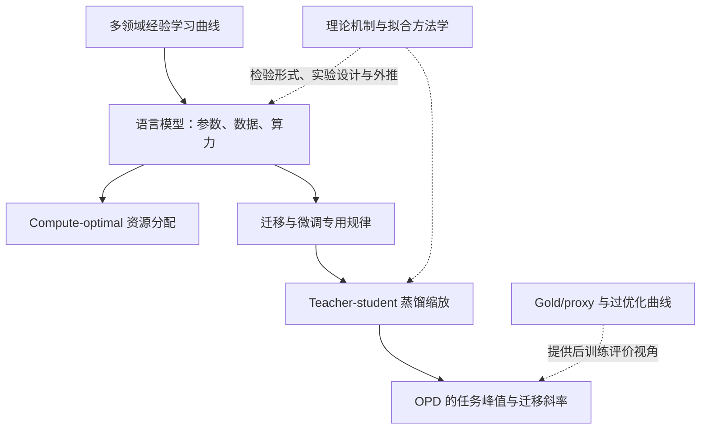

# 缩放律拟合：历史、方法与蒸馏应用

更新时间：2026-10-31。本页围绕“训练一些小模型，拟合公式，再预测其他配置”这类研究展开：公式如何提出，predicted 如何得到，如何验证外推，以及这些方法怎样延伸到微调、蒸馏和 OPD。核心选取 13 篇论文，另将 reward/gold 分支接到[既有历史调研](2026-10-31-Gold-score的来源与奖励过优化研究脉络.md)。

本文从现代深度学习的经验缩放研究讲起，不声称幂律或学习曲线始于 2017，也不将所有工作画成严格的引用关系。精确 ID 检索完整记录见[原始检索](sources/scaling-fit-history-20261031/完整原始检索.md)，核验深度与来源见[清单](sources/scaling-fit-history-20261031/reviewed-sources.json)。

## 1. 这种论文究竟在拟合什么

先把一个训练实验记成一行：

$$
x_i=(N_i,D_i,C_i,\text{方法、数据分布、teacher 等}),\qquad y_i=\text{实际评价量}.
$$

研究者提出一个参数化函数 $f(x;\phi)$，用部分已完成实验估计系数 $\widehat\phi$，再得到

$$
\widehat y_i=f(x_i;\widehat\phi).
$$

$\widehat y_i$ 就是图中的 predicted。它是一个统计公式的输出，目标可以是验证交叉熵、分类错误率、任务峰值、早期斜率或推理预算收益；不是默认指 LLM 自己预测的 token。

一个完整研究需要同时给出四件东西：**实验设计、候选函数、参数估计、留出验证**。只有函数和一张贴近对角线的图，还不能判断是否能预测没训练过的大模型。

## 2. 发展脉络：从经验学习曲线到专用拟合

| 时间       | 工作                    | 主要预测对象               | 在方法上的推进                          |
| ---------- | ----------------------- | -------------------------- | --------------------------------------- |
| 2017       | Hestness 等             | 数据增长下的泛化误差       | 多领域的幂律经验测量                    |
| 2019／2020 | Rosenfeld 等            | 模型和数据共同缩放的误差   | 从小规模实验构造大规模性能预测          |
| 2020       | Kaplan 等               | 语言模型交叉熵             | 参数、数据、计算量与资源分配            |
| 2020       | Henighan 等             | 多模态自回归交叉熵         | 区分可约损失和常数项                    |
| 2021       | Hernandez 等            | 迁移后的性能／有效数据量   | 用等效数据量刻画预训练迁移              |
| 2021／2024 | Bahri 等                | 数据／模型缩放指数         | 对不同缩放机制给出理论解释              |
| 2022       | Hoffmann 等，Chinchilla | 给定算力下的最优预训练损失 | 改进模型量与 token 量的联合实验         |
| 2022／2023 | Caballero 等            | 跨区间的性能曲线           | 平滑分段幂律与转折                      |
| 2023       | Muennighoff 等          | 数据受限时的损失           | 区分独立数据和重复 token 的价值         |
| 2024       | Zhang 等                | 微调性能                   | 数据、模型和微调方法的联合关系          |
| 2024／2025 | Choshen 等              | 缩放预测本身的误差         | 研究如何选择实验、checkpoint 和拟合方法 |
| 2025       | Busbridge 等            | 蒸馏 student 的验证交叉熵  | 加入 teacher 质量和完整计算成本         |
| 2026       | Bao 等，2609.32722      | OPD 任务峰值与局部迁移斜率 | 将规模／teacher 分数与后训练动态连接    |

这些工作并不是都在预测同一个 $y$。前训练 NLL 的规律不能不经验证就改名为任务 accuracy 的规律，student 对数据的交叉熵也不等于 student 对 teacher 的 KL。[^hestness][^rosenfeld][^kaplan][^henighan][^transfer][^bahri][^chinchilla][^broken][^repeat][^finetune][^guide][^distill][^opd]

图示是阅读路线，不表示每条箭头都对应可确认的直接历史影响。

## 3. 逐篇理解最重要的变化

### 3.1 Hestness：把“更多数据更好”变成可测的曲线

Hestness 等在语言、视觉、语音等领域研究泛化误差随训练数据增长的关系，报告可用幂律描述的区间。其贡献是系统组织规模实验，而不是只展示两个模型的优劣。[^hestness]

对读者而言，应关注：模型是否被充分训练、是否已经变成数据瓶颈、拟合覆盖哪个区间。即使一段近似幂律，也不应把同一指数外推到数据很少或误差饱和的所有区域。

### 3.2 Rosenfeld：联合建模，才能用小实验指导大实验

这项工作同时考虑模型与数据规模，并构造从较小模型／较少数据预测较大规模误差的函数形式。它强调的不仅是存在一条经验曲线，还包括如何指定能达到预测性能的模型配置。[^rosenfeld]

如果只增加数据而让模型规模保持在明显欠拟合区间，测到的是模型瓶颈；如果只增加参数而数据不足，测到的又是另一类瓶颈。联合网格比单一尺度扫描更能识别这些因素。

### 3.3 Kaplan：把预测损失与计算分配连接起来

Kaplan 等以语言模型交叉熵为主要目标，研究参数量、数据量和训练计算量的规律，并据此讨论固定计算预算如何分配。[^kaplan]

这一步让缩放律从描述工具变成训练规划工具：给定预算，选择模型规模、token 数和训练进度。必须同时记住其结论依赖数据分布、训练方式与估计设计，不能把某个指数视作所有语言模型的自然常数。

### 3.4 Henighan：常数项为什么有物理含义

Henighan 等扩展到多类自回归生成任务，使用幂律加常数的形式描述损失。交叉熵可以分为真实分布熵与模型逼近误差，这帮助解释可约损失与极限常数。[^henighan]

这是“拟合误差下限”最清楚的语境之一。但在我们的 teacher-KL 实验中，一个拟合出来的常数还可能来自数值误差、数据覆盖或预算不足，不能直接叫不可约容量下界。

### 3.5 Hernandez：把迁移收益换算成等效数据量

Scaling Laws for Transfer 通过对照从头训练与预训练后微调，把迁移收益表述为：从头训练的模型需要多看多少目标数据，才能达到相似损失。研究在低数据区间分析这个等效数据量与模型及微调数据规模的关系。[^transfer]

它提供了另一种 response variable：不只预测 loss，也能预测“预训练替代了多少目标域数据”。这不是把任意源域样本直接按固定比例折算；折算依赖任务、规模和目标损失。

### 3.6 Bahri：理论解释的是哪些条件下出现某类指数

Bahri 等区分方差受限与分辨率受限等缩放机制，在受控模型中推导并分析数据或模型规模的幂律行为。[^bahri]

理论工作的价值是解释某种机制为何产生某类指数。它不会自动替每篇大模型实证论文证明所拟合指数，也不会让拟合中的常数、训练误差或数据噪声全部消失。阅读时要把理论模型的条件与真实训练过程逐项对应。

### 3.7 Chinchilla：同一种规划问题，实验设计改变了答案

Hoffmann 等用更系统的模型量／token 量组合估计 compute-optimal 训练，使用固定模型量、IsoFLOP 曲线和参数化 loss 拟合等方法相互检查。其结论强调参数量与训练 token 应更均衡地增长。[^chinchilla]

这里最值得学的不是记住一个固定 tokens-per-parameter 数，而是**在同一计算预算下比较不同分配方案**。同样大小的模型如果训练 token 不同，不是只改变模型规模的实验。

论文的参数化形式可概括为

$$
L(N,D)=E+\frac{A}{N^\alpha}+\frac{B}{D^\beta}.
$$

若近似 $C=\kappa ND$，将 $D=C/(\kappa N)$ 代入并最小化：

$$
\alpha AN^{-\alpha}
=\beta B\kappa^\beta N^\beta C^{-\beta},
$$

所以

$$
N_{\mathrm{opt}}\propto C^{\beta/(\alpha+\beta)},\qquad
D_{\mathrm{opt}}\propto C^{\alpha/(\alpha+\beta)}.
$$

这展示了“拟合损失函数→解优化问题→得到资源分配”的逻辑。两指数接近时得到近似对半的算力增长分配；它不是无需实验就能设定的普遍前提。这个推导也只考虑此处的训练成本近似，不自动计入推理或 teacher 成本。

### 3.8 Broken Neural Scaling Laws：转折不应全当作异常值

Caballero 等使用平滑分段幂律，描述随规模变化时斜率改变、转折甚至非单调的现象。[^broken]

它提醒我们，单一直线在 log-log 坐标上拟合差，可能因为机制发生变化，而不一定是几个“坏实验”需要删掉。另一方面，增加转折与自由参数会提高拟合能力，也更需要留出验证和参数可识别性检查。

### 3.9 数据受限缩放：重复 token 不能一直等同于新 token

Muennighoff 等显式改变重复次数与计算量，为数据受限训练建模，研究重复数据的边际价值如何下降。[^repeat]

对我们最直接的启发是分别记账独立题数、独立轨迹和累计优化 token。不能将同一批轨迹 reuse16 等同于获得 16 倍独立数据。论文在预训练中的具体重复收益也不能直接搬到我们的短程蒸馏。

### 3.10 微调缩放：乘法式也有任务依赖

Zhang 等比较 full-model tuning 与参数高效微调，在翻译、摘要等任务上研究模型、预训练数据、微调数据和新增参数的影响，并讨论乘法式联合关系。[^finetune]

这说明预训练之后仍能研究规模规律，但需要换成合适的任务、变量和训练方法。方法之间的最优区间可能不同，不能先假设同一套指数同时覆盖 full fine-tuning、LoRA 和不同来源 teacher。

### 3.11 Hitchhiker’s Guide：怎样拟合，比选一个漂亮公式更重要

Choshen 等汇集多模型家族的训练记录，研究缩放估计可靠性、模型和 checkpoint 的选择、拟合求解及留出预测。原文报告中间 checkpoint 能帮助估计，但 seed 波动和实验组合会影响预测稳定性。[^guide]

这里有一个容易混淆的点：**中间 checkpoint 可作为拟合信息，不等于可以把同一 run 的 checkpoint 随机拆进训练和测试后宣称外推成功。** 选择哪些观测用于拟合，与用什么独立对象验证，是两个问题。

该文比较了平方损失与 Huber 等选择。我们应报告自己的 residual 在哪个尺度、如何加权、如何求解，而不是仅写“用 curve fitting 得到缩放律”。它也不支持“一条 run 就能自由识别全部参数”；借用其他家族的系数是一种额外先验。

### 3.12 Distillation Scaling Laws：teacher 质量与成本进入模型

Busbridge 等把蒸馏 student 的验证交叉熵写成 student 规模、蒸馏 token 和 teacher 质量等变量的函数，并区分 teacher 已存在、需要训练、是否计入 teacher 推理成本等情形。[^distill]

其预测目标是 student 对真实数据的交叉熵，不是 student 对 teacher 的 KL。论文的符号表对此有明确区分。对我们的研究，这意味着“蒸馏缩放”这个标题也不能保证其结论直接回答完全拟合问题。

更完整的成本还会改变最优 teacher 选择。一个更大 teacher 即使在等 student 更新数下更有效，也可能因为评分更贵，在等总算力下失去优势。比较现成 teacher 与需要从头训练的 teacher，还应把可摊销成本分开。

### 3.13 2609.32722：预测任务峰值与早期迁移斜率

Bao 等将同家族 OPD 网格概括为峰值 $G_{\mathrm{peak}}$ 和早期斜率 $m$，再用师生规模与 teacher 分数拟合，并另外检查留尺寸预测。[^opd]

它把两个传统连接起来：一边是资源与模型规模的经验规律，另一边是 gold/proxy 与 KL 位移坐标下的后训练动态。这里 $m$ 本身已经是一次曲线拟合的结果，随后又成为第二次缩放拟合的响应量，不能当作无噪声的原始观测。

详细的 predicted 计算、四个面板和留出验证见[单篇笔记 §5.2–5.4](2026-10-31-同家族OPD缩放规律精读与实验启发.md)。奖励模型过优化、DPO 与 teacher hacking 的另一条历史线由[gold score 调研](2026-10-31-Gold-score的来源与奖励过优化研究脉络.md)维护，避免在两处重复完整正文。

## 4. 公式形式怎样理解

### 4.1 单幂律：固定比例的规模增长带来固定比例的剩余误差变化

对 $e(N)=AN^{-\alpha}$，有

$$
\frac{e(cN)}{e(N)}=c^{-\alpha},\qquad
\frac{\partial\log e}{\partial\log N}=-\alpha.
$$

如果只是有限区间里导数近似常数，也会出现近似幂律。经验拟合本身没有证明所有区间都保持该导数。

### 4.2 加法式与乘法式不是换一种写法

加法式 $e=A N^{-\alpha}+B D^{-\beta}$ 表达两类残差分别贡献，固定其中一个变量时，另一项形成暂时的平台。

乘法式 $e=A N^{-\alpha}D^{-\beta}$ 表达一个因素按比例改变另一个因素留下的误差。它包含交互，也意味着某一变量无限增长时能将整个表达式压向零。

两种形式的外推含义不同。应由实验、变量含义、约束与留出误差共同决定，不能只因某一种更容易拟合就把它当成机制证明。

### 4.3 常数项与封顶变量都属于假设

$e=e_\infty+AN^{-\alpha}$ 中的 $e_\infty$ 可能对应不可约误差，也可能只是当前数据支持不了更复杂的变化。

$\min(N_T,N_S)$ 则预先表达 teacher 超过某个尺度后不再增加该协变量。它可以是有用近似，但其预测无法分辨所有更大 teacher 的差异。不能把封顶写进模型，再用拟合结果证明容量边界恰好发生在封顶处。

### 4.4 对数变换改变了误差模型

拟合

$$
\sum_i(y_i-\widehat y_i)^2
$$

更关注绝对偏差；拟合

$$
\sum_i(\log y_i-\log\widehat y_i)^2
$$

更关注相对偏差。若假设 log-error 的噪声是高斯，指数变换后的中心对应几何尺度；它不自动等于原始尺度的条件均值，可能需要校准。

$y_i=0$、accuracy 为 1、初始斜率为零或负数时，某些对数模型没有定义。不能静默加 epsilon 或删掉这些 run；处理规则会改变拟合对象，必须预先说明。

## 5. 一份可信的拟合研究应该怎样做

### 5.1 从完整 run 提取响应量

先明确预测对象是固定预算终点、整条曲线、观测峰值还是斜率。峰值包含 checkpoint 选择，斜率包含窗口和一次回归；这些中间估计的误差会传入后续拟合。

论文中的 teacher 分数本身也由有限样本测得。将其当作完全准确的协变量，可能低估不确定性；需要保存样本量、采样设置和复测证据。

### 5.2 设计能拆开变量的实验

以联合 teacher 公式为例：

$$
\log e=\log A-\alpha\log N_S-\beta\log N_T+\zeta\log e_T.
$$

若实验中近似存在 $\log e_T=a+b\log N_T$，则

$$
\log e\approx(\log A+\zeta a)-\alpha\log N_S+(-\beta+b\zeta)\log N_T.
$$

数据主要识别的是组合 $-\beta+b\zeta$，不一定能单独识别 $\beta$ 和 $\zeta$。在原趋势上再加很多点，仍可能没有解决问题。更有信息的实验是相同尺寸不同训练阶段、分数相近不同尺寸，或明确构造来源变化的对照。

这也说明“系数不稳定但预测还不错”并不矛盾。若关心因果机制，只有预测准确不够。

### 5.3 把函数选择、系数拟合和测试隔开

| 数据用途             | 可做的事                     | 不应泄漏的事                             |
| -------------------- | ---------------------------- | ---------------------------------------- |
| 拟合集               | 估计系数                     | 不预先使用测试目标                       |
| 选择集／内部交叉验证 | 选函数形式、窗口、正则、权重 | 不能反复根据最终外推成绩调参             |
| 最后留出配置         | 检验未见尺寸／来源           | 看结果后改公式再把同一结果称独立验证     |
| 独立 seed／确认题集  | 检查实验可重复性及评分噪声   | 不能用大量同 run checkpoint 冒充重复实验 |

若数据很少，可以用嵌套的分组交叉验证；但要明确哪个层级承担模型选择，哪个层级承担最后评估。

### 5.4 同时报告拟合和预测误差

全样本 $R^2$ 描述函数对已有数据的解释程度。RMSE、相对误差和留组误差则回答不同的问题。特别是 RKL／accuracy、峰值／斜率的单位不同，不能把原始 RMSE 直接跨目标比较。

除一张 predicted–observed 图外，还应看 residual 随规模、teacher 来源、训练预算的变化。若小 student 系统性被高估，而大 student 系统性被低估，整体高 $R^2$ 可能掩盖了结构性误差。

### 5.5 区分三种不确定性

- 系数不确定性：在拟合数据变化时，指数和截距是否稳定。
- 新 run 的预测不确定性：包括未解释残差、训练 seed 和优化波动。
- 评价测量不确定性：有限 prompt 和采样回答造成的分数噪声。

按模型 pair 做 bootstrap 不等于按训练 seed 重复；只给系数区间，也不等于给一个未来模型的预测区间。

## 6. 如何应用到我们的实验

当前研究最想预测的是 teacher 拟合残差与跨状态泛化，不是预训练 NLL，也不是所有曲线的最高 acc。应先定义统一的输出：

- 指定更新点、指定银行上的绝对 RKL／FKL；
- 相对初始的降幅；
- 固定 state 与 current-state 风险的差异；
- 如需斜率，明确是对 updates、token 预算还是策略位移求斜率。

输入也要固定语义：师生尺寸、输入模式、共同词表支持、teacher 来源、训练题覆盖与数值路径。不同模型家族可以先分层描述，不能先把“同尺寸／跨尺寸／SFT／RL”压成一个主观异源分数，再拟合一条看似精确的曲线。

我们现在只有少量 student 尺寸，而 teacher 的来源差异很大。与其立即报告一个“OPD scaling law”，更有价值的第一步是：检查哪些因素在受控对照下稳定解释残差，建立简单基线，留出完整 teacher 配对验证。若简单模型已经能解释结果，再决定更复杂形式是否带来真实预测收益。

## 7. 建议阅读顺序

1. Hestness 与 Rosenfeld：理解学习曲线和联合模型／数据设计。
2. Kaplan 与 Chinchilla：理解“拟合损失→选择资源配置”，并比较实验设计如何影响结论。
3. Choshen：理解拟合方法本身的可靠性和实际误差。
4. Busbridge：理解 teacher/student、teacher 质量与成本怎样进入蒸馏模型。
5. Zhang 与 Hernandez：理解迁移、微调的 response variable 为什么不同。
6. Bao：回到 OPD 的任务峰值、早期斜率和 predicted 图。
7. Bahri 与 Broken Neural Scaling Laws：分别看理论机制与跨区间函数形式；不要把两者当成同一种证据。

### 参考文献

[^hestness]: Hestness et al. Deep Learning Scaling is Predictable, Empirically. arXiv:1712.00409v1, 2017. [原文](https://arxiv.org/abs/1712.00409v1)。

[^rosenfeld]: Rosenfeld et al. A Constructive Prediction of the Generalization Error Across Scales. 2019 预印本／ICLR 2020，arXiv:1909.12673v2. [原文](https://arxiv.org/abs/1909.12673v2)。

[^kaplan]: Kaplan et al. Scaling Laws for Neural Language Models. arXiv:2001.08361v1, 2020. [原文](https://arxiv.org/abs/2001.08361v1)。

[^henighan]: Henighan et al. Scaling Laws for Autoregressive Generative Modeling. arXiv:2010.14701v2, 2020. [原文](https://arxiv.org/abs/2010.14701v2)。

[^transfer]: Hernandez et al. Scaling Laws for Transfer. arXiv:2102.01293, 2021. [原文](https://arxiv.org/abs/2102.01293)。

[^bahri]: Bahri et al. Explaining Neural Scaling Laws. 2021 预印本／PNAS 2024，arXiv:2102.06701. [作者机构页面](https://research.google/pubs/explaining-neural-scaling-laws/)、[期刊正文](https://pmc.ncbi.nlm.nih.gov/articles/PMC11228526/)。

[^chinchilla]: Hoffmann et al. Training Compute-Optimal Large Language Models. arXiv:2203.15556v1, 2022. [§3、附录 D](https://arxiv.org/html/2203.15556v1)。

[^broken]: Caballero et al. Broken Neural Scaling Laws. 2022 预印本，核对 arXiv:2210.14891v17, 2023. [原文](https://arxiv.org/abs/2210.14891v17)。

[^repeat]: Muennighoff et al. Scaling Data-Constrained Language Models. NeurIPS 2023，arXiv:2305.16264. [会议正文](https://papers.nips.cc/paper_files/paper/2023/file/9d89448b63ce1e2e8dc7af72c984c196-Paper-Conference.pdf)。

[^finetune]: Zhang et al. When Scaling Meets LLM Finetuning: The Effect of Data, Model and Finetuning Method. ICLR 2024，arXiv:2402.17193v1. [§3–5](https://arxiv.org/html/2402.17193v1)。

[^guide]: Choshen, Zhang, Andreas. A Hitchhiker’s Guide to Scaling Law Estimation. 2024 预印本／ICML 2025，arXiv:2410.11840v2. [§3–9](https://arxiv.org/html/2410.11840v2)。

[^distill]: Busbridge et al. Distillation Scaling Laws. ICML 2025，arXiv:2502.08606. [§2–5、附录 F](https://arxiv.org/html/2502.08606)、[会议记录](https://proceedings.mlr.press/v267/busbridge25a.html)。

[^opd]: Bao et al. Scaling Properties of Same-Family On-Policy Distillation. arXiv:2609.32722v1, 2026. [§5、附录 H](https://arxiv.org/html/2609.32722v1)。
