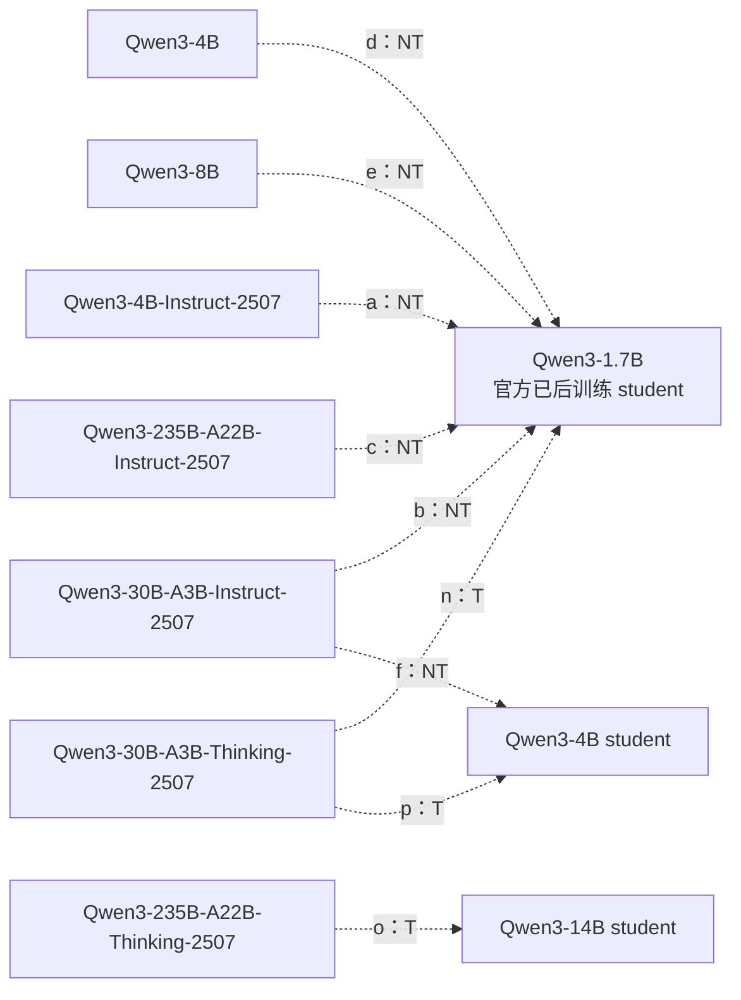
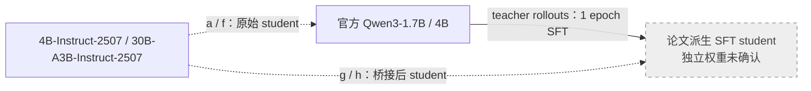

# 论文配对证据与历史模型选型

本文保留 2026-10-28 调研中的论文配对数据、控制条件与候选优先级。优先级和“拟测／暂缓”只描述当时的设计，后续执行状态由实际实验报告维护。公开模型的来源、SFT／RL 训练链和本项目使用入口统一见[模型来源、训练阶段与师生配对](../../settings/模型与师生配对.md)。

原调研从 2608.16647、2610.11291 的模型表出发，覆盖[92 个 HF 仓库](sources/model-registry.csv)，Nemotron 三个固定版本另表登记；该数量包含候选，不表示本项目下载或训练数量。[F1–F18 配对表](../../settings/teacher-transfer/settings.csv)保留原设计。原始模型卡、CSV 和来源快照保持冻结。

## Semi-OPD 的 Qwen3 配对

以下全部虚线都是 **teacher → student**，不是权重谱系。论文的 Qwen3-1.7B/4B/14B student 指官方已后训练模型，不能换成 Base。2507 版本也不画成 April 发布权重的确定后代：模型名相似不足以确认具体初始化。[^semi]

其中 T/NT 是论文的 thinking/non-thinking 运行模式；NT 行训练 response cap 为 4K，T 行为 16K。不同模式不是仅靠模型名称就完全确定的，需要保存 chat template、控制 token、停止条件与采样参数。

最值得复用的是小 student 的六教师矩阵：固定 Qwen3-1.7B，先测普通 4B/8B，再测 2507 的 4B-Instruct 与 30B MoE。它覆盖连续的实际分布差距，而不需要先跑 235B。30B-A3B 的激活参数小，并不意味着教师权重显存只按 3B 计算。

## Semi-OPD 的 17 组配对与证据边界

已将附录表 3 的全部 17 组转为[机器可读 CSV](sources/semi-opd-17-pairs.csv)与 [JSON](sources/semi-opd-17-pairs.json)，包括论文 ID、确切模型链接、模式、长度、初始 overlap、末步和 AUC 差值。完整数据比只摘“跨家族有效”更有用。成绩是四项 benchmark 的 avg@32 均值，不是单独 MATH；AUC 已按共同评测步数跨度归一化。除 q 使用 40,960-token 评测上限外，其余配对为 32,768；该评测上限与表中训练 cap 分开记录。[^semi]

| 配对                                          | 初始 top-64 overlap | Semi-OPD − OPD 末步 / AUC（百分点） | 对本问题的价值                                  |
| --------------------------------------------- | ------------------- | ----------------------------------- | ----------------------------------------------- |
| JustRL-1.5B → R1-1.5B（i）                    | 79.7%               | +1.4 / −1.36                        | 同源基准；末步与全过程结论不同                  |
| Polaris-7B → R1-1.5B（j）                     | 69.7%               | +0.1 / +0.24                        | 与 E48 相同模型组合；论文没有显示很大的修复收益 |
| Polaris-7B → R1-7B（k）                       | 86.8%               | −2.6 / −0.68                        | 同一教师、直接祖先学生；教师质量可固定          |
| Light-R1-14B → R1-7B（l）                     | 72.0%               | −1.7 / −0.30                        | 大教师额外 SFT 与数学 RL 增量                   |
| DeepCoder-14B → R1-7B（m）                    | 73.9%               | +1.5 / +0.97                        | 与上一行共同 14B 初始化，换后训练领域           |
| Qwen3-4B-Instruct-2507 → Qwen3-1.7B（a）      | 62.5%               | +9.5 / +7.09                        | 小学生、明显分布差距的低成本补充                |
| Qwen3-30B-A3B-Thinking-2507 → Qwen3-1.7B（n） | 58.9%               | +9.4 / +7.57                        | 更大差距下的候选；同时改变 size、MoE、阶段      |
| Cascade-2 Math-Expert → Cascade-2（q）        | 89.3%               | −0.1 / +0.09                        | 高 overlap 的参考；专家权重未确认公开           |

**这些差值是两种训练方法的差，不是“学生学会教师多少”的指标。**Overlap 是论文特定位置分布下的 top-64 集合重叠；2608 使用的 top-16 指标不能与之直接并列排名，更不能代替 full-vocab KL、teacher 残差投影或 Jacobian 谱。

本仓 E48 学不动，并不意味着加入 teacher rollouts 就会解决：对应论文 j 的收益很小。更合理的用途是借它的模型矩阵找“同一训练算法，在哪些实际差距下失效”，再用冻结前缀、局部更新和留出批次测量机制。

### 一轮 SFT 的桥接 student

论文 g/h 从官方 student 先在 teacher rollouts 上训练一轮，再比较 OPD/Semi-OPD。表中的 HF 链接仍指原始模型，不是这个派生 checkpoint。[^semi]

这可转化为我们的机制干预：固定同一个 teacher，轻量改变 student 后，重新测残差投影和跨 batch 改善。不过桥接同时改变能力、格式和 prefix 分布；需要在固定 S0 银行与新 student 自然 rollout 两套输入上分别评分。论文中一轮 SFT 虽提高 overlap，却常降低后续最终表现，因此不能把“更相似”直接当作“更好迁移”。

表 3 的每行两种方法训练 cap 匹配；其他速度表有 OPD 16K 对 Semi-OPD 4K 的比较，不能移用为等长度加速比。其 DAPO 预处理后为 14,116 条英文唯一题目，与本仓 17,917 条记录也不是同一个训练清单。

## 2026-10-28 候选设计与控制条件

### 当时的候选优先级

| 优先级 | 固定 student 与新增 teacher                                           | 真正回答的问题                         | 必要配套                                                         |
| ------ | --------------------------------------------------------------------- | -------------------------------------- | ---------------------------------------------------------------- |
| P1     | R1-1.5B ← Nemotron v1/v2/brorl                                        | 同源但训练路径更远，是否也发生迁移困难 | 同协议 teacher 成绩、初始 KL、长度、局部/留出收益；固定 revision |
| P1     | 原有 R1-1.5B ← MiniMath、R1-7B、Polaris、Light-R1-7B                  | SFT vs RL，以及跨尺寸底座与后训练增量  | 保留 E20，先测 R1-7B 这个起点                                    |
| P2     | Qwen3-1.7B ← 官方 4B/8B、4B-Instruct-2507                             | 在小 student 上复核论文的不同分布距离  | 官方 post-trained student，NT 模式、共同 cap；先验收新增模型接口 |
| P2     | Qwen3-4B-Base ← General-Reasoner、Thinking-Space GRPO、Rethinking SFT | 同 Base 的 RL 数据分支与 SFT 分支      | 分开 RL 数据与算法，不把终点差异写成纯 RL/SFT 因果效应           |
| P2     | Qwen3-4B ← Polaris-4B                                                 | 官方已后训练 student 的直接 RL teacher | 与上一行分组，不能偷换 student                                   |
| P3     | R1-7B ← R1-14B、Light-R1-14B、DeepCoder-14B                           | 相同大底座，数学/代码增量如何迁移      | 代码及数学双域测量，7B student 成本更高                          |
| 扩展   | Marin/Tulu、Olmo Hybrid、DeepSeekMath                                 | 独立预训练、架构差异、跨家族复核       | 单独学生体系与后端适配                                           |

新增设置已作为 F1–F18 写入 [settings.csv](../../settings/teacher-transfer/settings.csv)。这份 CSV 是候选设计，不是可直接启动的脚本：没有把 teacher 路径、硬件与模板未经验收写进训练预设。

### Filter 假说的判别条件

“同源程度”使用三套独立标签：**训练谱系、结构差异、输入条件下的功能差距**。不要把它们加成一个未经校准的序号。固定 student 后，才有同一个学生局部核，可以比较不同 teacher 的目标残差是否投向快/慢学习方向。

建议先讨论一个小矩阵：R1-1.5B 固定 student，JustRL、MiniMath、Polaris、R1-7B、Nemotron 三版本作为 teacher；之后选一个 Qwen3 组复核。每个 teacher 测共同 S0 前缀上的初始分布、teacher 能力和训练长度，再按相同局部拟合改善程度比较 held-out batch 收益。若使用 loss-gradient Gram 而非完整输出 Jacobian，必须沿用[谱诊断文档](../../experiments/teacher-transfer/mechanisms/spectral.md)的代理指标限定，不能称作完整 NTK 特征谱。

可判别的结果包括：①优化不下去且大部分残差落在慢方向；②当前 batch 优化得下去但其他 batch 不受益；③跨 batch KL 改善但任务能力不涨。这三种失败需要不同解释。模型族图只是帮助选择对照，不能单独证明 filter 机制。

KL 方向维持现有 full-vocab 设置，不作为这轮主要自变量。不同 teacher 的收益应相对各自同协议能力增量报告；不拿不同论文的 MATH 成绩直接排序，也不将小分母的能力回收率作为唯一结论。

## 2026-10-28 候选池及当时的暂缓原因

下表保留 2026-10-28 的选型理由；后续已经使用的模型以[统一模型介绍](../../settings/模型与师生配对.md)和实验报告为准。这些暂缓原因不构成当前排期。

| 候选或配方                                    | 暂缓原因                                                            | 后续可利用方式与来源                                                                                                                         |
| --------------------------------------------- | ------------------------------------------------------------------- | -------------------------------------------------------------------------------------------------------------------------------------------- |
| Qwen3-235B-A22B-Instruct-2507 / Thinking-2507 | 教师显存和推理成本大；多种因素同时变化                              | Semi-OPD c/o 已测，作为低 overlap 的大规模外推组；Instruct[^candidate-source-1]、Thinking[^candidate-source-2]                               |
| Qwen3-30B-A3B-Instruct-2507 / Thinking-2507   | MoE 总权重约 30B，不能按 3B 估计部署成本                            | 先复核 b/n，再考虑 235B；Instruct[^candidate-source-3]、Thinking[^candidate-source-4]                                                        |
| DeepSeek-R1-0528-Qwen3-8B                     | 相对 Qwen3 Base 的两个共享 token ID 冲突                            | 不同 trace teacher 的 SFT 来源对照；模型[^candidate-source-5]                                                                                |
| Nemotron-Cascade-2-30B-A3B                    | `model_type=nemotron_h`，Hybrid 架构和不同 tokenizer；不是 Qwen MoE | 研究 SFT、CascadeRL、多领域 OPD 的组合；公开模型来自 Nemotron-3-Nano-30B-A3B-Base-BF16；模型[^candidate-source-6]、论文[^candidate-source-7] |
| Cascade-2 Math-Expert                         | Semi-OPD 表 3 没有精确 HF 链接，本次未确认独立公开 artifact         | 借鉴共同 SFT 初始化、选中间领域专家的 recipe；公开 Cascade-2 最终模型与该专家身份不同。论文 q 的 89.3% overlap 仅作背景                      |
| Dev-1.5B、2608 Qwen3-8B-SFT                   | 论文派生 checkpoint 未确认独立发布                                  | 分别复用短程 OPD 改变 student、OpenThoughts3 SFT 改变 student 的设计；见 2608 表 3                                                           |
| Semi-OPD 的 Qwen3-1.7B/4B `(SFT)`             | 原始模型链接不是一轮 SFT 后的权重                                   | 保留 g/h 的桥接对照配方，不登记为另一个可下载 repo                                                                                           |
| 其他论文中未给出精确发布链接的 Qwen3-GRPO     | 名称不足以和 Thinking-Space、General-Reasoner 对号入座              | 如 2607.13399 的相关设置，需先追到训练 recipe/作者 artifact；论文[^candidate-source-8]                                                       |
| OpenMath-Nemotron-7B                          | 与 R1-7B 同 Math 基座的较早分叉，仍需接口验收                       | 为 2608 的同规模分支对照补齐；模型[^candidate-source-9]                                                                                      |
| OpenThinker / OpenThinker2 7B、32B            | 更大成本，不与前两代数据混成一组                                    | 同一公开 SFT 数据配对；数据论文[^candidate-source-10]、OpenThinker2-7B[^candidate-source-11]、32B[^candidate-source-12]                      |
| Tulu3-70B、Marin-8B、Olmo/Hybrid              | 独立学生体系；成本、上下文和接口控制更多                            | 独立预训练/公开阶段/Hybrid 结构复核；见[模型来源](../../settings/模型与师生配对.md)与原报告                                                  |
| Llama3.1-Mamba2-8B-distill、Llamba-8B         | 自定义加载器，不能仅看 config 中的 llama 标签                       | 跨架构蒸馏；不是独立初始化对照；Mamba-in-Llama[^candidate-source-13]、Llamba[^candidate-source-14]                                           |
| DeepSeekMath Base/Instruct/RL                 | 新 tokenizer 与 teacher 后端路径需验证                              | 完整 CPT→SFT→GRPO 阶段复核；Base[^candidate-source-15]、Instruct[^candidate-source-16]、RL[^candidate-source-17]                             |
| Falcon-H1                                     | 未满足现有 Qwen 的同 tokenizer 条件                                 | Hybrid 架构文献参考，不强行列为同接口教师；论文[^candidate-source-18]                                                                        |

核对范围：保留 2608 表 3 的 [17 条模型角色记录](sources/coin-paper-lineages.json)、2610 表 3 的 17 个配对，以及当前 92 个仓库的配置与元数据。新增模型仅按实际核对范围报告 token 映射，不把“有 config 和权重”写成“已跑通”。旧失败复现文档中 Qwen3/MoE 尚未支持的说明是当时的工程状态；当前 `hidden.py` 已包含 qwen3/qwen3_moe 路径，但具体配置仍需 smoke test。

原始检索输出见[本轮完整记录](sources/2026-10-28-图谱扩展完整检索记录.md)，包含 21 条去重检索结果，本轮检索无错误诊断。该检索记录不是人工推荐表，也不以搜索未命中证明权重不存在。

### 参考文献

[^semi]: _When Do We Need On-Policy Distillation? Distilling on Offline Student Rollouts Is Often Better_（Semi-OPD）. [2610.11291v1](https://arxiv.org/abs/2610.11291v1)，[附录表 3](https://arxiv.org/html/2610.11291v1#A1.T3)、SFT warm-start 与速度比较部分。数值均来自表 3，正号表示 Semi-OPD 高于 OPD。

[^candidate-source-1]: Instruct. [公开来源](https://huggingface.co/Qwen/Qwen3-235B-A22B-Instruct-2507)。

[^candidate-source-2]: Thinking. [公开来源](https://huggingface.co/Qwen/Qwen3-235B-A22B-Thinking-2507)。

[^candidate-source-3]: Instruct. [公开来源](https://huggingface.co/Qwen/Qwen3-30B-A3B-Instruct-2507)。

[^candidate-source-4]: Thinking. [公开来源](https://huggingface.co/Qwen/Qwen3-30B-A3B-Thinking-2507)。

[^candidate-source-5]: 模型。[公开来源](https://huggingface.co/deepseek-ai/DeepSeek-R1-0528-Qwen3-8B)。

[^candidate-source-6]: 模型。[公开来源](https://huggingface.co/nvidia/Nemotron-Cascade-2-30B-A3B)。

[^candidate-source-7]: 论文。[公开来源](https://arxiv.org/abs/2603.19220)。

[^candidate-source-8]: 论文。[公开来源](https://arxiv.org/abs/2607.13399)。

[^candidate-source-9]: 模型。[公开来源](https://huggingface.co/nvidia/OpenMath-Nemotron-7B)。

[^candidate-source-10]: 数据论文。[公开来源](https://arxiv.org/abs/2506.04178)。

[^candidate-source-11]: OpenThinker2-7B. [公开来源](https://huggingface.co/open-thoughts/OpenThinker2-7B)。

[^candidate-source-12]: 32B. [公开来源](https://huggingface.co/open-thoughts/OpenThinker2-32B)。

[^candidate-source-13]: Mamba-in-Llama. [公开来源](https://arxiv.org/abs/2408.15237)。

[^candidate-source-14]: Llamba. [公开来源](https://arxiv.org/abs/2502.14458)。

[^candidate-source-15]: Base. [公开来源](https://huggingface.co/deepseek-ai/deepseek-math-7b-base)。

[^candidate-source-16]: Instruct. [公开来源](https://huggingface.co/deepseek-ai/deepseek-math-7b-instruct)。

[^candidate-source-17]: RL. [公开来源](https://huggingface.co/deepseek-ai/deepseek-math-7b-rl)。

[^candidate-source-18]: 论文。[公开来源](https://arxiv.org/abs/2507.22448)。
