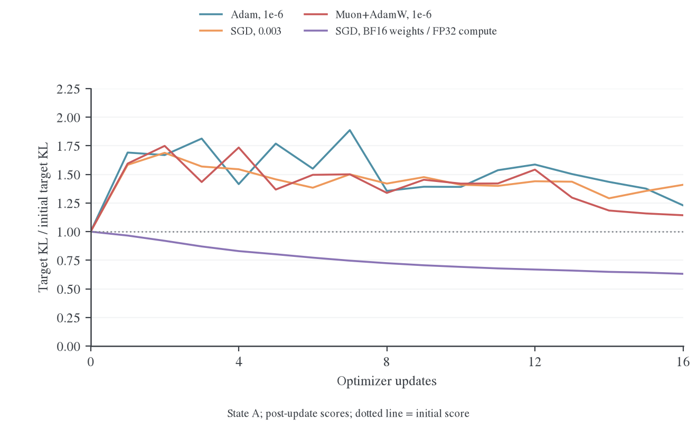
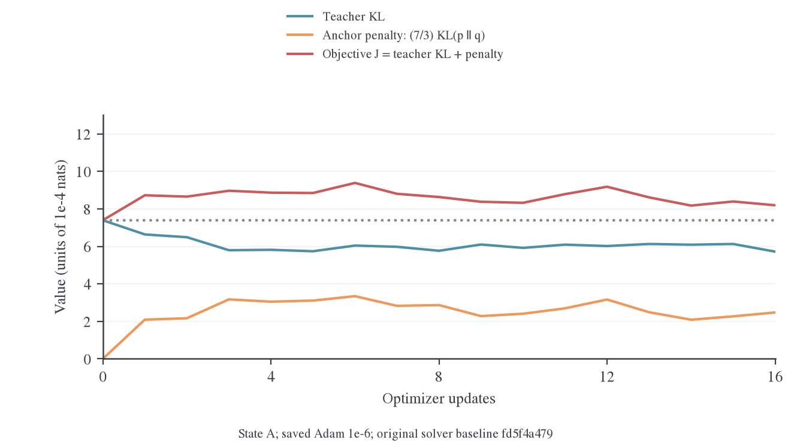
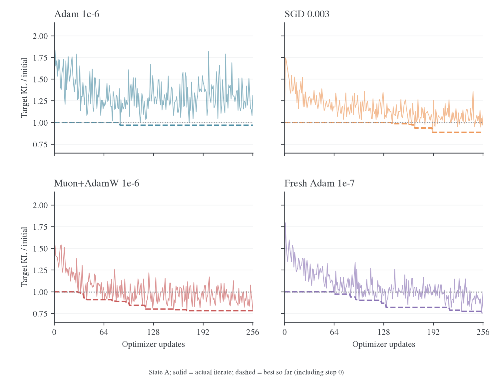
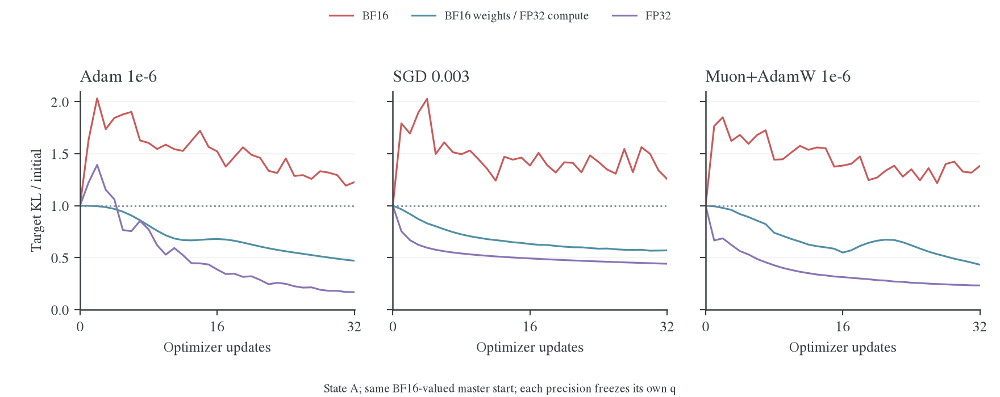
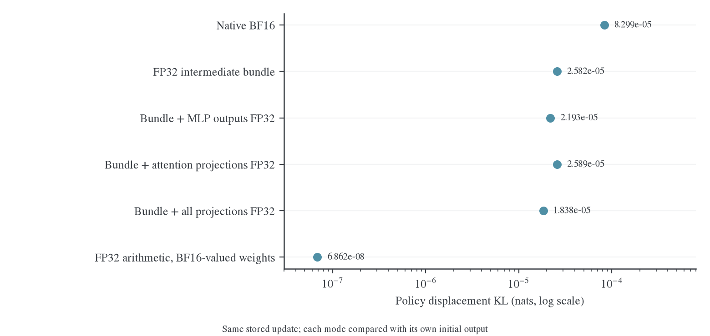

# MDPO 反弹机制与浮点精度研究报告

本文面向需要理解算法、核对实现并设计下一轮实验的同行。讨论对象是固定前缀上的 full-vocab MDPO：内层复用同一批数据，旧策略和教师保持冻结，但更新后的 target KL 经常高于更新前。报告把本机证据、浮点误差分析和相关论文／issue／PR 放在同一条论证线上。

报告更新于 2026-10-27。实验基线为 `fd5f4a479`，输出层数值修复后的集成复查为 `f2b0b3c01`，数据已随 `f4dc9440a` 合入。后文图表直接读取已归档结果；这里新增的是图表、文献核对和 CPU 数据类型语义检查，没有新增 GPU 训练，也没有修改生产默认配置。

## 1. 主要判断与证据范围

已经确认一个关键机制：保持同一份参数更新与相同的 BF16 权重值，改变前向算术，会大幅改变实际策略位移。低精度中间计算使接近目标时的内层求解更加困难。Adam 历史、学习率、求解预算和返回哪个迭代点也会影响结果。

当前证据尚未把问题归于单一算子，也没有直接测量整个 backbone 的反向梯度误差。因此，“梯度预测与实际策略变化不一致”是受到实验支持的机制解释；它还需要方向导数和实际 attention backward 的对照，才能定位到具体计算环节。

| 判断 | 证据强度与含义 |
| --- | --- |
| 输出目标和梯度实现曾存在数值缺陷 | 已复现、修复并验证；修复后的真实模型仍反弹 |
| Adam 历史是唯一原因 | SGD、重新初始化 Adam、Muon 的短内层对照不支持这一解释 |
| 前向算术是关键影响因素 | 固定参数位移的直接干预支持；改变前向时没有重新计算 optimizer 更新 |
| BF16 下目标存在绝对不可突破的下限 | 长预算 Adam／Muon 找到了更好点，不支持这一判断 |
| 返回最后一步会丢失已有改善 | 已保存并恢复最佳模型及 optimizer 状态验证 |
| 已找到唯一责任层或算子 | 尚缺单因素精度干预和真实 kernel 的反向误差测量 |
| 已解释原 E45/E47 的全部异常 | 原 run 的晚期 checkpoint 和 Adam 状态缺失，不能定量归因 |
| 已找到经过正式训练验收的修复配置 | 尚缺长序列、rollout 一致性、多 seed 和任务分数验证 |

读图时需要区分三个量：**teacher KL** 衡量靠近教师的程度，**anchor KL** 衡量离开旧策略的程度，**target KL** 衡量是否拟合了冻结的 MDPO 目标。教师拟合变好与 MDPO 目标变好不是同一个条件。

## 2. 目标函数与反弹的含义

### 2.1 符号与固定条件

对一个固定前缀，设词表为有限集合，所有分布具有相同支持且概率为正。实验按有效 token 求平均；下面先写单个位置。

| 符号 | 含义 |
| --- | --- |
| $p=p_\theta$ | 当前学生策略 |
| $q=p_{\theta_0}$ | 内层开始时冻结的旧学生策略；称为 anchor |
| $T$ | 冻结教师分布 |
| $\eta$ | MDPO 目标的步长参数；主对照取 0.3 |
| $m$ | 由 $q,T$ 构造的归一化目标分布 |
| $Z$ | 目标的归一化常数，与当前 $\theta$ 无关 |
| $J$ | 最终优化的单位置目标，包含约定的 $1/\eta$ |

本文主要研究 $\kappa=0$。此时

$$
\widetilde m_i=q_i^{1-\eta}T_i^\eta,\qquad
Z=\sum_i\widetilde m_i,\qquad
m_i=\frac{\widetilde m_i}{Z}.
$$

代入 KL 的定义可得

$$
\begin{aligned}
\mathrm{KL}(p\Vert m)
&=\sum_i p_i\left[\log p_i-(1-\eta)\log q_i-\eta\log T_i+\log Z\right]\\
&=(1-\eta)\mathrm{KL}(p\Vert q)+\eta\mathrm{KL}(p\Vert T)+\log Z.
\end{aligned}
$$

生产 loss 保留最终的 $1/\eta$，因此

$$
J(p)=\frac{\mathrm{KL}(p\Vert m)-\log Z}{\eta}
=\mathrm{KL}(p\Vert T)+\left(\frac1\eta-1\right)\mathrm{KL}(p\Vert q).
$$

在同一冻结目标内，$Z$ 和 $\eta>0$ 都不变，比较 $J$ 与比较 target KL 的升降完全等价。不同 outer 的 $q,m,Z$ 会变化，不能把跨 outer 的原始 loss 直接当作同一个函数上的优化轨迹。

### 2.2 接近目标时对更新的要求

在理想可微模型的 $p=q$ 起点，

$$
\begin{aligned}
\nabla_\theta\mathrm{KL}(p_\theta\Vert q)\big|_{\theta_0}
&=\sum_i\nabla_\theta p_i\,[\log(p_i/q_i)+1]\big|_{\theta_0}\\
&=\nabla_\theta\sum_i p_i\big|_{\theta_0}=0.
\end{aligned}
$$

所以，起点的 $\nabla_\theta J$ 等于 teacher KL 的梯度。减小 $\eta$ 不会自动缩小第一步的学习率，却提高了离开 $q$ 的代价。主对照中 $\eta=0.3$，anchor KL 的系数为 $7/3$。

旧参数 $\theta_0$ 本身属于可行集合，因此子问题的全局最优值不会高于 $J(p_{\theta_0})$。返回一个更差的迭代点表明有限步求解没有满足这个基本标准。Mirror descent 的精确最优化结论不能直接应用于这样的返回结果。

对 $\eta=1$，anchor 项消失，普通 Full-KL 只要求改善教师拟合。这解释了同一学习率和 reuse 预算在普通 Full-KL 与 MDPO 上可能表现不同。该推导限定于 $\kappa=0$，不把一般融合教师或 BPO 强行改写成同一公式。

## 3. 实验协议与已经排除的实现问题

### 3.1 两份受控状态

| 条件 | 状态 A | 状态 B |
| --- | --- | --- |
| 模型与硬件 | DeepSeek-R1-Distill-Qwen-1.5B 学生、JustRL-DeepSeek-1.5B 教师；四张 H800；FSDP2 | 相同 |
| 状态来源 | 早期固定前缀训练的 checkpoint，已有 144 次更新及 Adam 状态 | 从初始学生重新做 8 outer × 16 次普通 Full-KL 更新 |
| loss 位置 | 四条数学回答的前 128 个 response 位置 | 相同回答的第 128–255 个位置，输入保留到第 256 个位置 |
| 初始 teacher KL | 7.394e-4 | 5.559e-4 |
| 初始 BF16 target KL | 6.480e-5 | 5.086e-5 |
| 分支恢复 | 每个设置独立恢复模型与原 Adam，再构造对应优化器 | 相同 |

每 rank 一条回答；一个 optimizer update 对应一次完整的四序列更新。图中横轴不是 outer step。两个状态没有构成独立 seed 的统计样本，状态 B 也不等于另一轮正式 on-policy 训练。

多步求解器归档包含 62 个有效分支、3440 次成功更新，另有构造状态 B 的 128 次更新。早期单步、算子与精度探针单独归档，不与上述次数重复累加。七个 pilot 分支因实验脚本重建 scheduler 时误用了 checkpoint 的 `initial_lr` 被排除；对应设置已按实际 LR 重跑。这个工具错误不能用于解释原训练。

### 3.2 算子修复与剩余反弹

| 已核实的问题 | 已完成的处理 | 对当前反弹的解释范围 |
| --- | --- | --- |
| 近目标 KL 梯度的大数相减 | 先消去公共偏移，保留小残差，再中心化；补充主分量重建 | 确实影响算子正确性；修复后仍反弹 |
| MDPO target 小增量编码丢失 | 从原始 logits 保留分离增量，稳定处理目标常数 | 极小距离下重要；不能单独解释当前 $\eta=0.3$ 的现象 |
| BPO 方差与 q 总质量误差 | 归一化权重、稳定均值／方差与 VJP | 属于 BPO 的真实缺陷；不直接进入 MDPO kernel |
| FP16 投影和提前计算的小 VJP | 补齐 FP32 投影／累计与 AMP 缩放前保护 | 为 FP16 对照提供可用链路 |
| GradScaler 跳步计数 | 按实际更新是否执行记账，包括 fused optimizer 的跳步 | 排除把尝试更新误记为成功更新 |
| Sampled CE 的高置信度主梯度丢失 | 稳定 selected-log-prob 与 backward | 与 full-vocab MDPO 的直接目标反传分开 |

保留 BF16 backbone，把 target、行梯度和输出头梯度提高到 FP64 的早期对照仍反弹。后续生产数值修复集成后，Adam／SGD／Muon 的 16 步复查也仍反弹。输出层数值缺陷与 backbone／有限步求解因素需要分别处理。

独立评分使用原生模型投影及 FP64 行归约，并与训练指标按更新前后时间对齐。归档中二者最大绝对差约 4.54e-8，明显小于图中的反弹幅度；目标恒等式最大误差约 1.39e-17。这里的 FP64 指评分行代数，不代表整个模型前向都在 FP64 中执行。

## 4. 优化轨迹提供的证据

### 4.1 短内层下，更换优化器仍会反弹



图 1：数值修复后的生产代码，从状态 A 独立恢复。纵轴是各分支 target KL 除以自身起点；点线 1 表示没有改善。三种 BF16 求解器都高于起点。紫线保留 BF16 权重、提高前向算术精度，使用同一 SGD 学习率。该分支实际运行 32 步，图只取前 16 步以对齐预算。不同精度各自冻结初始 $q$，因此图 1 不是完全相同目标上的前向单因素因果实验；严格固定参数位移的证据见第 5 节。

| 修复后分支 | 初始 target KL | 第 16 次更新后 |
| --- | --- | --- |
| BF16 Adam，1e-6 | 6.480e-5 | 7.968e-5 |
| BF16 SGD，无动量，0.003 | 6.480e-5 | 9.133e-5 |
| BF16 Muon+AdamW，1e-6 | 6.480e-5 | 7.408e-5 |
| BF16 权重、FP32 算术，SGD 0.003 | 6.514e-5 | 4.112e-5 |

更早的 16-setting 扫描覆盖保留状态 Adam、重新初始化 Adam、$\beta_1=0$ 的 Adam、SGD 和 Muon+AdamW 的多个学习率；所有分支的 16 个更新后评分均未低于起点。Muon 对隐藏层二维矩阵使用完整矩阵正交化，embedding/head/norm/bias 使用 AdamW；四进程 CPU 与四卡测试已验证其与原生完整矩阵参考一致。

### 4.2 教师拟合改善仍可能被 anchor 惩罚超过



图 2：状态 A、Adam 1e-6、原求解器基线。蓝线是 teacher KL，橙线是乘了 $7/3$ 的 anchor KL，红线是二者之和 $J$。该图使用绝对量而非各自归一化，三条曲线具有相同单位。

16 次更新后，teacher KL 从 7.394e-4 降到 5.719e-4，改善 1.675e-4；anchor 惩罚增加 2.474e-4，超过教师拟合的收益。最终 $J$ 升到 8.193e-4，target KL 从 6.480e-5 升到 8.876e-5。模型确实靠近了教师，但没有以足够小的策略位移完成更新。

### 4.3 长预算能找到改善，最后一步不一定保留改善



图 3：每个面板是一条独立的 256-step 轨迹。实线保留每一步的原始评分，没有平滑；虚线是包括起点在内的历史最小值，不是另一条训练轨迹。曲线波动不构成跨 seed 的置信区间。

| 求解器 | 最佳更新编号 | 最佳 target KL | 第 256 次更新后 |
| --- | --- | --- | --- |
| 保留状态 Adam，1e-6 | 85 | 6.281e-5 | 8.494e-5 |
| SGD，0.003 | 191 | 5.754e-5 | 7.214e-5 |
| Muon+AdamW，1e-6 | 171 | 5.070e-5 | 5.101e-5 |
| Muon 独立进程重复 | 133 | 5.016e-5 | 6.314e-5 |
| 重新初始化 Adam，1e-7 | 254 | 4.896e-5 | 6.702e-5 |
| 保留状态 Adam，3e-7 | 221 | 5.121e-5 | 5.792e-5 |

所有起点均为 6.480e-5。最佳参数与对应 optimizer 状态已保存、恢复并重新评分。重新初始化 Adam 在第 254 次找到改善，两次更新后末点又高于起点，直接证明返回最后一步可能丢失已有收益。

最佳状态选择无法解决“预算内没有找到更好点”的情况。若原 16 步没有改善，返回起点只是避免恶化，不会产生学习进展。诊断脚本的最佳状态保存也不是生产 trainer 的完整 checkpoint／返回策略。

### 4.4 权重格式与前向算术需要分开比较



图 4：三个面板使用不同求解器；每个面板比较 BF16、BF16 权重加 FP32 算术、完整 FP32 路径。所有分支的初始 master 参数先舍入到同一组 BF16 可表示值，随后按各自路径更新；每种精度冻结自身的初始策略。BF16 权重／FP32 算术曲线表明提高前向算术精度的收益并不要求起始权重具有额外的 FP32 有效位。它不能排除后续梯度和优化轨迹的差异。

| 32 次更新后的 target KL | Adam 1e-6 | SGD 0.003 | Muon+AdamW 1e-6 |
| --- | --- | --- | --- |
| BF16，初始 6.480e-5 | 7.946e-5 | 8.136e-5 | 8.966e-5 |
| BF16 权重、FP32 算术，初始 6.514e-5 | 3.065e-5 | 3.714e-5 | 2.815e-5 |
| FP32，初始 6.514e-5 | 1.097e-5 | 2.878e-5 | 1.516e-5 |

### 4.5 第二份状态与更新范围对照

状态 A 上，仅更新输出头的 Adam 1e-6 在 16 步内将 target KL 降至 5.393e-5；仅更新 backbone 则升到 8.143e-5。冻结参数经过逐值检查。该干预同时改变了可行子空间和曲率，不能仅据此认定输出头“无误差”、backbone 某一层“有错误”。输出头 SGD 的过大学习率 0.1 也会发散。

| 状态 B 的独立分支 | 起点 | 末点 |
| --- | --- | --- |
| BF16 全模型 Adam 1e-6，32 步 | 5.086e-5 | 1.009e-4 |
| BF16 全模型 SGD 0.003，32 步 | 同上 | 1.002e-4 |
| BF16 全模型 Muon 1e-6，256 步 | 同上 | 7.616e-5；最佳更新后值 5.724e-5 |
| BF16 仅输出头 Adam 1e-6，32 步 | 同上 | 4.146e-5 |
| BF16 权重、FP32 算术，SGD 0.003，32 步 | 5.240e-5 | 4.692e-5 |

状态 B 上，Muon 延长到 256 步仍没有找到低于起点的更新。保留 BF16 GEMM 输入、只提高投影输出及中间表示精度的组合对 Adam／Muon 有效，但 SGD 仍失败。它是有价值的折中候选，尚不是跨状态可靠的修复配置。

早期 FP16 pilot 也提供了边界证据：16 outer × 16 次更新均成功，前 15 outer 的末次 target KL 低于首次；第 16 outer 在更小尺度上从 7.367e-6 升到 7.744e-6。提高精度可以缓解问题，但不保证固定学习率的每个子问题都下降。

早期零当前梯度对照还表明，保存的 Adam 历史能产生原参数更新范数的 90.48%。这个比例描述参数向量，不能解释成“90.48% 的 KL 反弹由动量造成”。去掉历史并匹配参数位移范数后仍反弹，也支持继续检查实际前向响应。

## 5. 固定参数位移的前向因果证据

### 5.1 同一更新在不同算术下产生不同策略位移



图 5：所有点使用同一份已保存的实际参数更新，来自 LR=1e-7 的单步捕获；有效权重值相同。横轴为每种执行方式相对自身初始输出的策略 KL，对数刻度。该量是策略位移 KL，不是 target KL。图中的“中间精度组合”对应脚本 `fp32_residual`，实际干预范围见第 6 节。

原 BF16 的位移 KL 为 8.299e-5；保持相同 BF16 权重值、使用 FP32 算术时为 6.862e-8，约相差 1209 倍。这里没有重新计算梯度或 optimizer 更新。由于图 5 的部分执行方式还切换了 attention 实现，早期另做了相同 SDPA math backend 的控制，得到 BF16 8.411e-5、FP32 6.859e-8；因此全部差异不能归于 FlashAttention 与 SDPA 的切换。

“FP32 算术”仍是浮点参考，不是实数精确解。它在这些实验中关闭 TF32。低精度误差的绝对大小与误差在参数更新前后的变化是不同对象；后者更直接影响 anchor KL。

### 5.2 分解计算差异的变化

在同一位置，定义低精度前向的 log probabilities 为 $\ell_0,\ell_1$，相同有效权重下的 FP32 参考为 $r_0,r_1$。令

$$
e_0=\ell_0-r_0,\qquad e_1=\ell_1-r_1,
$$

则存在精确恒等式

$$
\Delta\ell=\Delta r+\Delta e.
$$

用初始低精度策略 $q_i=\exp(\ell_{0,i})$ 定义均值、方差和协方差。对等式两边减去各自的 $q$ 加权均值，再平方并求期望：

$$
\begin{aligned}
\tfrac12\operatorname{Var}_q(\Delta\ell)
&=\tfrac12\mathbb E_q\left[(\Delta r-\mathbb E_q\Delta r)+(\Delta e-\mathbb E_q\Delta e)\right]^2\\
&=\tfrac12\operatorname{Var}_q(\Delta r)
+\tfrac12\operatorname{Var}_q(\Delta e)
+\operatorname{Cov}_q(\Delta r,\Delta e).
\end{aligned}
$$

其与 KL 的关系是局部近似。设 $a=\Delta\ell$，归一化给出 $\mathbb E_q e^a=1$。当有限词表上的 $\lVert a\rVert_\infty$ 足够小时，Taylor 展开给出

$$
\mathbb E_q a=-\tfrac12\mathbb E_q a^2+O(\lVert a\rVert_\infty^3),
$$

以及

$$
\begin{aligned}
\mathrm{KL}(p_1\Vert q)
&=\mathbb E_q[e^a a]
=\mathbb E_q a+\mathbb E_q a^2+O(\lVert a\rVert_\infty^3)\\
&=\tfrac12\operatorname{Var}_q(a)+O(\lVert a\rVert_\infty^3).
\end{aligned}
$$

实际数据使用精确 KL，同时计算二次型以检验近似质量；没有用该展开替代评分。

| LR=1e-7 对应的固定更新，BF16 前向 | 数值 |
| --- | --- |
| 实际策略位移 KL | 8.299e-5 |
| 二次型总量 | 8.297e-5 |
| FP32 参考变化项 | 6.816e-8 |
| 计算差异变化项 | 8.205e-5 |
| 交叉项 | 8.578e-7 |
| 更新前后计算差异的加权相关系数 | 0.745 |

二次型分解残差约 2e-22。主要的局部策略变化来自计算差异随参数的变化。这个结论不等于把真实训练 loss 或任务损害按百分比归因；交叉项也不能忽略。固定参数的零更新对照仍为零，不支持“同一模型每次推理随机漂移”的解释。

## 6. 精度名称必须对应实际计算路径

### 6.1 BF16、FP16 与 FP32 的差别

在正常数范围内，round-to-nearest 的单位舍入误差可写为 $u=2^{-p}$，其中 $p$ 是包含隐含首位的有效位数；1 附近向上的相邻数间距为 $2u$。以下数值来自格式定义并经本机 `torch.finfo` 核对。BF16 的指数范围接近 FP32，但有效位数少得多。[^bf16-study]

| 格式 | 有效位数 $p$ | 单位舍入误差 $u$ | 1 附近向上间距 |
| --- | --- | --- | --- |
| BF16 | 8 | 3.90625e-3 | 7.8125e-3 |
| FP16 | 11 | 4.8828125e-4 | 9.765625e-4 |
| FP32 | 24 | 5.9604645e-8 | 1.1920929e-7 |

一个说明算术语义的例子：先在各格式中计算 $1+0.001$，再减去 1，BF16 得到 0，FP16 得到约 0.0009766，FP32 得到约 0.00100005。它展示加法后的小增量丢失，不能用来测量真实 Transformer 的误差比例。数据见 [CPU 精度语义检查](data/precision-semantics-20261027.json)。

Loss scaling 主要处理低精度反向值的动态范围，不能恢复已经舍入的前向中间量。FP16 比 BF16 有更多有效位，但指数范围更窄；切换 FP16 仍需要 AMP、溢出处理和实际更新计数的验收。

需要分别记录 master 参数、前向参数、乘法输入、累加器、输出存储、归一化统计、反向中间量及分布式归约的 dtype。仅写“使用 BF16”不足以定义实验。

### 6.2 本机配置和组合干预的实际范围

已安装环境为 PyTorch 2.11.0+cu128、Transformers 5.12.1。重放脚本显式使用 FP32 学生 master 参数、FP32 梯度归约；BF16 主路径用 BF16 参数参与前向。单纯的“optimizer 把小更新写回 BF16 master 时丢失”不能直接解释这个配置。

本机 Qwen2 的 RoPE 角度生成已经关闭 autocast，并在 FP32 中计算；它随后把 cos/sin 转成 embedding 输出的 dtype。RMSNorm 在 FP32 中求统计，但将归一化结果转回输入 dtype。CPU 小张量检查确认：把 embedding 输出从 BF16 提升到 FP32，会同时把 cos/sin、RoPE 乘加结果及 RMSNorm 输出提升到 FP32。

| 脚本名称 | 实际干预 | 可以支持的结论 |
| --- | --- | --- |
| `fp32_residual` | embedding 输出提升、保留 FP32 residual／norm 输出、改变 RoPE 的表值及乘加 dtype、取消 FSDP block 输入强制降精度；输出头路径也随 hidden dtype 改变 | 这一组中间精度变化有效；不能把全部收益归于 residual add |
| `residual_only` | 在提升 residual 的基础上，额外把 norm 输入及 RoPE 输出恢复到 BF16 语义 | 比上一组更接近残差干预，但仍应核对所有 block 边界和 head 路径 |
| `bf16_mlp_fp32_outputs` | 以前述组合为基础，再保留 MLP 投影 FP32 输出 | 是条件于该组合的 MLP 干预，不是原生 BF16 上单独换一个算子 |
| `bf16_attention_fp32_outputs` | 以前述组合为基础，提升 attention 的线性投影输出 | 不等于把 attention softmax、PV 与 backward 全部升为 FP32 |
| `bf16_gemm_fp32_outputs` | BF16 主干 GEMM 输入、FP32 投影输出和后续中间量；attention 仍有低精度路径 | 是折中方案，尚不能保证跨状态下降 |
| `bf16_weights_fp32_compute` | BF16 有效权重值，FP32 前向算术；使用 SDPA | 支持把权重表示精度与算术精度分开讨论 |

这张表修正了此前“只保留 FP32 residual/normalization”的简写。已有测量数值保持不变，但单算子的归因强度需要降低。

本机新进程的 `allow_bf16_reduced_precision_reduction` 为 True。它是允许某些 GEMM 使用低精度中间归约的开关，不证明旧实验每个 GEMM 都用了该算法；旧结果也没有记录逐 kernel 的算法选择。PyTorch 2.11 文档将它与 TF32、SDPA math 中间精度分别描述。不能把关掉它理解成让整个模型成为 FP32。[^torch-cuda] 图 5 的 `out_dtype=float32` 也只明确输出存储类型，不独自规定所有内部归约方式。

## 7. 相关论文与实现讨论

### 7.1 文献与当前问题的对应关系

检索覆盖 2017–2026 年的混合精度训练、随机舍入、前向误差传播、attention 稳定性、RoPE，以及 PyTorch／Transformers／FlashAttention 的实现讨论。下面只把已经核对原文或实际 diff 的来源用于论证，不把检索排名作为证据。

| 来源 | 研究对象与结论 | 与当前问题的关系 |
| --- | --- | --- |
| Mixed Precision Training，2017/ICLR 2018[^mixed-precision] | FP32 master 参数、低精度计算与 loss scaling | 解释 master 参数为何保留小更新；不保证低精度前向能精确拟合很近的策略 |
| A Study of BFLOAT16 for Deep Learning Training，2019[^bf16-study] | 多任务上的 BF16 混合精度训练与数据流 | BF16 可以成功训练；不能由最终任务精度推导每一步近目标 KL 都会下降 |
| Revisiting BFloat16 Training，2020/2021[^revisit-bf16] | 16-bit-FPU 权重更新的舍入，随机舍入与 Kahan 累加 | 与低精度更新停滞相关；我们的 FP32 master 路径与其核心干预不同 |
| Stochastic Rounding for LLM Training，2025[^sr-llm] | 在模型更新步应用随机舍入，并分析 Adam 与学习率 | 提供未来试验方向；小 LR 下仍可能停滞，不能直接宣布 SR 解决 MDPO |
| Mixed precision accumulation…，2025[^componentwise] | 按分量分析线性层及激活的前向误差传播 | 支持检查局部条件数和误差放大；实验是 MLP 推理，不是 Qwen2 训练 |
| Is Flash Attention Stable?，2024[^fa-stable] | 区分 isolated forward 偏差与训练权重偏差 | 告诫不能把较大的前向数值差直接等同于任务训练失败 |
| Why Low-Precision Transformer Training Fails…，2025/ICLR 2026[^fa-fails] | attention 输出误差参与 backward 修正量；研究有偏、相干的更新误差 | 与“前向误差也影响反向”直接相关；仍需验证真实 FA2 kernel |
| When Precision Meets Position，2024[^rope-paper] | BF16 下 RoPE 的相对位置性质在长上下文中受损 | 提供位置平移对照；不能将长上下文机制直接当作短前缀反弹的原因 |

Golden 等人在文本生成图像工作负载中观察到 FlashAttention 的孤立前向数值偏差更大，但其训练权重偏差分析没有把这直接等同于训练失稳。[^fa-stable] Qiu 与 Yao 则研究特定 GPT-2 训练的失效轨迹并定位误差机制。[^fa-fails] 两篇工作的指标、模型和失效条件不同。对本机，应同时保留策略 KL、内层目标和任务质量三个层面的判断，避免把微小目标上的拟合失败泛化成 BF16 无法训练。

### 7.2 权重更新舍入与前向误差是不同位置的问题

Mixed Precision Training 保留 FP32 master，避免每次把小更新直接加到低精度权重而丢失。[^mixed-precision] Revisiting BFloat16 Training 研究纯低精度更新，用随机舍入或 Kahan 累加保留这些更新。[^revisit-bf16] 后续 SR 论文把随机舍入用于 AdamW 的模型更新步，并指出小学习率下量化效应仍可导致停滞。[^sr-llm]

本机已经保留 FP32 master 和 optimizer 状态。其计算路径可写为

$$
\theta_{t+1}=\operatorname{fl}_{32}(\theta_t+\Delta\theta_t),\qquad
W_{t+1}=Q_{16}(\theta_{t+1}),\qquad
p_{t+1}=F_{16}(W_{t+1}).
$$

$Q_{16}$ 表示前向权重转换，$F_{16}$ 还包括所有中间运算。提高 master 更新精度不能消除 $Q_{16}$ 的台阶，也不能消除 $F_{16}$ 内的舍入。图 5 保持相同 $W_0,W_1$ 而改变 $F$，所以它提供了独立于 master 更新丢失的证据。

若研究随机舍入，必须标明它作用于 optimizer 写回、前向权重转换，还是中间 activation。随机舍入会引入新的随机性；评估冻结目标时还需要固定随机数或估计期望，避免把随机前向差异误当作学习进展。

### 7.3 中间误差的放大值得逐层测量

El Arar 等人的逐分量误差分析把线性点积的条件性与激活的敏感性联系起来，并按条件数选择性提高累加精度。[^componentwise] 这为下一轮测量提供了方法：对同一输入、同一权重，记录每层局部误差，以及该误差对最终 log probabilities 的影响。

以点积 $s=\sum_j w_jx_j\ne0$ 为例，若每一项受到不超过 $\varepsilon$ 的相对扰动，则

$$
|\Delta s|\le\varepsilon\sum_j|w_jx_j|,\qquad
\frac{|\Delta s|}{|s|}\le\varepsilon\,\frac{\sum_j|w_jx_j|}{|\sum_jw_jx_j|}.
$$

正负项抵消时，比值可能很大。这个上界解释了为何应测具体位置与通道，不能仅靠 dtype 的有效位数给出统一误差阈值。接近零的分量还要报告绝对误差，避免相对误差分母过小误导排序。该推导不证明本机某个 MLP 通道已经满足大条件数条件。

### 7.4 Attention 前向输出如何影响反向

Qiu 与 Yao 的论文研究 attention 输出舍入误差进入 backward 的机制，并报告在其设置中存在相干的低秩误差与训练失稳。[^fa-fails] 对当前定位最有用的是一个可独立检验的代数关系。

令一行 attention 概率为 $P=\operatorname{softmax}(S)$，输出为 $O=PV$，上游梯度为 $G_O$。由矩阵乘法的链式法则，$G_P=G_OV^\top$；softmax 的雅可比给出

$$
G_S=P\odot(G_P-\delta\mathbf1^\top),\qquad
\delta=\sum_jP_jG_{P,j}.
$$

交换有限求和次序，得到等价表达式

$$
\delta=\sum_jP_j\sum_kG_{O,k}V_{j,k}
=\sum_kG_{O,k}\sum_jP_jV_{j,k}
=\sum_kG_{O,k}O_k.
$$

若只把该式中的 $O$ 换为已舍入的 $\widehat O=O+E_O$，其他量保持精确，则

$$
\Delta\delta=\langle G_O,E_O\rangle,\qquad
\Delta G_{S,j}=-P_j\Delta\delta,\qquad
\sum_j\Delta G_{S,j}=-\Delta\delta.
$$

这给出明确的探针：测量实际 $O$ 的舍入误差与 $G_O$ 的相关性，以及 softmax 输入梯度的行和。它只是单一误差源的推导；真实 kernel 还包括概率重建、log-sum-exp、乘法和归约误差，需要共同核对。

FlashAttention 的维护者在讨论 #1931 中指出，论文的 PyTorch 重实现可能与真实 kernel 的 FP32 accumulator、FMA 数值行为不同。[^fa-discussion] 作者公开代码也确实使用 PyTorch 自定义 autograd 重实现。[^fa-code] 因此，不能照搬论文的 softmax 平移补丁并宣布修复。此前同一 SDPA math backend 仍存在的策略位移差异，也意味着 FA2 不是当前全部前向放大的必要条件。

### 7.5 RoPE、归约和实现版本

| Issue／PR／文档 | 核实结果 | 本机判断 |
| --- | --- | --- |
| Transformers #25681[^rope-issue] | 模型整体降精度与扩展 RoPE cache 的历史问题；关闭状态不等于证明所有路径修复 | 检查 buffer，而不只看 forward 内是否 `.float()` |
| Transformers PR #29285[^rope-pr] | 已合并；关闭 RoPE 角度计算的 autocast，并修正相关输出转换 | 本机 Qwen2 已有关闭 autocast 的保护，不能重复把这一旧缺陷当作新原因 |
| Transformers PR #27033[^rope-cache-pr] | 动态 NTK cache 修复提案，未合并 | 历史上下文；不能作为已安装修复的依据 |
| PyTorch #111457[^mm-issue] | 报告 CPU／CUDA BF16 matmul 差异，包括关闭低精度归约后的差异 | 应对比独立高精度参考，不能默认 CPU BF16 就是精确答案 |
| FlashAttention #337[^fa-issue] | Triton attention、Alibi、BF16 O2 的训练爆炸报告 | 是相关失效案例；实现与任务条件不同，不是本机复现证明 |
| FlashAttention #1037[^fa-accum] | 维护者确认 QK 结果保留 FP32 以改善数值行为 | BF16 输入不代表内部所有算子、累加器或输出都是 BF16 |
| PyTorch 2.11 数值与 CUDA 文档[^torch-accuracy][^torch-cuda] | 区分 TF32、GEMM 中间归约和 SDPA math 的升精度 | 后续对照应分别固定这些开关，并记录实际 kernel |

RoPE 论文研究的是有限精度破坏相对位置性质，包括把旋转后的 Q/K 转入低精度 attention 的影响；这与旧版“角度矩阵乘被 autocast”的 bug 不完全相同。[^rope-paper] 本机 CPU 检查还验证，将 `inv_freq` 先转 BF16 再转 FP32 不能恢复原值。重放中的教师加载路径包含整体 dtype 转换，教师 buffer 的实际数值也值得核对；但教师在一个内层内冻结，仅这个静态差异不足以单独解释更新后的反弹。

## 8. 下一轮定位的优先级与判据

下面是待执行的实验设计，不是已经得到的实验结论。优先复用保存的真实输入、参数位移和 checkpoint，减少重新生成数据带来的变化。

| 优先级 | 对照 | 保持不变 | 需要记录与判据 |
| --- | --- | --- | --- |
| 1 | 只切换 BF16 GEMM reduced-precision reduction | 模型、参数位移、attention、输入形状、输出 dtype | 实际 kernel、位移 KL、逐层误差；无变化则降低此候选优先级 |
| 1 | 拆分 residual add、RMSNorm 输出、RoPE 表值／乘加、FSDP cast、head 投影 | 其余边界 dtype 与计算路径 | 单因素和必要的配对组合；避免继续用 `fp32_residual` 一次改变多个变量 |
| 1 | 真实 FA2 的局部 backward 对照 | 同一 Q/K/V、上游梯度、mask 与 scale | $\Delta\delta$、$G_S$ 行和、dQ/dK/dV 误差及其跨步方向相关性 |
| 2 | 高精度局部方向响应与实际位移比较 | 同一 checkpoint、方向和冻结目标 | 高精度参考 JVP／有限差分、实际低精度策略位移、梯度与位移夹角 |
| 2 | RoPE 统一位置平移、buffer 重建与长度对照 | token 内容、有效 loss 位置、模型状态 | 从固定短输入到正式长度，区分位置数值误差与输入形状／kernel 改变 |
| 2 | 以更新后目标为依据选择迭代点 | 同一目标与最大更新预算 | 改善率、退回起点比例、最佳状态恢复一致性及额外评分成本 |
| 3 | 选择性高精度、步长策略或随机舍入的正式训练 | 统一 rollout／anchor／训练执行语义与预算 | 多 seed 任务分数、目标改善率、吞吐和显存；不以单次较低 KL 代替验收 |

BF16 计算包含舍入边界，沿参数方向的有限差分可能呈现平台与跳跃；单个极小差分步长不能作为正确梯度的判据。应扫描位移尺度，用高精度参考的导数描述平滑响应，并把实际低精度变化单独报告。若要声称“反向误差主导”，必须进一步证明修正反向而保持原前向时，目标改善率稳定提高。

对每个候选干预，先测固定参数位移，再做 16/32-step 同预算求解，最后进入正式训练。判断链条分别回答“前向改变了什么”“能否求好同类子问题”“是否改善实际任务”，三个阶段不能互相替代。

## 9. 复现、图表与原始证据

五张图均为已有实测数据，提供 PNG 预览及同名 PDF 矢量文件，没有 HTML 浏览页。曲线未平滑，未绘制没有统计依据的误差带；独立精度分支的不同初始目标已在图注说明。

| 交付物 | 内容 |
| --- | --- |
| [求解器与精度归档](data/solver-precision-20261027.json) | 62 个分支、逐步独立评分、排除的 pilot、固定参数位移与误差分解 |
| [绘图脚本](scripts/plot_precision_report.py) | 直接读取归档，核对更新数、目标恒等式，生成五张图 |
| [CPU 语义脚本](scripts/audit_precision_semantics.py)与[结果](data/precision-semantics-20261027.json) | 安装版本、RoPE／norm dtype 传播、buffer 不可逆舍入与算术例子 |
| [图表审计](figures/precision-report-20261027/figure-audit.json) | figure-viz 渲染审计结果 |
| [数值与内层审计](2026-10-26-MDPO内层KL反弹与数值链路审计.md) | 早期真实重放、FP16、输出层 oracle 与具体缺陷 |
| [优化器历史与多步对照](2026-10-27-MDPO优化器历史与前向精度因果对照.md) | 零梯度、范数匹配、全部学习率与两份状态的详细记录 |
| [生产数值修复验收](2026-10-27-蒸馏数值修复与验收.md) | 已合入生产代码的修复、CPU／CUDA／FSDP2 验证及成本 |

从仓库根目录重绘，`FIGURE_SKILL` 指向本机安装的 figure-viz skill；绘图依赖 matplotlib、numpy 及 skill 的 `fvstyle`：

```bash
PYTHON=/root/.local/share/mirroropd/venvs/profile-cu128/bin/python
FIGURE_SKILL=/实际路径/figure-viz
MD_DIR=examples/mirroropd/docs/mirror-descent
"$PYTHON" "$MD_DIR/scripts/plot_precision_report.py" --figure-skill "$FIGURE_SKILL"
CUDA_VISIBLE_DEVICES='' "$PYTHON" "$MD_DIR/scripts/audit_precision_semantics.py" \
  --out "$MD_DIR/data/precision-semantics-20261027.json"
```

原始训练日志、配置及保存状态位于 `outputs/mirror-solvers-20261027/`。广泛检索的完整 24 条返回记录保留在 `outputs/mirror-precision-survey-20261027/paper-search.md`，arXiv／Crossref 各返回 12 条，来源错误数为零；其中包含不相关的线性代数和应用论文，未用来支撑本文结论。正文参考文献另经原文、代码或 PR diff 核对。

### 参考文献

[^mixed-precision]: Paulius Micikevicius et al. Mixed Precision Training. arXiv 2017，ICLR 2018. [论文](https://arxiv.org/abs/1710.03740).
[^bf16-study]: Dhiraj Kalamkar et al. A Study of BFLOAT16 for Deep Learning Training. arXiv 2019. [论文](https://arxiv.org/pdf/1905.12322).
[^revisit-bf16]: Pedram Zamirai et al. Revisiting BFloat16 Training. arXiv 2020，修订版 2021. [论文](https://arxiv.org/pdf/2010.06192).
[^sr-llm]: Kaan Ozkara, Tao Yu, Youngsuk Park. Stochastic Rounding for LLM Training: Theory and Practice. arXiv 2025，本文核对 v1. [论文](https://arxiv.org/html/2502.20566v1).
[^componentwise]: El-Mehdi El Arar et al. Mixed precision accumulation for neural network inference guided by componentwise forward error analysis. arXiv 2025，本文核对 v2. [论文](https://arxiv.org/html/2503.15568v2).
[^fa-stable]: Alicia Golden et al. Is Flash Attention Stable? arXiv 2024. [论文](https://arxiv.org/html/2405.02803v1).
[^fa-fails]: Haiquan Qiu, Quanming Yao. Why Low-Precision Transformer Training Fails: An Analysis on Flash Attention. arXiv 2025，ICLR 2026；机制细节按 arXiv v1 与作者代码核对. [论文](https://arxiv.org/html/2510.04212v1)，[会议记录](https://proceedings.iclr.cc/paper_files/paper/2026/hash/733209a1f12071a7ec979e8ffaeb1d99-Abstract-Conference.html).
[^rope-paper]: Haonan Wang et al. When Precision Meets Position: BFloat16 Breaks Down RoPE in Long-Context Training. arXiv 2024，本文核对 v1. [论文](https://arxiv.org/html/2411.13476v1).
[^fa-discussion]: Tri Dao et al. Why Low-Precision Transformer Training Fails，Discussion #1931. FlashAttention GitHub 2025，核对于 2026-10-27. [讨论](https://github.com/Dao-AILab/flash-attention/discussions/1931).
[^fa-code]: Haiquan Qiu et al. attention.py. why-low-precision-training-fails 作者代码，2025，核对于 2026-10-27. [代码](https://github.com/ucker/why-low-precision-training-fails/blob/67811bd77435a5bcd6a5cb56ccd8a7be8d328a6b/attention.py).
[^rope-issue]: Kerem Turgutlu et al. LlamaRotaryEmbedding (wrong cache value when casting model to float16/bfloat16), #25681. Transformers GitHub 2023，核对于 2026-10-27. [Issue 与讨论](https://github.com/huggingface/transformers/issues/25681).
[^rope-pr]: Daniel Han et al. RoPE loses precision for Llama / Gemma + Gemma logits.float(), #29285. Transformers GitHub 2024，已合并，状态核对于 2026-10-27. [PR](https://github.com/huggingface/transformers/pull/29285).
[^rope-cache-pr]: Transformers contributors. Fix LlamaDynamicNTKScalingRotaryEmbedding cache, #27033. GitHub 2023，未合并，状态核对于 2026-10-27. [PR](https://github.com/huggingface/transformers/pull/27033).
[^mm-issue]: MikeChenfu et al. BF16 Matmul not get same result on cuda and cpu, #111457. PyTorch GitHub 2023. [Issue](https://github.com/pytorch/pytorch/issues/111457).
[^fa-issue]: FlashAttention contributors. Pretraining loss blows up with Triton Flash attention, #337. GitHub 2023，核对于 2026-10-27. [Issue](https://github.com/Dao-AILab/flash-attention/issues/337).
[^fa-accum]: Tri Dao et al. If q,k is bf16 dtype, does q*kT output dtype need to be fp32, #1037. FlashAttention GitHub 2024. [维护者回复](https://github.com/Dao-AILab/flash-attention/issues/1037#issuecomment-2219720089).
[^torch-accuracy]: PyTorch contributors. Numerical accuracy. PyTorch 2.11 文档，核对于 2026-10-27. [文档](https://docs.pytorch.org/docs/2.11/notes/numerical_accuracy.html).
[^torch-cuda]: PyTorch contributors. CUDA semantics. PyTorch 2.11 文档，核对于 2026-10-27. [文档](https://docs.pytorch.org/docs/2.11/notes/cuda.html).
