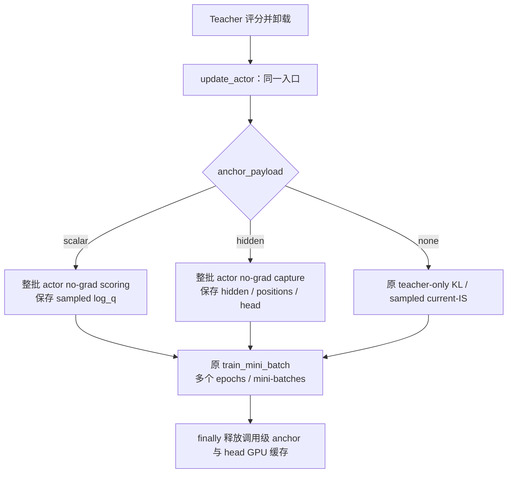

# Weighted teacher、MDPO 与 BPO 的统一实现方案

状态：实现已落地，验收范围见第 12 节。更新：2026-10-25。实现基于 `cfd6ee38c`。本文规定实现目标、配置语义、数据生命周期、计算边界和验收要求。数学背景见[形状与插值目标](形状与插值目标.md)，当前已运行的 Full-KL 链路见[内部实现说明](../internals/full-vocab.md)。

## 1. 架构决策与支持范围

Weighted teacher 是由冻结锚点 q 和原教师 T 构造的目标 m；MDPO、BPO 是拟合该目标的两种损失。目标构造、拟合损失、积分方式和计算后端分别维护，支持下表三种组合。

| 拟合损失 | 积分方式 | 状态与边界 |
| --- | --- | --- |
| MDPO | sampled | 单动作、未截断行为 IS；复用 sampled log-prob 链路 |
| MDPO | full_vocab | 精确动作求和；eta=1 包含现有普通 Full-KL |
| BPO | full_vocab | 精确 q 加权中心与方差 |
| BPO | sampled | 不实现；配置解析时拒绝 |

不增加 sampled BPO 的候选动作、辅助采样或随机中心接口。Part、Mean、current-J、NoIS 和 PPO clip 是理论比较对象，不在训练支持范围内。

| 层 | 唯一责任 | 共享方式 |
| --- | --- | --- |
| 目标构造 | 冻结 q/T → log-weight b | MDPO、BPO 共用同一个纯张量函数 |
| 拟合损失 | 明确标量目标、积分测度和 logit VJP | MDPO/BPO 各有小型行归约函数 |
| 积分方式 | sampled IS 或完整词表求和 | Sampled 仅支持 MDPO；full 共用投影与累计 |
| 数值后端 | dense、precompute、fused 等 | 依赖能力选择，不改变目标定义 |
| 训练运行时 | 评分、冻结、TQ、FSDP、更新、释放 | 共用现有 Trainer、TrainingWorker、LossContext 和 checkpoint |

首版运行范围为 shared-sync、单节点 FSDP2、dense Qwen2/Qwen3、固定前缀、token-mean。[targets.py](../../../../verl/trainer/distillation/targets.py) 定义目标，[objectives.py](../../../../verl/trainer/distillation/objectives.py) 定义纯张量损失，[anchor.py](../../../../verl/trainer/distillation/anchor.py) 管理调用级冻结状态。现有模块继续管理 IO、模型和 optimizer。无需目标插件框架、独立 BPO trainer、新 Tensor 容器或 anchor 模型副本。

## 2. 符号、目标教师与冻结语义

<a id="target"></a>

对一个固定前缀 s，省略条件记号：

| 符号 | 定义与生命周期 |
| --- | --- |
| T | 原教师，训练期间冻结 |
| q=q_k | 本轮 actor 调用开始时的学生，所有 inner updates 内冻结 |
| p=p_theta | 当前有梯度学生，每次更新后重算 |
| beta | 实际 rollout 行为分布，样本生成后固定；不强制等于 q |
| kappa | 融合形状，取 [0,1] |
| eta | 融合强度兼原镜像子问题的尺度参数，取 (0,1] |
| alpha_opt | optimizer 学习率，与 eta 分开 |
| z | 当前学生 logits，p=softmax(z) |

定义冻结信号与 log-weight：

$$
r_a=\log T_a-\log q_a,\qquad
f_{\kappa,\eta}(r)=
\begin{cases}
\kappa^{-1}\log(1-\eta+\eta e^{\kappa r}),&\kappa>0,\\
\eta r,&\kappa=0,
\end{cases}
$$

$$
b_a=\log q_a+f_a,\qquad
\log Z_m=\operatorname{LSE}(b),\qquad
m_a=\exp(b_a-\log Z_m).
$$

q/T/b/f/m 在一整个 actor 调用内冻结；计算时可从相同冻结输入重建 b，数值上仍是同一个目标。只有 p、当前 residual 和 sampled ratio 刷新。不能每次 inner update 都用当前 p 替换 q，否则进入 current-J 等不同目标。

| 参数 | 相同支持下的目标 m |
| --- | --- |
| kappa=0 | 归一化的 q^(1-eta) T^eta，几何融合 |
| kappa=1/2 | 归一化的 ((1-eta)sqrt(q)+eta sqrt(T))^2 |
| kappa=1 | (1-eta)q+eta T，算术融合 |
| 任意 kappa，eta=1 | T；无需 q 来构造目标 |

目标构造函数返回上面定义的 b，不随意加动作无关常数。BPO 对这种平移不敏感，MDPO 的训练标量会变化；统一固定 b 的定义才能比较 loss 数值。真实 target KL 指标才使用归一化后的 m。

### 2.1 Teacher 额外词表行

当前 Full-KL 允许 teacher 输出行数大于 student。记学生支持为 S，p/q 在 S 上归一化，T 保留其完整词表上的归一化。上述 b 只对 a 属于 S 构造，m 在 S 上重新归一化。这定义了学生可表示单纯形上的目标；不声称学生可以拟合 S 外的 teacher 质量。

Sampled 的 teacher log-prob 已包含完整 teacher normalizer，full 必须一致。现有 `teacher_support_correction` 给出 c_T=log(Z_T/Z_T,S)，可以先计算

$$
\log T_a=\operatorname{logsoftmax}(z_{T,S})_a-c_T,\quad a\in S,
$$

再构造融合信号。kappa>0 时，不能先用截断后重新归一化的教师做 fusion，再只向 loss 补一个常数：非线性信号和梯度已经被改变。

eta=1 时，b=log T|S，log Z_m=log T(S)，m=T(.|S)。此时本方案的 MDPO 训练标量仍精确等于原始 KL(p||T)，而 target KL 是 KL(p||T(.|S))，二者相差 -log T(S)。Teacher 行数小于 student 或 token-ID 语义不同继续拒绝。

## 3. 代码实际优化的目标

<a id="objectives"></a>

### 3.1 MDPO：保留原镜像子问题及 1/eta

令 h=log p-b。每个前缀的训练目标是

$$
L_{\rm MDPO}(p)=\frac1\eta\mathbb E_p h
=\frac1\eta\left[\mathrm{KL}(p\Vert q)-\mathbb E_p f\right]
=\frac{\mathrm{KL}(p\Vert m)-\log Z_m}{\eta}.
$$

代码返回前式，不将 loss 强制为非负。原始 target KL 和冻结常数 log Z_m 单独作为指标。关于 theta，利用 sum_a grad p_a=0：

$$
\nabla L_{\rm MDPO}
=\frac1\eta\mathbb E_p[h\nabla\log p]
=\frac1\eta\mathbb E_\beta\left[\frac p\beta h\nabla\log p\right].
$$

Full-vocab 直接计算标量及其梯度，sampled 估计同一个梯度。kappa=0 时有精确恒等式

$$
L_{\rm MDPO}
=\mathrm{KL}(p\Vert T)+\left(\frac1\eta-1\right)\mathrm{KL}(p\Vert q).
$$

因此 eta=1 恢复普通 Full-KL；eta<1 保持原教师蒸馏项系数为 1，同时增加 anchor 正则。删去外部 1/eta 会使梯度整体乘以 eta，改变相同 optimizer 配置下的有限步训练；本方案不做这种重缩放。

### 3.2 BPO：冻结 q 下的中心化残差回归

定义 C_q h=h-E_q h。BPO 的训练目标为

$$
L_{\rm BPO}(p)=\frac1{2\eta}\mathbb E_q[(C_qh)^2]
=\frac1{2\eta}\operatorname{Var}_q\log(p/m).
$$

中心必须在同一个前缀的完整词表上按 q 计算。q 冻结，且 E_q C_qh=0，因此

$$
\nabla L_{\rm BPO}
=\frac1\eta\mathbb E_q[(C_qh)\nabla\log p].
$$

BPO 的中心化是 loss 定义的一部分。它不等于 MDPO NoIS，也不是普通未中心化 MSE。完整正支持和自由分布可实现时，零方差要求 log(p/m) 为公共常数，归一化再确定 p=m；MDPO 也以 m 为最优分布。但共享神经网络参数下的最优投影、梯度和有限步轨迹可以不同。

eta=1 时，BPO 仍是 Var_q log(p/T)/(2 eta)，需要 q 来定义权重；它没有变成普通 Full-KL。即使与 MDPO 在 p=q 处有相同初始梯度，也不能据此合并后续更新。

### 3.3 训练标量、行梯度与缩放位置

所有底层 full 行归约返回未除 eta 的标量 j 和对应的未缩放 logit 梯度。最终 loss 层只除一次 eta，DP/global-token 缩放只由 LossContext 执行。Sampled 同样先生成未除 eta 的 surrogate，再在最终 loss 层缩放。

令 d=z-b、mu_p=E_p d、mu_q=E_q d，则

| 目标 | 底层逐前缀标量 j=eta L | 底层 logit 梯度 dz=partial j / partial z |
| --- | --- | --- |
| MDPO | mu_p-LSE(z) | p * (d-mu_p) |
| BPO | (1/2) E_q[(d-mu_q)^2] | q * (d-mu_q) |

BPO 的 h=d-LSE(z)，中心化后 LSE(z) 消失，所以可以直接在 logits 上计算方差。BPO 的 loss/VJP 不需要 student softmax 或目标最终的 Z_m；融合目标构造需要的 q/T normalizer 仍然必须计算。

实际 batch 目标为固定经验前缀上有效 token 的均值。所有表中的标量还需按同一个 loss_mask 和全局有效 token 数聚合。Full-vocab 消除动作抽样误差，不修复前缀分布覆盖，也不包含轨迹生成分布的导数。

## 4. Settings 与 reuse 的含义

<a id="settings"></a>

| objective | estimator | eta / kappa | 优化内容 | Anchor 需求 |
| --- | --- | --- | --- | --- |
| mdpo | full_vocab | eta=1，任意 kappa | 原始 $\mathrm{KL}(p\Vert T)$ | 无 |
| mdpo | sampled | eta=1，任意 kappa | 原始 KL 的 current-IS 梯度估计 | 无 |
| mdpo | full_vocab | 0<eta<1，kappa=0 | 原始 KL + (1/eta-1) anchor KL | hidden/head |
| mdpo | sampled | 0<eta<1，任意有效 kappa | 同一 MDPO 目标的未截断 IS 估计 | 动作 scalar |
| mdpo | full_vocab | 0<eta<1，kappa>0 | 到幂均值教师的 scaled reverse KL，减冻结常数 | hidden/head |
| bpo | full_vocab | 0<eta<=1，任意有效 kappa | q 加权中心化 log-residual 方差 | 始终需要 hidden/head |
| bpo | sampled | 任意 | 不支持 | 解析配置时报错 |

### 4.1 ppo_epochs 只控制优化预算

`ppo_epochs` 是同一批轨迹上的重复优化次数，不决定 loss，也不表示启用了 PPO clip。设 train_batch_size=B、ppo_mini_batch_size=M、rollout.n=n、epochs=E；在整除且没有额外 padding 的情况下，每次 actor 调用尝试 E*B/M 次 optimizer 更新。整个调用期间 q、T、m 不变；micro-batch 切分只影响梯度累积，不刷新目标。

普通 Full-KL + epochs>1 精确对应 `objective=mdpo, estimator=full_vocab, eta=1, epochs>1`。一般 MDPO 的多次 reuse 更充分地拟合本轮融合目标；BPO 则更充分地优化 q 度量下的回归。同一 eta 下 MDPO/BPO 的自由分布最优点相同，不意味着固定 epochs 的结果相同。

kappa=0、从 p=q 开始时，保留 1/eta 的 MDPO 初始梯度与 eta 无关。BPO 与 MDPO 在同一个 q 上的初始梯度也相同；验收必须包含 p 离开 q 后的第二、第三次更新。

### 4.2 普通 Full-KL 的 endpoint 执行分支

不再维护独立的 Full-KL 算法编排。配置解析后，MDPO eta=1 直接得到 b=log T，`anchor_payload=none`，跳过 anchor backbone、head 快照、anchor TQ 和融合运算，进入已有 teacher-only KL kernel。

统一入口通过 `--method full_kl` 或 `--method mdpo --eta 1` 选择同一个 endpoint。历史配置中的 `loss_mode=full_reverse_kl` 仍可由 resolver 读取；不再保留单独的 Shell 兼容入口。底层 teacher-only KL kernel 作为统一目标的优化实现保留。

已有编号预设的 backend、数值路径、KL 指标和预算保持不变。统一新入口默认 backend 为 precompute；比较迁移前后时必须显式使用相同 backend、dtype、optimizer 状态、数据顺序和 epochs。同 backend 的旧入口与新 eta=1 入口应共享同一次 kernel 调用，不能先构造多余 anchor 再声称计算成本相同。

只在 eta 精确等于 1 时采用此简化，不将 0.999 等值按容差吸附到端点。Sampled endpoint 对应未截断 current-IS，不声称与旧 vanilla PPO 或命中 ±20 guard 的 token_is 更新相同。

## 5. 配置解析与能力分派

<a id="configuration"></a>

`loss_mode=mirror` 内部用 objective 和 estimator 表达三个合法组合，配置解析集中在一个 resolver。目标只有本文定义的 q/T 幂均值，kappa/eta 只存一份，eta=1 自动简化为原教师，不额外增加易冲突的 target.kind 开关。

```yaml
# 目标配置；统一实验入口补齐兼容字段和资源配置。
actor_rollout_ref:
  actor:
    ppo_epochs: 4

distillation:
  distillation_loss:
    loss_mode: mirror
    mirror:
      objective: mdpo       # mdpo | bpo
      estimator: full_vocab # sampled | full_vocab；bpo 只接受 full_vocab
      kappa: 0.5
      eta: 0.3
      diagnostics: false  # 一般 MDPO/BPO 的 KL 诊断；BPO 默认省去 student softmax
    full_vocab:
      backend: precompute
```

`mirror` 在旧模式下默认为 null。纯配置函数 `resolve_distillation_spec(loss_config)` 在配置初始化时解析有效目标及数据需求，运行时使用已解析的 loss_settings。旧静态 registry 仍服务已有目标；只有 mirror 和旧 full_reverse_kl 的入口需要解析本节规则。解析过程不导入 tensor loss、Triton 或模型。

| 有效属性 | 推导方式 |
| --- | --- |
| objective / kappa / eta | MirrorConfig；旧 full_reverse_kl 映射为 mdpo/full_vocab/eta=1；estimator 的执行需求由 payload_kind 表达 |
| payload_kind | sampled → sampled；full_vocab → hidden |
| anchor_payload | bpo 或 eta<1 时按 estimator 取 scalar/hidden，否则 none |
| teacher_only_kl | objective=mdpo 且 eta=1 且 estimator=full_vocab |
| 优化尺度 | 1/eta，所有目标同一出口施加 |
| backend 支持 | 由目标是否是 teacher-only KL 及下表裁决 |

这些属性是派生值，不作为额外用户开关。尤其不能将 `need_anchor` 仅写成 eta<1，因为 BPO eta=1 仍需要 q。

| 后端 | MDPO eta=1 | MDPO eta<1 | BPO full |
| --- | --- | --- | --- |
| dense | 支持 | 已支持：独立 autograd oracle | 已支持：独立 autograd oracle |
| precompute | 支持 | 已支持：共享训练后端 | 已支持：共享训练后端 |
| precompute_fused | 支持 | 已支持 | 已支持：BPO 专用行归约 |
| recompute / cached / streaming | 继续使用原实现 | 首版拒绝 | 首版拒绝 |
| liger | 继续使用原实现 | 首版拒绝 | 首版拒绝 |

选择未支持组合时，启动前报错，不静默回退到另一个目标或 backend。`precompute_fused` 在非 CUDA/BF16 环境的数值 fallback 可以沿用已有 precompute 规则，但不能以该 fallback 通过代替真正 Triton 验收。

现有兼容字段由统一 launcher 设置并由 resolver 校验：纯蒸馏 `use_task_rewards=False`、clamp 为 null、`advantage_source=current`；sampled 使用 `use_policy_gradient=True, policy_loss_mode=token_is`，full 使用 `False, vanilla`。这些字段不再承担 mirror 内部的目标分流。与解析结果冲突的设置报错，不允许通过旧字段切换 current/frozen、NoIS 或 PPO clip。旧 full_reverse_kl 不接受 mirror 参数覆盖；需要选择融合或 BPO 时显式使用新入口。

[run_math_opd_ablation_fsdp2.sh](../../run_math_opd_ablation_fsdp2.sh) 是统一实验入口。E 预设提供模型和预算，`--method sampled/full_kl/mdpo/bpo` 提供方法；`custom` 不加载编号预算。算法参数集中在 [\_distillation_args.sh](../../launchers/_distillation_args.sh)，资源与数据仍由公共 launcher 管理。Math 不保留其他训练别名。

### 5.1 启动框架

| 模块 | 职责 | 扩展方式 |
| --- | --- | --- |
| [run_math_opd_ablation_fsdp2.sh](../../run_math_opd_ablation_fsdp2.sh) | 唯一公共训练入口，头部提供生成的对齐速查表，执行部分只启动规划器 | 不增加按算法/模型命名的包装入口 |
| [math_experiment.py](../../launchers/math_experiment.py) | ModelPair/Budget/Preset 声明、CLI 解析、覆盖合并、验证路由，生成 LaunchPlan | 增加模型对或预算表项；复用已有合并函数 |
| [\_distillation_args.sh](../../launchers/_distillation_args.sh) | 已选择的方法 → Hydra 目标字段 | 修改方法映射，不修改实验预算 |
| [\_run_single_teacher_fsdp2.sh](../../launchers/_run_single_teacher_fsdp2.sh) | 数据/资源/执行环境、记录命令和日志，启动训练 | 修改执行能力，不散布 E 编号逻辑 |

规划器只有标准库依赖，不导入模型、Torch 或 Hydra。`build_plan` 不修改输入环境、不写文件、不启动进程；执行副作用集中在 main 最后的 exec。`--help`、`--overview` 与 `--list-presets` 可在训练环境尚未建立时使用，实际训练解释器仍由 PYTHON_BIN 选择。预设先合并环境，再应用方法选项，原生 Hydra overrides 始终保留在参数末尾。

每种模型协议只在 MODEL_MATRIX 中声明一次，普通/16 次 reuse 的 sampled/full 组合由该表生成；学习率和等更新预算用 Budget 表达。E21/E22 的编号别名统一解析到 E15/E13，验证后缀复用同一个模型协议，不再用多层 case 重复分派。

### 5.2 运行入口

先按[训练配方](../训练配方.md)配置 Python、模型、数据与 CUDA_VISIBLE_DEVICES。方法选项和环境/原生 Hydra overrides 的优先级也在那里统一维护。

```bash
# E17 的模型与多次 reuse 预算，full MDPO / BPO 对照。
bash examples/mirroropd/run_math_opd_ablation_fsdp2.sh E17 --method mdpo --kappa 0.5 --eta 0.3
bash examples/mirroropd/run_math_opd_ablation_fsdp2.sh E17 --method bpo --kappa 0.5 --eta 0.3

# Sampled MDPO 与普通 Full-KL 都使用同一个入口。
bash examples/mirroropd/run_math_opd_ablation_fsdp2.sh E13 --method mdpo --estimator sampled --eta 0.3
PPO_EPOCHS=4 bash examples/mirroropd/run_math_opd_ablation_fsdp2.sh custom --method full_kl

# 继续使用旧 sampled 目标，保留信号、clipping/guard 与 NoIS 语义。
bash examples/mirroropd/run_math_opd_ablation_fsdp2.sh E15 --method sampled --policy-loss token_is --advantage current
```

原 sampled current token-IS 只有在数值 guard 不触发时才等价于 sampled MDPO eta=1；vanilla PPO、frozen 信号和 NoIS 不通过改 eta 自动转成 MDPO。`_sampled_inputs` 与 `sampled_policy_terms` 共用对齐、mask 和 surrogate，信号、guard 和 clipping 作为显式算法选项保留。Legacy vanilla 继续调用原 PPO 函数，保持 anchor 分母和 dual-clip 约定。

`MIRROR_DIAGNOSTICS=True` 开启一般 MDPO/BPO 的 target/teacher/anchor KL 及 log Z_m；teacher-only endpoint 保留原 Full-KL 指标。`DRY_RUN=1` 打印最终命令，`CONFIG_ONLY=1` 检查 Hydra 解析，均不代表模型运行通过。[smoke_mirror.sh](../../smoke/smoke_mirror.sh) 和 [smoke_full_reverse_kl.sh](../../smoke/smoke_full_reverse_kl.sh) 也调用统一入口的 custom 设置。

## 6. 数据与 anchor 生命周期

<a id="lifecycle"></a>

Trainer 保留 rollout、balance、teacher scoring/offload。统一目标分支跳过 legacy old-log-prob 与任务 advantage 准备，在 `ActorRolloutRefWorker.update_actor` 内根据 resolved spec 决定是否准备 anchor。



`anchor.py` 的 `anchor_scope(actor, data, spec)` 管理调用级准备和清理，MDPO/BPO 共用。它复用现有 `actor.infer_batch` 的 no-grad、动态分批、输出重排和 DP 同步。所有所需样本必须在第一个 optimizer step 前完成评分，不能按训练 mini-batch 懒生成 q。

Inference 使用独立的小字段 TensorDict 视图，设置 compute_loss=False、关闭 entropy/score-centering、清除 full_vocab_train，补齐 global_token_num（未知时显式为 None，仅影响 MFU）。不原地污染训练 data 的 flags。首版保持 infer/train 各自的 load/offload 生命周期，接受一次额外卸载和重载；不通过未经验证的嵌套 BaseEngineCtx 修改驻留方式。

### 6.1 Sampled MDPO

eta<1 时，把 anchor 返回的完整预测位置 log_probs 经 `response_from_nested` 转为 `old_log_probs`，保存在当前 worker 调用持有的 data 中，随 mini-batch shuffle 移动；无需绕回 driver/TQ。Teacher scalar 仍是完整预测位置布局；q/behavior 已 response-aligned，不能重复 shift。

eta=1 时不计算也不要求 `old_log_probs`，target 函数直接返回 log T。缺失的 anchor 指标不填零。`batch.fields` 仅包含 input、position、prompt、response、mask、teacher scalar 和 behavior，不依赖任务 advantages/returns。

### 6.2 Full-vocab MDPO 与 BPO

| Payload | 保存位置 | 消费者 |
| --- | --- | --- |
| teacher_hidden / teacher_positions | TQ，按 sample key | 所有 full 设置 |
| teacher_head | 原 FrozenTeacherHead | 所有 full 设置 |
| anchor_hidden / anchor_positions / anchor_version | TQ，按 sample key | MDPO eta<1；所有 BPO |
| anchor_head | 调用级独立 tensor holder | MDPO eta<1；所有 BPO |

复用 `prediction_positions` 与 backbone adapter。首次 anchor capture micro-batch 必须实际调用 wrapped `lm_head(..., full_vocab_callback=...)`，在回调内复制完整 forward dtype 权重。`detach()` 不隔离存储，wrapped module 外的 weight 可能仍是 DTensor 分片；不能将二者当成冻结快照。

所有 rank 在一致的首次 capture 阶段进入 head callback，包括本地有效 token 数为零的 rank；后续 micro-batch 不重复复制。Tied head 必须通过真实 FSDP 测试。Head 不注册到 student parameter/buffer，不进入 optimizer/checkpoint；CPU 副本与 GPU 缓存均在 actor finally 中释放。

使用已有 `(global_steps, local_trigger_step)` 标识一次调用；head snapshot、TQ anchor_version 和训练预期版本一致。准备完成且异步写 flush 后才进入训练。发生失败时沿现有任务失败语义退出，不在已部分更新的参数上重建 q 并自动续跑。

### 6.3 HiddenBatchIO 的来源参数化

Capture 来源为 teacher 或 anchor；训练读取来源为 teacher 或 teacher+anchor，由 spec 自动决定。从来源派生 hidden/positions 字段及 ready 标记，anchor 多一个 version。每个 micro-batch 一次获取全部 frozen payload，沿用现有单线程预取、单笔 pending write 背压和 flush。

继续使用 `retain_sample_identity=True` 与 `sample_keys/sample_partition`，不改 TQ 身份桥接，不把整轮 hidden 加入普通 batch.fields。读取检查样本数，engine 校验两套 positions 和 anchor version。注入 payload 的释放放在 yield 的 try/finally 内，异常时也移除引用。旧 full_vocab 标志只在 IO 边界转换，训练分流使用 resolved spec。

## 7. 纯数学接口与 sampled 实现

<a id="math-interface"></a>

只新增需要的函数，不建立目标类继承树：

```python
# Semantics: 纯张量接口；q/T 冻结，支持 sampled 或 token-block 布局。
build_log_weights(log_teacher, log_anchor=None, *, kappa, eta)
mdpo_sampled_terms(log_p, log_beta, b)
full_vocab_rows(z_student, b, log_q=None, *, objective, diagnostics)
```

`targets.py` 实现稳定 f 与 b：小 kappa*r 用 log1p/expm1，其余用 logaddexp；kappa=0 与 eta=1 走解析分支。eta=1 必须允许 log_anchor=None，不先求 q 再代数抵消。拒绝非有限参数、eta=0 和范围外参数。

`objectives.py` 负责 sampled surrogate 和 full 行级标量/梯度。Sampled MDPO 的核心计算是：

```python
# Semantics: 无效位置先清零；冻结 b/beta；只有 ratio 接收 student 梯度。
b = build_log_weights(log_T, log_q, kappa=kappa, eta=eta)
h = (log_p - b).detach()
ratio = (log_p - log_beta).exp()
token_terms = ratio * h
loss = context.aggregate(token_terms, response_mask, "token-mean") / eta
```

其行为期望前向值与梯度分别对应 L_MDPO 和其 score 梯度。禁止 residual 与 ratio 同时求导，也不再额外乘一个有梯度的 log_p。目标函数冻结 q/T；当前 log_p 每次刷新。q/T/behavior scalar 用 FP32，数学 oracle 用 FP64。

MDPO 使用未截断 IS，不继承现有 token_is 的 ±20 clamp。可以提取小 surrogate helper，旧 OPD 显式传 guard=20，MDPO 传 None。有效位置的非有限值明确失败；padding 在指数运算前清理；局部零有效 token 保留 student 图上的零值。两种 estimator 的 loss 都直接跳过通用任务 ppo_loss。

## 8. Full-vocab 算子与共享优化

<a id="kernels"></a>

### 8.1 投影、目标与归约分开

Engine 仅负责输入、有效行、head callback 和 frozen payload。数值层的 token-block 执行：冻结 q/T 投影及归一化 → build_log_weights → 当前 student 投影 → objective 行归约 → dH/dW 累计。MDPO eta=1 直接进入原 teacher-only kernel，不执行 q 分支。

MDPO 的行归约使用当前 p；BPO 使用冻结 q。二者共用后面的

$$
dH=dz\,W_S,\qquad dW_S=dz^\top H_S.
$$

Precompute 在 forward 分块计算并累计未缩放 dH/dW，只保存累计结果供 backward 乘上游梯度。Student hs/ws 必须是自定义 autograd Function 的显式 tensor 输入；q/T 无梯度；1/eta 只来自最终 loss 的上游梯度。每个 objective 不复制一份 precompute 循环。

Dense oracle 直接对第 3 节的标量做普通 autograd；BPO oracle 从 log p 和 q 加权中心定义开始，独立对照 logits 解析 VJP，不能让 oracle 和优化后端共用同一个自定义 backward。

### 8.2 Triton 与稳定中心

一般融合使用 `fused_log_weights` 构造 FP32 的 b，再由 `fused_mirror_rows` 求训练标量与 VJP。MDPO 的数学表达式为

$$
\ell_{\mathrm{MDPO}}=\mathbb E_p[\log p-b],\qquad
\nabla_z\ell_{\mathrm{MDPO}}=p\odot\big((\log p-b)-\mathbb E_p[\log p-b]\big).
$$

PyTorch 路径直接对 `log_softmax(z)-b` 做中心化。Triton 路径选择最大 student logit 所在 token $a$，令 $z_0=z_a$、$b_0=b_a$、$c_i=(z_i-z_0)-(b_i-b_0)$、$S=\sum_i\exp(z_i-z_0)$，计算

$$
\ell_{\mathrm{MDPO}}=\mathbb E_p[c]-\log S-b_0,\qquad
\nabla_z\ell_{\mathrm{MDPO}}=p\odot(c-\mathbb E_p[c]).
$$

各词表 tile 先使用自己的最大 logit 与对应 b 做差，再把局部矩平移到全行中心。概率也使用相对最大值的归一化。这避免先形成带有大公共常数的 `z-b`，再减均值时丢失近目标的小残差。三遍扫描不变，只增加小型 tile/row 中心缓冲；不改变目标、梯度的数学定义或最终的 $1/\eta$ 缩放。

训练不需要先求 $\log Z_m=\operatorname{LSE}(b)$。仅当 diagnostics 开启时，在同一遍词表扫描中额外累计 target normalizer、p 加权 anchor/teacher gap，得到四项诊断。普通 Full-KL endpoint 继续调用原 `fused_rows`；一般融合使用 MDPO 中心化梯度 kernel 或 BPO 方差 kernel，共享 PrecomputedKL 的 dH/dW 累计。此次近目标数值修正只覆盖 MDPO，不能据此推断 BPO 具有同样的相对精度保证。

Target kernel 在小 $\kappa(\log T-\log q)$ 区域使用 `log1p/expm1`，其他区域使用稳定 log-add-exp；未选中的 expm1 分支先限制输入，避免 GPU 同时求值时溢出。Teacher 在完整支持上完成 log-softmax 后才截取 student 行，kernel 支持这一截取产生的非连续行跨度。PyTorch 定义仍作为 CPU/非 BF16 回退和 dense oracle。

BPO 使用自己的 q 加权均值/方差与梯度归约，不冒充现有 p-softmax KL kernel。它可以复用分块、投影、buffer 和 precompute 累计。为避免小残差下 E_q[d^2]-(E_q d)^2 的消减误差，当前实现使用均值后中心化的平方归约，不用二阶矩相减或 clamp 掩盖负方差。

BPO 的默认训练路径不计算 student softmax；若请求原教师 KL、target KL 或 p||q 指标，则需额外计算 student 归一化和相关 reduction，但可复用已有 logits，不增加 backbone 或 head projection。日志的这部分成本要单独标明。

### 8.3 结果与兼容边界

统一内部结果为 `FullVocabObjectiveResult(loss_sum, token_objective, token_diagnostics)`。loss_sum 是未除 eta、未做 DP 缩放的 sum，token_objective 与命名诊断均 detached。Loss 层执行 `LossContext.normalize_token_sum(loss_sum) / eta`。Engine 复用位置统计工具，不解释 objective 的数学公式。

原 `full_reverse_kl`/`full_reverse_kl_result` 保留为 teacher-only 数值入口；统一 dispatcher 在 endpoint 直接调用它们，并适配为统一结果。这样原 FullKLResult API 和各 backend 的运算顺序保持不变，训练编排则只有一份。旧接口的值、梯度、返回字段和 backend 默认值由回归验证。

### 8.4 优化和成本边界

| 机制 | 统一后的处理 |
| --- | --- |
| teacher backbone 一轮一次、有效 hidden 缓存 | 所有 full 组合共享 |
| anchor backbone 一轮一次 | MDPO eta<1 / BPO 需要；MDPO eta=1 完全跳过 |
| token chunk、释放中间量、FP32 add_product 累计 | MDPO/BPO 共用 |
| frozen 输入不在 backward 重投影 | precompute 两目标共用 |
| TQ async write / prefetch / key 对齐 | 同一 IO 协议 |
| student head hooks、梯度累积、DP 分母 | 继续复用现有实现 |
| BPO student softmax | 目标/VJP 不需要，仅 KL 诊断按需启用 |
| recompute/cached/streaming/liger | 首版只保留 teacher-only endpoint 支持 |

一般融合每次 inner update 仍会重建 q/T head 投影和 b。首版不缓存整轮完整 m，也不建立跨调用的 logits cache；这能控制内存并保持简单的失效边界。`precompute` 的工作区仍为 [token_chunk,V]，vocab_chunk_size 不会自动将其变成二维 streaming。

以 V=151936、hidden=1536 的 BF16 anchor 为例，head 副本约占 0.435 GiB/rank；64 条回答各有 7168 个有效位置时，anchor hidden 的全局 payload 约为 1.3125 GiB。Token chunk=512 时三组 FP32 logits 同时驻留约为 0.869 GiB。它们是容量估算，不是实测峰值；详见[计算预算](../full-vocab/2026-10-22-词表蒸馏的计算与显存预算.md)。不同 objective 的时间和显存必须实际测量。

### 8.5 已完成的数值层优化与实测

2026-10-25 的优化只改目标构造、行归约和临时张量生命周期，不增加训练分支、缓存协议或新配置。MDPO 的 $1/\eta$、BPO 的 $1/(2\eta)$、冻结 q/T 和全局 token 分母均保持原定义。

| 环节 | 当前实现 | 生效范围 |
| --- | --- | --- |
| Weighted target | 单个 Triton kernel 代替 Boolean indexing 与多个逐元素临时张量 | CUDA BF16 的 `precompute_fused` |
| MDPO normalizer | 直接计算 $\mu_p-L_p$；训练不计算 LSE(b)，诊断仅计算一次 | 一般融合的 fused MDPO |
| KL 诊断 | 复用 p 的分块归约，不再为获取指标重跑 full_vocab_rows 或生成无用 dZ | Fused MDPO/BPO；BPO 关闭诊断仍不计算 student softmax |
| PyTorch 诊断 | teacher KL 复用同一份 log p/p | Dense 与普通 precompute |
| 工作区 | Student 投影前释放无用 lt；无诊断的 MDPO 同时释放 lq | 一般 MDPO/BPO |
| 分阶段 profiling | 标记 q/T 投影与归一化、target、student 投影、行归约和 dH/dW | 沿用现有 profiler/NVTX 开关 |

[固定输入基准](data/full-vocab-performance.json)使用四张 H800，各卡独立运行一个 objective/诊断组合。每个组合的优化前后使用相同 BF16 hidden/head、seed=71、N=512、V=151936、d=1536、kappa=0.5、eta=0.3。基线取自优化前的工作区数值模块并隔离 imports，不使用缺少已实现 mirror 代码的 Git HEAD。先预热、检查值和 VJP，再交替运行 9 组 AB/BA，报告墙钟中位数；CUDA event 原始样本也保留。

下表为 token chunk=512，两个版本均使用 `precompute_fused`。时间包括三组 head 投影、target、loss 及 hidden/head VJP；显存是扣除输入常驻量后的额外 allocated 峰值，包含梯度工作区和输出。

| 目标 | 诊断 | 优化前 → 后（ms） | 加速 | 额外峰值前 → 后（MiB） |
| --- | --- | --- | --- | --- |
| MDPO | 关 | 12.65 → 5.66 | 2.24× | 3829.6 → 1783.5 |
| MDPO | 开 | 18.78 → 5.90 | 3.18× | 4009.1 → 2229.2 |
| BPO | 关 | 12.17 → 5.88 | 2.07× | 3829.6 → 1932.0 |
| BPO | 开 | 18.43 → 6.16 | 2.99× | 4602.6 → 2229.2 |

Chunk=128 的四种组合加速 1.66–2.34×，优化后额外峰值均约 1340.8 MiB；chunk=32 加速 1.31–1.62×，前后峰值都受固定 head 梯度缓冲限制，未下降。12 个比较中，BF16 hidden/head VJP 相对 L2 差异最大约 $3.75\times10^{-5}$。这些测量不含 backbone、TQ、optimizer、rollout 或启动，不能解释为整轮训练加速。其他四张 GPU 当时有无关任务；每个 AB 比较在同一张专用 GPU 上完成，未做锁频或多次独立进程的置信区间研究。

生产入口仍默认 `precompute`。需要上述 CUDA BF16 融合优化时，显式选择已有 backend；无需新算法开关。例如：

```bash
FULL_KL_BACKEND=precompute_fused FULL_KL_TOKEN_CHUNK=512 \
  bash examples/mirroropd/run_math_opd_ablation_fsdp2.sh E17 --method bpo --eta 0.3
```

显存较紧时先用 chunk=128；具体选择仍取决于 backbone 激活和真实前缀长度。普通 Full-KL eta=1 的 kernel 运算路径保持原样，表中加速属于一般融合的 MDPO/BPO，不外推到 endpoint。

复测工具为 [benchmark_mirror.py](../infra/profile/scripts/benchmark_mirror.py)。以下命令使用已保存的优化前数值模块：

```bash
CUDA_VISIBLE_DEVICES=0 PYTHONPATH=. "$PYTHON_BIN" \
  examples/mirroropd/docs/infra/profile/scripts/benchmark_mirror.py \
  --baseline-dir outputs/mirror-performance/baseline \
  --objective mdpo --diagnostics \
  --chunks 32 128 512 --rounds 9 --output outputs/mirror-performance/recheck.json
```

基线目录包含 full_vocab、full_vocab_triton、objectives、targets、profiling 及空的包入口，内部 `verl.trainer.distillation.` imports 替换为独立的 `mirror_perf_baseline.`。再次修改代码前应另存基线，不能覆盖已有基线或让它导入候选实现。原始测量、基线和运行日志保存在 `outputs/mirror-performance/`；迁移到其他机器复测时需要一起传递这些本地产物。

### 8.6 仍待优化与验证的部分

| 环节 | 当前边界 | 下一步需要的证据 |
| --- | --- | --- |
| q/T 归一化 | log-softmax 仍用 PyTorch，target 已融合 | 投影/归一化分阶段 profile，判断是否值得增加融合归一化 kernel |
| Reuse 中的冻结计算 | 缓存 hidden/head，每次 inner update 重做 q/T projection 和 target | 受限分块缓存的内存与传输预算 |
| 模型驻留 | Anchor inference 和 actor train 分别进入 load/offload | 真实模型阶段耗时与异常清理验证，再决定是否合并驻留周期 |
| IO | CPU→TQ 异步写、TQ→CPU 预取；D2H 使用 cpu()，H2D 无专用 stream | 传输占比与 pinned buffer/stream 生命周期验证 |
| Teacher 额外行 | Endpoint 支持修正与等支持 backend 仍重复公共 teacher 投影 | 保留完整 teacher normalizer 的投影/归约复用方案 |
| 诊断采样 | 布尔开关，开启后每个块计算；融合后已减少重复工作 | 长训练是否还需要按 update 间隔记录 |
| 平台和整轮吞吐 | H800 数值层 A/B 与短训练集成验证 | A100、7k/15k 前缀、多次进程重复、整轮固定预算比较 |

一般融合的 precompute 工作区仍为 O(token_chunk × vocab)，不是二维 streaming。64×7168 个位置、151936 词表的单份 FP32 目标约为 259.66 GiB（全局）；因此没有默认增加整轮目标缓存。这些待办不影响已经实测的数值层收益，也不能据现有短测宣称全部优化完成。

## 9. 归一化、指标和恢复

<a id="metrics"></a>

每次 mini-batch update 在切 micro-batch 前跨 DP 统计原始 loss_mask 有效 token 数 N。局部未缩放 sum 为 S_r、DP 大小为 D 时，返回 D*S_r/(N*eta)，DP 平均后得到同一总体均值。不能再除 micro-batch 数或 epochs。全局 N=0 拒绝更新，本地 N_r=0 仍参与相同 collective 并保留 hs/ws 的零梯度连接。

| 指标 | 定义 |
| --- | --- |
| `distill/mdpo/objective` | 已除 eta 的 MDPO token 平均；sampled 是行为 IS 估计，可能为负 |
| `distill/bpo/objective` | 已除 eta 的真实 BPO 方差目标，full 精确计算 |
| `distill/target_kl` | 未除 eta 的 $\mathrm{KL}(p\Vert m)$；full 按需计算 |
| `distill/teacher_kl` | $\mathrm{KL}(p\Vert T)$，保留 teacher 完整支持 |
| `distill/target_log_z` | 冻结 log Z_m；sampled 不伪造该指标 |
| anchor drift / residual | 标明测度；endpoint 没有 q 时缺失，不填零 |
| ratio / ESS | 仅 sampled MDPO，使用实际 p/beta |
| anchor preparation 时间 | 仅需要 anchor 的设置；不得混入 teacher 时间 |

两个 objective 的 loss 数值不横向当作同一种误差比较。若比较拟合程度，使用同一 target KL、原教师 KL 或明确约定的其他指标。位置分桶沿用命名后的逐 token 诊断。普通 Full-KL endpoint 的旧 `distillation/full_kl` 指标仍表示原教师 KL，额外 teacher 行下不能误映射成条件化 target KL。

`update_observations` 后半段假设普通 current/frozen log-gap 和旧 guard；新目标只复用通用 pair/signal 观测，不继承错误的系数差异统计。BPO 的 KL 诊断由 mirror.diagnostics 布尔开关控制；开启后每个有效块都会计算，尚无按 update 间隔抽样的控制。默认关闭时保留无需 student softmax 的 logits 路径。

更新尝试、成功 optimizer step、scheduler 和 checkpoint 继续使用原模块。Anchor 不进入 state_dict 或 checkpoint，outer step 边界保存后，恢复时由恢复后的学生在新 actor 调用里建立 q；首版不增加 inner-update 中断续训。

## 10. 代码职责

<a id="implementation"></a>

| 模块 | 改动内容 |
| --- | --- |
| [distillation_spec.py](../../../../verl/workers/config/distillation_spec.py) | 增加纯配置 resolver 与只读有效属性，保留旧 registry |
| [distillation.py](../../../../verl/workers/config/distillation.py)、[YAML](../../../../verl/trainer/config/distillation/distillation.yaml)、[utils/config.py](../../../../verl/utils/config.py) | MirrorConfig、三种合法组合、endpoint、兼容字段和 backend 校验 |
| [targets.py](../../../../verl/trainer/distillation/targets.py) | f/b 语义定义与 PyTorch 参考，eta=1 无 anchor 快捷路径；CUDA 等价实现位于 full_vocab_triton.py |
| [objectives.py](../../../../verl/trainer/distillation/objectives.py) | sampled MDPO、MDPO/BPO full 行级目标与 VJP |
| [anchor.py](../../../../verl/trainer/distillation/anchor.py) | 条件式调用级准备/释放，共用 infer_batch |
| [trainer_base.py](../../../../verl/trainer/ppo/v1/trainer_base.py) | 按 spec 跳过 legacy 准备、明确 payload 和小字段 |
| [engine_workers.py](../../../../verl/workers/engine_workers.py) | 按 spec 安装 adapter；update_actor 的可选 anchor scope |
| [hidden_io.py](../../../../verl/trainer/distillation/hidden_io.py) | teacher/anchor 来源、version、异步读写和异常释放 |
| [transformer_impl.py](../../../../verl/workers/engine/fsdp/transformer_impl.py) | capture role、head callback 内快照、结果/位置统计适配 |
| [full_vocab.py](../../../../verl/trainer/distillation/full_vocab.py)、[full_vocab_triton.py](../../../../verl/trainer/distillation/full_vocab_triton.py) | 统一 dispatcher、共享 precompute、两种行归约、旧 API 薄适配 |
| [losses.py](../../../../verl/trainer/distillation/losses.py)、[policy_metrics.py](../../../../verl/trainer/ppo/policy_metrics.py) | 分流、一次 eta 缩放、LossContext、真实目标指标 |
| [统一实验入口](../../run_math_opd_ablation_fsdp2.sh)、[预设规划器](../../launchers/math_experiment.py)、[算法参数构造](../../launchers/_distillation_args.sh) | E/custom 模型预算与方法正交；只维护统一公开实验入口 |

通用 TrainingWorker 的 epoch/mini-batch 循环和 TQ 身份桥接保持原实现；Trainer、worker 和 loss 使用同一解析结果决定目标与数据需求。

## 11. 验收顺序和完成条件

<a id="validation"></a>

### 11.1 数学与配置

- 枚举 kappa=0、小正数、0.5、1 与 eta 的一般值和 1，验证 b/m、MDPO 标量、BPO 方差及解析 logit VJP。
- Dense BPO 从 log-prob 方差独立求导，对照无 student softmax 的 logits 版本；验证 q 加权中心、常数平移不变性和非负方差。
- Sampled MDPO 全动作枚举期望与 full 数值/梯度一致，beta 与 q 不同；不增加 sampled BPO 训练测试或接口。
- 同一目标在 p=q 的初始梯度相同，离开 q 后一般不同；BPO eta=1 不等于普通 KL。保留 1/eta 的尺度验证。
- Teacher 额外行下，MDPO eta=1 的值/梯度与原始完整 teacher KL 一致；一般 fusion 识别截断重归一化错误。
- Resolver 验证全部支持/拒绝组合、endpoint 无 q、BPO eta=1 仍有 q、旧入口映射和冲突配置。

### 11.2 Full-KL endpoint 回归优先

同 backend、精度、数据顺序和 optimizer 初态下，对比旧 full_reverse_kl 与 mirror/mdpo/full_vocab/eta=1，运行 epochs>1。比较每步 loss、参数分片、Adam 状态、scheduler 和执行计数；检查 anchor scoring、head 快照和 anchor TQ 写入次数均为零。

不因配置统一而强制 endpoint 更换 backend，也不新增 diagnostics 导致额外投影。旧 API 与旧算法设置的兼容由实际调用测试验证，而不只检查配置字符串。

### 11.3 共享 anchor 与三个设置的训练验收

主例使用 kappa=0.5、eta=0.3，至少三个 inner updates、两个 outer 调用。检查本轮 q/f/b 不变、p/residual 改变、下一轮 q 刷新。Sampled 检查 scalar 对齐与无重复 shift；full 检查不同 teacher/anchor/actor 分批边界、shuffle、TQ key/version、写入 flush、预取异常和 finally 清理。

真实多卡 FSDP2 覆盖 tied/untied head、不同 hidden 宽度、局部零有效 token、mask 空洞、不等长回答、padding NaN、global token 分母及 backbone/head 两路梯度。CPU mock 不代替 FSDP hook 与独立 head storage 验收。先用合成小 Qwen，再跑现有 1.5B 短训练。

### 11.4 Fused 与性能

MDPO/BPO 分别比较 dense、precompute、真实 CUDA BF16 fused 的前向值和 hidden/head VJP。先验证共同累计代码，再验证各自的 reduction；BPO 小残差场景必须覆盖稳定方差归约。

记录 teacher/anchor scoring、actor、IO、峰值显存、总墙钟和诊断开关成本。Checkpoint 保存/恢复覆盖三个设置的下一轮更新；不把单次随机 sampled 梯度与 full 梯度不同判成错误。Full-KL endpoint 的性能回归与一般 fusion/BPO 的性能测量分开。

## 12. 证据入口与当前完成状态

[实现验收结果](data/implementation-checks.json)记录实际运行配置、更新次数和原始证据位置。

| 验证范围 | 结果 |
| --- | --- |
| CPU 回归与真实 TQ | 302 passed；包括配置、数学目标、全局分母、生命周期、失败清理和 4 项真实 TQ 用例 |
| CUDA BF16 kernel | 初版 7 passed；优化后扩展到 35 passed，包含诊断/target 边界和 FP64 对照；词表 31/8193/151936 |
| 两卡 FSDP2 | MDPO full、MDPO sampled、BPO full、MDPO eta=1、BPO eta=1 通过多轮更新；含 Qwen2/Qwen3、tied head、额外 teacher 行和局部空有效 token |
| Checkpoint | MDPO full/sample 与 BPO 恢复后的参数、Adam 状态和 scheduler 与参考继续更新逐值一致 |
| Full-KL endpoint | 同 backend 的旧入口和统一 eta=1 入口，三次 reuse 后参数、Adam 状态和 scheduler 逐值一致；未准备 anchor |
| Actor wrapper 与耗时指标 | 真实 TQ + Gloo 和两卡 FSDP2 验证准备/清理及跨 rank 最大耗时归约 |
| 1.5B 配方整链路 | 初版三种设置各完成 4 次更新；数值优化后又用四卡补跑 full MDPO/BPO，各 4 次更新与诊断均通过 |

CPU 命令中的 7 个 CUDA 用例因禁用 GPU 而跳过，已在独立 CUDA 运行中全部通过。1.5B 配方使用 R1-Distill-Qwen-1.5B student 与 JustRL-DeepSeek-1.5B teacher，response cap 64。首轮 BPO 为共享显存采用四卡、BF16 参数与 Adam `foreach=False`；统一入口验收又补跑了两卡默认 FP32 参数/Adam 的 BPO，四次更新和 anchor 耗时日志均正常。Sampled/full MDPO 的真实短训练也已使用默认 FP32 参数/Adam。正式 launcher 默认精度和 optimizer 未因烟雾测试改变，短测不用于准确率或吞吐排名。

统一入口补充验收包括：E1–E43 改造前后逐项比较，只有规范目标表示字段变化；343 项入口/目标/预算回归通过；185 项后续定向回归通过，最终 37 项入口检查通过（各组有重叠，不能相加）；队列与分析脚本识别规范 Full-KL 和方法后缀；共享 sampled primitive 后，两卡多次 reuse/恢复的 loss 与原记录逐值一致。统一入口的 `E13 --method bpo --eta 0.3` 已在前一阶段完成真实两轮训练。

启动框架重构另对 194 组配置做了改造前后对比，覆盖 E1–E43、编号别名、验证后缀、BPO/sample MDPO 方法覆盖和环境/Hydra 优先级，最终启动参数一致。232 项启动与规划测试通过，其中 15 项直接验证标准库规划器；实际 `CONFIG_ONLY=1 E17 --method bpo --eta 0.3` 也通过。该阶段只调整启动与规划，不修改训练目标或 kernel，未重新运行 GPU 训练。

2026-10-26 的[近目标审计](2026-10-26-MDPO内层KL反弹与数值链路审计.md)发现并修正了 MDPO 行梯度中的大公共常数消减误差。修正后共 202 项 CPU、41 项 CUDA 测试通过，并补测两卡 MDPO checkpoint 与 η=1 endpoint。数学身份、有限步目标下降和混合精度有效更新是三个独立验收问题；本次修正不保证固定 LR 的内层目标单调下降。

数值层优化后的定向回归另有 **197 项 CPU 测试和 35 项真实 CUDA 测试通过**。CPU 运行跳过 35 项 CUDA 用例，随后在 GPU 独立执行；不与前面的历史计数相加。新 CUDA 用例覆盖诊断开关、FP64 行值/VJP 对照、kappa=0/1e-7/0.5/1、eta=1e-6/0.3/1、极端有限 log-ratio、额外 teacher 行和诊断不改变梯度。极小 eta 的 target 绝对误差测试不等于所有真实后期梯度的相对精度保证。两卡 MDPO tied Qwen2 和 BPO Qwen3 分别通过多次 reuse 与 checkpoint 恢复，恢复后的参数、Adam 和 scheduler 逐值一致；优化前后允许浮点归约差异，不要求参数位级一致。原始证据见 `outputs/mirror-performance/`。

优化后的 fused 实现还通过了四卡真实 R1-Distill-Qwen-1.5B / JustRL-DeepSeek-1.5B 短训练：MDPO 与 BPO 各 2 outer × 2 reuse，共各 4 次成功 optimizer step。使用默认 FP32 参数/Adam、BF16 混合精度、batch=8、prompt cap=512、response cap=64、chunk=128、diagnostics=True，开启 hidden async write/prefetch。Rollout、teacher、anchor、更新与权重同步全部完成；四项诊断、目标与梯度范数均有限，非有限梯度标记均为 0。命令、解析配置、逐更新指标和日志分别保存在 `outputs/mirror-performance/real-mdpo/` 与 `real-bpo/`，摘要并入[实现验收结果](data/implementation-checks.json)的 `numerical_kernel_optimization`。这组短测验证集成，不作为优化前后整轮速度或训练质量比较。

新增测试入口：[数学与配置](../../../../tests/trainer/distillation/test_mirror_on_cpu.py)、[CUDA kernel](../../../../tests/trainer/distillation/test_mirror_on_gpu.py)、[真实 TQ](../../../../tests/trainer/ppo/v1/test_mirror_tq_on_cpu.py)、[FSDP2 多步与恢复](../../../../tests/special_distributed/test_mirror_fsdp2.py)。统一入口测试见 [test_mirroropd_unified_launcher_on_cpu.py](../../../../tests/examples/test_mirroropd_unified_launcher_on_cpu.py)，分析兼容测试见 [test_unified_experiment_labels_on_cpu.py](../../../../tests/utils/test_unified_experiment_labels_on_cpu.py)。实际模型命令、配置与逐更新指标保存在 [outputs/mirror-acceptance](../../../../outputs/mirror-acceptance)。


现有 [FP64 验算脚本](scripts/verify_mirror_targets.py) 和[结果](data/finite-vocab-checks.json) 验证数学身份及反例。3,105 项比较通过，最大恒等式误差约 $3.56\times10^{-15}$；覆盖 MDPO/BPO logits 行归约、共享 hidden/head VJP、一次 eta 缩放、初始梯度一致及 teacher 额外行。反例确认 BPO eta=1 的梯度不同于 Full-KL，以及截断 teacher 后再融合会改变目标。BPO 的理论 score 估计检查不表示本方案支持 sampled BPO；脚本不作为生产 backend。

工程回归入口包括 [Full-KL CPU](../../../../tests/trainer/distillation/test_full_vocab_on_cpu.py)、[Hidden IO](../../../../tests/trainer/distillation/test_hidden_io_on_cpu.py)、[sampled OPD](../../../../tests/trainer/distillation/test_sampled_token_loss_on_cpu.py)、[LossContext](../../../../tests/trainer/distillation/test_loss_context_on_cpu.py) 和[真实 FSDP2](../../../../tests/special_distributed/test_full_vocab_fsdp2.py)。已有原链路验收见[四卡报告](../refactoring/2026-10-25-主分支四卡验收.md)。

统一 resolver、可选 anchor scope、weighted target、MDPO/BPO kernel 和 launcher 已实现。数学验证、单元测试和合成模型分布式测试只证明各自覆盖的合同，不代表长期训练质量或吞吐收益。

## 13. 尚未验证与不支持的范围

<a id="remaining-validation"></a>

入口的配置检查、kernel 的数学对齐、合成模型 FSDP 和真实短训练是不同证据层级。已通过的范围见第 12 节；下表不把尚未运行的实验记为完成。

| 范围 | 当前证据 | 仍缺少的验证 |
| --- | --- | --- |
| 正式训练效果 | 1.5B 配方每设置 2 outer × 2 updates、response cap 64 | 默认 7k/15k 训练长度、长验证、250 outer、reuse 16/32/64、多个 seed 和质量比较 |
| 真实模型组合 | R1 1.5B / JustRL；合成 Qwen2/Qwen3、tied head、额外词表行 | E23–E43 的各真实师生组合，尤其 7B/8B 教师、Qwen3 Base 和不同 hidden 宽度的完整训练 |
| 参数网格与精度 | 小词表边界/一般参数，CUDA BF16 kernel 以及真实 kappa=0.5、eta=0.3 | 极小 eta、近教师/极端 log-ratio 的全量 GPU 误差审计及真实后期 checkpoint 对照 |
| 采样支持与长尾 IS | 配置与有限词表完整支持下的梯度对照 | 真实模型所有禁采 token/padded head 行与 proposal 支持的专项审计，以及长训练 IS 长尾动态 |
| 真实进程恢复 | 两卡 engine checkpoint 的下一次更新逐值一致 | V1/Ray 整个进程退出后冷启动恢复、长任务中断重启；未承诺 inner-update 中间恢复 |
| 性能 | H800 固定输入 12 组数值层 A/B，含时间、峰值和 VJP；见第 8.5 节 | 三种方法整轮等预算性能、长序列压力、多进程重复和其他 GPU |
| 分析模板 | 方法识别、编号/后缀分组、规范 Full-KL 与预算检查已适配 | MDPO/BPO 的长期效果统计与专门 reuse 图表尚未全部补齐，旧 Full-KL 模板不能自动当作所有 mirror 方法的分析 |
| 更多平台与任务 | 当前 CUDA H800 / FSDP2 / shared-sync；入口可组合 math/code/IF 参数 | 新目标在 coding/IF 的真实训练与正式评估，其他 GPU 型号、设备后端、多机配置，以及美团开发机离线安装/实跑 |

按设计不提供 sampled BPO、Part/Mean/current-J、mirror 的 PPO/NoIS 开关、一般 weighted target/BPO 的 Liger/recompute/cached/streaming 后端。普通 Full-KL eta=1 仍可使用原有 backend；这不表示所有旧 backend 都在本次变更后逐个做了真实 GPU 长训练。

E1–E43 的解析配置对比证明模型与预算未被入口重构改变，不代表这些编号都重新训练过。旧日志、论文结果和历史配置继续作为原 setting 的证据，不能替代新方法的新实验。
