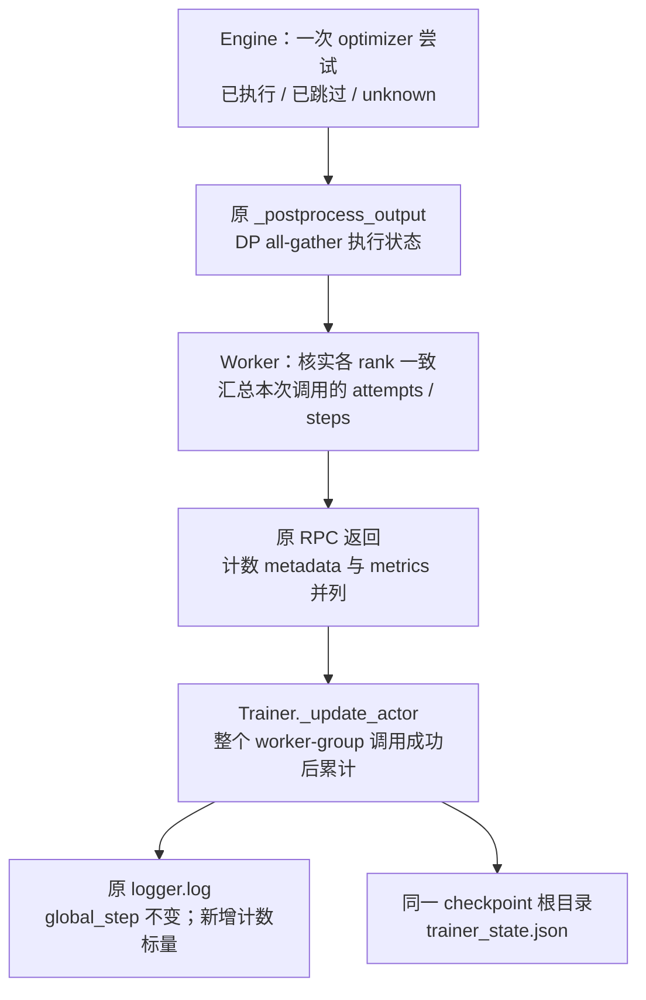

# 优势与 IS 消融及更新计数的最小实现方案

符号遵循[统一约定](../符号约定.md)；代码字段、论文原名与历史数据键保留原样。

本方案最初以源码 `565a1fda2` 为审阅基点，已在 `a9a61da09` 之后实施。V1 同步训练现支持 fixed/current advantage、token IS/NoIS、PPO clipping 对照，并记录 actor 的 optimizer 更新进度。算法与配置提交为 `d40950fc6`，计数与恢复提交为 `f274a24f6`；启动入口及测试状态见第 10 节。

首版采用同批多轮更新：batch=mini-batch=64，`ppo_epochs=4`。沿用现有共享八卡流水线，也允许相同算法在 standalone 下运行；执行模式不决定 loss。默认配置保留现有算法和一次更新，实验通过显式参数选择。暂不实现延迟队列 D、异步调度、长期离线缓存、MC 多候选或 prefix IS。

## 1. 文档边界与决定

| 内容 | 唯一维护位置 |
| --- | --- |
| 目标、梯度推导、有限缓存边界和论文依据 | [固定前缀推导](2026-10-21-固定前缀下的优势估计与重要性采样.md) |
| GPU 生命周期、完整调用链、teacher 数据对齐 | [共享八卡方案](../infra/2026-10-21-共享八卡运行与架构.md) |
| 已有测试证据与 GPU 验收 | [已完成的验证](../infra/2026-10-21-指标与验收.md#已完成的验证) |
| 生成、搬运、显存等性能指标与 W&B 通道 | [指标与验收](../infra/2026-10-21-指标与验收.md) |
| 算法开关、更新计数、恢复语义、文件改动和测试 | 本文 |

具体决定是：在蒸馏 loss 内增加一个局部计算分支，保留 legacy 分支；计数由 engine 提供单次执行事实、worker 汇总本次调用、trainer 持有累计值。复用现有字段、RPC、DP 指标收集和 logger。新增一个小的 trainer checkpoint 状态文件，不引入调度器、worker 子类、优化器包装器或事件服务。

## 2. 源码审阅得到的约束

| 位置 | 当前行为 | 对实现的约束 |
| --- | --- | --- |
| [distillation/losses.py](../../../../verl/trainer/distillation/losses.py)，`distillation_loss()` | 每次 forward 用当前 student 构造 detached advantage，调用 vanilla policy loss | 新实验分支放在此处；不修改通用 PPO 的含义 |
| 同文件，`distillation_ppo_loss()` | 即使 task reward 不贡献最终 loss，PG 模式仍计算普通 `ppo_loss()` 诊断 | 新实验应避免把另一套普通 PPO 诊断当作实际蒸馏指标 |
| [core_algos.py](../../../../verl/trainer/ppo/core_algos.py)，`compute_policy_loss_vanilla()` | 普通 clip、默认 dual-clip=3、log-ratio 的 `[-20,20]` 数值保护 | 放大普通 clip 参数不等于关闭所有限制 |
| [trainer_base.py](../../../../verl/trainer/ppo/v1/trainer_base.py)，`_compute_old_log_prob()` | 每次 actor 更新调用前重算一次 FSDP 参照概率；内部 epochs 复用 | 原 `old_log_probs` 保留，不覆盖生成时的行为概率 |
| [engine_workers.py](../../../../verl/workers/engine_workers.py)，`train_mini_batch()` | 遍历实际 mini-batch iterator，每次调用一次 `train_batch()` | 计数依据实际执行循环，不根据配置乘法估算 |
| [engine/base.py](../../../../verl/workers/engine/base.py)，`train_batch()` | 全部 micro-batch 完成后调用一次 `optimizer_step()` | micro-batch、backward 次数不能充当更新次数 |
| [FSDP engine](../../../../verl/workers/engine/fsdp/transformer_impl.py)，`optimizer_step()` | 非有限梯度可跳过 optimizer；FP16 另有 GradScaler | 尝试次数与实际执行次数必须区分 |
| `TrainingWorker._postprocess_output()` | 已通过 `allgather_dict_into_dict()` 收集各 DP rank 的指标 | 单次执行状态可复用这次收集，不另加一次同步 |
| [tensordict_utils.py](../../../../verl/utils/tensordict_utils.py)，`concat_tensordict_with_none_bsz()` | 纯 metadata 返回值合并时直接取第一份 | 返回 trainer 前，计数必须已经具有全局语义 |
| `train_mini_batch()` / `train_batch()` | LR scheduler 仅在整次调用的最后一次迭代推进 | 不能拿 scheduler 的步数当作 optimizer 更新次数 |

这些约束来自当前代码。尤其不能假设 Ray 会对计数求和，也不能把八卡上同一次全局更新计成八次。

## 3. 配置契约：只增加一个字段，扩展一个已有枚举

继续使用 `DistillationLossConfig`，不新建算法配置层。

| 字段 | 值 | 含义 |
| --- | --- | --- |
| 新增 `advantage_source` | `current` / `rollout` | 当前 student 信号 / 生成时冻结信号 |
| 扩展 `policy_loss_mode` | `vanilla` / `token_ppo` / `token_is` / `reinforce` | 原实现 / 行为概率分母的 PPO / 无 PPO clip 的 token IS / 无 IS 的 score-function loss |

默认仍为 `advantage_source=current`、`policy_loss_mode=vanilla`。`vanilla` 完整保留旧 ratio 分母、dual-clip、rollout correction 和诊断行为；首版要求其 advantage_source 为 current，避免给原实现叠加一组含混的混合语义。

三个新模式支持两种 advantage_source，彼此独立。NoIS 不强制改为 current advantage。无 IS 时没有可供 PPO clipping 的重要性比，因此使用三个明确模式表达有效组合，无需再增加 IS、clip、dual-clip 三组布尔开关。

### 3.1 实验组合

| 组别 | advantage_source | policy_loss_mode |
| --- | --- | --- |
| E1：固定 A + PPO clip | `rollout` | `token_ppo` |
| E2：固定 A + token IS | `rollout` | `token_is` |
| E3：重算 A + PPO clip | `current` | `token_ppo` |
| E4：重算 A + token IS | `current` | `token_is` |
| E5：重算 A + NoIS | `current` | `reinforce` |
| 可选：固定 A + NoIS | `rollout` | `reinforce` |

`token_ppo` 复用现有 `clip_ratio_low/high`；低/高值为空时沿用 `clip_ratio`。新模式不使用 legacy dual-clip。`token_is`、`reinforce` 不读取普通 clip 参数。配置解析后的实际 mode 必须进入现有 run config。

### 3.2 首版校验

局部 loss 组合由 `DistillationLossConfig.__post_init__()` 校验；依赖完整训练配置的限制接入现有 `validate_config()`，直接构造 V1 trainer 时复用同一个校验入口。不要在脚本、AgentLoop 和 worker 中各复制一份算法规则。

新模式首版要求：

- `loss_mode=k1`、`use_policy_gradient=True`、`use_task_rewards=False`，两个 loss/log-prob clamp 均为 null。
- V1 sync、FSDP2、SP=1、无 critic/reference，`parameter_sync_step=1`；现有 shared_sync 资源校验继续独立执行。
- Actor 使用原生 `torch.optim.AdamW`，BF16 或 FP32 计算、无 GradScaler。FP16、其他优化器和其他 engine 不纳入本次准确更新计数验收。
- 训练使用标准 vLLM 单轮路径，temperature=1、top-p=1、top-k=-1、repetition_penalty=1、processed_logprobs，并保存 `rollout_log_probs`。自定义 AgentLoop、额外 logits processor、强制 token 等改变采样分布的路径不在首版支持范围内。
- `algorithm.rollout_correction` 的 IS/RS 关闭，bypass_mode=False，避免重复校正或额外修改 mask。
- Actor entropy bonus 为 0，不混入 advantage 标准化等新变换。
- 同步 checkpoint 保存由配置校验强制要求。constant LR、零 warmup 是启动配方固定的实验控制条件，不属于 loss 的永久限制；保留原 scheduler 推进频率。

上述限制只约束新 loss 模式，不能缩小 vanilla 的既有支持范围。Frozen A 的定义明确为 teacher 减去生成时 log-prob；将来若研究 FSDP 冻结参照 $q$，应另设可辨认的实验，不能悄悄改变 `rollout` 的含义。

## 4. Loss 接线与数据合同

在 `distillation_loss()` 中按 mode 分支：vanilla 继续执行原代码；其他三个模式调用同文件内一个私有 sampled-token helper。不扩展全局 policy-loss registry，不改通用 `compute_policy_loss_vanilla()`，也不复制模型 forward 或 packing 逻辑。

| 数据 | 来源及刷新频率 | 在 helper 中的使用 |
| --- | --- | --- |
| 当前 log-prob | 每次训练 forward 的 `model_output["log_probs"]` | 保留梯度，使用现有 helper 提取 response 位置 |
| `teacher_logprobs` | 每个 rollout batch 评分一次 | 保留原 full-sequence next-token 布局，提取 response 后 detach |
| `rollout_log_probs` | vLLM 实际生成时保存 | 已是 response 布局，转为同形张量后 detach；不再次 shift |
| `old_log_probs` | 现有 FSDP 重算 | 新模式不拿它当行为分母；保留原生产链和诊断 |
| `response_mask` | 原始轨迹与 padding 流程 | 三个新模式使用相同有效 token 集合 |

本节 $\lambda_p=\log p$、$\lambda_T=\log T$、$\lambda_\beta=\log\beta$ 是实现侧对数概率，不占用核心稿的 log-ratio $r$。$A^{\rm OPD}$ 表示代码传入的未中心化信号：current 时为 $A^{\rm cur}$，rollout 时为 $A^{\rm roll}=\log(T/\beta)$；它不是核心稿的零均值 $\mathcal A_k$。仅在 $\beta=q_k$ 时 rollout 信号等于核心稿 $\kappa=0$ 的冻结 $A$。

设提取后的三种 log-prob 为 $\lambda_p,\lambda_T,\lambda_\beta$。实现合同只需以下定义，推导引用[目标文档](2026-10-21-固定前缀下的优势估计与重要性采样.md#32-两种正确的反向计算图)：

$$
A^{\rm OPD}=\operatorname{sg}(\lambda_T-\lambda_p)
\quad\text{或}\quad
A^{\rm OPD}=\operatorname{sg}(\lambda_T-\lambda_\beta),\qquad
w=\exp(\lambda_p-\lambda_\beta).
$$

| mode | 逐 token loss |
| --- | --- |
| `token_ppo` | $-\min(w A^{\rm OPD},\operatorname{clip}(w,1-\epsilon_l,1+\epsilon_h)A^{\rm OPD})$ |
| `token_is` | $-w A^{\rm OPD}$ |
| `reinforce` | $-A^{\rm OPD}\lambda_p$ |

两个有 IS 的模式通过 ratio 反传，NoIS 通过当前 log-prob 反传。不能把 ratio 变成常数 1 后继续使用 $-w A^{\rm OPD}$；也不能把未 detach 的 A 再乘入反向图。

Frozen A 可以在每次 forward 内从两个缓存张量相减；只要来源固定，数值就是冻结的。这不需要新增 advantage TQ 字段，不需要在 trainer 再做一遍前向。

三种模式统一复用 `agg_loss()` 和既有 `dp_size`、`batch_num_tokens`、`global_batch_size`。先屏蔽 padding 的无效概率，再做指数和乘法，避免 `0 * NaN`。局部 rank 没有有效 token 时仍要参与既有 FSDP 通信，不能在 loss 内单卡提前退出；全局有效 token 数为 0 的 batch 应在更新前统一拒绝。

### 4.1 数值保护与指标口径

新 IS 分支采用 FP32 log-prob 运算，复用当前 `[-20,20]` log-ratio 数值保护，并单独记录触发比例。`token_is` 表示关闭 PPO/dual-clip，不表示没有数值保护。首轮实验要求保护触发比例为 0；触发后不能将结果解释为未截断 IS。不要用很大的普通 clip 参数假装实现这个模式。

有效对照还要求非有限梯度跳步数为 0。出现跳步时记录事实并将该轮判为数值验收失败，不能仅凭外层 step 数声称完成了相同的参数更新预算。

对于新模式且 task rewards 关闭的情况，`distillation_ppo_loss()` 直接返回实际蒸馏 loss 和诊断，跳过普通 `ppo_loss()` 的无效计算。Vanilla 的诊断路径保持不变。模型 logits processor/top-k 路径仍沿原实现，新模式提前拒绝 top-k 组合。

## 5. 更新计数：事实留在 engine，累计留在 trainer

### 5.1 两个计数及其含义

- `optimizer_step_attempts`：一次完整 actor 调用中，实际完成的 optimizer-step 尝试数，包含非有限梯度导致的跳步。
- `optimizer_steps`：其中实际执行底层 optimizer.step 的次数；不承诺每个参数数值都改变，零梯度更新也属于执行。

Teacher 推理、old-log-prob、验证、micro-batch backward、梯度累积和权重同步都不推进计数。公式 `epochs × batch/mini_batch` 只用于测试预期和预算说明，不用作运行时事实源。

### 5.2 保留 optimizer_step 的返回接口

现有 `optimizer_step()` 返回 grad_norm，多个 engine 使用这个接口。首版不将返回值改成 tuple 或新结果类，也不根据 Adam 每个参数的 state.step 反推全局计数。

使用一个可选、非持久的执行状态：

1. `BaseEngine.train_batch()` 在调用 optimizer_step 前清空 `_optimizer_step_applied` 为 None。
2. FSDP 无 GradScaler 的路径，在非有限梯度跳步时写 False，在实际 optimizer.step 成功返回后写 True。
3. `BaseEngine.train_batch()` 仅在状态已知时，将 bool 放进输出 metrics 的内部键 `_optimizer_step_applied`；grad_norm 的返回和处理保持原样。
4. 其他 engine 未实现这个状态时保持 unknown，不用“函数返回了”推断实际参数更新。现有 FP16/GradScaler 行为保持不变，首版不读取其私有状态来猜测是否跳步。

该状态每次重置，只描述刚结束的那次尝试。Engine、worker 不保存跨训练调用的累计数，也不为 teacher 创建计数器。

### 5.3 复用现有 DP 收集，避免八倍计数

`_postprocess_output()` 已对普通 metrics 做 DP all-gather，因此内部 bool 会作为同次更新的 rank 列表返回。在 `train_mini_batch()` 的结果整理处，每个成功返回的 `train_batch()` 都令尝试数加 1；先消费并移除内部状态键，再执行原来的 loss/metric 聚合：

- 列表完整且各 rank 都为 True：全局实际执行数加 1。
- 列表完整且各 rank 都为 False：实际执行数不变。
- 缺失状态：实际执行数 unknown，不伪造为 0。
- 部分 rank 缺失或 True/False 不一致：视为分布式执行错误，不能取 MAX 或平均数掩盖它。

每个 mini-batch 只计一次。比如四次更新、八个 rank 都报告执行，结果是 4；不是 32，也不是把四次 `[1,1,1,1]` 平均成 1。

最终返回的计数放在现有 TensorDict 的非 tensor metadata 中，与 `metrics` 并列；已知值为整数，未知的实际执行数用 None 表示。不塞进轨迹 TQ 字段，也不交给通用 `reduce_metrics()`。所有输出 rank 已通过既有收集得到相同结论，所以当前“纯 metadata 取第一份”的合并规则可以继续使用，无需新增 collective。



### 5.4 Trainer 是累计值的唯一所有者

`_update_actor()` 在现有返回值被改写成 metrics 字典之前，通过 `tu.get()` 取两个计数。已知值必须是非负整数，两者均已知时还要求实际数不大于尝试数，然后累计到 trainer 的 actor 进度；普通指标再沿原路径处理。出现 unknown 时，相应累计值保持 unknown，不以 0 补齐历史。

计数不进入 `MetricsAggregator`，避免被样本权重平均或把累计值重复相加。即使未来一个外层 step 包含多次 `_update_actor()`，也是每次成功返回累计一次；本次新消融仍限制 `parameter_sync_step=1`。

Teacher 的 `infer_batch()` 不返回更新计数；critic 的计数不累入 actor。发生 RPC 异常时，调用可能已经做过部分更新，首版停止该次运行并从已有 checkpoint 恢复，不设计部分 mini-batch 的事务恢复。

## 6. 日志、scheduler 与 checkpoint

### 6.1 保持现有 global_step

新增的累计标量：

| 指标 | 含义 |
| --- | --- |
| `training/actor_optimizer_step` | 已确认 actor 调用累计实际执行的更新数 |
| `training/actor_optimizer_step_attempts` | 累计尝试数 |
| `training/actor_optimizer_skipped_updates` | 上述两者的差，派生值 |

在外层指标完成聚合后加入这些标量，继续调用 `logger.log(..., step=global_steps)`。初始验证也附上当前进度。W&B 中可选择 optimizer-step 标量作横轴；不改所有日志的 step，不在 worker 建立 W&B run，不增加每个 mini-batch 的远程日志调用。

此设计每个外层 step 记录一行，例如 PPO epochs=4 时记录进度 4、8、12……。累计计数不意味着已经提供逐次内部更新的曲线；首版不返回逐更新事件列表。批内过程先在固定 batch 的验收测试中检查。

### 6.2 不改变学习率推进频率

当前 scheduler 每次 `train_mini_batch()` 调用只推进一次，其 horizon 按外层调用配置。新计数不能取自 scheduler.last_epoch；也不应仅将 horizon 乘以 PPO epochs，却保留原推进频率。

本轮保留 constant LR 和零 warmup，计数只增加可观测性。将 scheduler 改成每个 optimizer update 推进属于另一个行为变更，另行设计、测试和比较。

### 6.3 恢复时不推算历史

在现有 checkpoint 根目录、`data.pt` 旁增加一个小的 `trainer_state.json`，由 trainer 读写。例如：

```json
{
  "schema_version": 1,
  "global_step": 20,
  "actor_optimizer_step_attempts": 80,
  "actor_optimizer_step": 80
}
```

同步保存时，actor 与 dataloader 保存完成后写临时文件，再用 `os.replace()` 发布状态文件，最后才沿既有流程发布 checkpoint 完成标记。状态文件写入失败不得宣告新 checkpoint 完成。无需修改 FSDP checkpoint manager 或把 trainer 状态塞进每个 rank 的 optimizer shard。

恢复规则：

- 新 checkpoint：检查 schema、global_step 与目录匹配、计数关系合法，然后恢复累计值；即使后续 PPO epochs 改变，也从已保存值继续累加。
- 旧 checkpoint 缺少状态文件：保留原模型与 dataloader 恢复能力，绝对计数标为 unknown 并省略相关累计标量，输出一次明确提示。不能用当前 epochs 乘历史 global_step 猜测。
- 状态文件存在但损坏或不一致：报错，不静默退回 0。
- 用旧模型权重开始一个新的实验，可以从计数 0 开始；这与续训是不同操作。

Unknown 可用 null 保存，不能将它解释成没有更新。严格比较更新预算的实验应从新 run 开始，或恢复带有有效计数的新 checkpoint。首版不增加手工填写历史偏移量的配置，也不修改异步 checkpoint callback。

## 7. 只补与消融直接相关的诊断

效果评测复用原三个验证集的 `acc/mean@16` 类指标，分别报告各数据集；不是 pass@16。性能指标继续引用 infra 文档。

新 loss 只补三个比例：`actor/distillation/ppo_clip_fraction`、`actor/distillation/advantage_sign_flip_fraction`、`actor/distillation/log_ratio_guard_fraction`。PPO clip 比例仅统计裁剪项严格改变 surrogate 的 token，不等于 ratio 越界比例。NoIS 不发布 clip 或 log-ratio 保护指标。两种 advantage 的乘积小于 0 才计为符号相反，零值不算。

使用现有 `Metric(SUM)` 收集有效 token 分母与各事件分子，在 `_update_actor()` 归约后相除。现有 `Metric.aggregate_dp()` 对 SUM 指标在 DP 间取均值，worker 后续还会对 mini-batch 标量取均值；分子、分母沿相同路径，公共平均因子在相除时抵消，中间值不作为全局事件总数发布。首版一个外层 step 只有一次 actor 更新调用，比例描述这次调用中所有 mini-batch 的有效 token 观测；不能先平均各卡或 micro-batch 的比例。

全局 ratio p99、逐内部更新轨迹和全词表 KL 留作固定 batch 的独立审计，不作为首版流水线必须增加的功能。尤其不能平均各 rank 的 p99 来冒充全局 p99。跨 loss 模式也不能直接比较 surrogate loss 数值来判断接近 teacher 的程度。

## 8. 文件改动与首轮预算

| 文件 | 实现改动 |
| --- | --- |
| [workers/config/distillation.py](../../../../verl/workers/config/distillation.py) | 新 advantage 字段、扩展已有 mode 枚举、局部及实验组合校验 |
| [distillation.yaml](../../../../verl/trainer/config/distillation/distillation.yaml) 及生成配置 | 声明向后兼容默认值 |
| [trainer/distillation/losses.py](../../../../verl/trainer/distillation/losses.py) | 一个私有 sampled-token helper；新模式跳过无效普通 PPO 诊断 |
| [engine/base.py](../../../../verl/workers/engine/base.py) | 重置并传递可选的本次 optimizer 执行状态，保留返回签名 |
| [FSDP engine](../../../../verl/workers/engine/fsdp/transformer_impl.py) | 在已执行和已跳过的分支填充 bool |
| [engine_workers.py](../../../../verl/workers/engine_workers.py) | 复用 DP 状态收集，汇总并返回每次调用计数 |
| [trainer_base.py](../../../../verl/trainer/ppo/v1/trainer_base.py) | 消费计数、累计、W&B 标量、状态文件保存恢复、诊断比率 |
| [utils/config.py](../../../../verl/utils/config.py) | 复用统一的新实验校验入口 |
| [公共脚本](../../_run_single_teacher_fsdp2.sh) | 增加 PPO epochs 和算法实验参数，保留现有默认训练 |

公共脚本已支持 `PPO_EPOCHS=1`、`OPD_ADVANTAGE_SOURCE=current`、`OPD_POLICY_LOSS_MODE=vanilla`、`OPD_CLIP_EPS=0.2`；最后一个值统一填写现有三个 clip 参数。专用消融入口支持 E1–E6，默认 PPO epochs=4；以下环境变量形式也可直接使用：

```bash
OPD_ADVANTAGE_SOURCE=rollout OPD_POLICY_LOSS_MODE=token_ppo \
PPO_EPOCHS=4 OPD_CLIP_EPS=0.2 \
CUDA_VISIBLE_DEVICES=0,1,2,3,4,5,6,7 \
bash examples/mirroropd/run_math_deepseek_r1_1_5b_fsdp2.sh \
  trainer.total_training_steps=32 \
  trainer.test_freq=32 \
  trainer.save_freq=32
```

统一 batch=mini-batch=64，先验收 32 个外层 step，再做 200 step 对照。无跳步时分别是 128 和 800 次 optimizer update。默认一题一条回答时，正式对照生成 12,800 条回答，复用后有 51,200 次样本训练；实际计数仍以运行返回值为准。所有组保持相同预算和验证设置。

各组从相同模型与 optimizer 初始状态开始，保持数据顺序和种子。固定输入的梯度验收使用同一批轨迹；端到端训练后续由各组自己的 student 生成回答，同一 seed 不保证不同 run 的回答相同。后者衡量训练效果，不能称为整个训练过程都共享同一个固定 prefix 集合。

不改 `trainer_sync.py`、AgentLoop、ReplayBuffer、TQ 底层、`core_algos.py`、`Metric`/`MetricsAggregator`、Tracking 或 checkpoint backend。无需新增 trainer 类型，也无需新增通用状态管理模块。

## 9. 实施顺序与验收

| 交付 | 必须验证的行为 |
| --- | --- |
| 纯 loss 与配置 | 六个新组合独立有效；legacy 输出及梯度保持；不支持的组合提前报错 |
| 数学一致性 | 正确 IS 下 current 梯度与完整目标对照；NoIS 非零梯度；fixed 值跨更新保持；改变 FSDP old 字段不改变新模式结果 |
| 数据布局 | 不等长 prompt/response、EOS、padding、空 response、不同 DP/micro-batch 划分；只做一次 response 对齐 |
| 数值边界 | 普通 clip 仅在 token_ppo 生效；无 dual-clip；保护触发率正确；无效 token 不产生 NaN |
| 更新事实 | 有限梯度调用 optimizer 后报 True，非有限跳步报 False；异常与未知 backend 不伪造成功 |
| 聚合计数 | batch64/mini64/epoch4 返回 4；batch256/mini64/epoch1 也返回 4；更多 micro-batch 不增加计数；八卡不乘八；DP 状态冲突报错 |
| Driver 与日志 | 每个成功 actor RPC 只累计一次；teacher/验证不累计；计数不被平均；同次 logger 调用进入离线 W&B history |
| Checkpoint | 保存恢复后计数连续；改变后续 epochs 仍准确；旧文件缺失为 unknown；损坏文件拒绝；失败保存不发布完成状态 |
| GPU 回归 | 在既有共享 teacher 测试中跑多轮 actor 更新与保存恢复；检查累计值、teacher 不变性、原权重同步路径 |

优先扩展 [mini-batch worker 测试](../../../../tests/workers/test_engine_workers_mini_batch_trace_on_cpu.py)、[trainer 测试](../../../../tests/trainer/ppo/v1/test_trainer_base_on_cpu.py)、[checkpoint callback 测试](../../../../tests/trainer/ppo/v1/test_checkpoint_callback_on_cpu.py)和[两卡集成测试](../../../../tests/special_distributed/test_shared_teacher_fsdp2.py)。新增一个聚焦 sampled-token loss 的 CPU 模块即可；复用[现有梯度验算](scripts/verify_fixed_prefix.py)的参照，不另写训练框架。

上表为验收范围。CPU 与启动配置验证的实际结果、GPU 验收状态记录于第 10 节，文档检查不代表训练通过。


## 10. 启动与实施验证

专用入口为 [run_math_opd_ablation_fsdp2.sh](../../run_math_opd_ablation_fsdp2.sh)，参数 E1–E5 对应第 3.1 节，E6 对应固定 A + NoIS。公共脚本默认仍为 vanilla、一次更新。专用入口默认 batch=mini-batch=64、epochs=4、32 个外层 step，并在最后验证和保存；无跳步时为 128 次 optimizer 更新。`TOTAL_TRAINING_STEPS=200` 对应 800 次更新。

```bash
# 在仓库根目录运行。先检查命令，再在 GPU 空闲时启动。
DRY_RUN=1 bash examples/mirroropd/run_math_opd_ablation_fsdp2.sh E1

CUDA_VISIBLE_DEVICES=0,1,2,3 STUDENT_GPUS=4 \
bash examples/mirroropd/run_math_opd_ablation_fsdp2.sh E1

# 其余组只替换 E1；该命令示例运行 E4 的 200-step 预算。
CUDA_VISIBLE_DEVICES=0,1,2,3 STUDENT_GPUS=4 TOTAL_TRAINING_STEPS=200 \
bash examples/mirroropd/run_math_opd_ablation_fsdp2.sh E4
```

默认 Python 为仓库 `.venv-native/bin/python`，模型与数据为仓库同级 `model/`、`data/`。本机测试环境可显式指定 `PYTHON_BIN=/root/.local/share/mirroropd/venvs/profile-cu128/bin/python`、`MODEL_ROOT=../models`、`DATA_ROOT=../MD-OPD/data`。各组从新 run 开始，末尾的 Hydra 参数仍有最高优先级；更改它们后须自行保持比较预算一致。启动脚本不会自动连续运行所有组。

恢复带计数的 checkpoint 示例：

```bash
CUDA_VISIBLE_DEVICES=0,1,2,3 STUDENT_GPUS=4 TOTAL_TRAINING_STEPS=200 \
bash examples/mirroropd/run_math_opd_ablation_fsdp2.sh E1 \
  trainer.resume_mode=resume_path \
  trainer.resume_from_path=/实际目录/checkpoints/global_step_32
```

新实验分支在旧 estimator 与 min/max 诊断之前分支，屏蔽无效 token 后计算 FP32 surrogate；全局空训练 mini-batch 由 FSDP 既有 token-count collective 的结果统一拒绝。全局 checkpoint 没有新增事务协议，`os.replace()` 只保证 trainer 状态文件的完整发布；状态写入失败不更新 latest 标记或触发保存完成 callback。异步 checkpoint 保留原行为，不写这份同步进度状态。

完整 CPU 回归 189 项通过，覆盖 loss、梯度与 token 对齐、DP/micro-batch 划分、计数、checkpoint、trainer 日志、启动脚本，以及旧 top-k、FSDP 梯度累积与配置测试。采样参数覆盖检查补充后，loss/配置与启动入口又通过 120 项复验。分阶段还分别运行过 112、53、66 项测试，与完整回归存在重叠，不重复计数。离线 W&B 实测读取 `.wandb` history，外层 step 0、1、2 对应 optimizer step 0、4、8，三行均含实际次数、尝试次数与跳步次数。

四卡集成测试已扩展为多 epoch、执行计数、teacher 不变性、保存恢复以及恢复后改变 epochs。运行入口如下；它使用本地生成的微型 Qwen2 与缓存行为概率，验证 FSDP worker 路径，不运行 Ray/vLLM 端到端生成。

```bash
CUDA_VISIBLE_DEVICES=0,1,2,3 OMP_NUM_THREADS=1 \
python -m torch.distributed.run --standalone --nproc-per-node=4 \
  tests/special_distributed/test_shared_teacher_fsdp2.py \
  --policy-loss-mode token_is --advantage-source current --ppo-epochs 4
```

GPU 验收待前四张卡释放后执行；当前 CPU 结果不代表 GPU 或完整训练已通过。32/200 step 正式消融尚未运行。
