# MirrorOPD 周会报告：框架能力、学习机制与目标设计

汇报日期：2026-11-02。项目从官方 verl `263653e7`（`verl-base-2026-10-19`）开始开发，至 `2b372ea5` 共 350 个提交。报告先介绍相对上游新增的功能，再按四条实验主线展开 RQ1–RQ4，并增加 RQ5 分析 teacher target。RQ3 使用十二组已完成训练与最终评测，RQ5 使用 10 月 31 日长程快照。统一评估部分同时纳入当前工作区的实现进展。

阅读顺序：[框架功能](#framework) · [RQ1 信号与理论](#rq1) · [RQ2 消融与预算](#rq2) · [RQ3 最新来源对照](#rq3) · [RQ4 迁移机制](#rq4) · [RQ5 Teacher target](#rq5)。

<a id="framework"></a>

## 1. 从 verl 到 MirrorOPD：新增了哪些框架能力

### 1.1 框架起点与当前结构

verl 基线已经提供 V1 Trainer、AgentLoop、vLLM rollout、TransferQueue（TQ）、ReplayBuffer、FSDP2、独立教师服务，以及 sampled `k1 + policy gradient` 蒸馏路径。MirrorOPD 在这套骨架上扩展教师执行、训练目标、生成策略和评估读出。

| 功能层                | 相对 verl 新增的主要能力                                                               | 代码落点                                                                       |
| --------------------- | -------------------------------------------------------------------------------------- | ------------------------------------------------------------------------------ |
| 实验入口与资产        | 声明式师生配对、预算和 E 系列预设；统一算法入口；模型身份与数据检查                    | `examples/mirroropd/launchers/`、`assets/`                                     |
| 教师执行              | shared-sync：teacher 与 student 分阶段共用 GPU 池；支持 token 概率与 hidden 两类监督   | `verl/trainer/distillation/shared_teacher.py`                                  |
| 算法目标              | 显式 sampled 信号／IS／PPO 消融；full-vocab RKL/FKL；sampled/full MDPO、full BPO       | `verl/trainer/distillation/`                                                   |
| Full-vocab 计算与数值 | Hidden/head 数据通路；分块投影与 VJP；precompute/Triton 融合；稳定小残差与独立精度配置 | `verl/workers/engine/fsdp/`、`verl/models/transformers/`                       |
| Rollout 来源与组合    | current/initial/teacher/checkpoint 引用；单模型、轨迹混合、逐 token 概率／几何融合     | `verl/experimental/rollout_policy/`、`verl/workers/rollout/`                   |
| 数据、指标与进度      | 样本身份、预测／response 坐标和全局分母；逐更新观测、位置分桶、成功更新计数与恢复      | `verl/workers/utils/`、`verl/utils/metric/`、`verl/trainer/ppo/v1/progress.py` |
| 验证与产物            | 独立验证协议；固定银行、动态历史、current 评估与 accuracy 调度；Parquet 与最终 HF 导出 | `verl/trainer/distillation/readout.py`、`verl/trainer/evaluation/`             |
| 研究与运行工具        | 固定状态／跨批机制研究；日志分析、图谱与性能探针；离线环境、源码与 W&B 日志交付        | `examples/mirroropd/research/`、`benchmarks/`、`meituan/`                      |

默认 shared-sync 训练主链如下。算法之间共用 Trainer、数据运输、worker 和 optimizer，在监督 payload 与目标计算处选择分支。


来源：[上游改动地图](../infra/architecture/upstream-changes.md)、[当前架构](../infra/architecture/README.md)、[训练循环](../infra/architecture/training-loop.md)。

### 1.2 共享教师与 Full-vocab 数据通路

shared-sync 将原来分开的师生资源池改为分阶段执行：rollout 生成后休眠，teacher 使用同一 GPU 池完成评分并卸载，再由 student 更新。验证复用 student 推理资源。Teacher 始终消费原始轨迹 token，保持前缀与监督位置一致。

Full-vocab 路径由 teacher 发布有效预测位置的 hidden，TQ 按样本身份运输；actor 按 micro-batch 读取 hidden，结合独立冻结的 teacher head 重建分布。Student 每次更新重新执行自身 backbone。需要 anchor 的镜像目标额外保留冻结的 anchor hidden/head。

这条设计把跨阶段传输从完整词表 logits 改为 hidden，并通过 token／vocab 分块控制计算显存。实现包括 recompute、precompute 和自有 Triton 融合后端。已有 OPD endpoint 固定输入测量中，融合使单卡 head-loss 耗时减少 43.5%，四卡管线的 actor 耗时减少 6.4%。

来源：[教师生命周期](../infra/architecture/teacher.md)、[Full-vocab 数据流](../infra/architecture/full-vocab.md)、[性能结论](../infra/performance/full-vocab/README.md)。

### 1.3 目标函数与数值执行

| 已接入的目标       | 主要控制项                                                               | 支持的研究比较                  |
| ------------------ | ------------------------------------------------------------------------ | ------------------------------- |
| Legacy sampled OPD | current／rollout 信号；REINFORCE、token-IS、token-PPO；保留 vanilla 路径 | 信号刷新、行为修正与更新约束    |
| Full-vocab RKL     | 完整词表动作求和；普通 Full-KL 也是 MDPO 的 η=1 端点                     | Sampled/full 对照与直接分布拟合 |
| Full-vocab FKL     | 教师在学生输出支持上的条件分布                                           | KL 方向对学习和完成行为的影响   |
| Sampled/full MDPO  | 冻结 anchor；κ 控制目标形状，η 控制插值与目标尺度                        | 镜像目标、约束强度与内层求解    |
| Full-vocab BPO     | 冻结 anchor 加权的中心化残差方差                                         | 同一目标教师下不同拟合损失      |

实现将目标构造、拟合损失、动作积分与计算后端分别组织。MDPO/BPO 共用 weighted target，普通 Full-KL 直接复用其端点；各方法共用训练循环与更新机制。正式共享主链使用单节点 FSDP2，Full-vocab 适配覆盖 Qwen2/Qwen3，并接入 Qwen3-MoE 教师。R1、Qwen3、Llama 的固定状态研究另由研究前端组织。

数值层增加近目标 KL／梯度的稳定计算、FP16 loss scaling、RoPE buffer 保真，以及 `bf16`、`fp16`、`bf16_fp32`、`fp32` 执行配置。Teacher、actor/anchor 与 rollout 的精度分别管理。模型兼容工作还包括 DeepSeek/Qwen 模板、输出支持和 EOS 等价终止动作，使监督目标与实际生成行为对应。

来源：[Sampled OPD](../infra/architecture/sampled-opd.md)、[MDPO/BPO 实现](../infra/numerics/mirror-objectives/实现方案.md)、[共享精度](../infra/numerics/precision/2026-10-27-共享训练精度与实验入口.md)、[模型兼容性](../infra/model-compatibility/README.md)。

### 1.4 可组合 Rollout

生成模型来源与监督 teacher 分开配置。Learner 可以在 A/B 生成的前缀上，继续学习监督 teacher Q。模型引用统一为 current、initial、teacher 或指定 checkpoint，组合方式有三种：

| 方式               | 生成行为                                                                                        |
| ------------------ | ----------------------------------------------------------------------------------------------- |
| Single             | 一份模型生成整条回答                                                                            |
| Trajectory mixture | 同一 batch 按配额分配完整回答，例如各一半来自 student 与 teacher                                |
| Token mixture      | 两份模型消费同一历史，融合下一 token 分布后采样一次；支持概率算术混合与 logit/log-prob 几何混合 |

每批生成前固定模型版本、混合系数、请求与随机身份；系数支持常数和线性日程，0/1 端点自动执行对应单模型。实现将来源解析、批次计划、资源阶段、权重同步和后端执行拆开，提供原生 vLLM 与 HF 参考路径，并记录真实 behavior log-prob。

来源：[Rollout 功能入口](../infra/rollout/fusion/README.md)、[统一模型来源与组合语义](../infra/rollout/fusion/semantics.md)。

### 1.5 指标、评估与恢复

指标系统按生成批次 outer、更新观测 update、实际 optimizer 更新分别记录进度。跨 micro-batch/rank 先合并 sum/count，再计算均值；Full-vocab 增加相对 response 位置分桶，MDPO/BPO 分别记录 objective、teacher KL、target KL 与 anchor KL。训练状态保存涵盖参数、Adam、scheduler、RNG、进度及相应 AMP scaler。

当前工作区的统一评估已接入 `EvaluationCoordinator`：在 outer 边界编译到期任务，将 source、history 和公共银行的 RKL 评分按字节预算合并执行，并分别调度 initial/current/teacher 生成及任务 accuracy。轨迹、逐题评分和更新记录写入 Parquet；最终模型导出为 HF 权重。

四卡多任务短验收已完成 source/history/bank/current 联合读出、Math/Code/Science/IF 小样本判分，以及独立 HF 重载；固定输入的重载 RKL 误差为 0。规模检查进一步覆盖 7B student／14B teacher 的 32K 合成前缀评分，以及六卡 batch128／reuse32 的一轮 32 次真实更新。后续正式配置为每域 6400 道训练题、batch128、reuse32、50 outer，先开展 Math；正式 50 轮结果待产出。

判分方面，原有迁入能力覆盖数学、代码、MultiIF 和函数调用；当前四域公共评测覆盖 Math、Code、Science 和 IF。LCB 判分采用有界进程隔离；验证支持独立长度、采样预算和重复检测。实验工具配套提供本地 W&B 日志分析、模型身份记录、逐题图谱、Nsight/Torch 性能探针与离线交付。

来源：[指标系统](../infra/architecture/metrics.md)、[进度与恢复](../infra/architecture/progress-checkpoint.md)、[统一评估实施进展](../infra/architecture/evaluation/代码走读与实施计划.md#8-统一评估实现与待验收边界)、[规模检查](../infra/performance/full-vocab/training.md#规模与六卡检查)、[判分器](../infra/evaluation/判分器与依赖.md)、[实验维护](../experiments/维护说明.md)。

<a id="rq1"></a>

## 2. RQ1：训练信号、动作积分与目标函数

### RQ1.1 固定前缀上的四种更新

固定输入前缀 $s$，省略条件记号。$p=p_\theta$ 为当前学生，$T$ 为冻结教师，$\beta$ 为生成动作时的真实行为分布。定义 $\psi_a=\nabla_\theta\log p(a)$、$\ell_a=\log[p(a)/T(a)]$、$w_a=p(a)/\beta(a)$。本节假设共同正支持、固定前缀与权重，使用未裁剪比值。

当前信号为 $A^{\rm cur}_a=-\ell_a$；冻结 rollout 信号为 $A^{\rm roll}_a=\log[T(a)/\beta(a)]$。两者在 surrogate 中均停止梯度，current 的数值在每次 student forward 后刷新。

从 reverse KL 的定义出发，利用 $\sum_a\nabla p(a)=0$：

$$
\begin{aligned}
D_T(p)&=\sum_a p(a)\log\frac{p(a)}{T(a)},\\
\nabla D_T
&=\sum_a\nabla p(a)(\ell_a+1)
=\sum_a p(a)\ell_a\psi_a\\
&=-\mathbb E_{a\sim p}[A^{\rm cur}_a\psi_a]
=-\mathbb E_{a\sim\beta}[w_a A^{\rm cur}_a\psi_a].
\end{aligned}
$$

因此，**current＋正确动作 IS 的期望梯度等于固定前缀 Full-KL 的梯度**。Full-vocab 通过完整动作求和计算这一梯度；sampled 通过实际行为样本估计它。

冻结信号使用 $r_a=\log[T(a)/\beta(a)]$ 时，$D_T-D_\beta=\mathbb E_p\log(\beta/T)$，故 $\nabla(D_T-D_\beta)=-\mathbb E_\beta[w r\psi]$。去掉 IS 后，current 的更新为 $\mathbb E_\beta[\ell\psi]=\nabla\frac12\mathbb E_\beta\ell^2$；冻结信号则给出 $-\mathbb E_\beta[r\psi]=\nabla[-\mathbb E_\beta(r\log p)]$。四格对应关系为：

| 信号           | 动作积分            | 对应标量目标                            | 实际含义                     |
| -------------- | ------------------- | --------------------------------------- | ---------------------------- |
| Current        | IS，等价于 $p$ 测度 | $D_T(p)$                                | 随当前学生刷新教师差值       |
| Frozen rollout | IS，$p$ 测度        | $D_T(p)-D_\beta(p)$                     | 持续强化冻结的相对偏好       |
| Current        | NoIS，$\beta$ 测度  | $\frac12\mathbb E_\beta[\log(p/T)]^2$   | 在行为分布下回归 log-prob 差 |
| Frozen rollout | NoIS，$\beta$ 测度  | $-\mathbb E_\beta[\log(T/\beta)\log p]$ | 冻结带符号权重的交叉熵型更新 |

这些是与期望梯度对应的目标。代码显示的 detached surrogate 数值另有含义；PPO clipping、log-ratio guard 触发时采用相应分段梯度。固定动作可以复用，current 信号仍随学生参数更新。

完整证明与小词表梯度核对见[固定前缀目标与梯度](../theory/2026-10-22-固定前缀下的OPD目标与梯度.md)、[计算图](../theory/2026-10-22-Full-vocab计算图与四种更新.md)。

### RQ1.2 镜像正则与冻结目标

令 $q$ 为本轮冻结学生 anchor。对冻结信号 $\log(T/q)$，加入精确的 $D_q/\eta$ 后，内层目标为

$$
F(p)=D_T(p)+\left(\frac1\eta-1\right)D_q(p)
=\frac{D_{\rm KL}(p\Vert m)-\log Z}{\eta},
\qquad m(a)=\frac{q(a)^{1-\eta}T(a)^\eta}{Z}.
$$

在完整概率单纯形上，$D_{\rm KL}(p\Vert m)$ 的极小值于 $p=m$ 取得，因此镜像步骤的目标教师为几何插值。$\eta=1$ 时恢复普通 Full-KL；实现保留外部 $1/\eta$ 尺度。

若 current 信号也直接加相同的 $D_q/\eta$，得到 $D_T+D_q/\eta$，极小值为 $m_{\rm prox}\propto q^{1/(1+\eta)}T^{\eta/(1+\eta)}$。要让 current 形式表达上式同一个镜像子问题，anchor 系数应设为 $1/\eta-1$。目标插值强度 $\eta$ 与 optimizer 学习率分别控制。

推导见[镜像下降与离策略更新](../theory/2026-10-22-镜像下降与离策略四种更新.md)。这里的 $q$ 是训练端冻结 anchor；真实 rollout 分母仍由 $\beta$ 提供。

### RQ1.3 论文结果与本项目比较轴

AsyncOPD 在 Qwen3-4B-Base ← Qwen3-30B-A3B-Instruct-2507、DeepMath 上分别改变信号刷新和 PPO clipping。原论文 Figure 3(a) 与 Table 1(a) 中，current＋IS、无 PPO clip 的退化斜率最接近零。[^asyncopd]

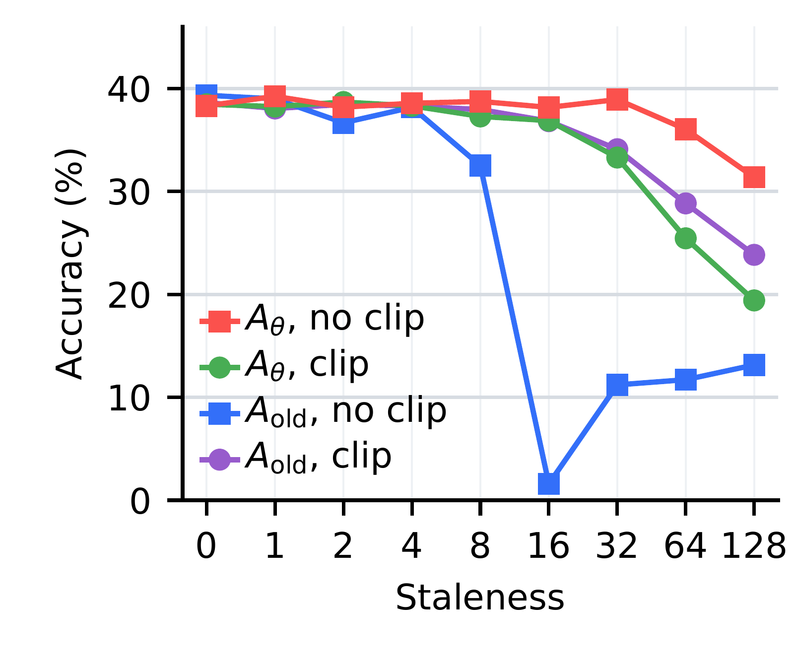

图 RQ1-1：AsyncOPD Figure 3(a) 原图。横轴为缓存 batch 延迟；本项目的 reuse 是同批内部更新次数，两者分别记录。

| AsyncOPD，AIME25                     | Frozen＋clip | Frozen＋IS | Current＋clip | Current＋IS |
| ------------------------------------ | -----------: | ---------: | ------------: | ----------: |
| Accuracy 对 $\log_2(D+1)$ 的拟合斜率 |        −1.42 |      −3.69 |         −1.88 |       −0.38 |

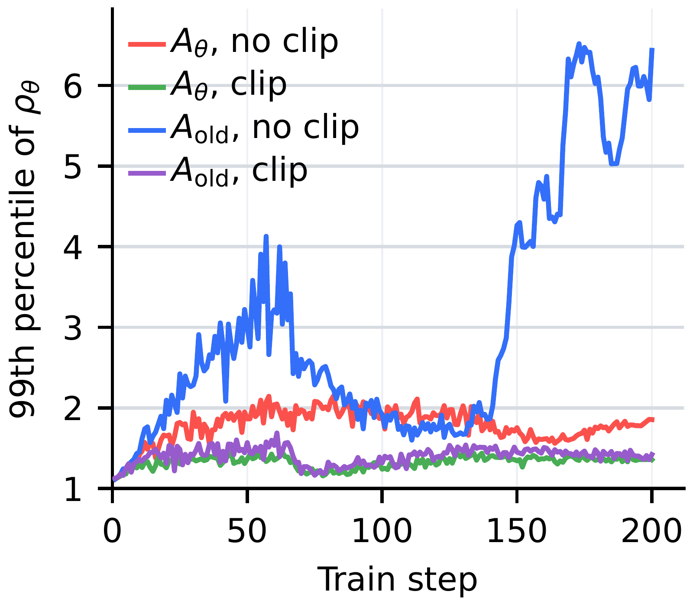

图 RQ1-2：原论文 Figure 5，固定 stale=64。current 信号对应的 ratio 长尾更小；PPO 限制 surrogate 的活跃分支，实际 ratio 仍可超出 clip 区间。图中约 6–6.5 与 1.5–2 是曲线近似读数。[^asyncopd]

GKD 将学生自生成序列上的教师分布监督与 divergence 选择分别建模。MiniLLM 使用序列 reverse KL 与 policy gradient；其单步分解减少估计方差，GPT-2-125M ← 1.5B 消融中去掉 single-step decomposition 后 Dolly Rouge-L 为 23.7，完整方法为 24.6。我们的 Full-vocab 路径精确计算给定前缀的动作积分。[^gkd][^minillm]

### RQ1.4 本项目 sampled 信号消融

实际配对为 R1-Distill-Qwen-1.5B ← JustRL-DeepSeek-1.5B；DAPO、batch64、LR1e-6、训练 cap7168。短程为 32 outer×reuse4，长程为 200 outer×reuse16；验证 MATH-500／AMC23／AIME25，每题 16 答、cap31744。

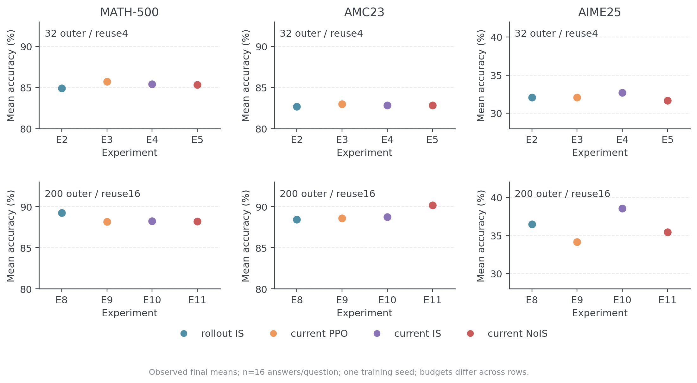

图 RQ1-3：从八个正式 run 的末次 mean accuracy 重画。上下排各自比较四种信号／修正；两个预算同时改变 outer 和 reuse。

| 长程分支           | MATH-500 |  AMC23 | AIME25 |
| ------------------ | -------: | -----: | -----: |
| E8：rollout＋IS    |   89.26% | 88.44% | 36.46% |
| E9：current＋PPO   |   88.19% | 88.59% | 34.17% |
| E10：current＋IS   |   88.25% | 88.75% | 38.54% |
| E11：current＋NoIS |   88.20% | 90.16% | 35.42% |

MATH、AMC、AIME 的最高末点分别来自 E8、E11、E10。理论给出目标与梯度身份，任务比较则显示不同基准的排序不同。当前已有四个长程分支；冻结信号＋PPO／NoIS 的对应配方仍需独立结果。

来源：[Sampled 信号消融](../experiments/learning-signal/sampled-controls/2026-10-25-Sampled信号消融.md)、[绘图输入](data/20261101/sampled-signal.csv)。

### RQ1.5 Sampled 与 Full-vocab 的直接对照

E13/E15 采用同一师生配对、LR1e-6、每批更新一次、200 outer。E13 为直接 Full-KL，E15 为 legacy sampled vanilla。二者使用相同验证预算。

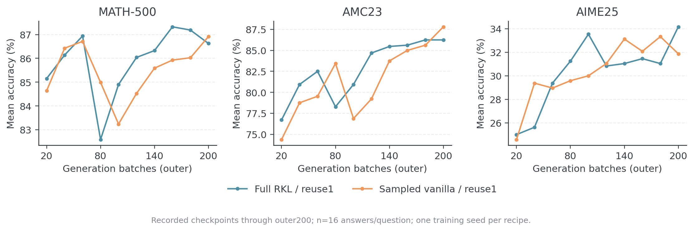

图 RQ1-4：从已归档完整 history 提取 20、40…200 的实际验证点重新绘制；E13 为 A800、E15 为 A100。

末点 MATH／AMC／AIME 分别为 Full-KL **86.63%／86.25%／34.17%**、sampled **86.91%／87.81%／31.88%**。Full-KL 精确消除了条件动作抽样误差；这一配对的任务收益呈现混合排序。

来源：[基础对照与实际设置](../experiments/learning-signal/sampled-vs-full/2026-10-28-基础对照设置与结果索引.md)、[逐点数据](data/20261101/baseline-evaluations.csv)。

<a id="rq2"></a>

## 3. RQ2：逐项拆解 Reuse、更新预算、长度与学习率

本节主配对仍为 R1-1.5B ← JustRL-1.5B，目标为 Full-vocab RKL。每个 ablation 分别说明固定项和改变项。

### RQ2.1 固定生成批次，增加同批更新次数

E13/E16/E17 固定 outer200、batch64、LR1e-6、cap7168，分别 reuse1/4/16；成功更新数为 200/800/3200，各生成 12800 条训练回答。

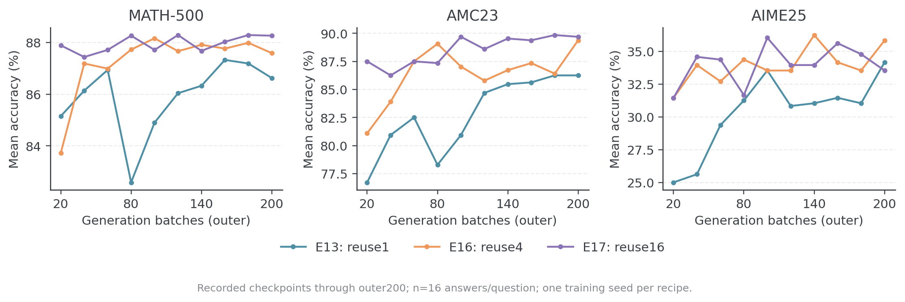

图 RQ2-1：三组完整验证轨迹，横轴为新生成批次。曲线使用最新完整 history，包含 E17 的 outer200。

| Reuse   | MATH-500 |  AMC23 | AIME25 | 成功更新 |
| ------- | -------: | -----: | -----: | -------: |
| 1，E13  |   86.63% | 86.25% | 34.17% |      200 |
| 4，E16  |   87.59% | 89.38% | 35.83% |      800 |
| 16，E17 |   88.26% | 89.69% | 33.54% |     3200 |

复用增加后，MATH/AMC 末点提高；AIME 的最高末点来自 reuse4。E17 比 E16 多四倍更新，任务收益随数据集变化。


图 RQ2-2：E16/E17 的冻结收敛分析，分别显示新批起点、复用末次与批内下降。第 1→第 16 次观测跨越 15 次已执行更新；E17 后期同批仍有约 46% 首末下降，换批起点另行统计。

来源：[基础配方与完整末点](../experiments/learning-signal/sampled-vs-full/2026-10-28-基础对照设置与结果索引.md)、[后期收敛](../experiments/reuse-budget/reuse-comparison/2026-10-24-E16E17位置指标与后期收敛.md)。

### RQ2.2 固定更新预算，改变新回答数量

E18/E19/E20 分别 reuse64/32/16。计划各 4096 次更新；以下三组图来自共同验证 update2560 的冻结分析，该预算下新回答数为 2560/5120/10240。

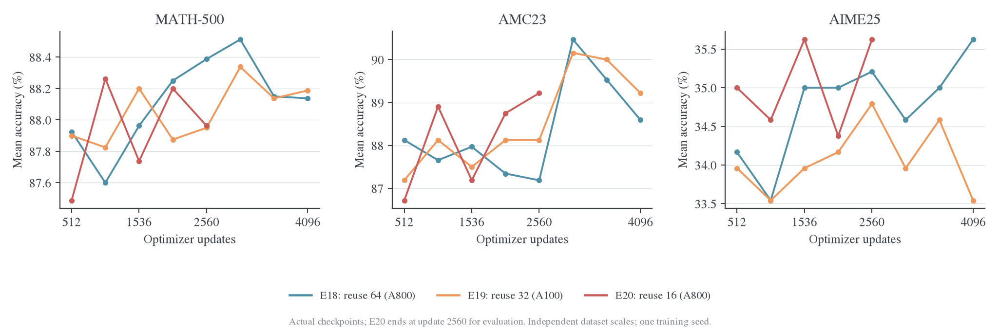

图 RQ2-3：横轴为真实 optimizer 更新数。三组共同点截止 2560；E18/E19 的后续记录继续保留在原图。

| Update2560   | MATH-500 |  AMC23 | AIME25 |
| ------------ | -------: | -----: | -----: |
| E18，reuse64 |   88.39% | 87.19% | 35.21% |
| E19，reuse32 |   87.95% | 88.13% | 34.79% |
| E20，reuse16 |   87.96% | 89.22% | 35.63% |

E18 相比 E20 少生成 **74.77%** response token，记录训练＋验证时间少 **19.56%**；MATH 高 0.43 个百分点，AMC/AIME 低 2.03/0.42 个百分点。高 reuse 提供了节省生成的有效基线。

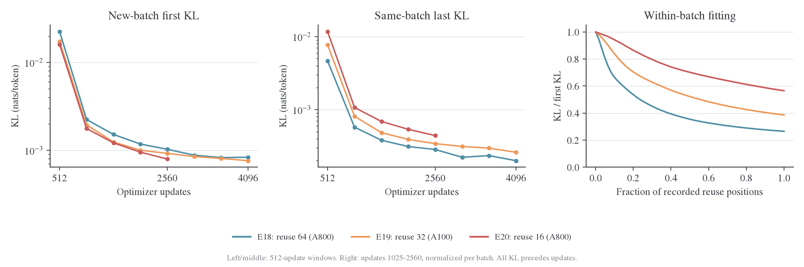

图 RQ2-4：高 reuse 的同批末次 KL 更低，更多新轨迹的新批起点更低。两种收益描述不同的训练阶段。

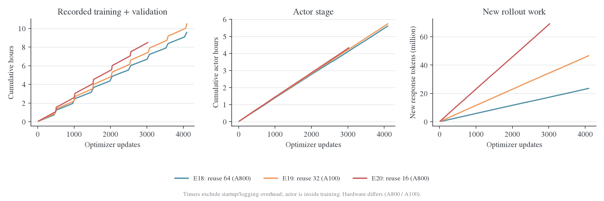

图 RQ2-5：同时展示新生成工作量与已记录耗时。真实更新数、新 token 和墙钟共同定义预算。

来源：[等更新预算冻结分析](../experiments/reuse-budget/equal-update-budget/2026-10-25-等更新预算冻结分析.md)。

### RQ2.3 固定生成批次和更新，扩大回答窗口

E35/E17 在共同 outer200/update3200 比较 cap15360/7168，均生成 12800 条回答；验证统一 cap31744、每题 16 答。

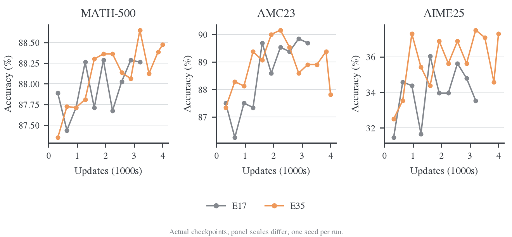

图 RQ2-6：长窗 E35 与短窗参照的实际验证点。训练窗口改变，验证窗口相同。

共同 outer200，E35 的 MATH／AMC／AIME 为 **88.65%／88.91%／37.50%**，相对 E17 为 **+0.39／−0.78／+3.96** 个百分点。训练触顶率从 **40.14%** 降到 **4.55%**，新 response token 增加 **22.71%**，记录训练时间增加 **45.18%**。

AIME 的收益与更完整的训练覆盖相伴；E35 在相同验证 cap 下的平均 AIME 回答还更短。该历史配对包含硬件和代码差异，后续用统一版本复测长度与成本关系。

来源：[E35 长窗口结果](../experiments/reuse-budget/response-cap/2026-10-28-E35长窗口与生成预算.md)。

### RQ2.4 固定预算，改变 optimizer 学习率

E13/E14 固定 Full-KL、reuse1、outer200，比较 LR1e-6 与 5e-7。

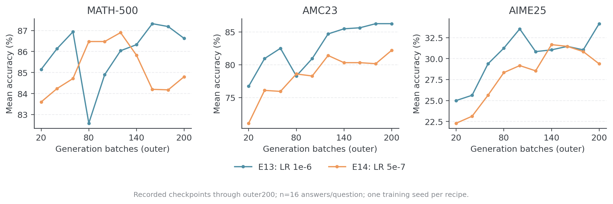

图 RQ2-7：相同生成与更新预算下的学习率对照。末点 LR1e-6 的 MATH／AMC／AIME 为 86.63%／86.25%／34.17%，LR5e-7 为 84.80%／82.19%／29.38%。

LR1e-6 在三个末点评价上都更高。这项结果支持将当前学习率保留为该配对的基线；Mirror 的目标插值参数另在 RQ5 比较。

<a id="rq3"></a>

## 4. RQ3：六种 Rollout 来源的最新完整结果

十二组在冻结代码 `c52e3eb6` 上完成各 40 outer/640 次更新及最终纯 student avg@4。JustRL 六来源的宏平均为 59.11%–60.63%，相对 current 的题目配对区间均跨零；Polaris 的 initial/current 为 53.28%/52.02%，混合为 44.09%–46.75%，teacher 来源为 37.45%。共同状态 RKL 与最终 accuracy 的排序不同，各分支仅一个训练 seed。

完整协议、六张图、配对统计、长度分析、完成审计及后续 fresh 读出边界统一由[十二组实验报告](../experiments/rollout-policy/2026-11-01-E20设置下的六种前缀对照.md#完成结果与分析)维护。本周会保留截至 2026-11-01 的摘要；原图和数据附件继续保存在本目录，不改写历史产物。

<a id="rq4"></a>

## 5. RQ4：师生迁移与优化机制

### RQ4.1 Failure reproduction：能否正常学习，以及能吸收多少教师行为

这组实验复用论文中学习受限的模型对，检验当前 Full-vocab 配方能否稳定更新、提高任务正确率，并持续缩小师生分布差距。观察分成两层：accuracy 描述解题收益，KL 描述在实际访问前缀上的教师拟合程度。三条运行各自作图，teacher 的参考另按其实际评测协议标注。

#### 实际 setting

共同设置为 DAPO、Full-vocab RKL、batch=mini-batch64、每题一条当前学生 rollout、reuse16、AdamW LR1e-6、seed42、token-mean；训练采样 T1/top-p1。Teacher 使用 shared-sync FSDP2 评分，八张 H800。验证均为 T0.7、top-p0.9、top-k−1、cap31744、每题 16 答，每 10 outer 一次。

| 实验 | Student ← Teacher                   | 训练 prompt/response cap | Outer／实际更新 | 初始验证／任务集                    | 实际 KL 目标          |
| ---- | ----------------------------------- | ------------------------ | --------------- | ----------------------------------- | --------------------- |
| E39  | Qwen3-1.7B-Base ← Qwen3-8B          | 1024/7168                | 200／3200       | 有；MATH500/AMC23/AIME25，共 570 题 | 合并 EOS151643/151645 |
| E41  | Qwen3-1.7B-Base ← Qwen3-4B          | 1024/7168                | 100／1600       | 无；同上 570 题                     | 合并相同两个 EOS      |
| E43  | Qwen3-1.7B ← Qwen3-4B-Instruct-2507 | 4096/7168                | 100／1600       | 有；增加 AIME24/26，共630题         | 原始词表 RKL          |

三组使用 non-thinking 提示；对 Base，这是输入协议。E39 对应 TIDE 的 Base←8B 失配，E41 对应 Rethinking OPD 的 Base←4B 配对，E43 对应 Semi-OPD 的后训练 student←4B-Instruct。当前运行采用 Full-vocab、reuse16 和各自终止设置，实际协议由表内条件确定。

KL 图同时显示同一批第 1 与第 16 次更新前的观测。E39/E41 的原始词表 KL 包含终止 token 身份差异，实际 loss 将两个 EOS 合为一个动作；E43 的两者相同。横向每个 outer 都换成新的学生轨迹。

#### E39：Base ← 8B，前期学习明显，后期保留较大差距

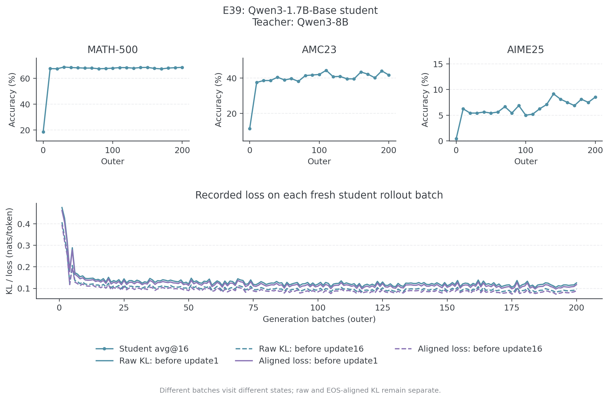

图 RQ4-1a：只展示 Qwen3-1.7B-Base ← 8B。上排为完整 570 题验证，下排分别记录原始词表 KL 和 EOS 对齐 loss，实线／虚线为批首／第 16 次观测。

初始→outer200 的 MATH／AMC／AIME25 为 **18.59%→68.39%、11.41%→41.72%、0.42%→8.54%**。主要提升在前 10 outer 形成。最后 20 批的原始 KL 平均为 **0.1162→0.0904**，实际优化 KL 为 **0.1078→0.0820**，同批仍能下降约 24%，跨新批起点则维持非零残差。

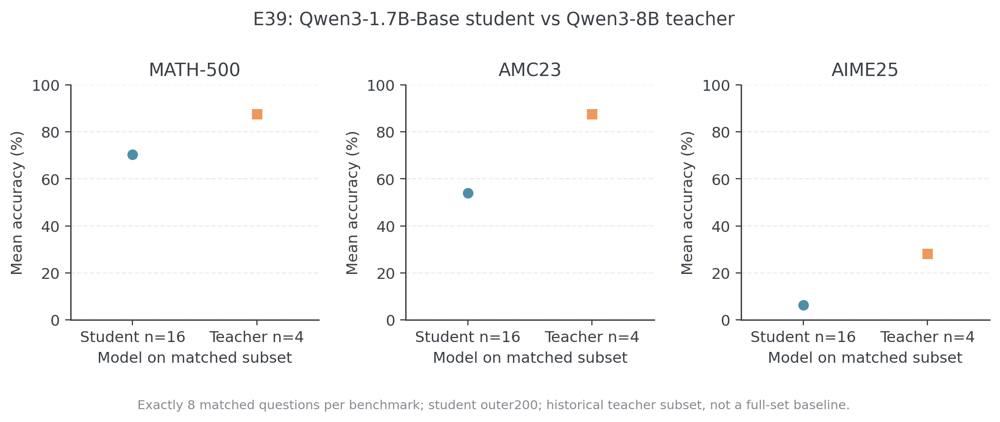

图 RQ4-1b：每个基准严格匹配 8 道题；student 为 outer200 的 avg@16，teacher 为历史 avg@4。这个子集单独画，不作为完整 570 题曲线的水平参考。

同题子集 teacher 的 MATH／AMC／AIME25 为 **87.50%／87.50%／28.13%**，学生为 **70.31%／53.91%／6.25%**。已有证据同时支持“能够学到任务相关行为”与“终点仍有分布残差和 teacher 任务差距”。

#### E41：Base ← 4B，训练 KL 持续下降，任务较早进入平台

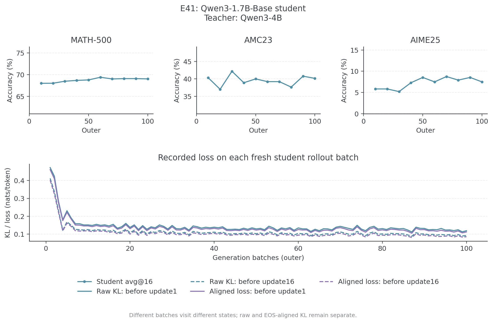

图 RQ4-1c：只展示 Qwen3-1.7B-Base ← 4B；验证从 outer10 开始。该配对尚缺本机同协议完整 teacher 基线。

MATH／AMC／AIME25 从 outer10 的 **68.03%／40.31%／5.83%** 变为终点 **69.04%／40.16%／7.50%**。第 16 次观测的原始词表 KL 从首批 **0.4121** 降到末批 **0.0919**，实际 loss 从 **0.4020** 降到 **0.0850**。最后 10 批仍有约 24.13% 的批内下降，后续任务增益较小。

#### E43：后训练 student ← 4B-Instruct，任务提高但仍低于 teacher 参考

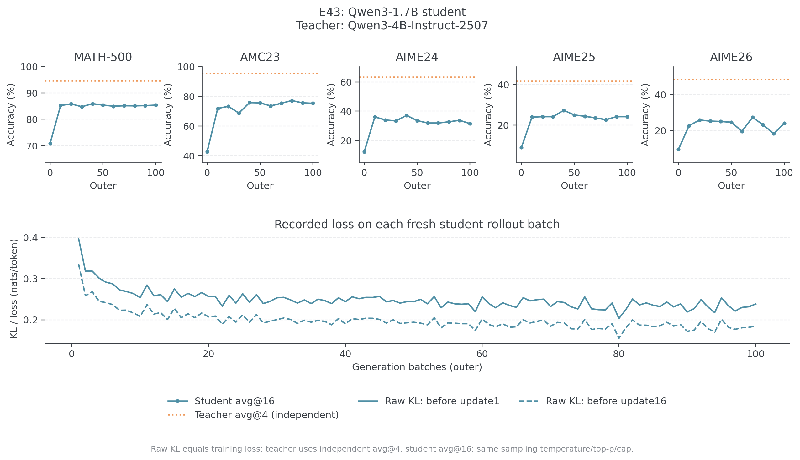

图 RQ4-1d：只展示后训练 Qwen3-1.7B。橙虚线来自已有独立 teacher 完整 630 题 avg@4；学生曲线为 avg@16。两者采用 non-thinking、T0.7/top-p0.9/cap31744，采样数、seed 与执行实例分别保留。

学生终点 MATH／AMC／AIME24/25/26 为 **85.39%／75.31%／31.46%／24.17%／23.96%**。独立 teacher 参考为 **94.70%／95.63%／63.33%／41.67%／48.33%**。MATH/AMC 相对学生初始点提高 14.60/32.50 个百分点，终点仍低于 teacher 参考。

E43 原始 KL 与实际 loss 相等，第 16 次观测从 **0.3351→0.1853**；最后 10 批仍有约 21.73% 的批内下降。三条 failure reproduction 都完成了连续有效更新，展示出可学习性；学习后期的任务平台、非零 KL 和可用 teacher 差距共同构成后续“充分吸收”研究的起点。固定状态的残差与覆盖另由 RQ4.2–4.5 测量。

来源：[Failure reproduction 矩阵](../experiments/teacher-transfer/teacher-comparison/failure-matrix/2026-10-28-矩阵与已运行变体映射.md)、[E39 完整分析](../experiments/teacher-transfer/teacher-comparison/qwen-base-8b/2026-10-27-完整训练与验证分析.md)、[E41/E43 实际设置](../experiments/teacher-transfer/teacher-comparison/qwen-teachers/2026-10-28-E41与E43完整结果及论文对照.md)、[新增图的逐点输入与 teacher 记录](data/20261101-review/followup-data.json)、[来源哈希](data/20261101-review/sources.json)。

### RQ4.2 同尺寸教师：谱系与直接后训练

固定状态主比较共完成 **42 个不同师生权重配对、50 个输入条件**，覆盖 R1、Qwen3、Llama。每条线固定原始学生与 S0 银行，数学题训练；batch16、reuse16、H1024。整体留出为 Math64/Code32/IF32，先合并风险再计算相对降幅。

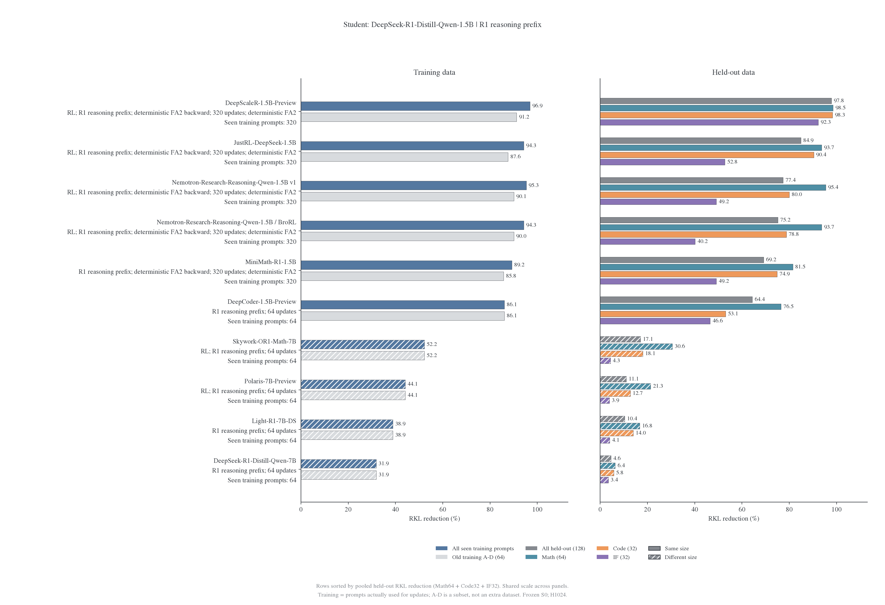

图 RQ4-2：R1 同一学生的教师谱系终点。每行标明真实预算，图中同时保留训练与留出。

R1-1.5B 在 320 更新后，学习 DeepScaleR、JustRL、Nemotron v1 的整体留出 RKL 分别下降 **97.83%、84.92%、77.40%**。JustRL 的 Math/Code/IF 降幅为 **93.69%/90.35%/52.79%**，跨域传播幅度也存在差别。

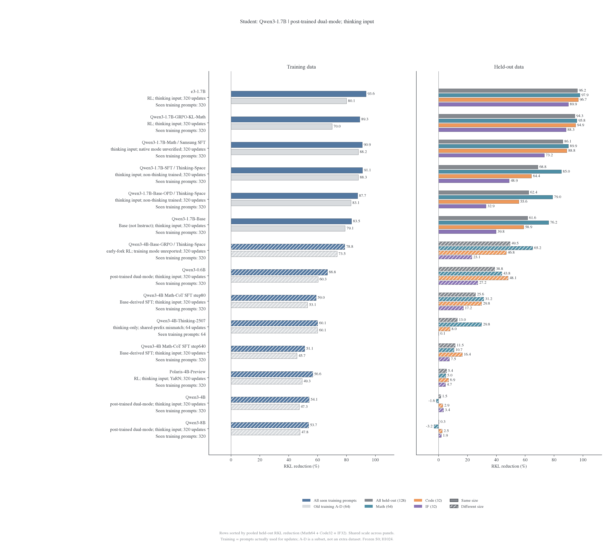

图 RQ4-3：相同 Qwen3-1.7B thinking 银行下的同尺寸与跨尺寸目标；本小节重点比较同尺寸行。

| Qwen3-1.7B 学习的同尺寸目标，320 更新 | 初始整体 RKL | 最终整体 RKL |   降幅 |
| ------------------------------------- | -----------: | -----------: | -----: |
| e3，直接 RL 后继                      |     0.033804 |     0.001298 | 96.16% |
| GRPO-KL-Math，直接 RL 后继            |     0.019611 |     0.001109 | 94.34% |
| Samsung Math SFT                      |     0.248817 |     0.034588 | 86.10% |
| Thinking-Space SFT                    |     0.616008 |     0.191977 | 68.84% |
| 公开 Qwen3-1.7B-Base                  |     0.599753 |     0.230065 | 61.64% |

直接 RL 与直接 SFT 后继都能取得较大拟合幅度，较早分叉或回到 Base 的目标残差更高。Teacher-copy 对照给出了更低风险的可行参数点，后续重点是**从规定学生起点出发的优化与泛化到达**。公开教师的目标改变量和数据也随谱系改变，下一项控制是同一教师固定，只更换 Base／后训练 student 初始化。

来源：[总览与逐题数据](../experiments/teacher-transfer/transfer-mechanism/2026-10-29-教师谱系实验总览与RKL进展.md)、[Qwen teacher-copy 与谱系分析](../experiments/teacher-transfer/transfer-mechanism/qwen3/2026-10-29-Qwen3谱系与同构教师吸收.md)。

### RQ4.3 跨尺寸的两个方向

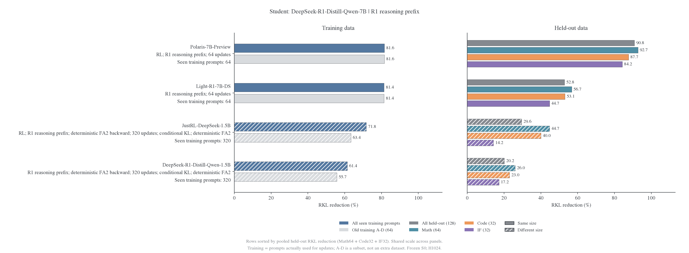

图 RQ4-4：固定 R1-7B 学生；小教大行采用共同 151936 维条件 RKL，并标明 320 更新；近源 7B 教师保留 64 更新的实际读出。

| Student ← Teacher               | 更新 | 整体留出 RKL 降幅 |
| ------------------------------- | ---: | ----------------: |
| R1-7B ← R1-1.5B                 |  320 |            20.16% |
| R1-7B ← JustRL-1.5B             |  320 |            29.57% |
| R1-7B ← Polaris-7B              |   64 |            90.82% |
| Qwen3-1.7B ← Qwen3-4B，thinking |  320 |             1.47% |
| Qwen3-1.7B ← Qwen3-8B，thinking |  320 |             0.26% |

小教大两组分别从 **0.236807→0.189057**、**0.349913→0.246454**，仍保留明显残差。大教小也出现弱改善，而近源同尺寸 Polaris→R1-7B 的拟合快得多。尺寸方向、初始化谱系和函数参数化共同影响有限预算结果。

下一项比较固定同一大教师，分别使用其同尺寸 Base 与小学生；小教大则继续使用同一小教师和共同银行，控制覆盖与预算。

来源：[R1 小教大协议](../experiments/teacher-transfer/transfer-mechanism/r1/2026-10-29-小教师到大模型的跨尺寸吸收.md)、[配对矩阵](../experiments/teacher-transfer/transfer-mechanism/2026-10-31-研究问题与师生配对设计.md)。

### RQ4.4 SFT 深度与后训练阶段：区分目标更远和增量更难迁移

这里分别回答两个问题：同一个 SFT run 的后期 teacher 是否更难拟合；不同 teacher 阶段训练出的学生是否追随了对应的阶段变化。前者有同 run 早晚 checkpoint，后者用相邻 teacher 的函数变化作独立方向诊断。

#### 同一 SFT run：晚期目标的局部拟合与泛化进一步分离

Student 固定 Qwen3-1.7B；两个 teacher 是同一 Qwen3-4B Math-CoT SFT run 的 step80/step640。共享原始 student 的 thinking S0 前缀、数学训练银行 320 题；batch16/reuse16、H1024、LR1e-6，各做 320 次更新。固定留出为 Math64/Code32/IF32。训练银行始终是同一320题，早期包含尚未访问的题。

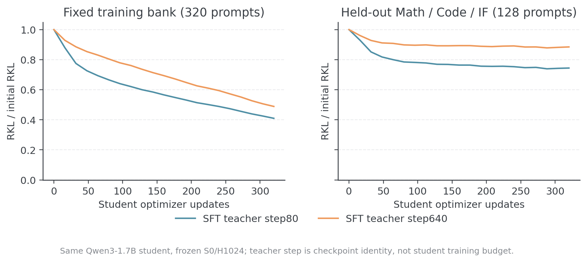

图 RQ4-5：各曲线按自己的初始风险归一化。左侧固定训练银行继续改善，右侧显示晚期 teacher 更弱的留出改善。

| 320 更新后的风险               |           SFT teacher step80 |          SFT teacher step640 |
| ------------------------------ | ---------------------------: | ---------------------------: |
| 固定训练银行 RKL               | 0.206245→0.084554，降 59.00% | 0.222822→0.108965，降 51.10% |
| 整体留出 RKL                   | 0.386144→0.287476，降 25.55% | 0.419072→0.370862，降 11.50% |
| 留出绝对下降量                 |                     0.098669 |                     0.048210 |
| 最后 64 更新：训练银行绝对下降 |                     0.013192 |                     0.018662 |
| 最后 64 更新：留出绝对下降     |                     0.001002 |                    −0.000203 |

晚期 teacher 的初始留出距离只高约 **8.53%**，学生取得的留出绝对改善却约为早期组的 **48.86%**；终点残差高约 **29.01%**。差距不仅体现在初始目标更远，也体现在相同学生预算下，已取得的拟合向新状态传播更少。最后 64 更新中，晚期组的固定训练银行仍下降 0.018662，留出基本持平。

因此，这组较清楚的结论是：**更深 SFT 的目标仍可在训练状态上学习，但其留出改善明显更弱，且后期增加更新与新题访问主要继续降低训练银行风险。** 另一条 4B-Base-GRPO 的留出降幅 49.52% 来自不同数据和配方，作为目标对照保留在原报告；SFT/RL 方法因素留给共同父权重的控制实验。

#### Tulu 阶段：总 KL 降幅接近，阶段方向仍可被学生追随

固定 Llama-3.2-3B-Instruct student 和 S0/H1024，分别学习 Tulu-8B 的 SFT、DPO、RLVR teacher，各 320 更新。训练和留出设置与阶段报告一致。

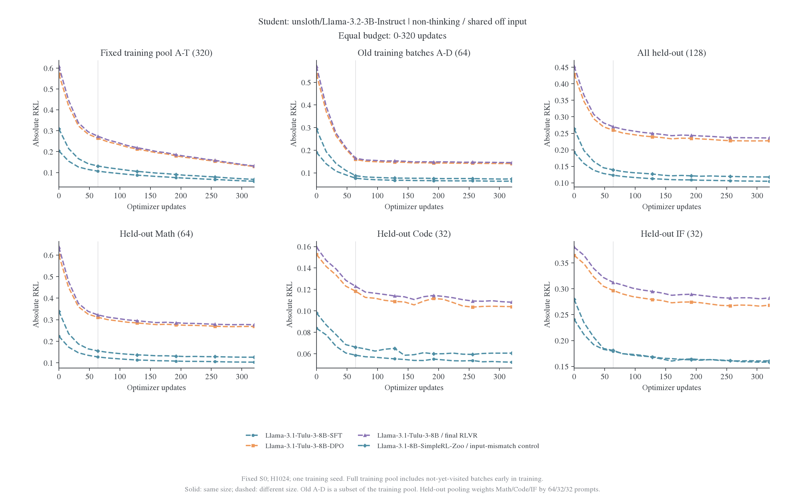

图 RQ4-6：不同阶段的初始距离不同；训练与留出分别展示。

| Teacher 阶段 | 初始→最终留出 RKL | 留出降幅 | 固定训练银行降幅 |
| ------------ | ----------------- | -------: | ---------------: |
| SFT          | 0.192855→0.104783 |   45.67% |           71.40% |
| DPO          | 0.428990→0.227525 |   46.96% |           77.42% |
| RLVR         | 0.453277→0.236005 |   47.93% |           78.38% |

三个百分比接近，但它们分别度量三个完整 teacher。要判断阶段增量，使用相同初始学生 $p_0$ 和共同状态，定义中心化偏好变化

$$
d=C_{p_0}(\log T_b-\log T_a),\quad
u_k=C_{p_0}(\log p_k-\log p_0),\quad
\alpha_k=\frac{\langle u_k,d\rangle_{p_0}}{\langle d,d\rangle_{p_0}},
\qquad C_{p_0}x=x-\mathbb E_{p_0}x.
$$

内积先在完整学生词表按 $p_0$ 加权，再按共同题目和 H1024 汇总。$\alpha$ 表示学生变化沿指定 teacher 阶段方向的投影；同时看余弦可区分整体变化幅度与方向。

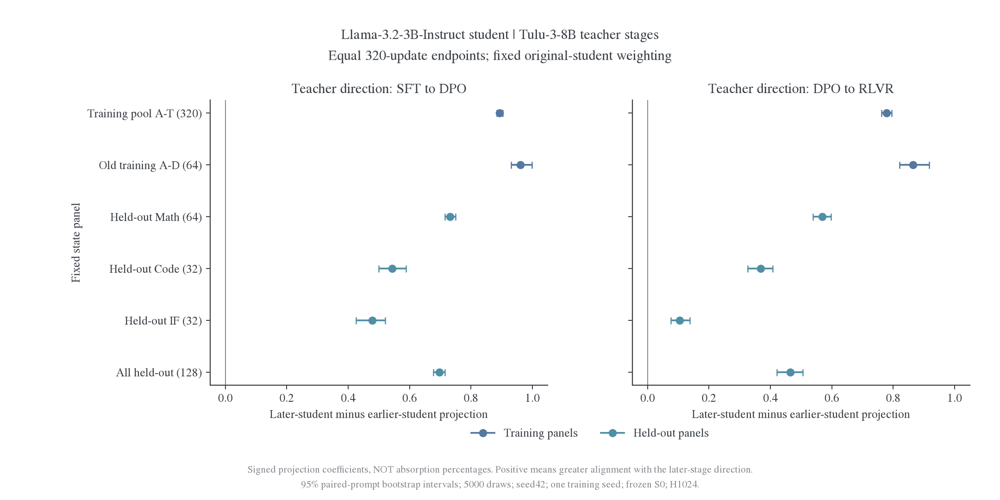

图 RQ4-6b：相同 448 题状态上的配对投影诊断；整体留出 128 题独立列出，区间以题目为配对重采样单位。

| 留出阶段方向 | 前阶段学生 α | 后阶段学生 α | 后减前及 95% 区间    | 余弦：前→后 |
| ------------ | -----------: | -----------: | -------------------- | ----------- |
| SFT→DPO      |        0.067 |        0.764 | +0.697 [0.677,0.715] | 0.136→0.676 |
| DPO→RLVR     |        1.914 |        2.378 | +0.465 [0.421,0.505] | 0.285→0.339 |

DPO→RLVR 的 teacher 增量平方范数为 **0.016081**，SFT→DPO 为 **0.566830**，前者约为后者的 **2.84%**，均使用同一个 $p_0$ 加权度量。因而整体 teacher KL 的相近降幅容易掩盖较小阶段变化，阶段投影提供了更直接的读出。

**已有证据支持学生追随部分 DPO/RLVR 的 token 偏好变化；SFT→DPO 的方向对齐更明显，DPO→RLVR 的额外对齐较弱。** 投影系数允许超过 1，它衡量方向与幅度，不是知识吸收百分比。下一项控制是直接的同尺寸阶段配对，以及同一跨尺寸 teacher 的 Base 目标，分别研究底座差距和新增行为。

来源：[固定模型版本与实际协议](../experiments/teacher-transfer/transfer-mechanism/2026-10-30-SFT深度与后训练阶段对照计划.md)、[阶段方向定义与数据](../experiments/teacher-transfer/transfer-mechanism/appendix/stage-comparisons.md)、[本次重分析输入](data/20261101-review/followup-data.json)。

### RQ4.5 局部拟合、旧批保持与跨批传播

B1 固定 A–D 各 16 条 S0 数学轨迹，按 A/B/C/D 顺序各更新 16 次，再重复一轮，共 128 更新；E–H 为独立 64 条数学留出。每 16 更新复测所有固定批次，保留连续 Adam 状态。

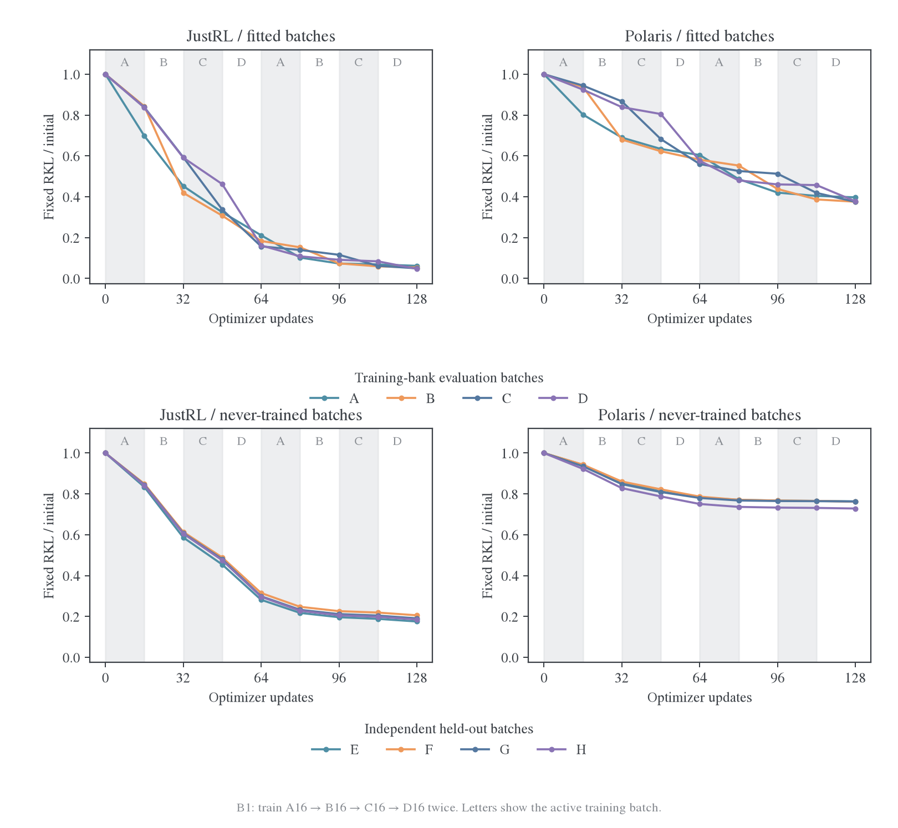

图 RQ4-7：上排是训练 A–D，下排是独立 E–H；每条曲线按自身初始风险归一化，背景标记当前训练块。

JustRL 的独立数学 RKL 从 **0.11800→0.02231**，Polaris 从 **0.24607→0.18558**。两种教师各 18 次已训练旧批复测全部继续下降。Polaris 的后期差距主要表现在未见状态改善变弱，同时已见批仍能保持和继续拟合。

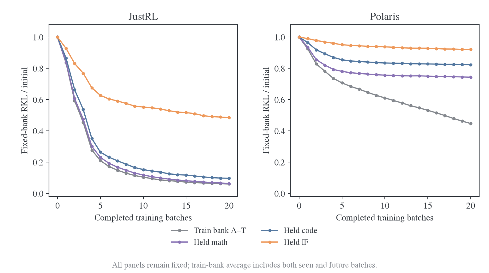

图 RQ4-8：每个新批只出现一次、各 reuse16，两个 teacher 各 320 更新；训练前保留 40 批输入，统一复测固定面板。

单遍后 JustRL/Polaris 的数学留出降幅为 **93.60%/25.67%**。Polaris 最后五批当前批仍平均下降约 **31.25%**，同期留出仅下降 **0.91%**。新题覆盖带来有限收益，局部改善向新状态传播的效率在后期减弱。

真实参数变化和 fresh 轨迹需分开测量。该单遍研究还保存了实际 Adam 首步与参数×状态交叉评分；后续继续用同一参数／optimizer 起点比较旧题、新轨迹、新题三类更新。

来源：[跨批与单遍完整结果](../experiments/teacher-transfer/transfer-mechanism/cross-batch/2026-10-28-跨批次迁移与单遍训练结果.md)、[机制总览](../experiments/teacher-transfer/transfer-mechanism/2026-10-27-跨源蒸馏泛化研究总览.md)。

### RQ4.6 改变 KL 方向的作用

E48/E49 固定 R1-1.5B ← Polaris、batch64、256 outer×reuse16，共 4096 更新，分别使用原生 RKL 和学生支持条件化 FKL。两组都从原始学生开始，沿各自 online rollout 训练。

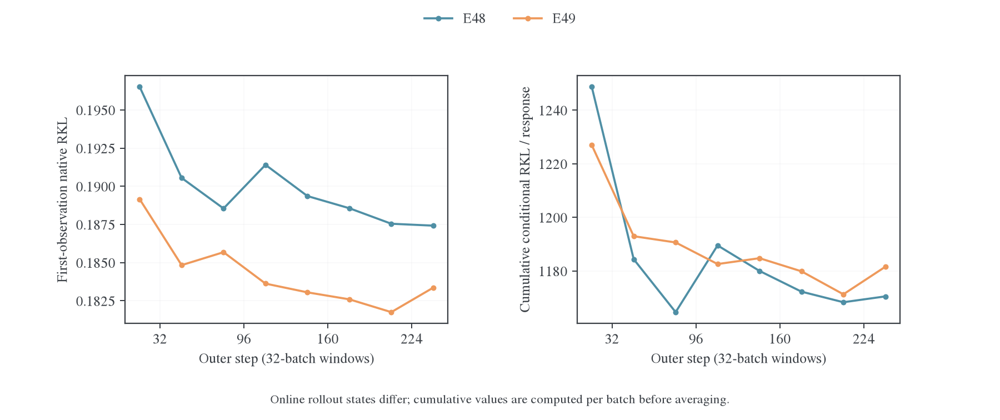

图 RQ4-9：同时观察 token-mean RKL 和按回答累计的条件差异，分开考虑回答长度。

E49 的 256 批内、3840 对相邻 FKL 观测全部下降；末段首次 FKL／RKL 为 **0.132793／0.183355**，跨批改善仍较小。末段每回答累计原生 RKL，E48/E49 为 **1170.50／1181.55**。

| Outer256 的验证结果      | E48 RKL | E49 FKL |
| ------------------------ | ------: | ------: |
| MATH mean                |  87.83% |  89.03% |
| AMC mean                 |  79.69% |  83.13% |
| AIME25 mean              |  28.75% |  28.96% |
| MATH 长度停止条数／8000  |     192 |      76 |
| AIME25 长度停止条数／480 |      92 |      25 |
| AIME25 pass@16           |   50.0% |   43.3% |

FKL 组完成行为和部分回答可靠性改善，候选覆盖没有同步扩大；它保留了新批分布拟合的平台。若研究晚期切换目标的作用，下一项从同一 warm checkpoint 和 Adam 状态分叉。

来源：[E49 完整方向对照](../experiments/teacher-transfer/cross-origin/polaris/2026-10-28-E49方向对照与跨源迁移.md)。

### RQ4.7 优化器、精度与近目标求解

本节区分正式在线训练与固定输入机制对照。前者评价完整配方的求解和任务表现；后者从指定权重、固定监督出发，检查局部优化是否能转化为留出改善。

#### A. 正式在线训练 E50–E53

共同配对为 **DeepSeek-R1-Distill-Qwen-1.5B ← JustRL-DeepSeek-1.5B**，DAPO、batch=mini-batch64、每题一条当前学生 rollout、reuse16、seed42。AdamW LR1e-6、β=(0.9,0.999)、ε1e-8、wd0.01、clip1；训练 cap7168，验证 cap31744。训练 T1/top-p1；每 32 outer 验证 MATH500/AMC23/AIME25，每题 16 答、T0.7/top-p0.9，无初始验证。

Full-vocab 使用 `precompute_fused`、token chunk128、vocab chunk8192；原始词表目标，终止等价类为空。MDPO 在每次 actor 调用开始冻结 anchor，随后 16 次更新优化相同 target。Teacher 与 rollout 各自保持既定 BF16 执行，actor/anchor 精度由下表改变。

| 实验 | 目标及 actor/anchor 精度          | 已记录 outer／成功更新      | 硬件   |
| ---- | --------------------------------- | --------------------------- | ------ |
| E50  | OPD，η1；FP16＋GradScaler         | 256／4091，另 5 次跳步      | 8×A100 |
| E51  | MDPO，κ0/η0.3；FP16＋GradScaler   | 256／4091，另 5 次跳步      | 8×A800 |
| E52  | OPD，η1；BF16 GEMM＋FP32 中间表示 | 256／4096                   | 8×A100 |
| E53  | MDPO，κ0/η0.3；同上混合精度       | 103／1648；最后验证 outer96 | 8×A800 |

`bf16_fp32` 的 Linear 操作数为 BF16、输出为 FP32，残差/norm/gating/head 保留 FP32，attention 仍含低精度。各组沿自己的在线学生轨迹训练。

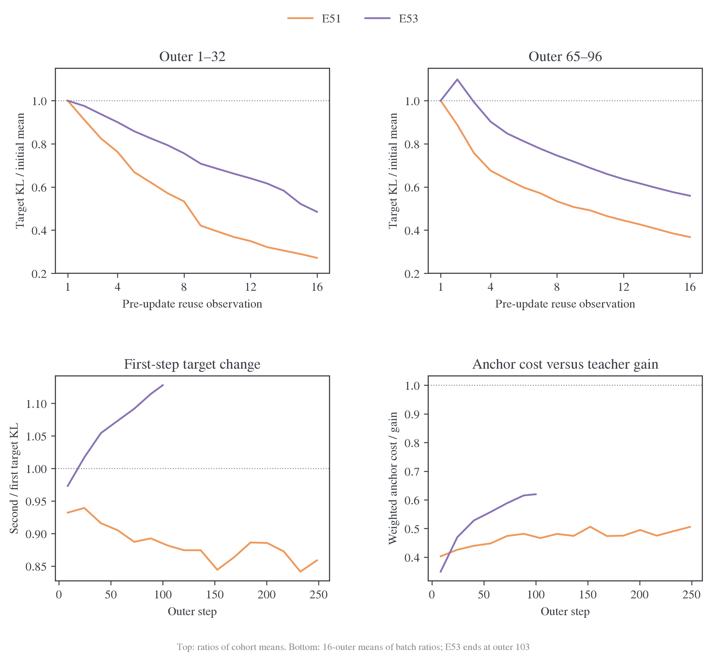

图 RQ4-10：E51/E53 比较固定 target 的内层轨迹，并拆分 teacher 收益与 anchor 代价。KL 记录来自每次更新前，首末观测跨 15 次已执行更新。

E51 在 **255/256** 批取得目标净下降；E53 已有 **103/103** 批净下降，其中 **88** 批第一步反升，后续又回到起点以下。内层求解的净进展与单步响应分别评价。

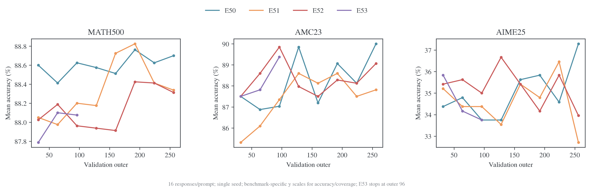

图 RQ4-11：E50/E52 为普通 OPD，E51/E53 为 MDPO；E53 只显示已有前期验证。

| 完整 outer256      | MATH-500 |  AMC23 | AIME25 |
| ------------------ | -------: | -----: | -----: |
| E50：FP16 OPD      |   88.70% | 90.00% | 37.29% |
| E51：FP16 MDPO     |   88.34% | 87.81% | 32.71% |
| E52：BF16/FP32 OPD |   88.31% | 89.06% | 33.96% |

精度修复恢复了 MDPO 子问题的有效求解，这组完整终点的任务分数则由 E50 领先。记录参数和优化器状态的读出，继续用于区分数值求解、实际步幅与任务收益。

#### B. Polaris 暖状态：对齐工作权重后的固定输入控制

这项实验采用 **同一个 R1-1.5B student、冻结 Polaris-7B teacher**，更新全部约 17.77 亿参数。Warm 权重来自另一条 Polaris 蒸馏的 64 次参数更新；各分支先将其舍入到相同 BF16 可表示值，再保存为 FP32 主副本，并各自重建 fresh AdamW。

| 控制项     | 实际设置                                                                                                |
| ---------- | ------------------------------------------------------------------------------------------------------- |
| 输入和监督 | 6 道新的数学 prompt，输入 token 固定；teacher logits 预先缓存并在各分支复用                             |
| 损失位置   | 每题前 256 个以内的 response 位置；完整前缀输入保留至 H1024                                             |
| 更新预算   | 同一批 16 次全参数更新，纯 Full-vocab RKL，无 anchor                                                    |
| 优化与精度 | AdamW β=(0.9,0.999)，wd0、clip1；BF16/FP32 工作权重与算术，SDPA math，TF32 关闭，RoPE buffers 保持 FP32 |
| 留出       | 48 道数学、8 道代码、8 道 IF；每 16 token 取位置，先按题平均；表内为数学留出                            |
| 评分       | 当前批和留出按各分支训练精度评估，另测 FP32 终点转回 BF16 的读出                                        |

| 对齐起点的配置      | 当前批 KL 降幅 | 数学留出 KL 降幅 |
| ------------------- | -------------: | ---------------: |
| BF16 AdamW，约 1e-6 |         44.99% |            0.11% |
| BF16 AdamW，3e-6    |         73.88% |            0.31% |
| FP32 AdamW，约 1e-6 |         78.81% |            0.75% |

FP32 将当前批末 KL 降至约 0.03119，BF16 标准步幅为 0.08099；留出改善仍很小。**步幅和精度能解除一部分局部拟合困难，跨状态传播还需要额外解释。** 这里的固定输入控制与 E48 正式 4096 更新训练分别保留身份。

早期 Adam 历史因果对照使用另一份已完成 144 更新的 R1/JustRL checkpoint：四张 H800、每 rank 一条固定回答、前 128 个 response 位置，MDPO κ0/η0.3；从同一参数和完整 Adam 状态分叉，比较原更新、零当前梯度与匹配范数更新。该对照解释历史状态与前向数值响应，未混入上述正式配方或 Polaris 暖状态的结果。

来源：[正式 E50–E53 设置与完整结果](../experiments/teacher-transfer/optimizer-precision/production/2026-10-29-E50至E53完整结果与混合精度对照.md)、[Polaris 对齐起点控制](../experiments/teacher-transfer/optimizer-precision/polaris/2026-10-27-Polaris跨State拟合的优化器与精度对照.md)、[144 更新状态的 Adam 干预](../experiments/teacher-transfer/optimizer-precision/mechanism/2026-10-27-MDPO优化器历史与前向精度因果对照.md)。

<a id="rq5"></a>

## 6. RQ5：Teacher target 的形状怎样影响学习与终止行为

### RQ5.1 目标分布与实际控制变量

RQ3 选择采集前缀的生成分布；本节研究 teacher target 的构造。固定原教师 $T$、本轮 anchor $q$，令 $r=\log(T/q)$，定义

$$
f_{\kappa,\eta}(r)=
\begin{cases}
\kappa^{-1}\log(1-\eta+\eta e^{\kappa r}),&\kappa>0,\\
\eta r,&\kappa=0,
\end{cases}
\qquad
m(a)=\frac{q(a)\exp f_{\kappa,\eta}(r_a)}{Z_m}.
$$

| 形状  | 目标教师                                  |
| ----- | ----------------------------------------- |
| κ=0   | $m\propto q^{1-\eta}T^\eta$，几何插值     |
| κ=0.5 | $m\propto[(1-\eta)\sqrt q+\eta\sqrt T]^2$ |
| κ=1   | $m=(1-\eta)q+\eta T$，概率算术插值        |

三种形状都通过同一 MDPO 损失 $(D_{\rm KL}(p\Vert m)-\log Z_m)/\eta$ 拟合。E55/E56/E57 固定 **η=0.1、LR1e-6**，只将 κ 设为 0/0.5/1。κ=0 对应 $D_T+9D_q$，E55 是带 anchor 的 MDPO；纯 Full-RKL 对照需按独立实验记录。

### RQ5.2 长程训练设置与日志覆盖

Student 为 Qwen3-1.7B-Base，teacher 为 Qwen3-30B-A3B-Instruct-2507；DAPO、batch64、reuse16，训练 cap16384。每 10 outer 验证 MATH500/AMC23/AIME24/25/26，n16、cap31744，每次 **10080 条回答**。EOS 等价类为 `[151643,151645]`，三组使用相同目标后端、精度配置和基础学习率。

10 月 31 日快照分别覆盖 **35/58/69 outer**、**560/928/1104** 次成功更新。三组的共同验证点为 outer30，E56/E57 的共同后续点为 outer50。E55/E57 使用 A100，E56 使用 A800；当前各为单训练 seed。

### RQ5.3 共同 outer30：目标形状与长尾

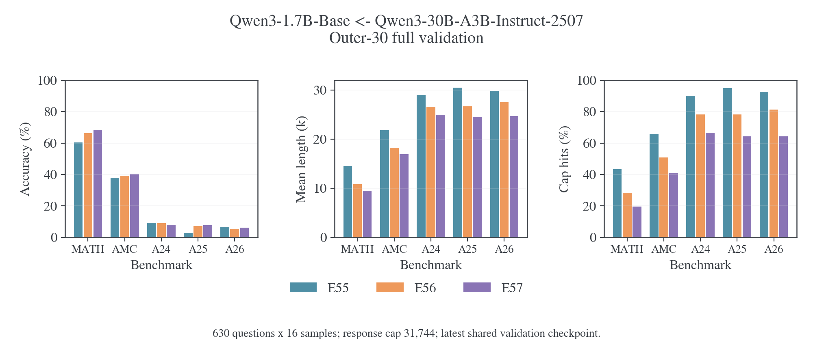

图 RQ5-1：相同训练进度、相同验证预算下比较 κ，五个题集等权宏平均。

| Outer30            | κ=0，E55 | κ=0.5，E56 | κ=1，E57 |
| ------------------ | -------: | ---------: | -------: |
| MATH-500           |   60.35% |     66.29% |   68.55% |
| AMC23              |   37.81% |     39.22% |   40.47% |
| AIME24             |    9.38% |      8.96% |    7.92% |
| AIME25             |    2.92% |      7.08% |    7.71% |
| AIME26             |    6.67% |      5.21% |    6.04% |
| 五集宏平均正确率   |   23.42% |     25.35% |   26.14% |
| 五集宏平均触顶率   |   77.40% |     63.47% |   51.17% |
| 五集宏平均回答长度 |   25.14k |     22.01k |   20.12k |

κ0.5/1 相对 κ0 的宏平均正确率高 **1.93/2.71** 个百分点，触顶率低 **13.93/26.23** 个百分点。κ0 在 AIME24 的点估计仍最高。形状变化对完整生成行为的影响，比单个训练 loss 数值更清楚。

### RQ5.4 后续轨迹：正确率与终止共同恢复

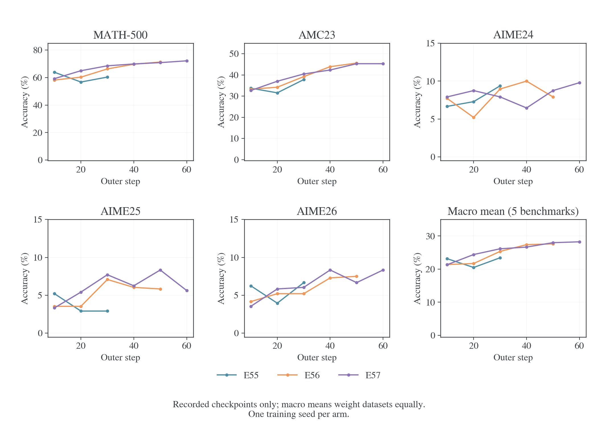

图 RQ5-2：连接各自真实验证点，保留 E55 的较短日志覆盖。

E56 的 MATH 从 outer10 **58.20%** 升至 outer50 **71.29%**，AMC 从 **33.28%** 升至 **45.62%**。E57 到 outer60 为 **72.17%/45.31%**。主要增益来自 MATH/AMC，三个 AIME 最新约 6%–10%。

共同 outer50，E56/E57 五基准宏平均为 **27.63%/27.99%**，差约 **0.35** 个百分点；两种目标的 accuracy 已接近。

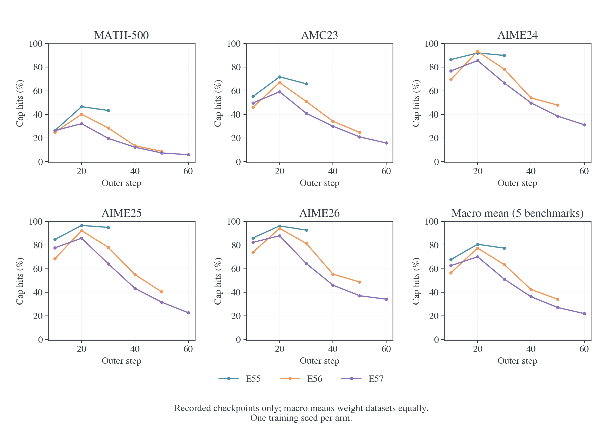

图 RQ5-3：回答触及 31744-token 上限的比例。κ0.5/1 先出现长尾恶化，后续逐步恢复。

E56 宏平均触顶率从 outer20 的 **77.43%** 降到 outer50 的 **34.13%**；E57 从 **70.14%** 降到共同 outer50 的 **27.12%**、outer60 的 **21.95%**。κ1 在共同 outer50 的触顶率比 κ0.5 低约 **7.01** 个百分点。目标形状同时改变学习进程与完成行为。

### RQ5.5 原始 teacher、target 与 anchor 的 KL 轨迹

现有日志同时记录三种 KL；MDPO objective 另外保留。它们分别对应：

| 量             | 定义                                   | 随本轮内层更新变化的对象        |
| -------------- | -------------------------------------- | ------------------------------- |
| Teacher KL     | $D_{\rm KL}(p\Vert T)$                 | 当前 student；原 teacher 固定   |
| Target KL      | $D_{\rm KL}(p\Vert m_{\kappa,\eta})$   | 当前 student；本轮 target 固定  |
| Anchor KL      | $D_{\rm KL}(p\Vert q)$                 | 当前 student 相对本轮起点的漂移 |
| MDPO objective | $(D_{\rm KL}(p\Vert m)-\log Z_m)/\eta$ | 实际优化量；包含冻结常数与尺度  |

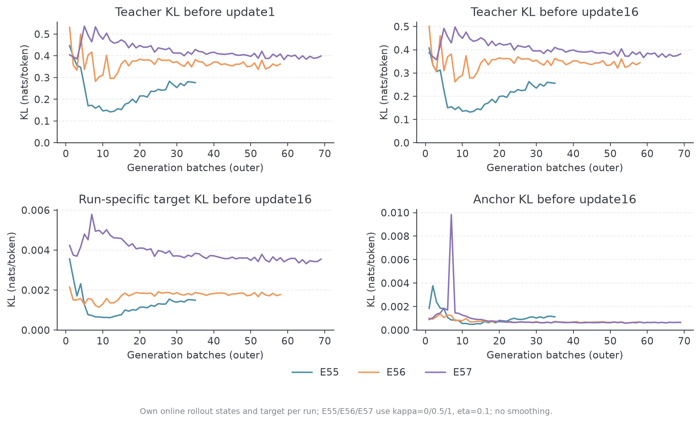

图 RQ5-4：从全部 2592 条更新观测重画，不平滑。上排为批首／第 16 次观测的原始 teacher KL，下排为第 16 次观测的 target KL 和 anchor KL。E55/E56/E57 分别画到已有 35/58/69 outer。

#### 跨批曲线为何没有持续下降

**当前批的 teacher KL 持续下降；跨批曲线包含早期波动与后期缓降，E57 在已有任务验证期间也有 KL 和 accuracy 的共同改善。** 先保留整个快照的端点读数：

| 运行            | 第 1 批批首 teacher KL | 最后完整批批首 teacher KL | 最后 10 批平均批内降幅 |
| --------------- | ---------------------: | ------------------------: | ---------------------: |
| E55，至 outer35 |                 0.4471 |                    0.2767 |                  7.37% |
| E56，至 outer58 |                 0.5312 |                    0.3625 |                  4.94% |
| E57，至 outer69 |                 0.4049 |                    0.3993 |                  4.29% |

E55/E56 有初期下降，随后分别出现回升或平台。E57 在 outer5 的批首值达到 **0.5366**，之后缓慢回落；outer1→69 的批首端点只下降约 1.38%，但它没有反映已有 accuracy 验证期间的变化。按相同的 outer10→60 窗口读取：

| 节点    | 批首 teacher KL | 第 16 次观测 teacher KL | 五基准宏平均 accuracy | 宏平均触顶率 |
| ------- | --------------: | ----------------------: | --------------------: | -----------: |
| outer10 |          0.4765 |                  0.4491 |                21.33% |       62.58% |
| outer30 |          0.4122 |                  0.3945 |                26.14% |       51.17% |
| outer60 |          0.4031 |                  0.3855 |                28.25% |       21.95% |

这段时间批首／第 16 次观测 teacher KL 分别下降 **15.41%／14.16%**，accuracy 提高 **6.92** 个百分点。**E57 存在 KL 拟合与任务表现的共同改善，较高的整体残差与部分能力迁移可以同时存在。** 该 run 的训练目标来自 teacher-conditioned KL，任务判分没有加入 loss。完整节点和源文件哈希见[对齐统计](data/topd-20261101/comparison.json)。

曲线每一点都带有当批访问状态。令 $\mu_k$ 为第 $k$ 批有效 response 位置的经验分布，则日志测量的是

$$
K_k(\theta)=\mathbb E_{s\sim\mu_k}
D_{\rm KL}\bigl(p_\theta(\cdot\mid s)\Vert T(\cdot\mid s)\bigr).
$$

在同一批内部，$\mu_k$ 固定，图中的首末点直接描述这批前缀上的拟合。进入下一批后，题目、学生生成历史和有效位置权重一起改变，下一点使用的是 $\mu_{k+1}$。例如 E57 的训练回答均长从第一批约 1.09k 变为最后一批约 9.74k，覆盖的前缀位置已经很不相同。跨批曲线同时包含参数改善和访问分布变化。

目标设置也限定了单轮更新的方向与范围：三组都使用 **η0.1 的混合 target**，κ0 的目标为 $D_T+9D_q$，其余形状同样保持对本轮 anchor 的依赖。优化的是规定的 MDPO 子问题，日志另行记录原 teacher KL。实现保留 $1/\eta$；κ0 在起点 $p=q$ 时 anchor 梯度为零，初始梯度仍等于 teacher KL 梯度，η的作用不能简化成把教师梯度乘 0.1。

当前 162 个完整批次的 teacher KL 均有首末下降，支持“当前监督可以被优化”；跨批曲线保留较高残差，独立任务同时已有改善。**下一项机制问题是整体 teacher 残差为何下降较慢，以及任务相关收益集中在哪些状态和回答阶段。** 固定银行的跨 checkpoint 评分可以测参数泛化，初始／最终参数×初始／最终轨迹的交叉评分可以进一步分离参数项和状态项；当前日志尚未给出这组分解，所以报告将目标约束与迁移效率作为待区分的解释。

数值汇总和统计口径见[KL 诊断快照](data/20261101-kl-diagnosis/summary.json)。

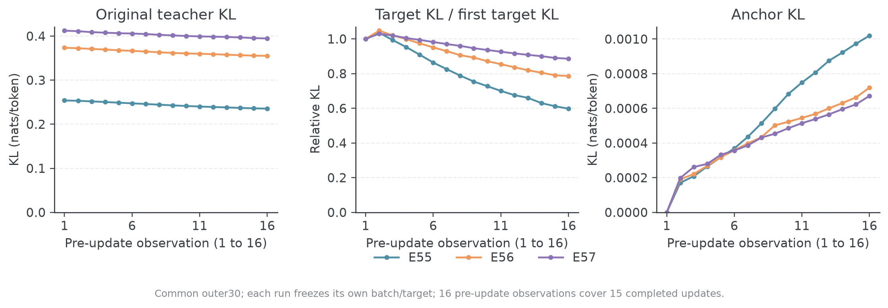

图 RQ5-5：每条曲线对应同一训练进度 outer30、各自固定的 batch 和 target。中间 target KL 除以该批首值，便于观察有限步求解；16 个观测跨 15 次已执行更新。

| 共同 outer30              |           κ0，E55 |         κ0.5，E56 |           κ1，E57 |
| ------------------------- | ----------------: | ----------------: | ----------------: |
| Teacher KL：批首→第 16 次 | 0.253861→0.235311 | 0.373476→0.355067 | 0.412248→0.394512 |
| Target KL：批首→第 16 次  | 0.002330→0.001393 | 0.002385→0.001875 | 0.004196→0.003716 |
| 同批 target KL 下降       |            40.22% |            21.41% |            11.42% |
| 第 16 次 Anchor KL        |          0.001020 |          0.000720 |          0.000672 |

三组同批都在接近自己的 target。κ0 的相对 target 下降最多、在线 teacher KL 也较低，但同 outer30 的 accuracy 和终止行为仍弱于另外两组。**更低的在线训练 KL，与更好的自由生成效果在这里给出了不同排序。** Target KL 随κ改变衡量的目标，分析时将其内层进展与共同预算下的任务结果一起读取。

κ0 的恒等式为 $J=D_T+9D_q$；κ1 的 $\log Z_m=0$，因此 $J=10D_{\rm KL}(p\Vert m)$。这解释了三组 objective 数值量级差别；图中直接画出的 KL 与其归一化常数分开解释。

输入来自[原始逐更新快照](../infra/model-compatibility/qwen-e54/2026-10-31-E55至E57长程训练阶段分析.md#数据与复算)，本次提取保存为[KL 绘图输入](data/20261101-review/followup-data.json)。

### RQ5.6 批内下降与自由生成行为的关系

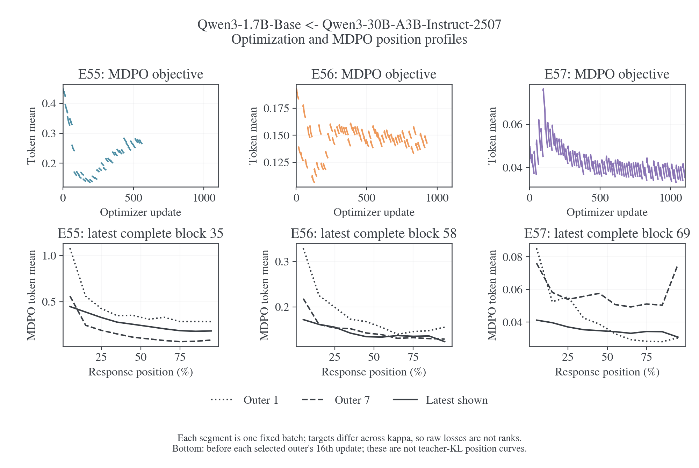

图 RQ5-6：目标、原教师距离与相对 response 位置分别记录。不同 κ 定义不同 target 和归一化常数，按各自目标观察内层进展。

已记录 **2592 次更新全部应用且有限**，162 个完整批次的 MDPO objective 与 teacher KL 都有首尾下降。最新批次的 target KL 首末降幅为 E55 **41.70%**、E56 **22.23%**、E57 **11.77%**。局部下降更大的 E55 仍有更重的验证长尾；目标求解进展与自由生成效果再次呈现分离。

执行成本也随长尾恢复变化：E56 单次验证生成从 outer20 的 **8.23 h** 降至 outer50 的 **3.25 h**；E57 从 **7.08 h** 降至 outer60 的 **2.78 h**。E55 的 outer30 仍需约 **8.66 h**。这些是各条曲线自身的成本变化。

当前结论是：**在这组 Base←MoE teacher 配对中，κ0.5/1 的后续任务与终止行为同时改善；两者共同进度的 accuracy 接近，κ1 的长尾更轻；teacher KL 后期也有下降，整体分布仍保留较大残差。** 后续继续跟踪三条轨迹，并用逐题正确性、finish reason、长度与回答文本解释 target 对行为的作用。

完整来源：[E55–E57 长程训练阶段分析](../infra/model-compatibility/qwen-e54/2026-10-31-E55至E57长程训练阶段分析.md)、[绘图输入与原始版本](../infra/model-compatibility/qwen-e54/2026-10-31-E55至E57长程训练阶段分析.md#数据与复算)、[耗时诊断](../infra/performance/full-vocab/2026-10-31-MDPO长程训练与验证耗时诊断.md)。

### RQ5.7 E57 与 TOP-D 对应到哪个层次

核对 TOP-D v2 论文与官方代码`9a2716cb`后，E57 的κ1/η0.1 确实采用相同的 proximal teacher：$m=0.9q+0.1T$。E57 实际优化 $10D_{KL}(p\Vert m)$，属于 full-vocab MDPO 实现；官方完整 TOP-D 还构造 future return、prompt 组内标准化，再执行 sampled-token PPO。两者的目标构造对应，完整更新算法分别记录。[^topd]

预算也需区分：论文的 512prompt×8 回答分成 16 个不同 mini-batch，每个 256 条；E57 把同一 64 条回答复用 16 次。官方当前单机配方又使用 128prompt×8 回答、mini-batch32prompt。相同“16 次”并不代表相同轨迹覆盖。

相同 Base1.7B←MoE30B 模型对，论文 TOP-D 的 AIME24/25/26 为 **20.31%/17.71%/13.75%**（avg@32），E57 outer60 为 **9.79%/5.62%/8.33%**（avg@16）；验证解码、长度与训练预算也不同。当前 E57 尚未达到论文 TOP-D 的 AIME 分数。E55 同样带 anchor 正则，本地纯 Full-RKL 的对应比较应由同协议 E58 提供。

完整公式、源码、三方设置表、理论量的解释与结果对照见[E57 与 TOP-D 专题核对](2026-11-01-E57与TOP-D对照.md)。

## 7. 后续工作与报告维护

| 研究问题       | 下一项有判别力的工作                                                  |
| -------------- | --------------------------------------------------------------------- |
| RQ1 信号与目标 | 同版本共同输入下对齐 sampled/full 梯度、任务轨迹与执行成本            |
| RQ2 预算       | 联合评估更新数、新 token、重复训练 token、完整推理覆盖与成本          |
| RQ3 来源       | 对十二组终点补 fresh 参数×轨迹交叉评分，定位 Polaris 的长尾与来源效应 |
| RQ4 迁移机制   | 补 Base／后训练初始化矩阵、同尺寸阶段配对，推进四域评估               |
| RQ5 Target     | 跟踪共同训练节点，关联逐题正确率、结束原因与目标形状                  |

报告维护在 `docs/progress/`，实验协议与完整推导继续由各专题维护。图 RQ1-3/4、RQ2-1/7，以及本次 RQ4.1、RQ4.4 和 RQ5 的补充图从真实记录重画，其他图复用现有分析；RQ3 的最新图和数据已固定到本目录，来源路径与 SHA256 见[清单](data/20261101/sources.json)。

新增图复算：

```bash
uv run --no-project --with matplotlib==3.10.9 --with numpy==1.26.4 \
  python examples/mirroropd/research/studies/production/plot_progress_report.py \
  --data examples/mirroropd/docs/progress/data/20261101 \
  --output examples/mirroropd/docs/progress/figures/20261101 \
  --style ../.agents/skills/figure-viz/assets/mpl
```

本次补充图复算（输入与来源哈希独立保存在 `data/20261101-review/`）：

```bash
uv run --no-project --with matplotlib==3.10.9 --with numpy==1.26.4 \
  python examples/mirroropd/research/studies/production/plot_progress_followup.py \
  --data examples/mirroropd/docs/progress/data/20261101-review/followup-data.json \
  --output examples/mirroropd/docs/progress/figures/20261101-review \
  --style ../.agents/skills/figure-viz/assets/mpl
```

原开发过程仍按功能演进理解：10/19–20 建立共享 OPD 基线，10/21–22 完成信号／指标与 Full-KL，10/23–25 扩展预算与 Mirror，10/26–27 定位数值和迁移平台，10/28–31 扩展生成来源、教师谱系与统一评估。基线至 `2b372ea5` 的 Git 记录保留全部 350 个提交。

### 参考文献

[^asyncopd]: Kang et al. AsyncOPD: How Stale Can On-Policy Distillation Be? arXiv:2606.24143v1, 2026. 第 5 节、Table 1(a)、Figures 3(a)/5；原图由仓库已保存的论文 PDF 渲染。[论文正文](https://arxiv.org/html/2606.24143v1)。

[^gkd]: Agarwal et al. On-policy Distillation of Language Models: Learning from Self-Generated Mistakes. ICLR 2024, arXiv:2306.13649v3. 第 3 节。[论文正文](https://arxiv.org/html/2306.13649v3)。

[^minillm]: Gu et al. MiniLLM: On-Policy Distillation of Large Language Models. arXiv:2306.08543v6. 第 2.2 节与第 3.4 节 single-step 消融；HTML 表题为 Table 4。[论文正文](https://arxiv.org/html/2306.08543v6)。

[^topd]: Xie et al. Trust Region Policy Distillation. arXiv:2607.04751v2, 2026. [论文与 Table3](https://arxiv.org/html/2607.04751v2)、[固定官方实现](https://github.com/xie-lab-ml/TOP-D/blob/9a2716cba22cab508825ad3be3f78327bb8139e5/verl/verl/trainer/ppo/core_algos.py)。
