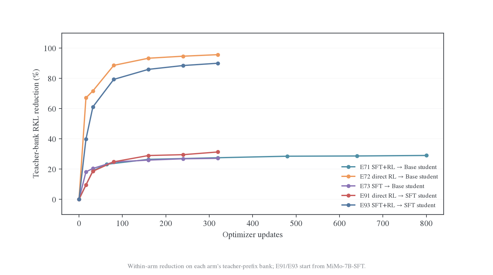
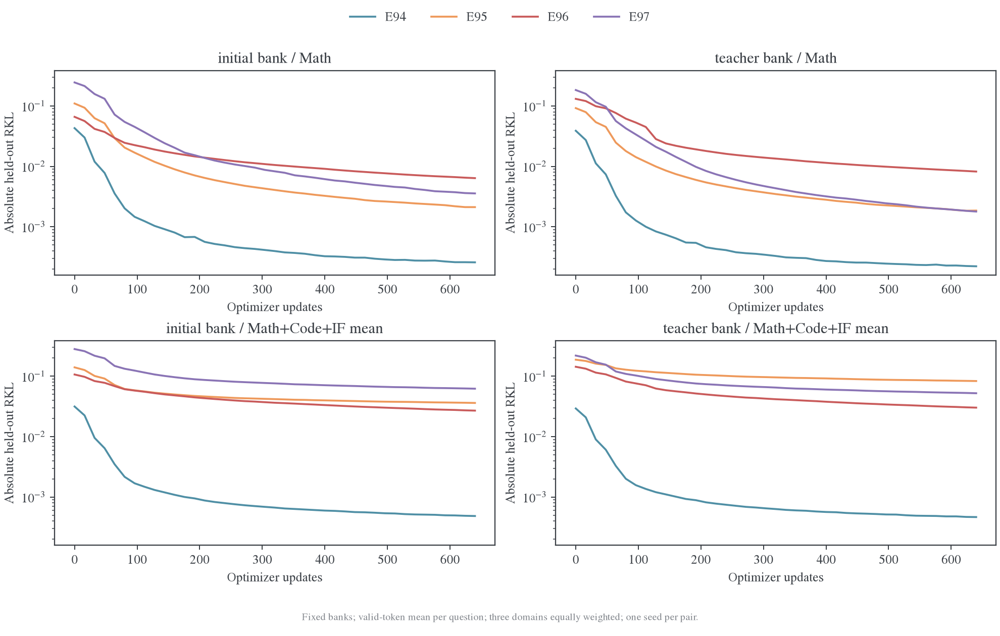
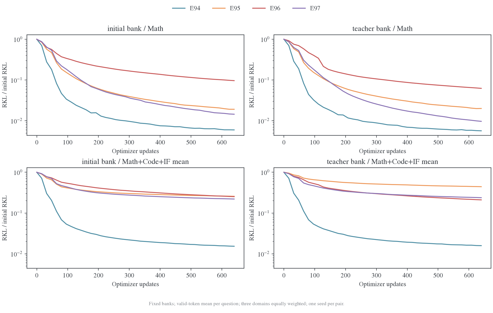
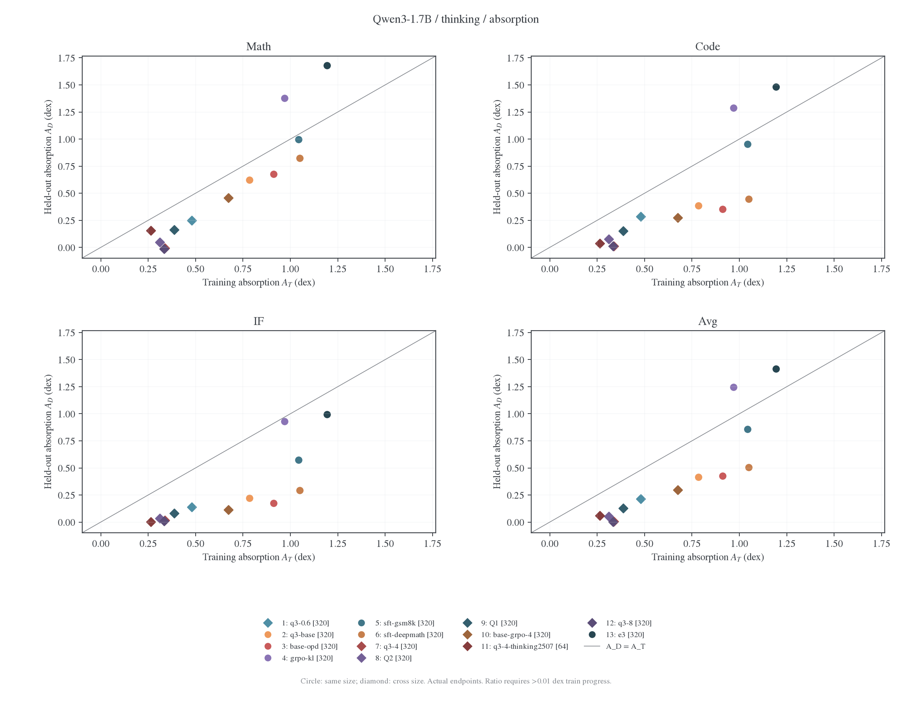
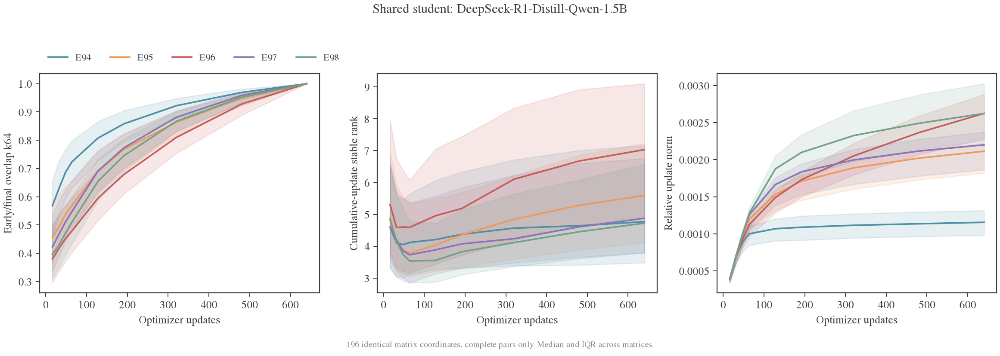
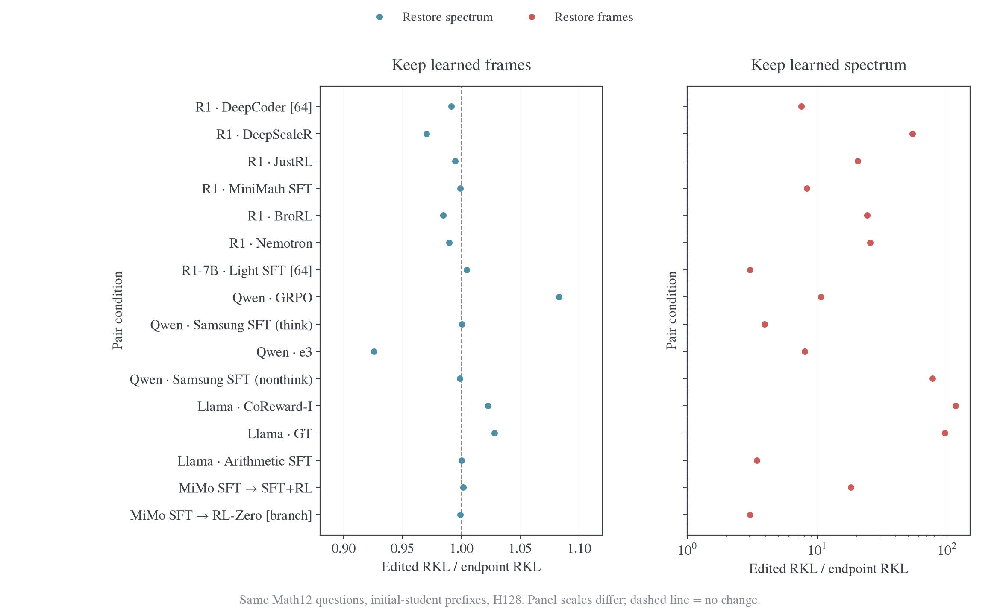
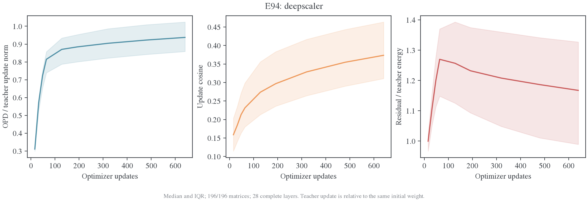
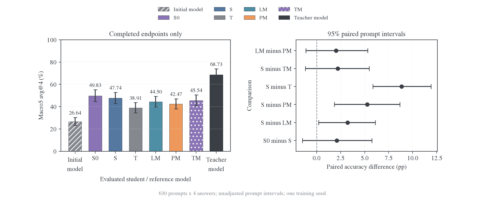

# MirrorOPD 近两周周报：教师吸收边界、参数动力学与 Rollout 来源

汇报日期：2026-11-12。承接上一份 11 月 2 日周会，汇总至 11 月 12 日的主要新增结果。重点回答三个问题：什么教师容易吸收，输出吸收对应怎样的参数变化，以及生成来源是否改善学习。所有新训练均使用单 seed；本文将分布拟合与任务准确率分别报告。

## 研究背景：三篇论文分别解释权重保谱、框架作用与更新空间

| 论文                                                 | 关键结论                                                                                                          | 本项目对应的问题与结果                                                                                              |
| ---------------------------------------------------- | ----------------------------------------------------------------------------------------------------------------- | ------------------------------------------------------------------------------------------------------------------- |
| PNT：The Path Not Taken[^pnt]                        | 在所测 RLVR 中，KL 约束与模型几何使更新偏离完整权重的主方向、谱漂移较小；BF16 将微小更新隐藏，放大表观稀疏性。    | 小谱漂移能否解释 OPD 吸收？我们观察到完整权重保谱，但它不足以区分好坏吸收。                                         |
| ISO：An RLVR-Native Optimization Stack[^iso]         | RLVR 可继承 base 奇异值，通过改变输入／输出奇异框架获得行为；恢复 base 谱可保留表现，并据此设计固定谱优化与合并。 | 将谱交换扩展到 OPD：保留终点框架、恢复初始谱，已学分布匹配基本保留；恢复初始框架则基本丢失收益。                    |
| On the Geometry of On-Policy Distillation[^geometry] | OPD 累计更新较早进入低维通道；所测 attention 矩阵的早期右 top-16 空间接近最终空间，后续梯度投影训练总体保留性能。 | 扩展到全层 attention＋MLP、多 rank、多 pair；早期方向有较高能量捕获，但完整更新空间仍持续演化，尚未复现投影后训练。 |

三篇论文测量的对象需要分开：PNT 的完整权重主方向、ISO 的完整权重奇异框架，与 Geometry 的累计更新子空间并不相同。本文以 $W_t$ 表示完整权重、$\Delta W_t=W_t-W_0$ 表示累计更新；“保谱”与“更新子空间固定”是两个独立判断。

## 1. 主要结论

| 结论                                                                            | 最重要的新增证据                                                                                                                | 对后续研究的影响                                                          |
| ------------------------------------------------------------------------------- | ------------------------------------------------------------------------------------------------------------------------------- | ------------------------------------------------------------------------- |
| **教师吸收取决于 student 起点与 teacher 谱系，RL／SFT 标签不足以预测难度。**    | MiMo 同为 320 更新，SFT student 吸收同源 SFT+RL teacher 的四域 teacher-bank RKL 为 0.00420，吸收 direct-RL teacher 为 0.26162。 | 优先比较相同 student、不同 teacher 路径，联合看初始距离和训练动态。       |
| **Math 吸收好不代表跨域吸收好。**                                               | 新训练 E95 的 Math teacher-bank RKL 为 0.00185、剩余 2.0%，三域均值仍为 0.08337、剩余 44.3%。                                   | 按域、按 bank 同时展示绝对 RKL 和剩余比例，避免给 pair 贴单一好坏标签。   |
| **输出接近 teacher，可以沿另一套参数路径实现。**                                | E94 三域平均 RKL 约 $5\times10^{-4}$；完整权重谱到 teacher 的距离仍保留 102.2%，参数残差能量比为 1.167。                        | 将更新的方向、能量和函数效果作为机制主线，完整权重谱作为背景。            |
| **固定 initial rollout 已能获得较强任务收益；teacher 前缀和融合没有普遍优势。** | Qwen 六来源全部完成：initial／current 五集宏平均为 49.83%／47.74%，teacher 来源为 38.91%。                                      | 以共同状态 RKL 和纯 student accuracy 比较来源，不能按各自训练 loss 排序。 |

## 2. 教师吸收：MiMo 阶段链给出了更清楚的对照

**同一 direct-RL teacher 对 Base student 易吸收，对 SFT student 却明显更难；同一个 SFT student 又能很好吸收沿自身 SFT 阶段继续 RL 的 teacher。** 目前最有依据的解释轴是初始化与教师训练路径的匹配，以及起始函数距离。

实际训练使用 DAPO 数学题、current rollout、full-vocab reverse KL（完整词表反向 KL），batch128、LR $10^{-6}$、response cap7168。E72／E73／E91／E93 均为 reuse16、20 outer、320 更新；E71 为 reuse32、25 outer、800 更新。固定银行覆盖 Math／Code／Science／IF，每域 128 题；先计算每题有效 token 平均，再做四域等权平均。

| 实验 | Student 起点 | Teacher 路径   | 更新数 | 终点 teacher-bank 四域 RKL | 相对初始下降 |
| ---- | ------------ | -------------- | -----: | -------------------------: | -----------: |
| E72  | Base         | Base→direct RL |    320 |               **0.002795** |   **95.68%** |
| E73  | Base         | Base→SFT       |    320 |                   0.337572 |       27.13% |
| E71  | Base         | Base→SFT→RL    |    800 |                   0.288201 |       29.04% |
| E91  | SFT          | Base→direct RL |    320 |                   0.261616 |       31.34% |
| E93  | SFT          | Base→SFT→RL    |    320 |               **0.004198** |   **90.02%** |



图 1：各分支在自己的固定 teacher bank 上，相对自身初始 RKL 的下降比例。E71 使用更多更新；各 teacher bank 独立生成。E91／E93 初始 teacher-bank RKL 分别为 0.381016／0.042049，差约 9.1 倍，因此这组对照尚不能把“阶段路径匹配”与“初始距离更近”两个因素拆开。

**分布吸收与能力变化也应分开。** E93 八项任务准确率均高于自身 SFT 起点，AIME25 为 45.21%→57.50%，MATH-500 为 94.20%→96.00%。E91 虽保有较高数学终点，相对自身起点却有七项下降，GPQA 为 29.04%→8.08%，IFEval 为 52.87%→44.73%。较高终点可能继承自较强初始化，不能全部归因于 OPD。

完整结果与逐题复算见[后训练阶段对照](../experiments/teacher-transfer/post-training-stages.md#mimo-e71-early)。

## 3. 新训练：跨模型吸收差异已在统一长响应协议下复查

**已完成 E94–E104 共 11 个 pair 的训练，剩余训练已暂停，当前集中分析已有 checkpoint。** 新协议统一为 DAPO batch64、current rollout、reuse16、40 outer／640 更新、LR $10^{-6}$、seed42，不测 accuracy。保留第 16／32／48／64／128／192／320／480／640 更新的九个 FP32 checkpoint。

Held-out 固定 bank 由 initial student 与 teacher 分别生成，每套 Math128、Code64、IF64，response cap7168；每 outer 对完整有效响应评分，共 512 行。RKL 先题内有效 token 平均，再域内平均；三域平均对 Math／Code／IF 等权。以下括号为终点相对初始的剩余比例。

| 实验／teacher 简称           | 初始 student          | Math RKL：initial bank | Math RKL：teacher bank | 三域平均 RKL：teacher bank |
| ---------------------------- | --------------------- | ---------------------: | ---------------------: | -------------------------: |
| E94／DeepScaleR              | R1-Qwen-1.5B          |      0.000257（0.60%） |      0.000221（0.57%） |          0.000465（1.59%） |
| E95／JustRL                  | R1-Qwen-1.5B          |      0.002111（1.92%） |      0.001851（2.01%） |         0.083373（44.30%） |
| E96／MiniMath                | R1-Qwen-1.5B          |      0.006378（9.66%） |      0.008202（6.25%） |         0.030234（21.05%） |
| E97／Nemotron                | R1-Qwen-1.5B          |      0.003560（1.45%） |      0.001784（0.97%） |         0.052348（23.78%） |
| E98／BroRL                   | R1-Qwen-1.5B          |      0.004788（1.85%） |      0.004688（2.02%） |         0.121539（38.05%） |
| E99／GRPO                    | Qwen3-1.7B            |      0.000332（1.07%） |      0.000342（0.81%） |          0.000675（2.37%） |
| E100／e3                     | Qwen3-1.7B            |      0.000337（0.72%） |      0.000343（0.83%） |          0.000863（2.37%） |
| E101／Qwen3-Math             | Qwen3-1.7B            |      0.017099（9.97%） |      0.009104（1.39%） |          0.042121（7.31%） |
| E102／Qwen3-4B-Instruct-2507 | Qwen3-1.7B            | **0.252773（60.15%）** | **0.274474（65.28%）** |    **0.990329（104.56%）** |
| E103／CoReward-MATH          | Llama-3.2-3B-Instruct |      0.009726（8.62%） |      0.000378（0.52%） |          0.004236（9.07%） |
| E104／arithmetic-full        | Llama-3.2-3B-Instruct | **0.135539（30.11%）** | **0.087740（12.50%）** |         0.250099（19.63%） |

按 Math 两套 bank 看，E94／E95／E97／E98／E99／E100 的相对吸收较充分，其中 E94／E99／E100 的绝对残差尤其低。E102／E104 残差明显较大；E96 仍有中等残差；E101／E103 对 bank 更敏感。这里采用描述性分组，不设新的“完全吸收”阈值。

**相对比例与绝对值必须同时看。** E101 的 teacher-bank Math 只剩 1.39%，绝对 RKL 仍为 0.00910；E95 的 Math 已充分下降，但跨域残差显著。它们分别说明“大比例下降”和“训练域吸收好”都不足以概括整个 pair。

### 3.1 E94–E97 的 RKL 动态：Math 与跨域吸收明显分离



图 2：颜色固定标识 E94／E95／E96／E97；上排为 Math，下排为 Math／Code／IF 等权平均；两列分别为 initial 与 teacher 固定 bank。纵轴是绝对 RKL 的对数刻度，横轴是实际 optimizer 更新数，保留全部逐 outer 读出。



图 3：相同轨迹除以各自 step0 风险，起点统一为 1。与绝对图配合，区分“初始距离大”和“剩余比例高”。E94 的三域改善最全面；E95／E97 的 Math 大幅下降，但三域平均仍有明显残差。E96 的 Math 终点更高，两个 bank 上都保留更多初始差异。

这批读数使用长响应有效 token 归一化，历史 H1024 固定分母实验保留独立身份，不直接拼接曲线。新训练没有任务准确率，因此上述分类只描述分布吸收。模型全名、设置与结果见[checkpoint 动力学报告](../experiments/teacher-transfer/checkpoint-dynamics/README.md)。

### 3.2 历史 explorer：训练池拟合与留出传播是两条不同的轨迹

[固定状态交互探索器](../experiments/teacher-transfer/fixed-state-results/interactive.md)已直接核对内嵌数据：47 个 run、7 组 student／输入模式，891 个 run 内 checkpoint，五个评分池。它保留 0–320 更新内的单遍有效前缀，64 步条件按实际预算展示；训练池早期包含未来会训练的题。以下旧协议统一采用题数×H1024 分母，Avg 按 Math64／Code32／IF32 的题数合并，与前述新长 bank 三域等权均值不同。

用对数吸收量比较训练池 $T$ 和留出池 $D$：

$$
A_D(t)=\log_{10}\frac{K_D(0)}{K_D(t)},\qquad
\eta_D(t)=\frac{A_D(t)}{A_T(t)},\qquad
\Delta_D(t)=A_T(t)-A_D(t).
$$

$A_D=1$ 表示 RKL 降低十倍；$\eta_D$ 是留出与训练的对数改善比，不是知识吸收率；$\Delta_D>0$ 表示累计训练改善领先。

| Qwen3-1.7B thinking 的 teacher | 训练吸收 $A_T$ | 整体留出吸收 $A_D$ | 累计迁移效率 $\eta_D$ | 最终整体留出 RKL |
| ------------------------------ | -------------: | -----------------: | --------------------: | ---------------: |
| e3                             |          1.194 |              1.416 |             **1.186** |     **0.001298** |
| GRPO-KL                        |          0.969 |              1.247 |             **1.287** |     **0.001109** |
| Samsung SFT                    |          1.042 |              0.857 |                 0.822 |         0.034588 |
| DeepMath／Thinking-Space SFT   |          1.050 |              0.506 |                 0.482 |         0.191977 |
| 官方 Qwen3-4B                  |          0.339 |              0.006 |             **0.019** |         0.295592 |
| 官方 Qwen3-8B                  |          0.335 |              0.001 |             **0.003** |         0.312846 |



图 4：每个点是一个真实终点，比较训练与各域消除的风险倍数；参考线表示训练和留出相对改善同步。官方 4B／8B teacher 可以改善训练池，整体留出却几乎停滞；e3／GRPO 则同时改善训练和留出。仅凭训练 loss 下降，无法判断 teacher 差异能否传播到未见状态。

后期窗口也有区分力：DeepMath SFT 的最后 64 步训练吸收增加 0.0688 dex，整体留出仅增加 0.00452 dex，窗口效率约 0.066；e3／GRPO 末窗训练池有反弹，但留出仍改善，不能将所有训练—留出偏离都解释成泛化恶化。相关原始行、窗口定义及缺失值规则见[量化诊断](../experiments/teacher-transfer/fixed-state-results/absorption-diagnostics.md)，[累计偏离随训练变化图](figures/20261112/explorer-qwen-drift.png)提供对应时间视图；本报告保存了 [explorer 内嵌数据快照](data/20261112/explorer-data.json)。

## 4. 参数动力学：重要更新方向较早形成，后续仍有扩展与旋转

**完整权重谱基本保留，累计更新内部却仍在演化；输出吸收不要求恢复 teacher 参数。** 以下选取同一个 R1-Qwen-1.5B student 的四组完整结果，每组均为 28 层、attention q/k/v/o 与 MLP gate/up/down 共 196 个矩阵。统计先逐矩阵计算，再取中位数。

| 指标                          |     E94／DeepScaleR |         E95／JustRL |       E96／MiniMath |       E97／Nemotron |
| ----------------------------- | ------------------: | ------------------: | ------------------: | ------------------: |
| 完整权重归一化谱距离，0→640   | $7.52\times10^{-7}$ | $1.43\times10^{-6}$ | $1.75\times10^{-6}$ | $1.46\times10^{-6}$ |
| 累计更新归一化谱距离，16→640  |             0.00573 |             0.00774 |             0.00900 |             0.00897 |
| 最终更新 stable rank          |                4.77 |                5.60 |            **7.03** |                4.88 |
| 最终 top-16 更新能量占比      |               56.7% |               52.1% |           **47.0%** |               55.9% |
| Top-64 调整后 overlap，16→640 |           **0.568** |               0.455 |               0.380 |               0.422 |
| Top-64 主角中位数，480→640    |           **5.22°** |               7.85° |          **10.76°** |               6.87° |

归一化谱距离为 $\Vert p_a-p_b\Vert_2$，其中 $p_i=\sigma_i/\sum_j\sigma_j$；完整权重和累计更新是不同对象，不能将两行距离解释成同一种运动的幅度倍数。Stable rank 为 $\sum_i\sigma_i^2/\sigma_1^2$，衡量能量相对最强方向的分散程度，不等于矩阵真实秩。



图 5：展示已测齐的 E94–E98 五组；上表展开其中四组的数值对照。左为各 checkpoint 到最终累计更新的 top-64 调整后 overlap，中为累计更新 stable rank，右为更新与初始权重的 Frobenius 范数比。曲线为相同矩阵坐标的中位数，阴影为四分位区间，不是多 seed 置信区间。最终 overlap 为 1 是自比较的结果。

E94 更早接近最终更新空间，早期 top-64 空间还能捕获最终最优 top-64 能量的约 87%。E96 的 stable rank 后期持续上升，末段 frame 旋转更多，且 Math 残差更高；这支持“较慢稳定、持续扩展”这一动力学描述。

**单个谱距离或 overlap 都不足以判定吸收。** E97 与 E96 的更新谱距离几乎相同，但 E97 后期 frame 更稳定，最终能量更集中，Math 吸收也更充分。后续需联合考察重要方向的形成时间、后期新增更新、能量分配与同阶段 RKL 变化。

E94 的 OPD 更新幅度与 teacher 更新幅度之比为 0.937，参数残差能量比 $\Vert W_{640}-W_T\Vert_F^2/\Vert W_T-W_0\Vert_F^2$ 仍为 1.167；输出已经匹配得很好，参数距离却没有缩小。这是“替代参数路径”的直接证据。

本轮取图快照为 2026-11-12 18:40（北京时间）：E94–E98 均为 196／196；E99 为 81／196、11 个完整层，E103 为 100／196、13 个完整层。Qwen／Llama 部分层图已生成，仅作为预览，未纳入全模型排序。表中只比较四组完整结果；不同尺寸的 E102 只分析 student 自身 checkpoint，不做师生对应矩阵相减。完整图表和指标定义见[动力学图集](../experiments/teacher-transfer/checkpoint-dynamics/图集.md)。

### 4.1 恢复初始奇异值保留收益，恢复初始框架基本抹去收益

对每个完整权重矩阵 $W_0=U_0\Sigma_0V_0^\top$、$W_1=U_1\Sigma_1V_1^\top$ 做互补编辑：

$$
W_{\mathrm{restore\ spectrum}}=U_1\Sigma_0V_1^\top,
\qquad
W_{\mathrm{restore\ frames}}=U_0\Sigma_1V_0^\top.
$$

这里的 initial／base 指各 pair 实际的初始 student，可能已经经过 SFT；不统一指原始预训练模型。只编辑七类投影，其他参数保留 OPD endpoint。以下是历史功能诊断：initial-prefix、held-out Math12、H128，16 个条件覆盖五种骨干；不是 E94–E104 新长 bank 的重测。

| 条件                      | 初始 RKL | OPD endpoint |   恢复初始谱 | 恢复初始框架 |
| ------------------------- | -------: | -----------: | -----------: | -----------: |
| JustRL                    | 0.084577 |     0.003804 | **0.003785** |     0.078141 |
| Qwen GRPO                 | 0.017909 |     0.001602 | **0.001735** |     0.017147 |
| Qwen Samsung SFT thinking | 0.485070 |     0.122876 | **0.122926** |     0.481885 |
| Llama CoReward-I          | 0.225261 |     0.001907 | **0.001950** |     0.221394 |
| MiMo SFT→SFT+RL           | 0.044534 |     0.002253 | **0.002257** |     0.040841 |
| MiMo SFT→RL-Zero          | 0.185459 |     0.059880 | **0.059830** |     0.181128 |



图 6：均以未编辑 endpoint RKL 为 1；左面板放大换谱后的微小变化，右面板展示换框架后的风险倍数，两个面板尺度不同。16/16 条件恢复初始框架后，Math 风险回到初始的 91.4%–99.3%；扩展到两种 prefix、三个域的 96 个相关条件，范围为 85.4%–103.2%。

**已学行为主要随终点框架保留，小幅奇异值漂移不是主要载体。** 这是权重编辑后重新前向得到的函数证据，比单看谱漂移小更直接。该结论支持 ISO 的谱继承思想在这些 OPD 条件上成立；当前短面板还需用长响应、更多独立题复查。完整数据见[谱交换结果](../experiments/teacher-transfer/absorption/跨模型结果.md#iso-谱交换16-条件均指向奇异框架)。

### 4.2 输出吸收与 teacher 参数恢复并不同步

**OPD 学会 teacher 的条件输出，并不要求走回 teacher 的参数终点。** 设 $\Delta_S=W_t-W_0$、$\Delta_T=W_T-W_0$，参数残差能量比为

$$
R(t)=\frac{\Vert\Delta_S-\Delta_T\Vert_F^2}{\Vert\Delta_T\Vert_F^2}
=1+a^2-2ac,
\qquad
a=\frac{\Vert\Delta_S\Vert_F}{\Vert\Delta_T\Vert_F},\quad
c=\frac{\langle\Delta_S,\Delta_T\rangle}{\Vert\Delta_S\Vert_F\Vert\Delta_T\Vert_F}.
$$

| 新训练 pair     | 终点三域 teacher-bank RKL | OPD／teacher 更新幅度中位数 | 参数残差能量比中位数 |
| --------------- | ------------------------: | --------------------------: | -------------------: |
| E94／DeepScaleR |              **0.000465** |                   **0.937** |            **1.167** |
| E95／JustRL     |                  0.083373 |                       0.458 |                0.974 |
| E96／MiniMath   |                  0.030234 |                       0.100 |                0.996 |
| E97／Nemotron   |                  0.052348 |                       0.479 |                1.001 |
| E98／BroRL      |                  0.121539 |                       0.498 |                0.942 |

表内各列分别取逐矩阵中位数，不能把这些中位数直接代入恒等式。E96 的残差接近 1 确实同时伴随较小更新，单独说服力有限；E94 更新幅度已接近 teacher，却仍保留较大参数残差，同时输出 RKL 很低，更直接支持替代参数路径。



图 7：从左到右分别是 OPD／teacher 更新范数比、更新余弦、参数残差能量比，均为 196 个矩阵的中位数及四分位区间。与图 2／3 的 RKL 动态配合阅读：输出分布越来越接近 teacher，参数端点却没有同步恢复为 teacher。这是测量窗口内的路径差异，不是无限训练后的终点定理。

## 5. Rollout 来源：Qwen 六组终点已补齐，initial 与 current 都有较强收益

**Qwen 新增完整终点延续了上一份 R1 结果中的主要方向：更强 teacher 生成的前缀不自动带来更好的 learner。** Qwen3-1.7B non-thinking student 学习 Qwen3-4B-Instruct-2507，六组均完成 DAPO batch64、40 outer×reuse16＝640 更新、LR $10^{-6}$、训练 response cap7168。Initial 来源固定的是生成器权重，每轮仍对新题生成回答。

终点评测使用纯 student，覆盖 MATH-500、AMC23、AIME24／25／26，共 630 题，每题 4 答；T0.7、top-p0.9、cap31744。主指标是五集合等权宏平均 avg@4。

| 模型／训练来源               | 五集宏平均 |  相对未训练 student | 普通 outer 中位耗时 |
| ---------------------------- | ---------: | ------------------: | ------------------: |
| 未训练 student               |     26.64% |                   — |                   — |
| Initial student              | **49.83%** | **+23.19 个百分点** |        **161.3 秒** |
| Current student              |     47.74% |     +21.10 个百分点 |            441.5 秒 |
| 整轨迹混合 TM                |     45.54% |     +18.89 个百分点 |            421.1 秒 |
| 逐 token logit 融合 LM       |     44.50% |     +17.86 个百分点 |            493.9 秒 |
| 逐 token probability 融合 PM |     42.47% |     +15.83 个百分点 |            513.9 秒 |
| Teacher                      |     38.91% |     +12.27 个百分点 |            382.2 秒 |
| 原始 teacher 模型            |     68.73% |                   — |                   — |



图 8：六种生成来源训练后 student 的任务表现与配对比较。Initial−current 为 +2.09 个百分点，题目 bootstrap 95% 区间为 [−1.48,+5.76]，尚不能确认 initial 优于 current。Current−teacher 为 +8.83 个百分点，区间 [5.85,11.90]；current 相对 LM／PM 的区间也高于零，current−TM 的区间跨零。区间描述题目抽样，不代表训练 seed 不确定性。

**Initial 来源是当前值得保留的成本基线。** 它的普通轮平均响应为 1748 token，current 为 4817 token，普通轮墙钟约为 current 的 36.5%。这一差异主要伴随生成长度与工作量改变，不是同负载引擎加速；普通轮耗时排除了启动和周期评估。

Teacher 来源的 teacher-bank Math RKL 为 0.2570，低于 current 的 0.2901，任务准确率却明显更低。共同固定状态拟合与自由生成能力必须分别评估。这里的旧六来源 RKL 使用 H1024 固定分母，与第 3 节新训练的有效 token 均值分开解释。

完整结果见[Qwen 六来源报告](../experiments/rollout-policy/qwen-sources.md)。上一份已经汇报的 [R1 十二组](../experiments/rollout-policy/r1-sources.md)作为参照：JustRL 六种来源接近，Polaris 中 initial／current 明显优于融合和 teacher 来源。Qwen 的新增终点使这一来源效应有了第二个模型家族的对照。

## 6. 已交付与下一步

| 工作         | 已完成                                                                        | 下一步重点                                                         |
| ------------ | ----------------------------------------------------------------------------- | ------------------------------------------------------------------ |
| 阶段链吸收   | MiMo 五分支、固定银行与八项任务终点；E91／E93 初始和终点逐题重算              | 分离初始函数距离、teacher 谱系与初始化效应                         |
| 跨模型训练   | E94–E104 共 11 组，统一长响应双 bank，逐 outer RKL，九个 FP32 checkpoint      | 先完成现有 checkpoint 分析，剩余训练保持暂停                       |
| 谱与 frame   | 全奇异值、多个 rank 的主角／overlap、更新能量捕获、参数残差；E94–E98 全层测齐 | 将 Qwen／Llama 的完整测量与 RKL 同阶段对齐，核对好坏吸收的共同模式 |
| Rollout 来源 | Qwen 六组全部终点与题目配对区间；R1 十二组作为既有参照                        | 保留 initial／current 成本对照，避免用来源自身 loss 推断任务收益   |

下一阶段最重要的问题是：**吸收较弱时，更新是否持续投入到不能有效降低 held-out 风险的方向。** 已有结果支持追踪更新方向与能量的联合变化，尚需用余下模型的完整轨迹验证这一解释。

## 附：来源与复算

本文只选关键结果；实际设置、完整矩阵和定义由上述专题维护。周报图片固定在本目录，取自已有真实数据图及冻结曲线重绘，没有新增训练或 GPU 测量。[附件来源清单](data/20261112/sources.json)记录引用正文、数据文件与图片的 SHA256；RKL 图使用[冻结逐 outer 数据](data/20261112/rkl-trajectories.json)，复算命令如下：

```bash
FIGURE_VIZ_MPL=../dotfiles/.agents/skills/figure-viz/assets/mpl \
  ../envs/mirroropd-fusion/bin/python -m examples.mirroropd.research.studies.production.plot_progress_absorption \
  --data examples/mirroropd/docs/progress/data/20261112/rkl-trajectories.json \
  --output examples/mirroropd/docs/progress/figures/20261112
```

同时保存取数时的专题正文、关键 CSV 和[几何表逐矩阵输入](data/20261112/geometry-table.json)，避免后续自动刷新改变本报告依据。

### 参考文献

[^pnt]: Hanqing Zhu 等。The Path Not Taken: RLVR Provably Learns Off the Principals. arXiv:2511.08567, 2025。[原文](https://arxiv.org/abs/2511.08567)；核对本地 [TeX 快照](../experiments/teacher-transfer/absorption/data/layer-review/paper-2511.08567.tex)。

[^iso]: ISO: An RLVR-Native Optimization Stack. arXiv:2607.19331, 2026。[原文](https://arxiv.org/abs/2607.19331)；核对本地 [TeX 快照](../experiments/teacher-transfer/absorption/data/teacher-spectrum-20261110/iso-2607.19331/source.tex)。

[^geometry]: Zhennan Shen 等。On the Geometry of On-Policy Distillation. arXiv:2606.07082v3, 2026。[原文](https://arxiv.org/abs/2606.07082v3)；核对本地 [TeX 快照](../experiments/teacher-transfer/absorption/data/layer-review/paper-2606.07082v3.tex)。
