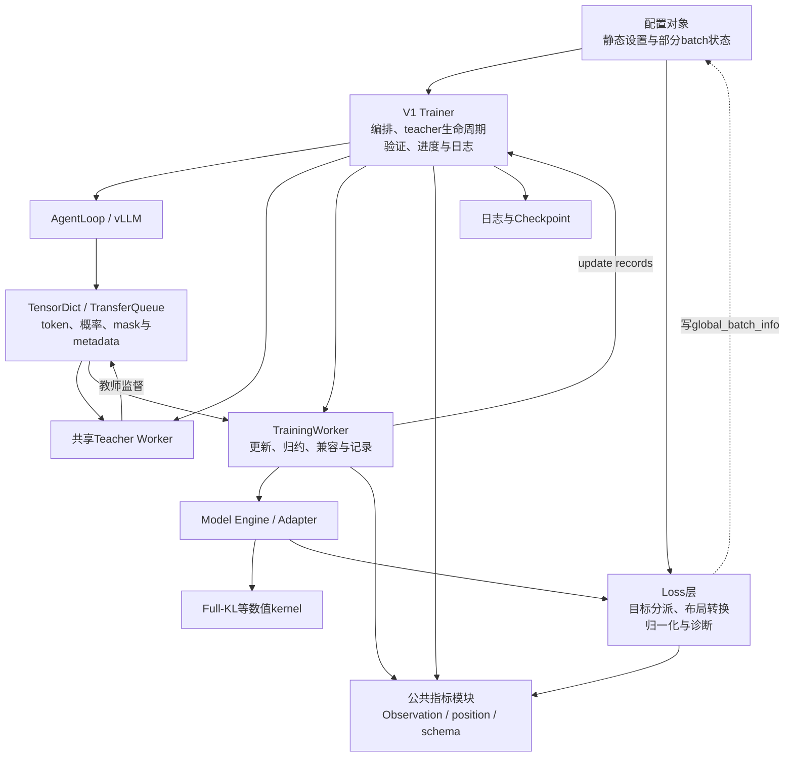
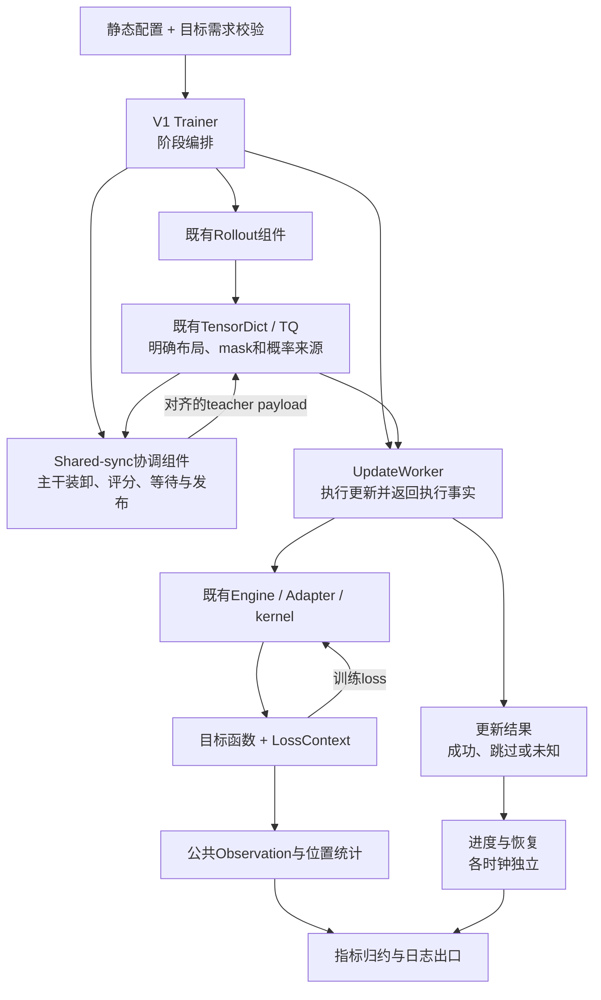

# MirrorOPD 架构背景与重构计划

更新：2026-10-24。状态：**计划经独立上下文 reviewer 评审后修订，尚未实施架构重构。** 本文记录背景、拟议边界和验收条件；其中的模块名称是设计说明，不表示相应组件已经存在。

重构目标是让新增目标、teacher 执行方式或 token 诊断时，修改集中在对应模块，同时保持训练数学、数据含义、执行时序和历史可复现性。继续复用 verl V1 Trainer、Worker、Engine、TensorDict 和 TransferQueue，不建立另一套训练框架。

## 1. 背景与审阅基点

### 1.1 固定版本

| 项目 | 版本／状态 |
| --- | --- |
| 官方 verl 基线 | `263653e749306287a5032140cce3d7833c1959d0` |
| 基线标签 | `verl-base-2026-10-19` |
| 本计划审阅版本 | `f9987d7ef` |
| 独立 review 结论 | `approve with changes`，有条件通过 |
| 实施状态 | 未开始；各项属于拟议工作 |

基线来源见 [UPSTREAM.md](../../../../UPSTREAM.md)。代码证据、行号和规模统计均按上述固定版本解释；后续工作区中的资产、验证资源等修改不自动成为本计划的一部分。实施前应复核新变更与本计划的交集，保留其他任务的工作。

相对固定上游基线，审阅版本的 `verl/` 下有 63 个文件变化，其中 35 个修改、28 个新增，新增 7801 行、删除 247 行。新增内容包括目标函数、共享 teacher 执行、Full-KL、指标系统和领域判分器；判分器及相关代码占新增 3659 行。文件数量和行数用于定位范围，不作为重构优先级的唯一依据。

### 1.2 已有能力与当前压力

| 已有能力 | 后续扩展面临的问题 |
| --- | --- |
| Sampled-token、top-k 及 Full-KL 目标 | 目标选择、输入准备和能力检查跨多个层次 |
| Shared-sync teacher 与上游 standalone teacher | 资源模型不同，生命周期不能简单合并 |
| Packed／nested／padded 张量 | 预测位置、response 位置和 mask 需要严格对齐 |
| Behavior、anchor、current、teacher 概率 | 字段名与策略来源并非始终一一对应 |
| 批内多次复用与更新计数 | Outer、attempt、成功更新、scheduler 调用有不同单位 |
| Observation、公共位置统计及评测预算指标 | 原始统计、训练 loss 贡献和历史 scalar 采用不同归约规则 |

V1 Trainer 从上游 2028 行增至 2590 行；`train_mini_batch` 从 97 行增至 184 行；`distillation_loss` 从 73 行增至 164 行。主要压力来自职责和语义约定的交织。仅拆分文件不能解决这些问题。

## 2. 当前结构

下面的箭头表示主要调用与依赖，虚线表示跨层状态写入；它不是完整的训练时序图。

当前已经有清晰、应保留的边界：`FullKLResult`、共享 precompute 梯度累积、公共位置统计、Observation、有界 HiddenBatchIO，以及 teacher head 与 student 参数的隔离。现有计算路径见[KL 计算与位置指标分层](../full-vocab/2026-10-24-KL计算与位置指标分层.md)。

## 3. 独立评审后的修订

Reviewer 在独立上下文中对固定代码和已有测试作只读审查，没有实施修改或运行训练。结论是方向成立，但应缩小抽象范围，先裁决 mask／分母语义，并保留独立训练时钟。

| 级别 | 评审发现 | 本计划采用的修订 |
| --- | --- | --- |
| P1 | Scheduler 按训练调用末次 mini-update 推进，与成功 optimizer 次数不同 | 统一记录执行事实，保留独立时钟；scheduler 状态由引擎 checkpoint 恢复 |
| P1 | 拒绝采样更新 response mask，分母读取 loss mask，实际关系尚需验证 | 先做 TQ／worker 边界测试；语义修复与行为保持型重构分开提交 |
| P2 | 概率布局不同，full 路径并不需要全部 sampled 概率字段 | 复用现有 padding 工具，新增窄转换函数，不创建强制所有字段齐全的大对象 |
| P2 | payload kind 不能单独决定目标和后端兼容性 | 保留现有 registry，补少量需求声明或集中校验，不建立能力协商框架 |
| P2 | shared-sync 和 standalone 生命周期不同，teacher 主干与 head 也有不同 owner | 只先抽 shared-sync 协调逻辑，保留现有 standalone manager 和微批 I/O |
| P2 | Legacy scalar 缺少原始权重，不能一律变成精确 Observation | 适配集中到边界，但保留训练贡献与原始统计量的规约差异 |

额外复核：`engine_workers.py` 的 `update_actor` 已在 `finally` 中调用 teacher head 的 `release()`。这里不存在需要补造的释放功能；重构应保留这个上层 owner，而不是把 teacher 主干 offload 和 head 释放合成同一个动作。

## 4. 实施前必须裁决的两个问题

### 4.1 Mask 与归一化分母

固定版本中能确认的事实：

- [agent_loop_tq.py](../../../../verl/trainer/ppo/v1/agent_loop_tq.py) 初始化 `loss_mask=response_mask`。
- [trainer_base.py](../../../../verl/trainer/ppo/v1/trainer_base.py) 在拒绝采样后回写 `response_mask` 等字段，回写列表不包含 `loss_mask`。
- [FSDP engine](../../../../verl/workers/engine/fsdp/transformer_impl.py) 的 `forward_backward_batch` 按 `loss_mask` 计算全局 token 分母。
- [PPO loss](../../../../verl/workers/utils/losses.py) 使用 `response_mask` 计算目标。

待验证问题是：经过 TQ 字段存储和读取后，拒绝采样是否使分子使用筛选后 mask、分母仍使用筛选前 mask。这个现象尚未被认定为 bug，也不能在统一 mask 时默认改成另一种语义。

建议用实际 TQ／worker 边界构造一个最小案例：两个 response 原有 6 个有效 token，拒绝采样后保留 3 个；对每个保留 token 使用受控的单位损失，观测分子为 3、分母实际为 6 还是 3。同时测试全空、部分空 sequence，以及 DP／microbatch 切分变化。

Sequence 归一化也需要单独列明：当前 trainer 会传入配置的 mini-batch 大小，`agg_loss` 仅在分母缺省时才回退到非空 sequence 数量，不能在重构中自动替换。

测试确认后，要记录每类目标的分子 mask、token 分母、sequence 分母和空样本政策。若确认存在缺陷，应先独立修复并说明行为变化；若为有意设计，应写成契约测试。

### 4.2 执行事实与独立时钟

| 事件 | 含义／现有语义 |
| --- | --- |
| Outer | 一轮训练编排对应的批次进度 |
| Update attempt | 尝试执行一次 optimizer 更新 |
| Optimizer applied | 后端明确报告实际发生了参数更新 |
| Scheduler invocation | 每个 `train_mini_batch` 调用的最后一次循环后推进一次 |

[现有 pipeline 测试](../../../../tests/workers/test_policy_metrics_pipeline_on_cpu.py) 明确验证 4 次尝试、3 次执行、scheduler 只推进 1 次。不能根据 optimizer 成功次数重新推导 scheduler 次数，也不能把 horizon 自动乘上 epochs 或 mini-batch 数量。

执行结果允许 `Optional[bool]`：未知不等于失败或成功。部分后端／scaler 路径没有报告执行事实时，应保持未知，不能用 finite gradient norm 猜测。依赖精确更新预算的实验可在能力检查或恢复入口拒绝缺失信息，但不能伪造计数。

Scheduler 状态继续由[引擎 checkpoint manager](../../../../verl/utils/checkpoint/fsdp_checkpoint_manager.py)保存／恢复。Trainer 的日志计数不用于重建 scheduler 内部状态。

## 5. 五项重构工作

### 5.1 窄 token 布局与概率语义适配

复用 [workers/utils/padding.py](../../../../verl/workers/utils/padding.py) 和现有 TensorDict 字段，增加明确命名的转换函数／只读访问器、shape 检查和必要的来源描述。

必须区分：

| 对象 | 需要保留的区别 |
| --- | --- |
| 概率角色 | behavior、anchor、current、teacher |
| 布局 | 完整序列预测位置、response 位置、有效 token 子集 |
| Mask | 优化 mask、原始观测 mask 及 padding 排除 |
| 概率条件 | 温度、处理方式、采样支持以及策略版本来源 |

Behavior 已经是 response 布局时不能再次移位；shared teacher 的输出已经按预测位置对齐时，只处理尾部 dummy；bypass 路径的 `old_log_probs` 来自 behavior，不能无条件解释成 anchor。Full-KL 可以没有 behavior 和 anchor，不应为满足统一对象而额外计算它们。

完成标准：所有迁移调用点使用相同的明确布局规则；不等长 prompt/response、EOS、masked gap、padding NaN 及 detach 规则保持不变。现有字段 ABI 先保持，旧命名在边界解释。

### 5.2 小型 LossContext 与目标需求声明

目标函数需要的每次调用信息通过小型 `LossContext` 传递：全局 token／sequence 分母、DP 规模、归一化方式和缩放。静态配置不再作为项目新增目标的 batch 状态容器。

上游注册的 policy loss 仍读取 `config.global_batch_info`，这是现有接口事实。先通过调用级适配副本满足旧接口，避免修改整个 PPO 注册表；副本只承载小型配置和上下文，不复制模型或 batch。

继续使用已有 `payload_kind` 和 loss registry。补充或集中验证 PG/direct、task reward、advantage 来源、clamp、采样支持及后端限制；payload 种类不是完整兼容判断。

检查分为配置字段自身、启动时跨组件兼容、运行时张量三层。完成标准是新增同类目标主要修改目标实现和需求声明，数学语义和各目标的分母不变。

### 5.3 Shared-sync teacher 协调逻辑

只抽取 shared-sync 的上卡、评分、等待、offload 和发布协议；[上游 standalone manager](../../../../verl/experimental/teacher_loop/teacher_manager.py) 保留现有异步请求与多 teacher 路由，不纳入统一生命周期框架。

组件接收 worker/client、必要配置和数据描述，不接收整个 Trainer 作为隐式依赖集合。Teacher 主干的资源 owner 和 student 使用的冻结 teacher head owner 仍分别明确。

必须保留：

- DP dispatch 将 KVBatchMeta 转换成 index-based BatchMeta 后恢复 sample keys 的能力。
- 单笔 pending write 的背压、退出 flush 以及读取后的及时释放。
- Wrapped head 的 FSDP2 hooks，以及 transfer 完成包含的设备同步。
- 失败不进入后续更新，清理失败不覆盖原始异常。

通用 TQ 逐步只处理批次身份和传输，不直接解释 Full-KL 算法角色。`HiddenBatchIO`仍在微批边界工作，不把整个 batch 的 hidden 集中读取，也不建立泛化存储框架。

### 5.4 执行结果、进度与恢复

先把 optimizer 执行事实从普通 metrics 字典中分离，形成明确的更新结果；保留成功、跳过和未知三种状态。随后收敛 attempt/applied 计数、日志坐标与 checkpoint 进度序列化，避免多处重复推算。

“统一”指同一执行事实只有一个来源，不表示 outer、optimizer 和 scheduler 变成一个计数器。各时钟的推进规则保持第 4.2 节的约定。Actor 和 critic 的对应事件也不能混为一条轴。

旧 checkpoint 缺少计数时继续显式表达未知。完整恢复和只加载权重是不同操作；不能把无法恢复的历史计数填零后宣称继续原训练。

完成标准：成功／跳过／未知更新、DP 状态不一致、恢复后的计数与 scheduler 状态都符合原有契约。执行结果与指标归约分别提交，便于定位行为差异。

### 5.5 指标协议与兼容边界

保留 Observation 作为原始充分统计的合并机制，公共位置统计继续用于任意逐 token 标量。旧字段名称、Metric/list/scalar 类型适配集中到明确出口，新目标不再重复生产新旧两套名称。

兼容转换必须保留归约语义：训练 loss 贡献可能已包含全局缩放，需要本地累积后 DP 平均；原始 Observation 则先合并统计状态。旧 scalar 没有 token count 时，不能包装成伪精确的 token 均值。

逐 update 记录与 outer 统计保持分离。新记录的事件时点明确，逐步减少仅由指标名字推断横轴的依赖；历史读取仍使用冻结的字段与轴映射。

完成标准：字段含义、分母、时点、缺失值和非有限值政策都保留；改变卡数或 microbatch 划分，不改变可精确合并指标的结果。

## 6. 拟议目标结构

下图聚焦 shared-sync。`LossContext`和批次语义视图是小型调用约定，不是新配置系统或新 Tensor 容器；standalone 保持原有路径。

对普通与 fused Full-KL 继续复用现有共享 precompute 累积与 `FullKLResult`。本轮不替换 KL 数值公式、不改梯度目标，也不因接口统一而导出完整词表 logits 到通用传输层。

## 7. 兼容代码的处理政策

| 内容 | 处理方式 |
| --- | --- |
| 旧指标名称、嵌套 list 返回格式 | 集中到边界；当前 producer 完成迁移后删除主循环重复分支 |
| `global_batch_info`运行时写入配置 | 项目新增目标改用显式上下文；上游旧 loss 经薄适配调用 |
| 旧 checkpoint／旧 backend 缺执行事实 | 保留 unknown；严格预算场景明确检查，不能猜测或填零 |
| `vanilla`与新增`token_ppo`等路径 | 保留各自算法语义；分母和 dual-clip 区别不是格式兼容 |
| 原始统计与归一化 loss 贡献 | 保留不同规约，不能统一改成普通 mean |
| Full-KL 标量包装函数 | 保留廉价接口兼容，不另留重复算法实现 |
| `token_kl=None` | 表达真实后端能力，不能补假诊断 |
| Qwen adapter、tied head、额外词表归一化修正 | 保留正确性机制，只调整调用边界 |
| CPU/FP64参考及fused回退 | 本轮保留既有政策；实际 backend 审计与策略变更另行处理 |

兼容清理不以删除行数为目标。退出条件是对应生产端已经迁移、必要信息仍可获得、历史读取有明确入口，而不是看函数是否含有 `legacy` 字样。

## 8. 实施顺序与提交边界

| 阶段 | 工作 | 进入下一阶段的条件 |
| --- | --- | --- |
| 0 | 契约表及缺口测试，优先裁决 mask／分母 | 行为已确认；必要修复与重构分开 |
| 1 | 窄布局辅助函数与调用点迁移 | 位置、mask、概率来源、detach 及字段 ABI 等价 |
| 2 | 小型 LossContext 与目标需求校验 | 固定输入 loss/VJP 及 DP／microbatch 不变性通过 |
| 3a | 更新执行结果与进度整理 | attempts/applied/unknown及scheduler恢复保持一致 |
| 3b | 指标归约、命名和兼容边界整理 | 统计、横轴、缺失值与逐 update 记录等价 |
| 4 | Shared-sync 协调逻辑抽取 | 异步 I/O、失败清理、FSDP hooks 与有界内存验收通过 |

每项采用小批独立提交，不把数值目标变化、默认参数变化或已知语义修复混入同一个“重构”提交。先保留旧接口边界，再逐步迁移当前调用点；没有第二套长期并行的训练主链。

## 9. 验收矩阵

现有测试已有较多覆盖，应复用并补缺口，不新建重复测试体系。

| 不变量 | 现有入口／需补内容 |
| --- | --- |
| sampled 目标及概率来源、detach | [test_sampled_token_loss_on_cpu.py](../../../../tests/trainer/distillation/test_sampled_token_loss_on_cpu.py) |
| Full-KL 值、VJP、教师额外词表支持 | [test_full_vocab_on_cpu.py](../../../../tests/trainer/distillation/test_full_vocab_on_cpu.py) |
| Qwen 模型适配和全部参数梯度 | [test_full_vocab_adapter_on_cpu.py](../../../../tests/trainer/distillation/test_full_vocab_adapter_on_cpu.py) |
| 位置桶、mask 空洞、分区重建 | [test_position_metrics_on_cpu.py](../../../../tests/utils/test_position_metrics_on_cpu.py)及 Full-KL 位置测试 |
| 指标开关不影响 loss、梯度和 RNG | sampled 目标测试、[Observation 测试](../../../../tests/utils/test_metric_observations_on_cpu.py) |
| scheduler 与执行事实、逐 update 日志 | [test_policy_metrics_pipeline_on_cpu.py](../../../../tests/workers/test_policy_metrics_pipeline_on_cpu.py)、[mini-batch 记录测试](../../../../tests/workers/test_engine_workers_mini_batch_trace_on_cpu.py) |
| 共享 teacher 顺序与异常清理 | [test_shared_teacher_on_cpu.py](../../../../tests/trainer/ppo/v1/test_shared_teacher_on_cpu.py) |
| 有界 hidden 写入、prefetch 及 keys 恢复 | [test_hidden_io_on_cpu.py](../../../../tests/trainer/distillation/test_hidden_io_on_cpu.py) |
| 两卡真实聚合和 FSDP hooks | [test_full_vocab_fsdp2.py](../../../../tests/special_distributed/test_full_vocab_fsdp2.py) |
| 拒绝采样后的真实分母 | 需补 TQ／worker 边界定向测试；尚未裁决 |
| 空 sequence 与真实 scheduler 恢复 | 先复核现有覆盖，再补跨边界缺口；不能仅检查 mock 调用次数 |

没有重新运行的测试不能写成新重构的验收结果。每个实施提交记录实际命令、结果、覆盖范围及未验证边界；单卡数学正确不代替多卡生命周期验证。

## 10. 暂不纳入与后续维护

本轮不做启动器重写、验证流程全面拆分、删除所有上游后端、替换 KL 数值公式、改变训练精度、扩大模型支持范围或建立大型插件框架。验证编排和 Hydra 配方收敛可在主链契约稳定后作为第二轮工作。

继续保留上游骨架、已有领域判分器、冻结实验材料和独立日志仓库。当前实验的模型、batch、长度、采样、停止条件、scheduler 与验证预算均不因本计划自动改变。

后续更新本目录时，应分别记录计划修订与已实施结果。已完成项须链接对应 commit 和验收证据；未验证问题保持未验证状态。代码规模统计和旧行号属于固定审阅版本，不随工作区变化默认为最新事实。
