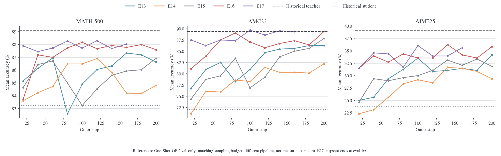

# Full-KL 批内收敛与原始师生参考评测

日期：2026-10-24。本文补充[五组 Math 实验分析](2026-10-24-五组Math实验对比分析.md)，回答 E16/E17 的 IS、批内收敛和师生差距问题。五组训练仍使用同一份冻结快照；E17 最后验证为 outer 160，完整 outer 汇总到 177，更新记录到 2848。这里没有重新评测模型，也不根据快照判断当前作业是否结束。

**结论是：E16/E17 对应 current + 精确动作 IS 的 Full-KL，不是 current + NoIS；16 次复用仍未把固定批次上的条件 KL 优化到不再变化。历史 teacher 的准确率参考已找到，但没有其长度和熵，当前不能证明学生整体生成分布已经接近 teacher。**

## 1. 没有显式 ratio，不等于 NoIS

沿用理论稿符号：$p=p_\theta$ 是当前学生条件分布，$T$ 是固定教师，$q$ 是冻结 anchor，$\beta$ 是实际生成数据的行为分布，$s$ 是固定前缀。定义

$$
K(s;\theta)=\sum_a p(a\mid s)\log\frac{p(a\mid s)}{T(a\mid s)},\quad
A^{\rm cur}(s,a)=\log\frac{T(a\mid s)}{p(a\mid s)},\quad
\psi(s,a)=\nabla_\theta\log p(a\mid s).
$$

支持集足够时，sampled-token 的 current + 未截断 IS 梯度期望为

$$
\mathbb E_{a\sim\beta}\left[-\frac{p(a\mid s)}{\beta(a\mid s)}A^{\rm cur}(s,a)\psi(s,a)\right]
=-\sum_a p(a\mid s)A^{\rm cur}(s,a)\psi(s,a)
=\nabla_\theta K(s;\theta).
$$

Full-KL 直接做右边的完整动作求和，$\beta(p/\beta)=p$ 已经代数消去，所以不用缓存或显式形成每个动作的 IS ratio。这里消除的是**给定前缀后的动作采样误差**。NoIS 的 sampled-token 期望则保留 $\beta$ 权重；对当前信号，它对应固定 $\beta$ 下 $\frac12\mathbb E_\beta[\log^2(p/T)]$ 的梯度，与 reverse KL 不同。四格推导集中在[Full-vocab 计算图](../theory/2026-10-22-Full-vocab计算图与四种更新.md#four-cases)。

当前实现的证据：

- [full_vocab.py](../../../../verl/trainer/distillation/full_vocab.py) 的 `PrecomputedKL.forward`（151–183 行）重算当前 student logits、固定 teacher logits，求 $p\log(p/T)$；175 行计算 logit 梯度 $p[\log(p/T)-K]$。它不是冻结 advantage。
- [losses.py](../../../../verl/trainer/distillation/losses.py) 的 `full_reverse_kl` 分支（265–274 行）按有效 token 总数归一化，不走 PPO ratio/clip 分支。
- [engine_workers.py](../../../../verl/workers/engine_workers.py) 的 `train_mini_batch`（304 行起）把同一批数据交给多 epoch iterator。当前 global batch=mini-batch=64，因此 E16 每批 4 个 optimizer update，E17 每批 16 个；不是 4/16 批新 rollout。

因此管线是：**旧策略生成固定回答和前缀 → 固定 teacher hidden/target → 每次更新重算当前 student hidden/head 与完整动作 KL → 更新 student → 在同一批前缀上重复。** 旧轨迹上的 teacher 条件目标不随 student 更新改变；student 的条件概率和对应 KL 梯度每次改变。异步写入、预取和 head-loss 分块只改变执行方式，不改变这个目标。

### 1.1 ESS 仍可定义，但日志没有测量

ESS 是动作重要性采样的诊断，Full-KL 直接积分不需要它来解释动作估计量的方差。不过仍可用它诊断 current student 与旧 behavior 的漂移。对同一前缀上的独立行为动作、权重 $w=p/\beta$，大样本归一化 ESS 是

$$
\frac{\mathrm{ESS}}N\longrightarrow
\frac{(\mathbb E_\beta w)^2}{\mathbb E_\beta w^2}
=\frac1{\sum_a p(a\mid s)^2/\beta(a\mid s)}
=\frac1{1+\chi^2(p\Vert\beta)}.
$$

这不是 $1/\sum_a p_a^2$，也不能说完整词表的 ESS 等于词表大小或无穷大。训练序列里的 token 还存在相关性，上式的条件独立抽样解释不能原样当作整条轨迹的有效样本量。

现有 E16/E17 没有记录 current–behavior ratio/ESS；Full-KL 路径也没有为了这些诊断保留足够的行为概率记录。可以另加 rollout action 的 behavior/current log-prob 来测 sampled ratio，或额外缓存完整 behavior 分布相关信息做精确漂移，但不是当前训练 loss 必需的数据。**不能从较小的 $K(p\Vert T)$ 推出较高的 $\mathrm{ESS}(p/\beta)$，两者参照分布不同。**

### 1.2 多 epoch 仍有前缀陈旧问题

一次 outer step 中优化的是

$$
F_k(\theta)=\mathbb E_{s\sim\widehat d_k}K(s;\theta),
$$

其中 $\widehat d_k$ 是这批旧回答的有效 token 前缀经验测度。Full-KL 对这个固定测度的梯度是精确的，但不会把 $\widehat d_k$ 自动换成当前学生的访问分布。它也没有加入完整序列目标中访问概率变化的梯度。故“没有动作 IS 估计误差”和“没有任何 off-policy 问题”是两回事。

## 2. 多次复用到底降低了多少 KL

下面统一取 outer 141–160 的 20 批。每一批先计算自己的相对降幅，再对 20 批取均值；不是用表中两个均值的比值替代逐批统计。单位为自然对数 nats/token。

| 实验 | 第 1 次更新前 KL 均值 | 最后一次更新前 KL 均值 | 批内相对下降均值 | 最后相邻两个观测之间的下降均值 |
| --- | ---: | ---: | ---: | ---: |
| E16，4 epochs | 0.00198573 | 0.00186135 | 6.26% | 2.83% |
| E17，16 epochs | 0.00082887 | 0.00046412 | 43.85% | 2.21% |

**日志测量发生在 optimizer 更新之前。E16 的首末差只覆盖 3 次已执行更新，E17 覆盖 15 次；都没有对最后一次更新后的同一批再 forward。** 不能把最后一点写成“完成第 16 次更新后的 KL”。E16/E17 的轨迹本身不同，上表也不是相同输入的 epoch 数控制实验。

E17 更靠后的 outer 159–178 共 20 批，首末 KL 均值为 0.00076594 → 0.00041153，逐批相对下降均值 45.89%，最后相邻观测平均仍下降 2.49%。outer 178 有完整的 16 条更新记录，但没有完整 outer 汇总或对应验证，故只用于批内分析。最后一条 KL 为 0.00040642，梯度范数约 0.00834。

这些结果说明 **E17 在已经复用十余次后仍有可见的局部优化空间**。它们不证明继续增加 epochs 会提升 held-out 准确率，也不证明固定批次能收敛到零。要判断该批次的停止状态，至少应比较同一批上的 update 前后 KL、梯度范数和后续几步相对变化；要判断模型训练收敛，还应看新 rollout、固定 held-out 前缀及验证指标。不能用旧批次损失下降替代这些证据。

### 2.1 不存在由 epochs 单独决定的理论降幅

即使对普通梯度下降，也需要光滑性和步长等条件。例如 $L$-smooth 的 $F$ 满足

$$
F(\theta-\alpha\nabla F)\leq F(\theta)
-\alpha(1-L\alpha/2)\|\nabla F(\theta)\|^2.
$$

只有再加 PL/强凸等假设，才能给出相对最优值的几何收敛界。当前是共享参数的 Transformer、AdamW、梯度裁剪和低精度训练，不能把这个理想 GD 界直接代入 $\alpha=10^{-6}$，更不能将 16 epochs 解释成 16 次独立的分布空间精确镜像更新。这里实际采用 lr=$10^{-6}$、weight decay=0.01、grad clip=1；E17 的梯度范数非零也不等价于任务指标必然还有收益。

## 3. 找到的原始 Student / Teacher 评测

历史记录来自已保存的 **2026-10-20 API 快照**，不是本轮从 .wandb 重新解码：

- [Student 6uorrk2k](../data/oneshot-student-6uorrk2k-api-20261020/source.json)：`DeepSeek-R1-Distill-Qwen-1.5B`。
- [Teacher u87buult](../data/oneshot-teacher-u87buult-api-20261020/source.json)：`JustRL-DeepSeek-1.5B`。

两者都是 One-Shot-OPD 的 val-only，MATH-500/AMC23/AIME25，每题 16 个回答、temperature=0.7、top-p=0.9、max_tokens=31744。这些采样预算与五组实验一致，但历史输入/模板与执行管线不同，不能当成五个 run 各自的真实 step 0，也不构成严格的配对显著性比较。

| 参考或实验 | 验证点 | MATH mean | AMC mean | AIME mean |
| --- | --- | ---: | ---: | ---: |
| 历史原始 student | val-only | 83.2500% | 72.0313% | 23.7500% |
| 本仓原始 student，rzfdphjr | val-only | 83.2375% | 71.5625% | 23.1250% |
| 历史 teacher | val-only | **89.1125%** | **89.3750%** | **39.1667%** |
| E13 Full-KL ×1 | 200 | 86.6250% | 86.2500% | 34.1667% |
| E14 Full-KL ×1，半 LR | 200 | 84.8000% | 82.1875% | 29.3750% |
| E15 sampled ×1 | 200 | 86.9125% | 87.8125% | 31.8750% |
| E16 Full-KL ×4 | 200 | **87.5875%** | **89.3750%** | **35.8333%** |
| E17 Full-KL ×16 | 160 | **88.0250%** | **89.3750%** | **35.6250%** |

E17 距历史 teacher 的 MATH/AIME 点估计分别还有 **1.0875/3.5417 个百分点**；E16 为 **1.5250/3.3333 个百分点**。AMC 的点估计相等，只能说这个指标相等，不能说分布已经一致。也不能仅凭 E16@200 与 E17@160 的 AIME 差异认定更多 epochs 有害；共同预算比较见原报告。

图中历史参考是水平线，不是 step 0 数据点。面板使用不同纵轴范围以显示各数据集变化，不能比较视觉斜率大小。新的[单文件交互报告](../data/five-run-comparison-20261024/dashboard.html)可开关参考线、切换 outer/update/time 横轴；**参考线只用于 mean accuracy**。旧 `best@16/mean`、`maj@16/mean` 含历史 bootstrap 估计口径，不与新的 exact `pass@16` / `majority@16` 混画。

### 3.1 长度和熵：已找到什么，仍缺什么

原始两份 One-Shot 评测的 history 和 summary 中均没有 length、entropy 或生成 token 数记录。不能补写 teacher 长度，不能用训练长度替代验证长度，也不能从准确率倒推熵。它们另有 format_score 等辅助指标，但这些同样不是 KL。

本仓已有一次原始 student 的四卡 H800 验证（[性能实测](../infra/2026-10-22-训练与验证性能实测.md)，`rzfdphjr`）保留了总生成 token：56,291,141 / 9,120 responses，整体均值 **6172.27 tokens**。它使用相同验证题目和采样预算、graph rollout；该值来自 engine 生成计数，未存逐数据集长度或熵。

| 验证点 | MATH 平均长度 | AMC 平均长度 | AIME 平均长度 | 全部回答加权平均长度 |
| --- | ---: | ---: | ---: | ---: |
| 本仓原始 student | 未记录 | 未记录 | 未记录 | 6172.27 |
| E13@200 | 4600.72 | 6932.50 | 10482.11 | 5073.90 |
| E14@200 | 5236.30 | 8201.90 | 11584.50 | 5778.52 |
| E15@200 | 4728.27 | 7146.05 | 10762.53 | 5215.53 |
| E16@200 | 4557.12 | 6919.46 | 10318.40 | 5026.12 |
| E17@160 | 4435.98 | 6647.74 | 10321.78 | 4900.97 |
| 历史 teacher | 未记录 | 未记录 | 未记录 | 未记录 |

据此可以说，相较本仓初始 checkpoint 的这次历史验证，E16/E17 的整体回答均值更短，准确率更高。但不知道 teacher 的回答有多长，因此不能声称长度已经趋近 teacher。还应联合查看 p50/p95、length-limit stop、答案缺失和正确/错误回答长度，避免把截断或答案缺失造成的变短误判为效率提升；这些训练后指标已在交互报告中保留。

E16/E17 没有 entropy 日志。E15 有训练前缀的 `pre_update` entropy：最初 20 次均值约 0.8782，最后 20 次约 0.6728；这是训练采样前缀上的条件熵，**不是验证生成序列的熵，也不是 teacher 自己生成前缀上的熵**，不能拿来填师生 entropy 对照表。

## 4. KL 能否趋于零，序列行为能否趋近 Teacher

### 4.1 表达能力允许，不等于这条训练路径保证达到

本地两个模型配置的 qwen2 架构、28 层、hidden size=1536、vocab size=151936、12 attention heads/2 KV heads、RoPE 和非共享输出 head 等关键结构一致。对相同 token 定义和输入/输出变换，且全部对应参数可训练时，直接取 teacher 参数是一个可表示的 $p=T$ 解；不是小学生架构天然无法表达 teacher。

但有限训练前缀、共享参数耦合、非凸优化、AdamW 权重衰减、恒定学习率和数值精度都不保证训练到这个解。某一批的 $F_k\approx0$ 只说明该经验测度上的平均条件误差小；不代表未见前缀、验证题目或完整序列分布一致。

### 4.2 完整序列 KL 的正确关系

固定 prompt $x$、一致 EOS/停止规则及有限长度边界，令 $P_\theta$ 和 $\mathsf T$ 是自回归序列分布，则链式法则为

$$
D_{\mathrm{KL}}(P_\theta(\cdot\mid x)\Vert\mathsf T(\cdot\mid x))
=\mathbb E_{Y\sim P_\theta}\left[\sum_{t\leq\tau(Y)}K(x,Y_{<t};\theta)\right].
$$

它要求当前学生自己的前缀分布，且沿序列**求和**。训练日志则是旧回答前缀上的 token mean。只有同一套新鲜当前策略轨迹、相同 mask/停止规则上的统计，才可用“所有 token 的平均条件 KL × 平均有效长度”恢复该样本集合的平均序列 KL 和；不同批次、不同策略、不同温度的数据不能混乘。

一个纯量纲例子：若在同一批当前轨迹上 token KL 为 $8\times10^{-4}$、平均长度为 5700，则平均序列 KL 和约为 **4.56 nats**。这不是 E17 的实测序列 KL，只说明很小的每 token 数字可能累积成不小的序列差异。

更强的边界来自[核心理论附录](../../../../../MirrorOPD/theory/core/appendices/g_dynamics.tex)“条件更新与完整序列”：**即使每个前缀的条件 KL 都下降，序列 KL 仍可能上升**，因为学生更频繁访问残余误差较大的分支。本文用两步离散树枚举复核了原稿反例：条件 KL 分别从 $[4.5032,0,69.0775]$ 降到 $[4.3759,0,68.7778]$，而序列 KL 从 5.1940 升到 6.0745。它说明不能由批内 conditional loss 单调下降推出 sequence KL 单调下降，不是对本轮模型的数值测量。

### 4.3 Accuracy、length、entropy 是诊断，不是多项相加得到的 KL

这些指标应联合观察，但既不能识别完整分布，也不能取代序列 KL。例如 $p=(0.9,0.1)$ 和 $T=(0.1,0.9)$ 的熵完全相同（0.32508 nats），KL 却为 1.75778 nats。

正确的熵分解是

$$
D(P\Vert\mathsf T)=H(P,\mathsf T)-H(P),
$$

交叉熵 $H(P,\mathsf T)$ 必须在**学生轨迹**上用 teacher 打分；不是 teacher 自己的熵 $H(\mathsf T)$ 减去 student 熵。Length 与 acc 也不出现在这个恒等式中，它们反映不同的行为差异。

若在同一 prompt 分布及同一生成协议下，真正的序列 KL 趋于零，则 TV 由 Pinsker 不等式控制。对 $[0,1]$ 奖励，$|\mathbb E_P r-\mathbb E_{\mathsf T}r|\leq\sqrt{D(P\Vert\mathsf T)/2}$；对最大长度为 $H_{\max}$ 的序列，平均长度差至多为 $H_{\max}$ 乘同一 TV 界。因此在这些条件下分布趋同会带来相应指标趋同，有限词表和有限长度下熵也连续。但反方向不成立，而且准确率不必随 KL 单调改善，teacher 准确率也不是所有学生策略的硬上界。

当前训练 full KL 使用全支持的温度 1 分布，验证使用 temperature=0.7、top-p=0.9。后者改变分布且可能产生支持集差异；其 KL 甚至可能因 teacher 截断掉 student 有正质量的动作而无穷大。不能把 raw full KL 与 top-p 生成分布的序列 KL 无条件等同。

## 5. 下一步最小补证方案

这里列的是后续测量建议，本轮没有启动 GPU 作业或改变训练实现。

1. **同管线师生基线**：用当前验证脚本跑原始 student 和 teacher，固定题目、采样预算、模板、停止规则；保存每条回答的 token IDs、长度、完成原因、正确性和模型版本。与 E16/E17 checkpoint 用相同口径比较 acc、长度分布、截断/答案缺失、pass/majority。
2. **固定前缀拟合审计**：冻结一小批训练与 held-out 前缀，比较 E16/E17 不同更新位置的完整条件 KL。至少补一次最后更新后的 forward，避免把 pre-update 记录当作 batch 终态。它测拟合，不直接叫 sequence KL。
3. **新鲜轨迹概率审计**：单独采用一致全支持采样协议，在 checkpoint 自己的新轨迹上累计 full conditional KL、学生条件熵和 teacher cross-entropy，报告每序列总量及每 token 量。保留 EOS/长度边界定义和置信区间；实际 top-p 任务评测仍独立报告。
4. **确有诊断需求时补行为漂移**：保存 rollout token 的 behavior log-prob，按 epoch 记录 current/behavior log-ratio、分位数、sampled ESS；明确这是额外测量，不把 ratio 再乘到现有 Full-KL 上。后者会改变已正确的动作积分。

如果只选最有价值的两项，优先同管线 teacher 基线和 held-out/current-trajectory KL 审计。它们能区分“尚未拟合 teacher”“只在旧前缀上拟合得好”“任务指标已接近但行为仍不同”，比盲目继续加 epochs 更有解释力。

## 6. 数据与验算

所有派生数值在 [references.json](../data/teacher-convergence-20261024/references.json)，有限分布验算在 [mathematical-checks.json](../data/teacher-convergence-20261024/mathematical-checks.json)。提取脚本为 [compare_teacher_references.py](../scripts/compare_teacher_references.py)，验证脚本为 [verify_sequence_kl.py](../scripts/verify_sequence_kl.py)。复现命令集中在[分析复现](../分析复现.md)，不会请求网络或占用 GPU。

验收包括历史 mean/budget/缺失字段逐项核对、固定窗口统计复核、有限分布链式法则与反例、既有分析/导出测试 14 项通过，以及四个 Python 脚本的 Ruff 检查。独立临时目录只放一个 HTML，以浏览器 offline 模式确认 mean 显示 7 条线、其他指标保持 5 条、参考开关有效、E17@200 保持缺失、批内图保留 16 个点，无页面错误或网络请求。PNG 与页面截图已检查；图审计的独立纵轴提示在图注中说明。
