# 策略蒸馏泛化的双重性：实验、结果与完整设置

论文：*Every Coin Has Two Sides: On the Dual Nature of Generalization in On-Policy Distillation of Large Language Models*，Zhaoyi Li 等，arXiv:2608.16647。本文固定核对 **v3，2026-10-23** 的 LaTeX 源与 31 页 PDF；整理日期为 2026-10-26。所有图、表、章节编号均指 v3。未带版本号的 HTML 在核对时仍显示 v2，不能据此替换 v3 的图表编号或训练参数。[^paper]

本笔记覆盖正文和附录中的实验，附录整理学生、教师、数据及训练／评测设置。论文报告的数字、曲线观察和作者的机制解释分别表述；没有原始数值的曲线不补造精确终点。模型卡用于补充模型来源，不把模型原始发布成绩混入本文实验成绩。

正文嵌入 v3 的全部 13 张原图，按实验主题排列；图片从论文 PDF 的图区域裁出，仅去掉周围正文与页边空白，保留子图布局、图例和原英文图注。每图附矢量 PDF，便于放大查看。来源页码与裁切范围见[原图说明](figures/coin-2608.16647v3/README.md)。Mermaid 图用于整理实验组合，与论文原图分别标明。

## 1. 研究问题与实验全貌

论文研究在策略蒸馏（On-Policy Distillation，OPD）的泛化：教师能否把能力传递到训练题以外的难度、语言、推理跨度和领域；当多个教师同时参与时，这种跨领域影响怎样相互作用。实验主要支持三个观察：

1. 数学训练题的教师通过率影响较小；教师四次都答错的题也能产生有效监督。动态剔除学生已四次全对的题，有小幅平均收益。
2. 在所测试的师生配对中，同源教师通常使学生在多个评测分布上接近教师；跨源教师的迁移更依赖训练分布。但跨源也能发生跨语言／长程迁移，学生也可能超过教师，因此这不是二元成败规律。
3. 多教师在策略蒸馏（Multi-Teacher OPD，MOPD）中，按领域路由 prompt 不能隔离教师的跨领域影响。改变教师比例可能同时改变多个领域的成绩，甚至增加数学 prompt 占比反而降低数学成绩。[^paper]

### 1.1 实验索引

下表按独立问题组织；同一条训练曲线可能出现在多个图里，不能把图中曲线数相加当作独立训练次数。

| 实验 | 实际改变的因素 | 对照与观测 | 原文位置 |
| --- | --- | --- | --- |
| 教师通过率筛题 | BigMath easy／hard／random | 3 个师生对，每对 3 个 25K 子集；英文数学六集均分 | §3.1，图 1，PDF p.4 |
| 学生动态筛题 | 不筛／仅全错／仅全对／排除全对 | 2 个师生对，每对 4 种策略；六项数学成绩 | §3.1，表 1，p.5 |
| 绝对难度 | GSM8K／DeepMath 最难切片／BigMath | 3 个师生对，约 8K 唯一题目规模对齐 | 附录 C.1，图 10，p.27 |
| 数学域内迁移与原教师数据 | 同源／跨源教师，BigMath／教师原 RL 数据 | 1.5B、7B 学生；英文／中文／长程数学 | §3.2，图 2，p.6 |
| 补充模型与规模 | 4B 同源、8B 跨源、14B 同源 | 三类数学及代码；4B 额外比较 Polaris-53K | 附录 C.2，图 11，p.29 |
| 数学与代码双向迁移 | Math／Code prompt | 两种学生及各自同源／跨源教师；LCB 与三类数学 | §4.1，图 3a/b/d、图 12，pp.7、30 |
| 数学与科学双向迁移 | Math／Science prompt | 包括 Nemotron 的正迁移、JustRL 的科学负迁移 | §4.1，图 3c/d、图 12 |
| 指令遵循到数学 | IF／Math prompt | Nemotron→1.5B、Polaris→7B；三类数学 | 附录 C.3，图 13，p.30 |
| 1.5B 双教师比例与路由 | J/N 比例、教师负责的领域、学生初始化 | 科学／代码／IF 曲线，数学终点 | §4.2，图 4，表 2、6 |
| MOPD 训练中相互影响 | 跟踪不同混合比例的训练过程 | AIME24-Horizon-2，与两种单教师端点比较 | §4.2，图 5a/b，p.10 |
| 级联 OPD | 先科学教师，后数学教师 | GPQA 的先升后降 | §4.2，图 5c |
| 师生策略重叠 | 同源／跨源教师 | 1.5B 的 7 位教师、7B 的 5 位教师；top-16 overlap | §5，图 6，p.11 |
| 同源与跨源教师共同蒸馏 | Light-14B／Light-7B 比例 | 7B 学生的科学、数学、代码 | §5，图 7，p.11 |
| 数学数据比例反转 | Light-14B 数学／Polaris-7B 科学-IF 比例 | 4 项数学；比较纯数学教师 OPD | §5，图 8，p.12 |
| RL 与 SFT 教师 | Polaris-7B／Light-R1-7B | 同一 7B 学生；英文数学及 top-8/16 overlap | §5，图 9，p.13；v3 新增 |

### 1.2 单教师实验的实际配列

箭头统一表示 **教师 → 学生**。图中每个分支只描述相应实验的组合，分支之间不构成全排列。

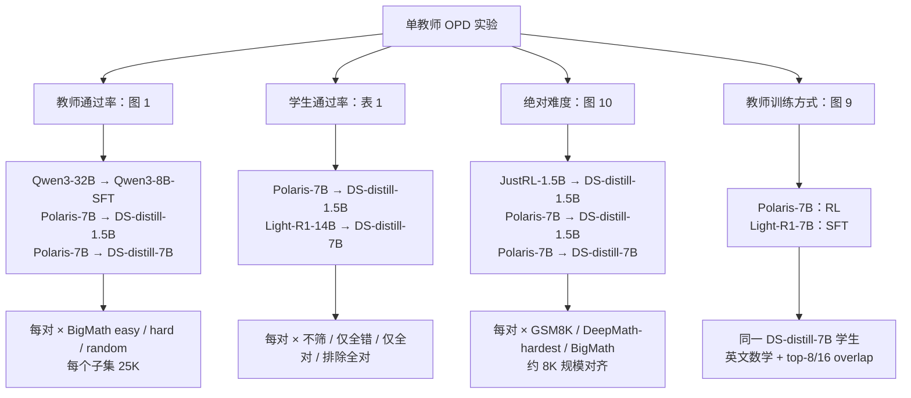

## 2. 方法与比较口径

### 2.1 OPD 与 MOPD 的监督来自哪里

令 $x$ 为训练 prompt，$y$ 为当前学生策略 $\pi_\theta$ 采样的回答，$h_t=(x,y_{<t})$ 为已生成前缀，教师策略为 $\pi_\phi$。原文先给出逐前缀 reverse KL 目标：

$$
\mathcal L_{\mathrm{OPD}}
=\mathbb E_{x\sim\mathcal D,\,y\sim\pi_\theta}
\left[\frac{1}{T}\sum_{t=1}^{T}
D_{\mathrm{KL}}\!\left(\pi_\theta(\cdot\mid h_t)\Vert\pi_\phi(\cdot\mid h_t)\right)\right].
$$

实际全部实验使用 sampled-token $k_1$ 的 PG-style OPD，监督信号是教师与学生在**学生已采样 token** 上的 log-prob 差：

$$
\widehat A_t=\operatorname{sg}\!\left[
\log\pi_\phi(y_t\mid h_t)-\log\pi_\theta(y_t\mid h_t)\right],
\qquad
\mathcal L_{\mathrm{PG}}
=-\mathbb E_{x,y}\left[\frac{1}{T}\sum_t\widehat A_t\log\pi_\theta(y_t\mid h_t)\right].
$$

这里 $\operatorname{sg}$ 表示停止梯度。教师赋予 token 更高概率时强化它，反之抑制。原文损失式用 $\bar A_t$，定义式用 $\widehat A_t$，没有交代二者转换；上式统一记号以表达文中的基本监督机制，不据此推断额外优势归一化。原文的目标表达也不能替代训练代码中 minibatch、clipping 或梯度估计细节。[^paper]

MOPD 将每个 prompt 路由给一个对应领域的教师，随后仍用学生回答和该教师的 token 评分训练。它不是让两个教师各生成一份答案，也不是逐 token 平均两个教师的 logits。外部正确性判分用于筛题和评测；论文展示的 OPD 优势中没有任务正确率奖励项。图 6、9 的 top-k 是**诊断指标**，不代表训练用了 top-k 蒸馏损失。

### 2.2 同源的操作定义

附录 B.2.1 将同源定义为共享具体初始化 checkpoint、再从该 checkpoint 后训练。正文实验中的实际判定为：

| 学生 | 同源教师 | 跨源教师示例 |
| --- | --- | --- |
| DS-distill-1.5B／Dev-1.5B | JustRL-1.5B、Nemotron-1.5B、DeepScaleR-1.5B | Polaris-7B、DS-distill-7B、OpenMath-Nemotron-1.5B、VibeThinker-1.5B |
| DS-distill-7B | Polaris-7B、Light-R1-7B | Light-R1-14B、DS-distill-14B、OpenMath-Nemotron-7B |
| DS-distill-14B | Light-R1-14B | 此配置的补充图没有配套跨源臂 |
| Qwen3-4B | Polaris-4B | 此配置的补充图没有配套跨源臂 |
| Qwen3-8B-SFT | 本文没有相应同源对照 | Qwen3-32B |

图 6 将 OpenMath-Nemotron 与对应 DS-distill 归为跨源，尽管二者有更早的 Qwen2.5-Math 祖先。本文沿用论文对具体配对的分类，不按“同一家族／同参数量／存在共同远祖”自行改分类。表 3 同时列了较早的预训练来源与直接后训练起点，需结合图例和 B.2.1 阅读。

### 2.3 评测均分

| 汇总名 | 组成 | 易混淆之处 |
| --- | --- | --- |
| English Math | AMC2023、MATH-500、AIME2025、AIME2026、BeyondAIME、OlymMATH-Hard，共 6 项 | OlymMATH-Easy 不在这个主均分中 |
| Chinese Math | OlymMATH-ZH、LiveMathBench-ZH，共 2 项 | 不是中文训练集 |
| Long-Horizon Math | AIME24-Horizon-2、AMC23-Horizon-4，共 2 项 | Horizon 是组合任务跨度，不是 token 长度上限 |
| 表 2 Average | BeyondAIME 与 OlymMATH 两列 | 与表 6 对照可识别后者为 OlymMATH-Easy 英文列 |
| 表 6 Average | BeyondAIME、OlymMATH-e(en)、OlymMATH-e(zh)、OlymMATH-h、AIME24-n2，共 5 项 | 不能直接比较其约 19% 与主英文六集约 50% 的均分 |

各基准使用独立回答的平均准确率 Avg@K，$K$ 随基准变化；具体表见附录 C。图中曲线做了居中平滑，表格数值未平滑。[^paper]

## 3. 同域实验：难度、语言和推理跨度

### 3.1 教师通过率筛题：图 1

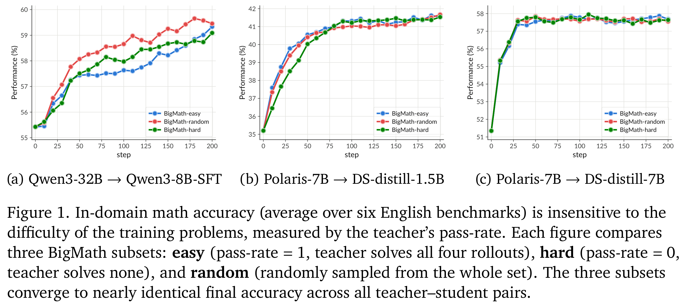

原论文图 1，v3 PDF p.4；保留原始子图、图例与英文图注。[放大查看矢量 PDF](figures/coin-2608.16647v3/figure-01.pdf)。[^paper]

对 BigMath 每道题先生成 4 条教师回答，将 4/4 正确视为 easy，0/4 正确视为 hard，并从全集随机抽取 random；三个子集各 25K。三个师生对是 Qwen3-32B→Qwen3-8B-SFT、Polaris-7B→DS-distill-1.5B、Polaris-7B→DS-distill-7B。每个配对在三种训练集上比较英文数学六集均分，其他条件保持相同。

结果是三类子集的末段成绩接近；教师在筛选阶段 0/4 正确的题同样能提供有效的 token 监督。作者据此解释为迁移了推理行为，而不是仅传递这些题的正确答案。这里的 hard 只表示**四次采样中未答对**，不能等同于教师真实成功概率严格为零。图中也没有证明任何领域、任何难度分布都等效。[^paper]

### 3.2 绝对难度及唯一题目数对齐：图 10

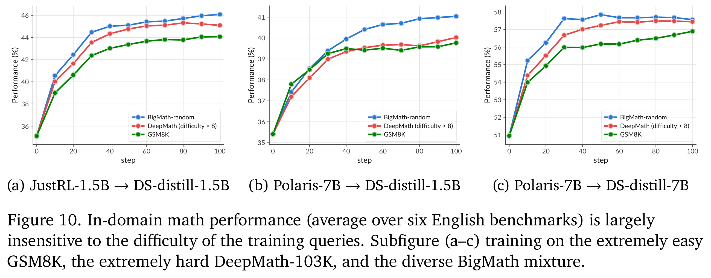

原论文图 10，v3 PDF p.27；保留原始子图、图例与英文图注。[放大查看矢量 PDF](figures/coin-2608.16647v3/figure-10.pdf)。[^paper]

三对教师→学生为 JustRL-1.5B→DS-distill-1.5B、Polaris-7B→DS-distill-1.5B、Polaris-7B→DS-distill-7B。训练集比较 GSM8K、DeepMath-103K 中难度评分大于 8 的切片，以及 BigMath 的规模对齐子集。附录将前两者概括为约 8K 题，因此 BigMath 也抽约 8K，以降低唯一训练题目数的混杂。

作者报告两端难度都能恢复默认 BigMath-random **超过 80% 的 OPD 增益**；这说的是相对初始学生的提升量，不是最终准确率达到 BigMath 的 80%。附录 C.1 进一步报告，极易与极难训练集的最终均分差距小于 2 个百分点，但两者总体仍落后于覆盖更多难度的 BigMath。因而结论是绝对难度不是唯一决定因素，同时保留数据多样性收益这一观察。[^paper]

### 3.3 学生动态采样：表 1 的完整结果

训练源为 BigMath-random，每题生成 4 条当前学生回答。比较不筛选、仅保留 0/4、仅保留 4/4、保留 0–3/4 四种策略。下表数字均为百分比；“Δ”是相对同一师生对不筛选基线的百分点变化，沿用原表四舍五入。

| 教师 → 学生 | 保留条件 | AMC23 | MATH500 | AIME25 | AIME26 | BeyondAIME | Olym-Hard | 均分 | Δ |
| --- | --- | ---: | ---: | ---: | ---: | ---: | ---: | ---: | ---: |
| Polaris-7B → DS-1.5B | 不筛 | 80.4 | 89.5 | 30.2 | 30.1 | 13.6 | 4.7 | 41.4 | — |
| 同上 | 仅全错 | 78.8 | 90.1 | 30.5 | 30.0 | 14.7 | 4.4 | 41.4 | 0.0 |
| 同上 | 仅全对 | 79.9 | 89.7 | 30.9 | 28.9 | 14.7 | 4.0 | 41.4 | 0.0 |
| 同上 | 排除全对 | 80.9 | 89.8 | 31.2 | 31.1 | 13.7 | 5.4 | **42.0** | **+0.6** |
| Light-R1-14B → DS-7B | 不筛 | 91.7 | 95.0 | 42.8 | 49.7 | 26.5 | 8.7 | 52.4 | — |
| 同上 | 仅全错 | 92.1 | 94.3 | 40.2 | 50.3 | 28.2 | 7.8 | 52.1 | −0.3 |
| 同上 | 仅全对 | 92.3 | 94.5 | 42.2 | 48.7 | 28.0 | 8.0 | 52.2 | −0.2 |
| 同上 | 排除全对 | 92.1 | 95.4 | 43.2 | 50.6 | 28.0 | 7.5 | **52.8** | **+0.4** |

两组最佳均分都来自排除全对，但不是每个单项都改善，例如 7B 学生的 OlymMATH-Hard 从 8.7 降到 7.5。论文没有给出这些差值的跨 seed 方差或置信区间，适合表述为两组一致的小幅均分改善，不能直接称为统计显著提升。

§3.1 的 takeaway 框误将“已解出”写作 `pass-rate = 0`；表 1 和紧邻正文明确是剔除 `pass-rate = 1`、保留 $[0,1)$，本笔记按表与正文记录。筛选后如何补足 batch、是否重新采样及额外生成成本，没有完整披露。[^paper]

### 3.4 跨语言、长程组合及教师原训练集：图 2

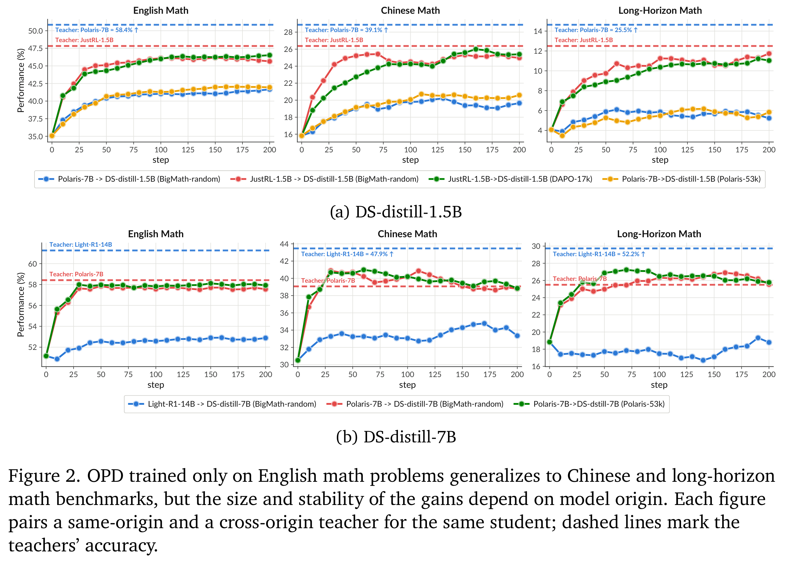

原论文图 2，v3 PDF p.6；保留原始子图、图例与英文图注。[放大查看矢量 PDF](figures/coin-2608.16647v3/figure-02.pdf)。[^paper]

| 学生 | 教师 | 关系 | 图中训练数据 |
| --- | --- | --- | --- |
| DS-distill-1.5B | JustRL-1.5B | 同源 | BigMath-random；DAPO-17K |
| DS-distill-1.5B | Polaris-7B | 跨源 | BigMath-random；Polaris-53K |
| DS-distill-7B | Polaris-7B | 同源 | BigMath-random；Polaris-53K |
| DS-distill-7B | Light-R1-14B | 跨源 | BigMath-random |

每条训练轨迹评测英文数学、中文数学及组合长程数学。学生只用英文、原子数学题训练，没有专门加入中文或 R-HORIZON 组合题。

同源组通常接近相应教师在三组评测上的成绩。7B 学生的跨源 Light-R1-14B 教师虽然独立分数更高，蒸馏效果却弱于同源 Polaris-7B，长程收益尤其有限。使用教师原 RL prompts 与 BigMath 的曲线总体接近，表明这些配对中并不要求找回教师原训练数据。这里是特定师生对的实证，不能从“同源”单独推出全部性能排序。[^paper]

### 3.5 规模与配对补充：图 11

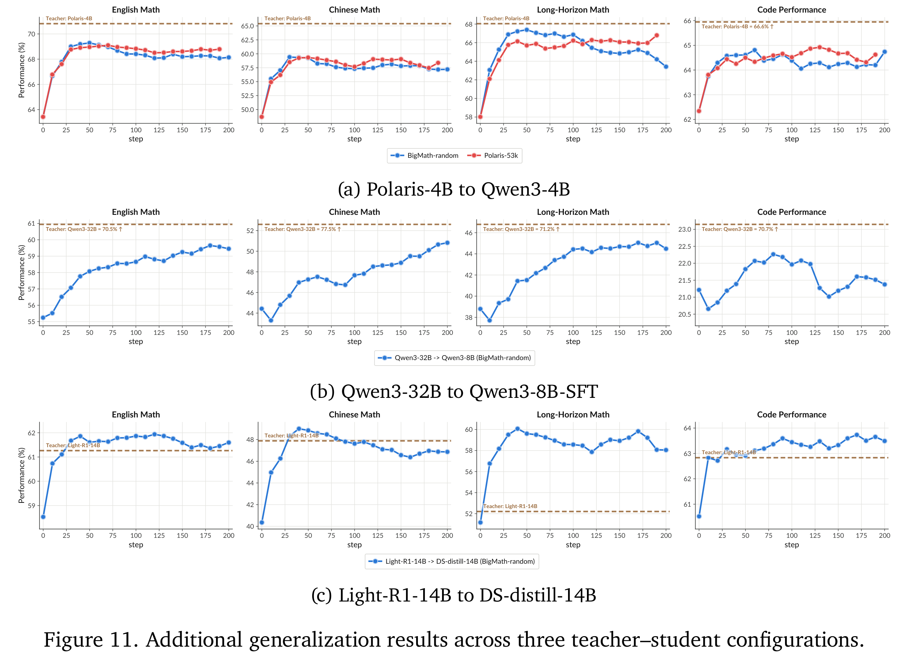

原论文图 11，v3 PDF p.29；保留原始子图、图例与英文图注。[放大查看矢量 PDF](figures/coin-2608.16647v3/figure-11.pdf)。[^paper]

| 教师 → 学生 | 训练数据 | 结果 |
| --- | --- | --- |
| Polaris-4B → Qwen3-4B，同源 | BigMath-random／Polaris-53K | 英文、中文、长程数学和代码均有提升；两种数据的曲线接近 |
| Qwen3-32B → Qwen3-8B-SFT，跨源 | BigMath | 三类数学均明显改善，代码变化较小；跨源也可有较强域内迁移 |
| Light-R1-14B → DS-distill-14B，同源 | BigMath | 四类评测均提升，长程数学学生明显超过教师水平线 |

图 11c 是“教师独立准确率不是学生绝对上界”的直接例子。图 11b 则限制了“跨源只会拟合原分布”的强表述：跨源模型也能从英文原子题迁移到中文和组合题，只是没有表现出同样程度的代码迁移。[^paper]

## 4. 跨领域实验：训练 prompt 不限定迁移能力

### 4.1 实际师生与训练领域矩阵

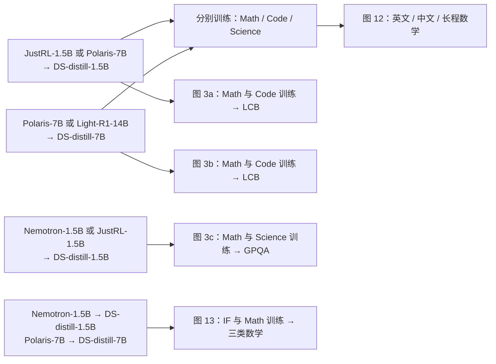

图 12 的 1.5B 行用 JustRL／Polaris 两位教师；Nemotron 的科学对照在图 3c，IF 对照在图 13。不能把三个名字与所有训练／评测领域无条件交叉。

### 4.2 Math → Code：图 3a/b

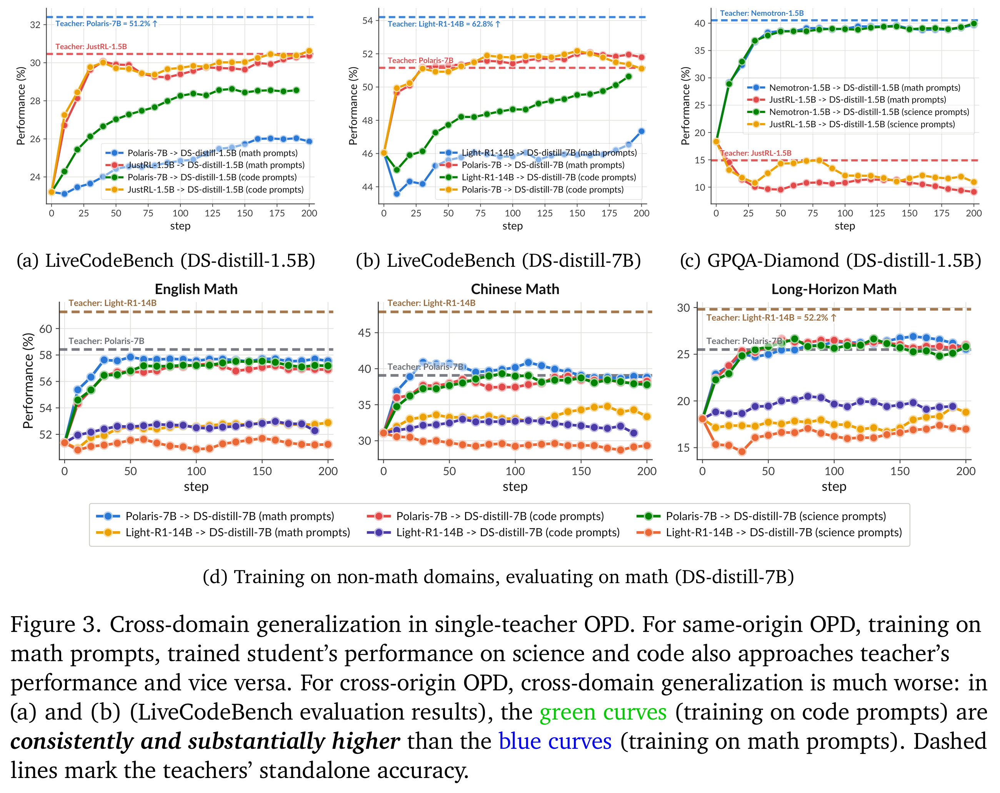

原论文图 3，v3 PDF p.7；保留原始子图、图例与英文图注。[放大查看矢量 PDF](figures/coin-2608.16647v3/figure-03.pdf)。[^paper]

固定师生对，比较只用数学 prompts 与只用代码 prompts 的 OPD，并在 LiveCodeBench v5 评测。同源的 JustRL→DS-1.5B、Polaris→DS-7B，两种训练领域均使代码成绩接近教师；跨源的 Polaris→DS-1.5B、Light-R1-14B→DS-7B，直接代码训练优于数学训练后的代码迁移。教师能力能跨领域传递，但迁移幅度受师生配对影响。[^paper]

### 4.3 Math → Science 与负迁移：图 3c

学生为 DS-distill-1.5B，同源教师分别为 Nemotron-1.5B 与 JustRL-1.5B。每位教师都比较 Math 和 Science 两种训练源。

Nemotron 的数学训练与科学训练均提高 GPQA，末段接近其教师水平；JustRL 的 GPQA 本来低于初始学生，用任一训练源都会使学生科学成绩下降。这里的负迁移有明确比较对象：不是数学教师在数学上教不好，而是其较弱的科学行为也随 OPD 迁入学生。图中教师 GPQA 参考线约为 Nemotron 40.5%、JustRL 14.9%，这些是本文评测值，不是模型卡的发布成绩。[^paper]

### 4.4 Code／Science → Math：图 3d、12

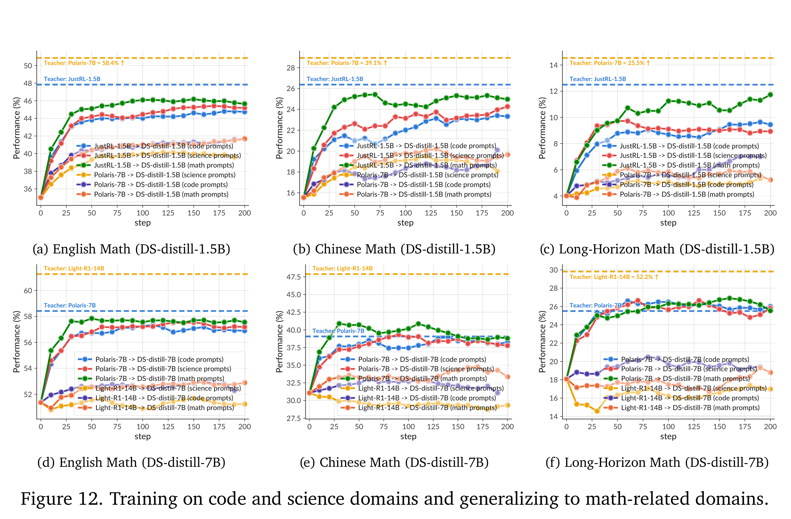

原论文图 12，v3 PDF p.30；保留原始子图、图例与英文图注。[放大查看矢量 PDF](figures/coin-2608.16647v3/figure-12.pdf)。[^paper]

图 12 展开 1.5B 和 7B 两种学生。每位教师分别使用 Math、Code、Science prompts，统一在英文、中文、长程数学评测。同源组不同训练领域的差距总体较小；跨源组通常迁移较弱，且与直接数学训练有差距。代码／科学训练得到的数学收益并非只限于英文短题，也出现在中文与组合长程任务。图 3d 是 7B 结果的正文呈现，不能再算一套新增实验。[^paper]

### 4.5 IF → Math：图 13

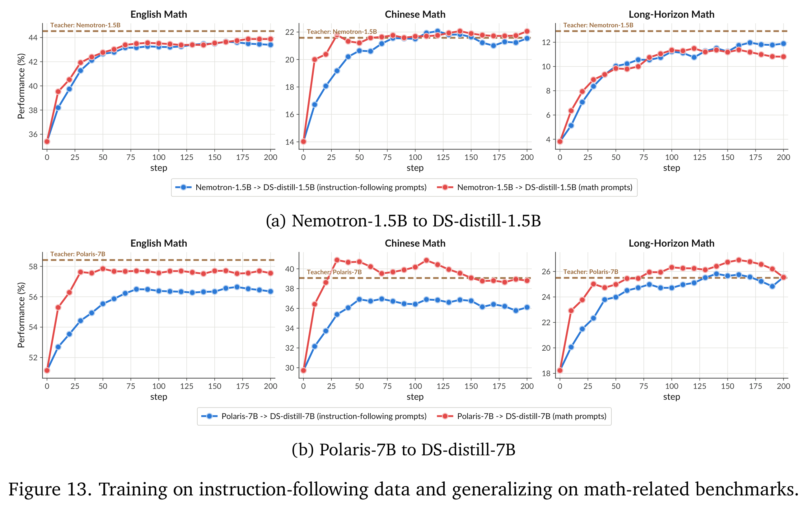

原论文图 13，v3 PDF p.30；保留原始子图、图例与英文图注。[放大查看矢量 PDF](figures/coin-2608.16647v3/figure-13.pdf)。[^paper]

两组是 Nemotron-1.5B→DS-distill-1.5B、Polaris-7B→DS-distill-7B。各自比较 IF prompts 与 Math prompts，均评测三类数学。两组 IF 训练都能迁移数学能力，但图中曲线不要求逐 checkpoint 与 Math 训练完全重合。IF 数据的具体来源见附录 B；Science/IF 的 50:50 混合专指 MOPD 池，不应自动套到这里的纯 IF 臂。[^paper]

## 5. 多教师实验：领域路由与能力相互影响

### 5.1 路由、初始化与比例必须同时记录

记 J=JustRL-1.5B、N=Nemotron-1.5B。二者相对 DS-distill-1.5B／Dev-1.5B 都是同源，但 J 更擅长数学，N 更擅长科学、IF，且代码更强。Science/IF 池内部各占 50%。论文保持教师分配的总 prompt 量不变，改变分配比例。

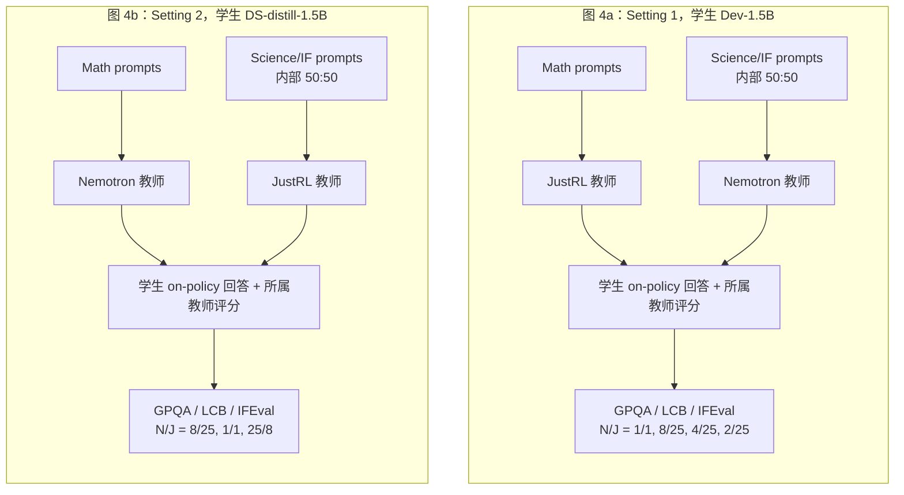

图 4a 的学生是 Dev-1.5B；图 4b 是 DS-distill-1.5B；表 6 两块标题均写 DS-distill-1.5B。它们不能直接合并成“只交换教师路由、其他全部相同”的两臂对照。图 4、5 用 **N/J**，表 2、6 用 **J/N**，以下均显式写出方向。

### 5.2 图 4：科学、代码和 IF 的曲线

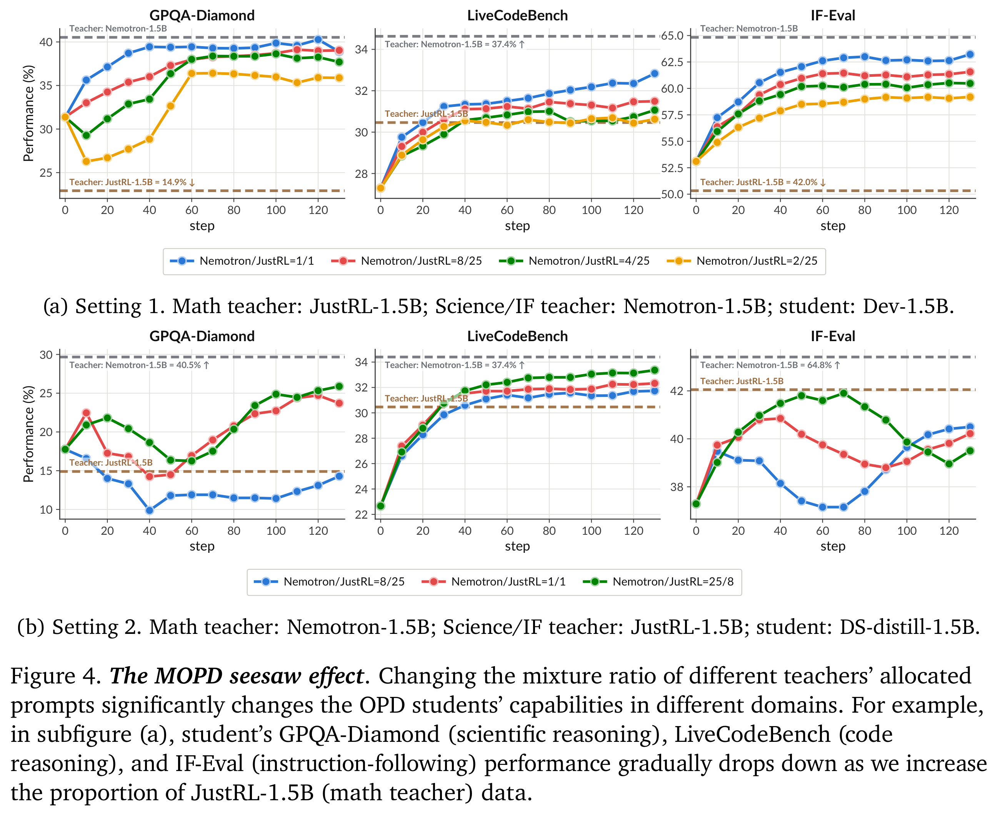

原论文图 4，v3 PDF p.9；保留原始子图、图例与英文图注。[放大查看矢量 PDF](figures/coin-2608.16647v3/figure-04.pdf)。[^paper]

Setting 1 中增加 J 比例，科学、代码、IF 成绩总体被拉向 J 的较低水平。J 占比最大的 `N/J=2/25` 在早期 GPQA 约下降 5 个百分点，随后回升；“存在早期负迁移”与“最终比初始差”是不同结论。

Setting 2 将 N 分配给 Math、J 分配给 Science/IF。增加 N 占比仍能提高科学和代码成绩，即 N 可以经数学轨迹传递科学／代码能力。IFEval 的中后段曲线交叉较多，末点排序并非严格随比例单调；作者的 seesaw 描述应理解为总体教师影响，不能逐时刻理解成线性插值规律。[^paper]

### 5.3 表 2：两项数学结果

下表单位为百分比。表中的 OlymMATH 与表 6 的 OlymMATH-e(en) 数值对应；Δ 相对同一分配的 1:1。

| Math 教师 / Science-IF 教师 | J/N | BeyondAIME | OlymMATH | 两项均分 | Δ |
| --- | --- | ---: | ---: | ---: | ---: |
| 初始 DS-distill-1.5B | — | 9.6 | 14.2 | 11.9 | — |
| J / N | 25/2 | 19.4 | 33.3 | 26.4 | +0.1 |
| J / N | 25/8 | 19.6 | 34.5 | **27.1** | +0.8 |
| J / N | 1/1 | 20.2 | 32.4 | 26.3 | 0.0 |
| J / N | 8/25 | 19.7 | 32.5 | 26.1 | −0.2 |
| J / N | 2/25 | 19.2 | 31.0 | 25.1 | −1.2 |
| N / J | 25/8 | 17.4 | 28.0 | **22.7** | +0.7 |
| N / J | 1/1 | 17.3 | 26.6 | 22.0 | 0.0 |
| N / J | 8/25 | 17.1 | 26.2 | 21.7 | −0.3 |

反向分配中 J 没有监督数学 prompt，但增加 J 占比仍改善数学。该结果支持能力由教师身份和迁移共同决定，而不只由 prompt 的领域标签决定。[^paper]

### 5.4 表 6：step 200 的五项数学完整结果

表头简写：B=BeyondAIME；E-en/E-zh=OlymMATH-Easy 英文／中文；H=OlymMATH-Hard；A24-H2=AIME24-Horizon-2。所有数字为百分比。

| 模型／路由 | J/N | B | E-en | E-zh | H | A24-H2 | 五项均分 |
| --- | --- | ---: | ---: | ---: | ---: | ---: | ---: |
| 初始 DS-distill-1.5B | — | 9.6 | 14.2 | 11.2 | 3.2 | 6.0 | 8.8 |
| JustRL 教师 | — | 19.0 | 32.6 | 23.0 | 5.7 | 16.3 | 19.3 |
| Nemotron 教师 | — | 17.6 | 29.2 | 16.6 | 5.6 | 14.3 | 16.7 |
| Math=J，Science/IF=N | 25/0 | 19.0 | 32.6 | 23.0 | 5.7 | 16.3 | 19.3 |
| 同上 | 25/2 | 19.4 | 33.3 | 23.0 | 5.9 | 14.1 | 19.1 |
| 同上 | 25/8 | 19.6 | 34.5 | 23.2 | 5.5 | 15.3 | **19.6** |
| 同上 | 1/1 | 20.2 | 32.4 | 20.6 | 5.0 | 17.3 | 19.1 |
| 同上 | 8/25 | 19.7 | 32.5 | 22.7 | 5.5 | 15.7 | 19.2 |
| 同上 | 2/25 | 19.2 | 31.0 | 19.2 | 5.2 | 12.3 | 17.4 |
| 同上 | 0/25 | 15.9 | 25.3 | 15.7 | 3.7 | 13.8 | 14.9 |
| Math=N，Science/IF=J | 25/0 | 18.2 | 29.8 | 21.1 | 5.8 | 12.3 | **17.5** |
| 同上 | 25/8 | 17.4 | 28.0 | 17.8 | 4.5 | 14.8 | 16.5 |
| 同上 | 1/1 | 17.3 | 26.6 | 16.8 | 4.4 | 13.9 | 15.8 |
| 同上 | 8/25 | 17.1 | 26.2 | 16.8 | 4.7 | 14.3 | 15.8 |
| 同上 | 0/25 | 17.4 | 26.5 | 17.0 | 4.5 | 13.6 | 15.8 |

正向分配的 `25/8` 均分最高，比 1:1 高 0.5 pp，比 J-only 高 0.3 pp；这保留了适量互补的可能，不能把 MOPD 概括成必然低于所有单教师。N 过多时数学总体下降，但比例与成绩不是严格单调。反向分配 J-only 达 17.5%，比 1:1 和 N-only 的 15.8% 高 1.7 pp。原表 J-only 的五列恰与 J 教师一致，本笔记忠实保留原表，不能由舍入后的相等推断学生策略已完全相同。[^paper]

### 5.5 训练中的相互影响与级联：图 5

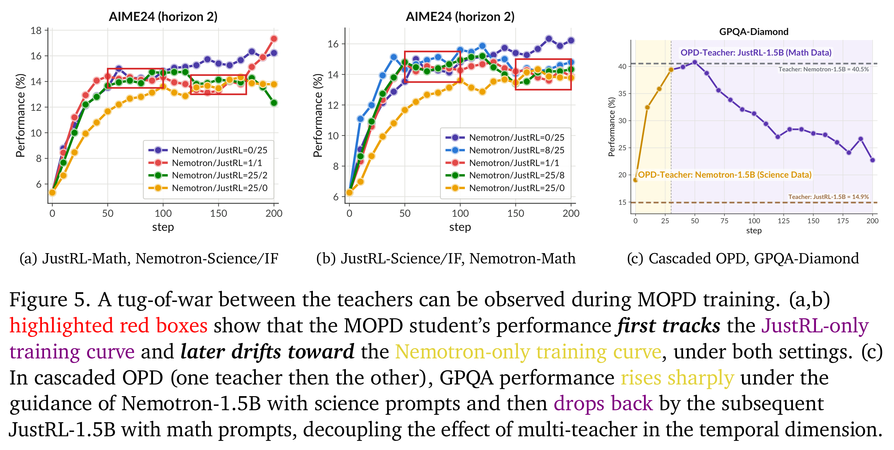

原论文图 5，v3 PDF p.10；保留原始子图、图例与英文图注。[放大查看矢量 PDF](figures/coin-2608.16647v3/figure-05.pdf)。[^paper]

图 5a/b 跟踪 AIME24-Horizon-2：

| 子图 | 路由 | 实际图例比例 N/J | 主要动态 |
| --- | --- | --- | --- |
| 5a | Math=J，Science/IF=N | 0/25、1/1、25/2、25/0 | 混合组先跟随 J-only 上升，中段部分转向 N-only；1:1 末段又恢复向 J-only 靠近 |
| 5b | Math=N，Science/IF=J | 0/25、8/25、1/1、25/8、25/0 | 也出现中后段向 N-only 成绩靠近的轨迹 |

因此，单一固定混合比例不意味着训练全程都处在固定的教师间插值位置。

图 5c 先用 Nemotron＋Science prompts，再切换到 JustRL＋Math prompts。按图近似读数，切换发生在 step 30 左右；GPQA 从约 19% 升至约 40%，随后降至约 23%。正文描述为向原水平回落，图中末点仍高于初始，且高于 JustRL 的约 14.9% 水平线。可以确认明显遗忘／回退，但不能写成完全回到初值或完全降至教师。切换步数和这些曲线点是读图近似值，并非独立参数表或原始日志。[^paper]

## 6. 机制诊断及额外教师组合

### 6.1 Top-16 overlap：图 6

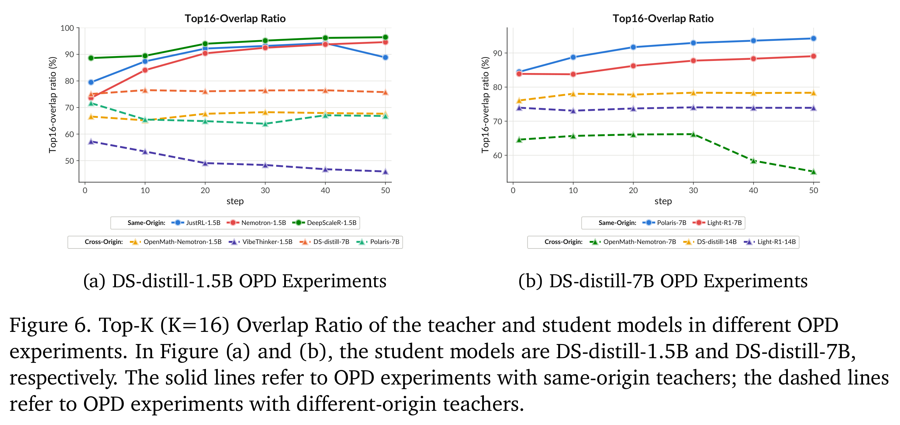

原论文图 6，v3 PDF p.11；保留原始子图、图例与英文图注。[放大查看矢量 PDF](figures/coin-2608.16647v3/figure-06.pdf)。[^paper]

此实验比较师生下一 token 分布的 top-16 候选重叠。通常可将等长候选集合的交集大小除以 16 来理解这个指标，但本文没有展开代码中的前缀抽样、mask 与聚合细节，不据此补齐实现。

| 学生 | 同源教师：实线 | 跨源教师：虚线 | 展示范围 |
| --- | --- | --- | --- |
| DS-distill-1.5B | JustRL-1.5B、Nemotron-1.5B、DeepScaleR-1.5B | OpenMath-Nemotron-1.5B、VibeThinker-1.5B、DS-distill-7B、Polaris-7B | step 0–50 |
| DS-distill-7B | Polaris-7B、Light-R1-7B | OpenMath-Nemotron-7B、DS-distill-14B、Light-R1-14B | step 0–50 |

整体上，同源 overlap 初始较高、随后上升；跨源曲线较低且多为平稳或下降。1.5B 的 JustRL 曲线在最后展示点有回落，因此“同源训练持续单调上升”过强。额外的 DS-distill-7B、DS-distill-14B 在这里也是**教师**，不能因表 3 将其列作 Student 而漏记。

作者把这些结果解释为同源更容易实现整体策略对齐。证据是 overlap 与跨分布成绩的共同变化，不是对所有输入状态的策略等价证明；本文没有用隔离全部混杂的干预证明“overlap 上升导致泛化”。[^paper]

### 6.2 同源数学教师与跨源科学教师：图 7

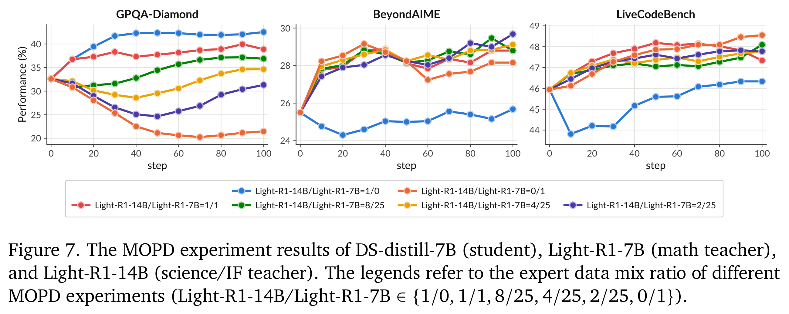

原论文图 7，v3 PDF p.11；保留原始子图、图例与英文图注。[放大查看矢量 PDF](figures/coin-2608.16647v3/figure-07.pdf)。[^paper]

学生 DS-distill-7B；Math 教师为同源 Light-R1-7B，Science/IF 教师为跨源 Light-R1-14B。图例比例是 **Light-14B/Light-7B**：`1/0、1/1、8/25、4/25、2/25、0/1`。评测 GPQA-Diamond、BeyondAIME、LiveCodeBench，曲线展示到 step 100。

随着同源 Light-7B 占比增加，GPQA 更容易向其较弱科学水平移动；即使 1:1，也能看到相比纯 Light-14B 科学监督的下降。BeyondAIME、LCB 的不同混合组并没有呈现与 GPQA 相同的统一排序。这组支持同源教师有更强影响的解释，但没有把教师相近性与教师自身能力完全解耦。[^paper]

### 6.3 增加数学数据反而降低数学成绩：图 8

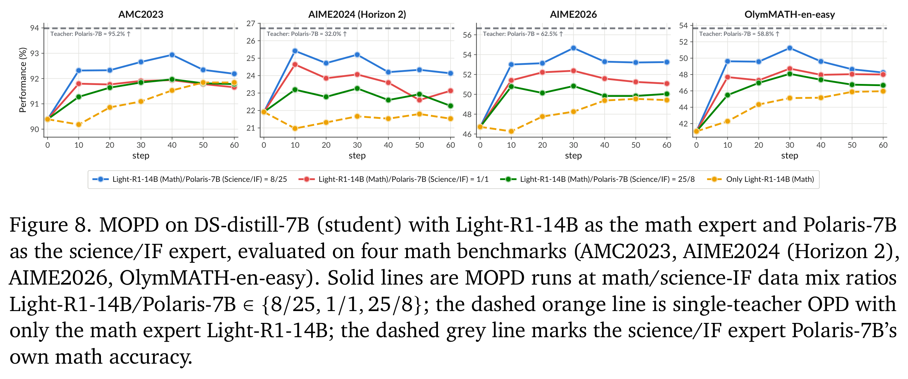

原论文图 8，v3 PDF p.12；保留原始子图、图例与英文图注。[放大查看矢量 PDF](figures/coin-2608.16647v3/figure-08.pdf)。[^paper]

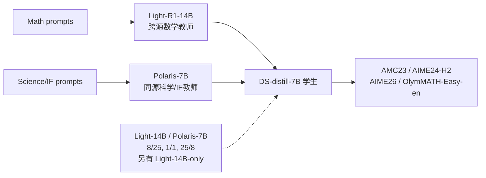

三种混合配置的数学数据份额依次约为 24.2%、50%、75.8%（由图例比例换算）。作者报告提高这一份额反而使四个数学基准表现变差，Light-14B-only 更弱。同源 Polaris 虽被分配 Science/IF prompts，自身数学很强；文中给出的教师参考值包括 AMC23 95.2%、AIME26 62.5%。减少它的监督份额，等于减少有效的跨领域数学迁移。

这个对照同时改变了**数据领域份额与对应教师份额**，不能单独归因于“数学题本身有害”。论文的解释是跨源数学监督替代了更有效的同源监督。[^paper]

### 6.4 RL 教师与 SFT 教师：图 9，v3 新增

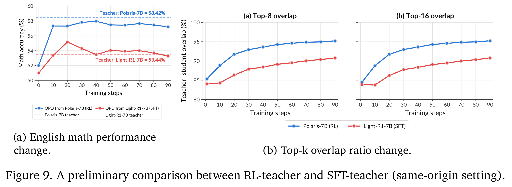

原论文图 9，v3 PDF p.13；保留原始子图、图例与英文图注。[放大查看矢量 PDF](figures/coin-2608.16647v3/figure-09.pdf)。[^paper]

学生固定 DS-distill-7B，同源 RL 教师为 Polaris-7B，同源 SFT 教师为 Light-R1-7B。沿用数学 OPD，评测英文数学六集均分及 top-8、top-16 overlap，展示到 step 90。

| 观察 | RL 教师 Polaris-7B | SFT 教师 Light-R1-7B |
| --- | --- | --- |
| 图中教师英文数学参考线 | 58.42% | 53.44% |
| 学生数学结果 | 训练后接近相应教师，末段约 57% | 训练后接近相应教师，末段约 53% |
| overlap | top-8/16 均明显上升，末段约 95% | 两种 overlap 也上升，末段约 91% |

除教师参考线外，上表末段数值均为读图近似值。该例中 SFT 与 RL 教师都能有效迁移；RL 教师产生更高 overlap，但其独立能力也更高。它不是同一教师只切换训练算法、其他完全受控的因果对照。作者也将结论限定为 preliminary，指出 SFT 数据偏移和训练程度会改变效果；文中提到的大规模 SFT 教师经验没有附配套实验表。[^paper]

## 7. 结论的证据范围与原文需保留的区别

| 问题 | 应保留的口径 |
| --- | --- |
| “教师做不对的题有效” | hard 是四次采样全错；有效的是学生前缀上的局部概率监督 |
| “同源泛化、跨源拟合” | 是这批配对的总体趋势；图 11b 的跨源数学迁移是明确补充 |
| “学生接近教师” | 指给定 benchmark 成绩；图 11c 还显示学生可以超过教师 |
| “增加某教师占比拉向该教师” | 多个领域的总体趋势，含非单调结果；不是线性混合定律 |
| 图 4 与表 6 的学生 | 图 4a 是 Dev，图 4b 是 DS；表 6 两块均标 DS，分别记录 |
| 最大训练步数 | B.3 写最大 200；B.4 又说原始轨迹超出图的末点以支持居中平滑，实际额外步数未列出 |
| 图例里的 step | 论文训练坐标；不能从每题 4 回答推出每步恰好 4 次 optimizer update |
| 教师原训练与本论文蒸馏 | 原教师可能经 SFT／RL；本论文学生阶段统一为 on-policy PG-style OPD |
| 显著性与成本 | 未提供系统的多 seed 方差、显著性检验、全部 run 的 token/FLOPs 成本表 |
| 适用任务 | 推理型语言模型，Math／Code／Science／IF；双教师、固定领域路由；没有多模态、工具或交互 agent 验证 |

## 附录 A. 学生、教师与开放情况

“公开权重”表示存在官方可获取的模型权重，不代表预训练数据、训练全过程及使用许可都完全开放。论文没有逐模型固定 revision；以下官方链接用于识别来源，不能替代作者实验 checkpoint 的完整版本清单。外部模型卡信息截至 2026-10-26。[^paper]

### A.1 学生模型

| 论文简称 | 模型／初始化 | 来源与训练方式 | 权重情况与入口 |
| --- | --- | --- | --- |
| DS-distill-1.5B | `deepseek-ai/DeepSeek-R1-Distill-Qwen-1.5B` | 从 Qwen2.5-Math-1.5B 用 DeepSeek-R1 整理的推理样本 SFT；作者直接用蒸馏 checkpoint | 官方公开；MIT 模型卡及底座说明。[^ds] |
| DS-distill-7B | `deepseek-ai/DeepSeek-R1-Distill-Qwen-7B` | 同类 SFT，底座为 Qwen2.5-Math-7B | 官方公开；另在图 6a 担任教师。[^ds] |
| DS-distill-14B | `deepseek-ai/DeepSeek-R1-Distill-Qwen-14B` | 同类 SFT，底座为 Qwen2.5-14B，不能写成 Qwen2.5-Math-14B | 官方公开；另在图 6b 担任教师。[^ds] |
| Dev-1.5B | 作者从 DS-distill-1.5B 构造 | 先做 10 steps Science/IF OPD；用于图 4a | 论文未给独立权重链接，也未完整给出预热作业配置。[^paper] |
| Qwen3-4B | `Qwen/Qwen3-4B` | 官方已有后训练的混合推理 checkpoint；在此作为 Polaris-4B 的学生起点 | 官方公开，Apache-2.0；不是 Qwen3-4B-Base 或 2507 变体。[^qwen] |
| Qwen3-8B-SFT | 从 `Qwen/Qwen3-8B-Base` 构造 | 作者在 OpenThoughts3-1.2M 上 SFT，再进行 OPD；B.2 表 3 与 C.2 明确 Base 起点 | 底座和数据公开；论文未给这个 SFT checkpoint 的独立权重链接。[^qwen][^openthoughts] |

DeepSeek 官方说明其蒸馏系列使用约 800K 整理样本；这是学生初始权重的训练来源，不是本论文每次 OPD 的数据量。[^ds]

### A.2 教师模型与训练来源

| 教师 | 直接训练起点 | 教师自身如何得到 | 本文角色 | 权重／官方来源 |
| --- | --- | --- | --- | --- |
| JustRL-1.5B | DS-distill-1.5B | 数学 RL；官方配方为 DAPO-Math-17K 上单阶段 GRPO、二值结果奖励、固定超参数，无离线难度筛选或在线动态采样 | 1.5B 同源数学教师，单教师／MOPD／级联／overlap | `hbx/JustRL-DeepSeek-1.5B`，公开，Apache-2.0。[^justrl] |
| Nemotron-1.5B | DS-distill-1.5B | ProRL 长程多领域 RL，基于 GRPO，涉及熵控制、DAPO、KL 正则和参考策略重置；训练域包括数学、代码、科学、逻辑、IF | 1.5B 同源科学／IF 教师及领域交换对照 | `nvidia/Nemotron-Research-Reasoning-Qwen-1.5B`，公开；模型卡 CC-BY-NC-4.0。[^nemotron] |
| Polaris-7B | DS-distill-7B | 数学 RL；Polaris-53K 来自 DeepScaleR 与 AReaL 筛选，配方结合难度分布、rollout 多样性和分阶段训练 | 7B 同源／1.5B 跨源教师，多领域及 MOPD | `POLARIS-Project/Polaris-7B-Preview`，公开，Apache-2.0。[^polaris] |
| Polaris-4B | Qwen3-4B | Polaris 数学 RL 配方，从 Qwen3-4B 继续训练 | 图 11a 同源教师 | `POLARIS-Project/Polaris-4B-Preview`，公开，Apache-2.0。[^polaris] |
| Light-R1-14B | DS-distill-14B | 长 CoT RL 后训练；官方说明其在已具备长 CoT 的模型上继续 RL | 14B 同源／7B 跨源教师；动态筛题、跨域、MOPD | `qihoo360/Light-R1-14B-DS`，公开，Apache-2.0。[^light] |
| Light-R1-7B | DS-distill-7B | 约 3K 高质量长 CoT 数据 SFT；本文图 9 明确作为 SFT 教师 | 7B 同源教师，overlap、MOPD、RL/SFT 对照 | `qihoo360/Light-R1-7B-DS`，公开，Apache-2.0。[^light] |
| Qwen3-32B | Qwen3-32B 官方发布模型 | 官方混合推理后训练模型；本文直接拿来评分，没有重新训练该教师 | Qwen3-8B-SFT 的跨源教师 | `Qwen/Qwen3-32B`，公开，Apache-2.0。[^qwen] |
| OpenMath-Nemotron-1.5B | Qwen2.5-Math-1.5B | 在 OpenMathReasoning 上 SFT，官方模型支持 CoT／工具推理／GenSelect；本文只给出 overlap 诊断，不意味着使用了工具模式 | 图 6a 跨源教师 | `nvidia/OpenMath-Nemotron-1.5B`，公开，CC-BY-4.0。[^openmath] |
| OpenMath-Nemotron-7B | Qwen2.5-Math-7B | 同系列 OpenMathReasoning SFT | 图 6b 跨源教师 | `nvidia/OpenMath-Nemotron-7B`，公开，CC-BY-4.0。[^openmath] |
| DeepScaleR-1.5B | DS-distill-1.5B | 约 40K 数学问答对上的 GRPO；迭代扩展训练上下文 8K→16K→24K | 图 6a 同源教师 | `agentica-org/DeepScaleR-1.5B-Preview`，公开，MIT。[^deepscaler] |
| VibeThinker-1.5B | Qwen2.5-Math-1.5B | SSP 框架：SFT 阶段探索解法多样性，再用 RLVR 强化正确解题信号 | 图 6a 跨源教师 | `WeiboAI/VibeThinker-1.5B`，公开，MIT。[^vibethinker] |
| DS-distill-7B／14B | Qwen2.5-Math-7B／Qwen2.5-14B | DeepSeek-R1 蒸馏 SFT，来源同 A.1 | 分别在图 6a／6b 作跨源教师 | 官方公开；不是额外的 RL 模型。[^ds] |

Polaris 与 Light 的官方仓库后缀分别是 `-Preview` 与 `-DS`，表中提供与论文简称和谱系匹配的官方入口；论文没有给出各 run 的精确 revision。Nemotron 官方页面同时介绍后续 v2／BroRL 版本，本文简称没有这些后缀，不应自动改用新版。

### A.3 主要后训练关系

下图只画与本文解释同源关系直接相关的后训练链；完整 13 个教师 checkpoint 的用途以上表和图 6 矩阵为准。

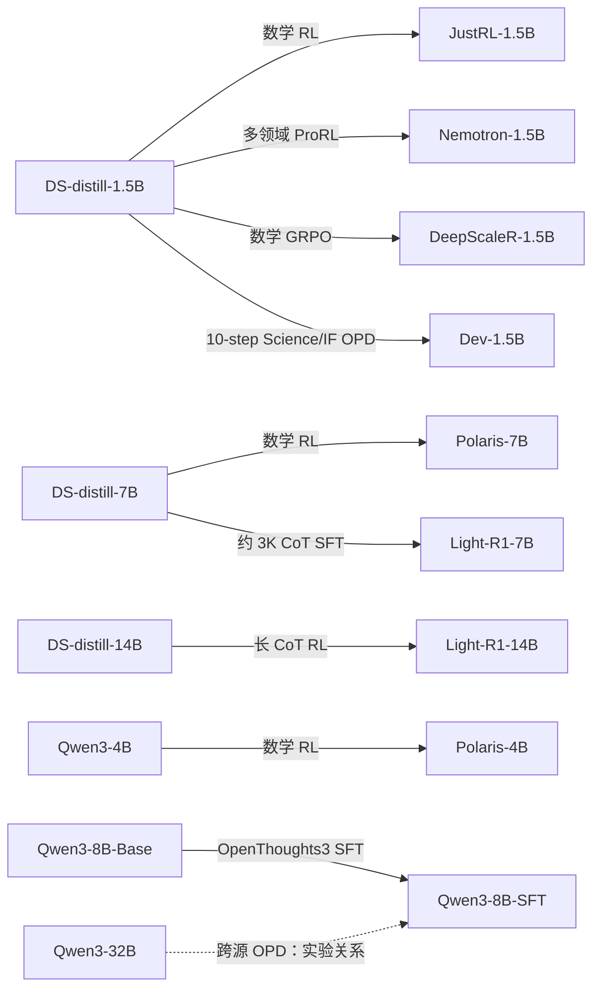

## 附录 B. 数据集

### B.1 本论文 OPD 训练数据

| 数据集 | 是什么 | 本文取法与用途 | 规模与来源 |
| --- | --- | --- | --- |
| Big-Math-RL-Verified，简称 BigMath | 带可验证答案的大规模数学题集合 | 默认数学源；教师 easy/hard/random；学生动态采样；域内、跨域和 MOPD 数学监督 | 全集约 251K；通过率实验各 25K；绝对难度对照约 8K。[^bigmath] |
| GSM8K | 小学多步算术文字题 | 极易训练分布；使用训练集，不是评测本文的数学主均分 | 原始训练 7,473、测试 1,319；本文将可用训练池概括为约 8K。[^gsm8k] |
| DeepMath-103K-Hardest | 从有难度标注的复杂数学题集切出最难部分 | 保留 difficulty>8，代表极难训练分布 | 原集约 103K；本文切片约 8K，未给精确保留数。[^deepmath] |
| DAPO-Math-17K | 带可核验答案的数学 RL prompts | JustRL 原 RL 数据；图 2 中与通用 BigMath 对比 | 名称约 17K，本文未列最终去重数。[^dapo] |
| Polaris-53K | 从 DeepScaleR-Preview 与 AReaL-boba 数据筛选的数学集合 | Polaris 原 RL 数据；图 2 与图 11a 的原训练数据对照 | 约 53K。[^polaris-data] |
| DeepCoder-Preview-Dataset | 竞赛编程题与可执行测试用例 | Code-domain OPD；用其 prompt 让学生生成回答 | 约 24K；LCB 2023-05-01 至 2024-07-31、经验证 TACO、SYNTHETIC-1。[^deepcoder] |
| TextbookReasoning | 从约 12K 大学科学教材抽取题目及参考答案，原集约 650K、覆盖 7 学科 | 单教师 Science；剔除 Mathematics 与 Computer Science，降低与 Math／Code 的直接重叠 | 本文未给过滤后的确切大小。[^textbook] |
| SCP-116K | 从科学文档抽取的高等教育科学问题—解答数据，涉及数学、物理、化学、生物 | MOPD 的 Science 部分；剔除 Mathematics | 原集约 116K；本文未给过滤后大小。[^scp] |
| Llama-Nemotron-Post-Training-Dataset 的 `RL/instruction_following` | NVIDIA 后训练数据中的可验证指令遵循任务 | Science/IF 池的 IF 部分；文中也做纯 IF→Math 实验 | MOPD 池内 SCP Science 与 IF 各占 50%；具体 IF 实验子集数量未列。[^ifdata] |

训练集包含标准答案或测试用例，并不表示 OPD 直接对这些答案做 SFT；它们可用于通过率筛选与验证，训练回答仍由学生在线生成。Science/IF 池内部的 50:50 与两个教师之间的混合比例是两层不同的比例。

### B.2 模型构造涉及的数据

OpenThoughts3-1.2M 是作者构造 Qwen3-8B-SFT 的前置 SFT 数据，包含约 1.2M 推理样本；它不是图 1 的 OPD prompt 集。OpenMathReasoning 是 OpenMath-Nemotron 教师的既有 SFT 来源；Light-R1 的约 3K 数据、DeepScaleR 的约 40K 数据也属于教师自身训练背景。它们不能计入本文某次 200-step OPD 的训练预算。[^openthoughts][^openmath][^light][^deepscaler]

### B.3 评测集与用途

| 基准 | 任务内容 | 本文用途／子集 | 每题 K | 来源 |
| --- | --- | --- | ---: | --- |
| AMC 2023 | 中学数学竞赛题 | 英文数学主均分 | 16 | MAA。[^maa] |
| MATH-500 | MATH 测试集的 500 题子集，覆盖多类竞赛数学 | 英文数学主均分 | 1 | MATH-500。[^math500] |
| AIME 2025、2026 | 美国数学邀请赛年度试题 | 两个独立的英文数学主基准 | 16 | MAA。[^maa] |
| BeyondAIME | 难度高于常用 AIME 的进阶数学题 | 英文主均分；部分 MOPD 单项 | 5 | ByteDance Seed。[^beyondaime] |
| OlymMATH-Hard | 奥林匹克数学高难子集 | 英文主均分；表 6 的 H | 5 | RUC-AIBOX。[^olymmath] |
| OlymMATH-Easy | 同系列相对容易子集 | 图 8 及 MOPD 数学表；不在英文主六集内 | 5 | 同上。[^olymmath] |
| OlymMATH-ZH | 中文奥数任务 | 中文数学均分；表 6 明确使用 Easy 中文列 | 5 | 不能仅因表 6 使用 Easy 就补写所有 ZH 曲线的未明示子集。[^olymmath] |
| LiveMathBench-ZH | 动态收集较新竞赛题的中文部分 | 中文数学均分 | 16 | 本文未固定精确 release／题目数。[^livemath] |
| R-HORIZON | 将多个子问题组合、需要传递中间答案的长程推理任务 | AIME24-Horizon-2、AMC23-Horizon-4 | 10 | 分别为 2／4 horizon；本文没有用它训练。[^rhorizon] |
| LiveCodeBench v5 | 竞赛代码生成、测试用例判分 | 题目日期 2024-08-01 至 2025-02-01 | 10 | 晚于本文 DeepCoder 训练源中 LCB 的截止日。[^lcb] |
| GPQA-Diamond | 物理、化学、生物专家级选择题 | 科学推理 | 4 | Diamond 子集。[^gpqa] |
| IFEval | 用程序检查字数、关键词、格式等指令约束 | 指令遵循 | 4 | 本文未细分 strict/loose、prompt/instruction-level 的最终汇总选项。[^ifeval] |

代码训练／测试的时间边界减少这部分数据的直接重叠，但不能由此证明模型全部预训练和后训练都没有见过评测题。论文没有提供涵盖全部模型的完整污染审计。[^paper]

## 附录 C. 训练、验证与未披露参数

### C.1 统一训练设置

| 参数 | v3 明确报告／可以直接换算的值 | 证据与边界 |
| --- | --- | --- |
| 训练范式 | On-policy，学生当前策略生成 | §2；不是离线 teacher-answer SFT |
| 优化目标 | sampled-token $k_1$，PG-style reverse KL | §2；全文采用该范式 |
| Learning rate | **`1e-5`，全部 OPD/MOPD 实验** | B.3；不能沿用早期整理的“LR 未公布” |
| Prompt batch size | 128 | B.3 |
| 每题 rollout 数 | 4 | B.3；与教师筛题阶段的 4 次采样区分 |
| 名义每步回答数 | 128×4=512 | 直接换算；动态过滤的实际保留数另需实现信息 |
| 最大训练 steps | 200；多数配置 100–200 内收敛 | B.3；图 6/7/9 等只展示部分范围，不代表全都恰跑 200 |
| 名义 prompt 实例预算 | 200×128=25,600 | 可重复抽到同一道题，不是 25,600 个唯一 prompt |
| 名义回答预算 | 200×128×4=102,400 | 不含教师预筛、动态筛题可能增加的采样、验证与预热 |
| 训练 temperature | 1.0 | B.3 |
| 训练 top-p / top-k | 1.0 / −1 | 不截断 top-k；诊断 top-16 与此无关 |
| 最大序列长度 | 依模型组为 40K／64K／96K | 表 4，详见下表 |
| Dev 构造 | 额外 10 steps Science/IF OPD | B.2.1；不是所有学生共享的预热 |
| MOPD 领域分配 | 每个 prompt 路由至对应教师 | §2、§4.2；固定总量下改变教师比例 |
| Science/IF 池 | Science 50%，IF 50% | B.1.1；教师间混合比例另设 |

### C.2 长度：原文是 maximum sequence length

| 原文表 4 模型组 | Rollout 与 evaluation 的最大序列长度 |
| --- | ---: |
| Qwen3-4B、Qwen3-8B、Qwen3-32B、Polaris-4B | 40K |
| DS-distill-1.5B、JustRL-1.5B、Nemotron-1.5B | 96K |
| Light-R1-14B、DS-distill-14B | 64K |
| Polaris-7B、DS-distill-7B | 96K |

表中 Qwen3-8B 对应本文的 SFT 学生，但没有逐 run 配置。论文没有给出独立 `max_prompt_length` 与 `max_response_length`，也未说明 K 的精确整数换算；因此不将 40K／64K／96K 直接改写为 response-only cap。对于 64K 教师配 96K 学生的跨源配置，也没有完整解释采用哪个联合上限。Dev、Light-R1-7B、DeepScaleR、VibeThinker、OpenMath-Nemotron 的长度未在此表逐项列出，不由家族名称自动补齐。[^paper]

### C.3 评测采样、判分与平滑

验证生成 temperature=1.0、top-p=0.95、top-k=−1；最大序列长度沿用表 4。每题采样数见 B.3。若 $\mathcal V$ 为单条回答的验证得分，则：

$$
\operatorname{Avg@}K
=\frac{1}{|\mathcal D|}\sum_{x\in\mathcal D}
\frac{1}{K}\sum_{k=1}^{K}\mathcal V(x,y^{(k)}).
$$

Avg@K 对每条回答分别计分再平均；不是从 K 次里只挑一次成功，也不是多数投票。论文表 5 的 K 是每题回答数，不是验证集题数。数学和科学任务均用统一 system instruction 要求逐步推理并把最终答案放进 `\boxed{}`；GPQA 额外限制最终内容为 A/B/C/D。提取最后一个 boxed 答案后使用 Math-Verify；代码／IF 使用各自任务判分器。本文没有逐项给出判分库版本、代码超时、IFEval 汇总选项或 chat template。[^paper][^mathverify]

仅曲线显示使用居中移动平均。设 $s_t$ 为按评测顺序排列的原始成绩，$t$ 是评测点索引，则：

$$
\widetilde s_t=
\begin{cases}
s_1,&t=1,\\
\frac13\sum_{j=1}^{3}s_j,&t=2,\\
\frac15\sum_{j=t-2}^{t+2}s_j,&t\ge3.
\end{cases}
$$

B.4 说明原始轨迹延伸到绘图末点之后，使右端也有完整窗口；表格、checkpoint 选择和统计计算不受平滑影响。由此不能从图中末点直接倒推出最终实际训练步数，也不能把平滑曲线读数当作表格原始分数。

### C.4 仍不能从论文恢复的配置

| 项目 | 信息状态 |
| --- | --- |
| 优化器类型、Adam 系数、epsilon、weight decay | 未明确给出，不能默认填 AdamW |
| LR scheduler、warmup、梯度裁剪 | 未明确给出 |
| Mini-batch、micro-batch、梯度累积、每批更新轮数 | 未完整给出；512 条 rollout 不等于 optimizer batch 已确定 |
| PPO clip、重要性采样、优势归一化、token/sequence 聚合实现 | 只有目标公式，未给完整实现合同 |
| 动态过滤的补采／重采、教师难度筛选的 decoding | 没有足以复现的逐项配置 |
| 精度、GPU 数与型号、并行策略、训练框架版本 | 未提供完整实验运行配置 |
| Seed、独立重复次数、误差条 | 未系统报告 |
| 验证频率、最佳 checkpoint 选择规则 | 没有统一配置表；图中坐标不等于通用执行规则 |
| 各模型权重 revision、数据 revision、全量 run 列表 | 未提供完整固定清单 |
| Qwen3-8B-SFT 的 SFT LR／epochs、Dev 的完整预热参数 | 只给构造来源与部分步骤 |
| 独立训练代码入口 | 正文与附录未给出足以逐 run 还原实验的配套仓库／启动配置；模型原项目代码不能替代本文代码 |

### 参考文献

[^paper]: Zhaoyi Li 等。Every Coin Has Two Sides: On the Dual Nature of Generalization in On-Policy Distillation of Large Language Models. arXiv:2608.16647v3, 2026-10-23. [版本摘要](https://arxiv.org/abs/2608.16647v3)、[PDF](https://arxiv.org/pdf/2608.16647v3)、[HTML](https://arxiv.org/html/2608.16647v3)、[TeX 源](https://arxiv.org/src/2608.16647v3)。
[^ds]: DeepSeek. DeepSeek-R1 Distill 官方模型卡。[1.5B](https://huggingface.co/deepseek-ai/DeepSeek-R1-Distill-Qwen-1.5B)、[7B](https://huggingface.co/deepseek-ai/DeepSeek-R1-Distill-Qwen-7B)、[14B](https://huggingface.co/deepseek-ai/DeepSeek-R1-Distill-Qwen-14B)。
[^qwen]: Qwen Team. Qwen3 官方模型。[4B](https://huggingface.co/Qwen/Qwen3-4B)、[8B-Base](https://huggingface.co/Qwen/Qwen3-8B-Base)、[32B](https://huggingface.co/Qwen/Qwen3-32B)。
[^justrl]: JustRL 作者。JustRL-DeepSeek-1.5B 官方模型卡，含 Training Recipe 与 Training Data. [模型卡与权重](https://huggingface.co/hbx/JustRL-DeepSeek-1.5B)。
[^nemotron]: NVIDIA. Nemotron-Research-Reasoning-Qwen-1.5B 官方模型卡，ProRL. [模型](https://huggingface.co/nvidia/Nemotron-Research-Reasoning-Qwen-1.5B)、[v1 模型卡](https://huggingface.co/nvidia/Nemotron-Research-Reasoning-Qwen-1.5B/blob/v1/README.md)。
[^polaris]: POLARIS Project. Polaris Preview 官方模型与训练配方。[7B](https://huggingface.co/POLARIS-Project/Polaris-7B-Preview)、[4B](https://huggingface.co/POLARIS-Project/Polaris-4B-Preview)、[项目说明](https://hkunlp.github.io/blog/2025/Polaris)。
[^light]: Qihoo360. Light-R1 官方模型与项目。[7B-DS](https://huggingface.co/qihoo360/Light-R1-7B-DS)、[14B-DS](https://huggingface.co/qihoo360/Light-R1-14B-DS)、[GitHub](https://github.com/Qihoo360/Light-R1)。
[^openmath]: NVIDIA. OpenMath-Nemotron 官方模型卡。[1.5B](https://huggingface.co/nvidia/OpenMath-Nemotron-1.5B)、[7B](https://huggingface.co/nvidia/OpenMath-Nemotron-7B)、[OpenMathReasoning 数据](https://huggingface.co/datasets/nvidia/OpenMathReasoning)。
[^deepscaler]: Agentica. DeepScaleR-1.5B-Preview 官方模型卡，Data 与 Training Recipe. [模型与配方](https://huggingface.co/agentica-org/DeepScaleR-1.5B-Preview)。
[^vibethinker]: WeiboAI. VibeThinker-1.5B 官方模型卡，SSP Training Pipeline. [模型与配方](https://huggingface.co/WeiboAI/VibeThinker-1.5B)。
[^bigmath]: SynthLabsAI. Big-Math-RL-Verified. [数据集](https://huggingface.co/datasets/SynthLabsAI/Big-Math-RL-Verified)、[官方 Collection](https://huggingface.co/collections/SynthLabsAI/big-math)。
[^gsm8k]: OpenAI. GSM8K 数据卡，原始训练／测试划分。[数据集](https://huggingface.co/datasets/openai/gsm8k)。
[^deepmath]: DeepMath 作者。DeepMath-103K 数据卡。[数据集](https://huggingface.co/datasets/zwhe99/DeepMath-103K)。
[^dapo]: ByteDance 与清华 SIA. DAPO-Math-17K. [数据集](https://huggingface.co/datasets/BytedTsinghua-SIA/DAPO-Math-17k)。
[^polaris-data]: POLARIS Project. Polaris-Dataset-53K，说明上游 DeepScaleR 与 AReaL 来源。[数据集](https://huggingface.co/datasets/POLARIS-Project/Polaris-Dataset-53K)。
[^deepcoder]: Agentica. DeepCoder-Preview-Dataset. [数据集](https://huggingface.co/datasets/agentica-org/DeepCoder-Preview-Dataset)。
[^textbook]: MegaScience 作者。TextbookReasoning，约 650K 教材题及参考答案。[数据集](https://huggingface.co/datasets/MegaScience/TextbookReasoning)。
[^scp]: SCP-116K 作者。科学问题与解答数据。[数据集](https://huggingface.co/datasets/EricLu/SCP-116K)。
[^ifdata]: NVIDIA. Llama-Nemotron-Post-Training-Dataset. [数据集](https://huggingface.co/datasets/nvidia/Llama-Nemotron-Post-Training-Dataset)。
[^openthoughts]: Open Thoughts. OpenThoughts3-1.2M. [数据集](https://huggingface.co/datasets/open-thoughts/OpenThoughts3-1.2M)。
[^maa]: Mathematical Association of America. [AMC](https://www.maa.org/math-competitions/amc-10)、[AIME](https://www.maa.org/math-competitions/american-invitational-mathematics-examination-aime)。本文具体年份取自论文，未用网页当前年度替换。
[^math500]: MATH-500. [数据集](https://huggingface.co/datasets/HuggingFaceH4/MATH-500)。
[^beyondaime]: ByteDance Seed. BeyondAIME. [数据集](https://huggingface.co/datasets/ByteDance-Seed/BeyondAIME)。
[^olymmath]: RUC-AIBOX. OlymMATH. [数据集](https://huggingface.co/datasets/RUC-AIBOX/OlymMATH)。
[^livemath]: OpenCompass. LiveMathBench. [数据卡](https://huggingface.co/datasets/opencompass/LiveMathBench)、[项目](https://github.com/open-compass/GPassK)。
[^rhorizon]: R-HORIZON 作者。组合长程推理基准。[官方项目](https://github.com/meituan-longcat/R-HORIZON)。
[^lcb]: LiveCodeBench 作者。[官方项目](https://livecodebench.github.io/)。本文 v5 的日期范围以论文 B.1.2 为准。
[^gpqa]: David Rein 等。GPQA. [原论文](https://arxiv.org/abs/2311.12022)。
[^ifeval]: Jeffrey Zhou 等。Instruction-Following Evaluation for Large Language Models. [原论文](https://arxiv.org/abs/2311.07911)。
[^mathverify]: Hugging Face. Math-Verify. [官方实现](https://github.com/huggingface/Math-Verify)。
