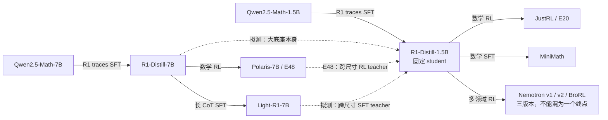

# 异源教师分级对照与 Student 选择

更新时间：2026-10-28。目标是构建不同训练来源、训练阶段、规模和架构的教师对照，研究这些差异如何影响 OPD 的局部拟合与跨 batch 迁移。这里的“本地资料”指已有 docs 的调研积累，不指只使用已经下载的模型。

## 模型关系速览与本轮补充

完整的分族谱系和论文配对见[模型谱系图与论文配对扩展](2026-10-28-模型谱系图与论文配对扩展.md)。下图实线为初始化→后训练结果，虚线为 teacher→student 的蒸馏对照；**相同模型家族、相同架构、直接权重继承是三个不同概念**。

本轮优先新增 Nemotron v1/v2/BroRL 的固定 revision、DeepCoder-14B、Polaris-4B、Thinking-Space 的 Qwen3-4B-Base-GRPO，以及 Semi-OPD 的 Qwen3-2507 配对。用途、接口限制、未公开 checkpoint 和暂不使用的模型统一放在扩展文档，原有 A–E 设置编号保持不变；新增设置用 F 编号。2610.11291 的全部 17 组见[配对 CSV](../../literature/teacher-transfer/sources/semi-opd-17-pairs.csv)，其收益是 Semi-OPD 相对 OPD 的差，不是教师能力回收率。

## 1. 推荐结论

建议保留两条主线，并按研究问题选择补充组。

1. **R1-Distill-1.5B 现象主线**：保留 E20/E48，补 MiniMath 的直接 SFT 教师、R1-Distill-7B 的规模对照，以及 Light-R1-7B 的额外 SFT 对照。它最贴近当前问题。
2. **Qwen2.5-1.5B 机制主线**：直接 RL、直接 SFT、同结构的 Coder 继续预训练分支，以及共享 tokenizer 的 Qwen3 教师都能找到；同数据跨尺寸的 SFT checkpoint 也可通过作者 ModelScope 镜像取得。适合低成本拆因素。
3. **Qwen3-4B 数据与 checkpoint 主线**：作者公开的 Math-CoT／Countdown-CoT／No-CoT、多尺寸和多训练阶段权重很完整；另有 General-Reasoner 的直接 RL 教师和 Qwen3 MoE 教师。
4. **Llama 3.1／Marin 补独立预训练**：如果“完全不同”要求从头独立预训练，而非同基座上的大规模继续训练，Marin-8B 是比 Qwen-Coder 更符合要求的候选。
5. **Olmo 3／Olmo Hybrid 补架构差异**：发布了较完整的 SFT→DPO→RLVR 阶段，且 Instruct 分支与 Hybrid 的 tokenizer 可匹配；工程接入和算力成本高于现有 Qwen 路径。

不建议把六类差异预先排成“1 到 6 越来越异源”。例如同源但大量 SFT 的教师，功能距离可能大于另一个更大模型。类别用于实验分层，初始分布差距、教师能力差和梯度／谱对齐用于实际量化。

## 2. 六类需求的具体落点

表中箭头一律为教师 → 学生。“同数据”首先限定为最后可控的训练阶段；预训练 corpus 名称相同，不自动表示逐条样本、权重、顺序及 exposure 相同。

| 用户提出的类别 | 优先选择 | 控制价值 | 尚未完全隔离的因素 |
| --- | --- | --- | --- |
| 1. RL teacher | JustRL → R1-1.5B；SimpleRL-1.5B → Qwen2.5-1.5B；General-Reasoner-4B → Qwen3-4B-Base | 前两者／后者的直接初始化和 RL 方式有论文或模型来源支持 | 各 RL 数据与能力提升量不同；不能将跨项目差距只归于 RL |
| 2. SFT teacher | MiniMath → R1-1.5B；Rethinking-SFT-1.5B → Qwen2.5-1.5B；Rethinking-SFT-4B → Qwen3-4B-Base | 直接 SFT、公开数据或训练流程，能与同初始化的 RL 分支比较 | RL/SFT 项目的题目和监督预算不相同，不是单独切换算法的严格消融 |
| 3. 同架构、训练来源很不同 | Qwen2.5-Coder-1.5B → Qwen2.5-1.5B；独立预训练用 Marin-8B → Llama3.1-8B | Coder 保留结构及 tokenizer，改变大量继续预训练；Marin 提供独立预训练谱系 | Coder 仍有共同初始化；Marin 的上下文配置及模板需控制 |
| 4. size 不同、数据相同 | Rethinking-SFT 1.5B/7B 或 4B/8B 的教师配对；OpenThinker 7B/32B；Tulu3-SFT 8B/70B | 可公开核对相同 SFT 数据集，部分配方也相同 | 尺寸对应的预训练模型不同；不是全过程只改 size |
| 5. size 不同且额外后训练 | R1-7B／Polaris-7B／Light-R1-7B → 固定 R1-1.5B；Qwen2.5-7B／SimpleRL-7B → 固定 Qwen2.5-1.5B | 在同一个大教师基座上比较额外 RL 或 SFT，最能解释 E48 | 与小学生仍有尺寸差；教师自身能力增量须单独评测 |
| 6. 架构不同，保留 tokenizer | Qwen3-30B-A3B-Base → Qwen2.5-1.5B 或 Qwen3-4B-Base；Olmo-Hybrid-Instruct-SFT-7B → Olmo3-7B-Instruct-SFT | 稠密／MoE 或 Transformer／Hybrid 的结构差异明确，tokenizer 已逐项核对 | 规模、预训练和后训练仍可能不同；需要标成结构压力测试而非架构唯一因果实验 |

第 5 行的大教师三元组尤其重要：R1-7B 是 Polaris 和 Light-R1-7B 的直接起点，先问跨尺寸基座能转移多少，再问大教师的 RL/SFT 增量额外转移多少。这样不会把所有难度统称为“Polaris 异源”。[^r1][^coin][^light]

## 3. Setting A：固定 R1-Distill-1.5B

Student：`deepseek-ai/DeepSeek-R1-Distill-Qwen-1.5B`。下列权重不以是否已下载为限制。

| 编号 | Teacher repo | 教师来源 | 推荐用途 |
| --- | --- | --- | --- |
| A0 | 与 student 相同 | 自教师 | 数值和协议基线，非能力提升实验 |
| A1 | `hbx/JustRL-DeepSeek-1.5B` | R1-1.5B 上数学 RL | E20 基准，优先 |
| A2 | `oumi-ai/MiniMath-R1-1.5B` | R1-1.5B 上数学 SFT | 新增同源 SFT 教师，优先 |
| A3 | `agentica-org/DeepScaleR-1.5B-Preview` | R1-1.5B 上数学 RL | RL 数据和长上下文训练的另一分支 |
| A4 | `nvidia/OpenMath-Nemotron-1.5B` | Qwen2.5-Math-1.5B 上独立 SFT 分支 | 同骨干同规模、更早分叉；接口需处理 |
| A4b | `WeiboAI/VibeThinker-1.5B` | Qwen2.5-Math-1.5B 上 SFT＋RL | 与 OpenMath 区分后续 RL，但不是同数据严格配对 |
| A5 | `deepseek-ai/DeepSeek-R1-Distill-Qwen-7B` | 同一 R1 蒸馏项目的更大模型 | 跨尺寸基座基线，优先 |
| A6 | `POLARIS-Project/Polaris-7B-Preview` | A5 后继续数学 RL | E48，与 A5 配对，优先 |
| A7 | `qihoo360/Light-R1-7B-DS` | A5 后继续长 CoT SFT | 与 A5/A6 形成大教师阶段对照 |
| A8 | `UCSC-VLAA/STAR1-R1-Distill-1.5B` | R1-1.5B 上安全 SFT | 若分析能力保持／跨领域负迁移，再加入 |

### 3.1 MiniMath 补齐了原先缺失的直接 SFT 教师

官方模型卡明确写出 MiniMath 从 R1-Distill-1.5B 做监督微调，数据为 MetaMathQA-R1。此次核对的结构字段和 tokenizer JSON 与学生一致，没有此前 OpenMath／Vibe 的特殊 token 冲突。[^minimath]

作者链接的 notebook 提供 `sample_count=25000`、模型长度 4096、LR1e-4、单 epoch 的教程设置，但同时保留 `max_steps=10` 的演示开关。当前 revision 没有可取得的 `trainer_state.json`。因此可以确认模型来源和训练方式，不能把教程的步数直接当作发布 checkpoint 的完整训练记录，也不能把约 395K 条整个数据集声称为模型全部消费量。

### 3.2 R1 的“同数据跨 size”证据到什么程度

R1 论文说明蒸馏系列使用同一构建的约 800K 样本做 SFT，不含 RL；1.5B 和 7B 分别从 Qwen2.5-Math-1.5B／7B 出发。附录 B.4.3 给出 2–3 epochs、batch64、长度 32768，各尺寸学习率不同。[^r1]

这支持“同一个蒸馏数据项目／同一声明的数据集”，但数据未完整公开，无法在本调研中逐条核对 exposure。它不等于整个预训练数据相同。1.5B→7B 比直接跳到 14B 更适合首轮，因为 14B 的底座变成通用 Qwen2.5-14B，而非 Math 分支。

### 3.3 A4/A4b 的接口限制仍然存在

OpenMath 和 Vibe 的核心层数、宽度及注意力头数与 R1-1.5B 相同，但 RoPE 和 head 绑定设置不同，且存在 7 个共享 token ID 的含义冲突。它们仍是有价值的不同分支候选，不能直接当作严格同接口 teacher 切换。详见[已完成的配置核对](../../experiments/teacher-transfer/transfer-mechanism/spectral/2026-10-28-谱滤波诊断与同架构教师对照.md)。

STAR-1 各尺寸使用公开同一安全数据集，论文明确为全参数 SFT、默认 5 epochs、LR1e-5、batch128。它可以补充“同数据跨尺寸”的安全任务对照，但不是强数学 teacher；应评估其安全／拒绝行为与数学保持，而非只要求数学涨分。[^star]

## 4. Setting B：固定 Qwen2.5-1.5B，低成本拆因素

Student：`Qwen/Qwen2.5-1.5B`。这里明确选择通用 Base，不能误换成 Math、Instruct 或 R1-Distill。

| 编号 | Teacher | 主要变化 | 数据／接口说明 |
| --- | --- | --- | --- |
| B1 | `hkust-nlp/Qwen-2.5-1.5B-SimpleRL-Zoo` | 直接 RL | 从通用 Base 做 zero RL；核心结构和 token 映射一致 |
| B2 | Rethinking-SFT Qwen2.5-1.5B，`step640` | 直接 SFT | 同一学生底座，Math-CoT-20k；权重在作者 ModelScope 镜像 |
| B2b | `nvidia/OpenReasoning-Nemotron-1.5B` | 大规模 SFT | 从通用 Qwen2.5-1.5B 出发；仅 SFT，math/code/science 等多领域 |
| B3 | `Qwen/Qwen2.5-Coder-1.5B` | 大规模领域继续预训练 | 结构及 tokenizer 核对一致，是有用的高训练路径偏移对照 |
| B3b | `Qwen/Qwen2.5-Coder-1.5B-Instruct` | B3 之上的后训练 | 用 B3/B3b 区分 Coder 底座与其对齐阶段 |
| B4 | `Qwen/Qwen2.5-7B` | 更大通用 Base | 用于和 B5/B6 比较大教师额外后训练 |
| B5 | Rethinking-SFT Qwen2.5-7B，`step640` | 更大模型＋同一 SFT 数据 | 与 B2 用同一 Math-CoT-20k、LR5e-5、8 epochs、batch256 |
| B6 | `hkust-nlp/Qwen-2.5-7B-SimpleRL-Zoo` | B4 后直接 RL | 与 B4 成对；不能宣称其 RL 样本与 B1 完全一致 |
| B7 | `Qwen/Qwen3-1.7B-Base` | 新架构版本、近似尺寸 | 已核对共享 token 映射及 tokenization 组件；QK norm、GQA 和宽度等变化 |
| B8 | `Qwen/Qwen3-30B-A3B-Base` | 稠密→MoE | 保留 tokenizer；总参数、激活参数、预训练同时变化，属于结构压力测试 |

这一组比在 R1 上直接接 OpenMath/Vibe 更容易处理接口。已核对 B1、B2b、B3/B3b 与学生共享 token-ID 没有冲突；B7/B8 同样可共享 Base tokenizer。所谓“结构相同”仍以完整配置为准，context 上限和停止协议另外登记。

### 4.1 不能把 SimpleRL 不同尺寸当作严格同数据实验

SimpleRL-Zoo 在通用 Base 模型上直接 GRPO，训练数据来自 GSM8K 与 MATH；作者按能力划分 Easy／Medium／Hard 三档，每档约 8K。部分小模型还使用更简单的 prompt。因此它适合直接 RL 分支和跨尺寸后训练对照，但跨尺寸不自动等于同一 8K 数据。[^simple]

### 4.2 Rethinking SFT checkpoint 的真实位置

HF 的以下两个 repo 在本次读取时只有 `.gitattributes` 和 README，不能直接 `from_pretrained`：

- `jasonrqh/Qwen2.5-1.5B_Math-CoT-20k_lr5e-5_ep8_bs256`
- `jasonrqh/Qwen2.5-7B_Math-CoT-20k_lr5e-5_ep8_bs256`

作者在 ModelScope 发布了对应权重：

- `nebularaid/Qwen2.5-1.5B_Math-CoT-20k_lr5e-5_ep8_bs256/step640`
- `nebularaid/Qwen2.5-7B_Math-CoT-20k_lr5e-5_ep8_bs256/step640`

已通过 ModelScope 文件列表确认前者的单个 safetensors、后者的四个分片，并读取实际 config 和 tokenizer；没有下载权重。它们同样提供 step10/20/40/80/160/320/480/640 等 checkpoint。数据为作者公开的 20,480 条 Math-CoT，不能拿模型 repo 根目录当最终 checkpoint。[^rethink-code]

固定 B 的 Base 学生时，B2/B5 是“用同一 SFT 数据训练的不同尺寸 teacher”。如果要求 student 自己也接受相同 SFT 数据，则另立子实验：**SFT-1.5B step640 作为 student，SFT-7B step640 作为 teacher**。这两个问题相关，但不要混成一个固定 student 的结果表。

### 4.3 Coder 并不代表独立随机初始化

Qwen2.5-Coder 沿用 Qwen2.5 架构，并在代码、文本代码混合、合成代码及通用数据上继续预训练，总训练规模超过 5.5T tokens。它适合检验大量不同训练数据是否改变可学习性，但仍有共同底座。若“完全不同”要求独立从头训练，应采用 Setting D 的 Marin。[^coder]

### 4.4 OpenReasoning 的数据不能粗略写成“全部公开且完全相同”

OpenReasoning-Nemotron 是通用 Qwen2.5 底座上的 SFT 模型，区别于 Math 底座的 OpenMath-Nemotron。官方卡片描述约 5M 条 R1-0528 响应及额外 IF/tool 数据；官方训练文档列出 Math CoT、TIR、GenSelect、Code、Science 五部分，同时注明 GenSelect 尚未公开。它可以构成同一 SFT 项目的尺寸序列，但严格同数据主对照优先使用 Rethinking 或 OpenThoughts。[^openreason]

Base 学生可能存在格式和自然 rollout 质量瓶颈。第一阶段固定前缀诊断仍可进行；进入自然 OPD 前应独立检查。如果需要统一格式 warm-up，所有 teacher 分支须从同一 warm-up 后的 student 重新开始，并将其作为新 student 明确命名。

## 5. Setting C：Qwen3-4B 的公开数据与阶段序列

Student：`Qwen/Qwen3-4B-Base`。相比 1.5B，其已有推理基础更强，且 Rethinking 论文公开了实际可取的多阶段权重。

| 编号 | Teacher | 该对照回答的问题 |
| --- | --- | --- |
| C1 | `TIGER-Lab/General-Reasoner-Qwen3-4B` | 同一 Base 直接 RL 后的 teacher；不是官方 Qwen3-4B 终点 |
| C2 | `jasonrqh/Qwen3-4B_Math-CoT-20k_lr5e-5_ep8_bs256`，step80/320/640 | 同数据、同一次 SFT 训练、不同阶段，建立连续的功能距离序列 |
| C3 | `jasonrqh/Qwen3-4B_Countdown-CoT-20k_lr5e-5_ep8_bs256`，step640 | 相同架构与优化配方，更换为算术游戏 CoT |
| C4 | `jasonrqh/Qwen3-4B_Math-NoCoT-20k_lr5e-5_ep8_bs256`，step640 | 同题目与最终答案、移除长 CoT；控制监督内容 |
| C5 | `jasonrqh/Qwen3-8B_Math-CoT-20k_lr5e-5_ep8_bs256`，step640 | 与 C2 保持 SFT 数据与主要配方，改变尺寸 |
| C6 | `jasonrqh/Qwen3-14B_Math-CoT-20k_lr5e-5_ep8_bs256`，step640 | 更大尺寸的同数据补充，不必首轮都跑 |
| C7 | `TIGER-Lab/General-Reasoner-Qwen3-14B` | 更大模型＋直接 RL；需另配 Qwen3-14B-Base 作为大教师起点 |
| C8 | `Qwen/Qwen3-30B-A3B-Base` | 共享 Base tokenizer 的 MoE 结构对照 |

General-Reasoner 从通用 Qwen Base 直接 GRPO，使用跨学科可验证问题与生成式 verifier；论文对 Qwen3-4B 和 14B 均给出设置，不能误写成在官方 Instruct 上继续 RL。[^general]

Rethinking 的 Qwen3 权重已在 HF repo 的 `step.../` 子目录确认存在；`step640`是 8 epochs×20,480/256 对应的 640 步。相同 run 的 step80 与单独以 1-epoch cosine schedule 训练的模型不是同一优化轨迹，不能混用。[^rethink][^rethink-code]

这些 SFT tokenizer 在 Qwen3-Base 词表上增加 4 个控制 token 定义，但 head 大小仍相同；原有 ID 不冲突。比较自然 rollout 时要统一控制 token 定义与模板并记录变更。不能因层数和 head 相同，就假定 tokenizer 整个文件相同。

不要把官方 Qwen3 小模型终点一律标成“纯 RL teacher”。Qwen3 报告说明 0.6B/1.7B/4B/8B/14B 和 30B-A3B 走 strong-to-weak distillation，包括 off-policy 与 on-policy 阶段；旗舰模型的四阶段 SFT/RL 流程不能直接贴到每个小模型。[^qwen3]

## 6. Setting D：Llama 3.1／Marin，覆盖独立预训练和混合架构

如果第 3 类要求真正独立预训练，这套 8B 体系更完整。建议基本 student 为 `meta-llama/Llama-3.1-8B`；其 HF 权重访问条件应在实际下载前确认。本调研未下载该权重。

| 编号 | Teacher | 角色与可分辨因素 |
| --- | --- | --- |
| D1 | `hkust-nlp/Llama-3.1-8B-SimpleRL-Zoo` | 直接 Base RL，模型名称由 SimpleRL 发布索引定位 |
| D2 | `allenai/Llama-3.1-Tulu-3-8B-SFT` | 同一 Base 的公开 SFT teacher |
| D3 | `allenai/Llama-3.1-Tulu-3-8B-DPO` | 在 D2 上偏好优化；DPO 单独一类，不写成纯在线 RL |
| D4 | `allenai/Llama-3.1-Tulu-3-8B` | D3 后 RLVR；用 D3/D4 配对识别最终 RL 阶段增量 |
| D5 | `marin-community/marin-8b-base` | 从头独立预训练、Llama 型相同核心结构，最贴近“完全不同来源” |
| D5b | `marin-community/marin-8b-instruct` | D5 之上的 SFT 分支，先保留 D5 作起点 |
| D6 | `allenai/Llama-3.1-Tulu-3-70B-SFT` | 与 8B SFT 使用同一公开 Tulu3 mix，跨尺寸 |
| D7 | `allenai/Llama-3.1-Tulu-3-70B` | 更大模型＋DPO/RLVR；需增加 70B-DPO 以隔离最后 RL 增量 |
| D8 | `JunxiongWang/Llama3.1-Mamba2-8B-distill` | 共享 Llama 词表、转换成混合 Mamba2 的结构对照 |

### 6.1 Marin 是比“同基座继续训练”更远的来源

Marin 官方训练复盘明确从头训练，采用 Llama3.1-8B 的主要结构配置和 Llama3 tokenizer；训练经历 DCLM、Nemotron-CC、代码等数据阶段，最终约 12.7T tokens。当前配置的 hidden4096、FFN14336、32 层、32 query/8 KV heads、RMSNorm 和 RoPE 参数与 Llama3.1 核心配置相符。[^marin]

仍有上下文边界需要控制：Marin 配置声明 max_position_embeddings4096，而 Tulu/Llama3.1 配置是 131072。首轮用共同短窗，并保留原生配置，不能把不同长上下文能力归为来源差异。当前 Marin tokenizer 与所核对的 Llama 系词表在共享 ID 上无语义冲突。

### 6.2 Tulu 3 为 size 和阶段提供较透明的数据依据

Tulu3 的 8B/70B SFT 使用相同公开 mix，batch128、长度 4096、2 epochs；学习率分别 5e-6 和 2e-6。论文有不同 seed 与 model soup 的研究，但最终选择单个 SFT run，不能把所有发布阶段当作固定 seed、完全相同优化轨迹。DPO 数据又包含 on-policy 生成，不会因为用同一 prompt 源就使两个尺寸的偏好 pairs 逐条相同。[^tulu]

Tulu 模型 head 扩为 128264，而 Marin 和 Mamba-Llama 是 128256；tokenizer 里也有额外 padding 定义。必须明确公共支持和终止事件，不能直接裁剪后仍声称原生全词表目标完全相同。

### 6.3 Mamba-in-Llama 的架构需要看实际加载器

论文转换模型时复用了 Transformer 的投影权重，并蒸馏、SFT 及可选 DPO；它是跨架构，但不是独立随机初始化的混合模型。发布仓库另有 `mamba_config.json` 和自定义加载代码，即使 `config.json` 的 `model_type` 仍显示 llama，也不能按普通 Llama 模型加载并称完成对照。[^mamba]

另一个候选 `cartesia-ai/Llamba-8B` 的作者用法直接指定 Llama3.1 tokenizer，但需要 Cartesia 模型库，尚未核验本仓的 teacher hidden/head接入。它留作扩展，不列首轮默认teacher。[^llamba]

## 7. Setting E：Olmo 3／Hybrid 的公开模型流

Olmo 系列的优势是阶段和中间 checkpoint 透明；它不应因“都叫 Dolci”而被当作跨尺寸严格同数据基准。

### 7.1 阶段与训练数据分支

基础 student 可以用 `allenai/Olmo-3-1025-7B`。直接 RL 教师有 `allenai/Olmo-3-7B-RL-Zero-Math`、`-Code`、`-Mix`；SFT 教师有 `allenai/Olmo-3-7B-Think-SFT` 和 `allenai/Olmo-3-7B-Instruct-SFT`；后者分别有 DPO 和最终 RLVR checkpoint。[^olmo]

HF 实际 refs 核对到 Think-SFT 的 44 个 branch、Think 最终模型的 56 个 branch，包括 step 级 checkpoint，适合做同 run 的距离连续谱。main 可能是 checkpoint soup 或选优终点，不应假定它就是数值最大的 step；沿同一个 run 研究时要固定具体 revision。

### 7.2 Olmo 7B/32B 的数据不是逐条相同

Olmo3 论文表 17 列出 Think-SFT 7B 的 2,268,468 条与 32B 的 2,253,916 条，32B 做了额外模型身份和无关 prompt 过滤。两个尺寸的预训练、midtraining 和 long-context token 预算也不完全相同。因此把 7B/32B 称作“同一 Dolci 数据家族”可以，称作“数据完全一样，只改 size”不成立。[^olmo]

### 7.3 架构对照优先用 Instruct 接口

推荐配对：

- Student：`allenai/Olmo-3-7B-Instruct-SFT`
- Teacher：`allenai/Olmo-Hybrid-Instruct-SFT-7B`

本次实际核对，两者 token-ID 映射、normalizer、pre-tokenizer、post-processor 和 decoder 一致。Hybrid 以 Gated DeltaNet 替换多数局部注意力层，hidden3840、30heads；dense 为 4096、32heads，参数约 7.0B 和 6.8B。其 Instruct 阶段数据与 Olmo3 共享，但 Hybrid 更早的 Think-SFT 增加 tool 数据、midtraining 用更新 mix、long-context 采用 DroPE；不能宣称整个训练过程只改架构。[^hybrid]

Think-SFT 与 Instruct-SFT 两个分支之间有 10 个共享 ID 的特殊 token 含义差别，故不能随意跨分支混配。Hybrid head100352 与 dense head100278 不同，属于明确输出支持问题。Hybrid 原文也报告了推理内核和缓存精度敏感性，本仓需要单独做 teacher 前向验收，不能直接归入 Qwen 已通过的工程路径。

## 8. 哪些“同数据跨 size”更值得优先

| 配对 | 数据证据 | 优先级与限制 |
| --- | --- | --- |
| Rethinking-SFT 1.5B/7B，或Qwen3-4B/8B | 同一公开 Math-CoT-20k；相同主要 LR/epoch/batch；有阶段权重 | 优先；严格区分 teacher 配对和 student 自己也接受同数据的设置 |
| OpenThinker-7B/32B | 同一 OpenThoughts-114K，均 LR1e-5、3epochs、batch96、seed42 | 很好的独立交叉验证；底座分别是 Qwen2.5-7B/32B-Instruct |
| OpenThinker2-7B/32B | 同一 OpenThoughts2-1M，均 LR8e-5、5epochs、batch512、seed42 | 可和上一行形成“数据规模×模型规模”2×2；不要将 114K 与 1M 混作同数据 |
| Tulu3-SFT 8B/70B | 同一公开 SFT mix；相同 epoch/batch/长度 | 数据依据强，LR 按 size 不同，70B 成本高 |
| R1-Distill 1.5B/7B | 论文声明同 800K 构建数据 | 与现有实验最贴近；无法逐条审计未公开的完整训练输入 |
| Olmo3 Think 7B/32B | 同数据家族但明确额外过滤 | 不作为严格同数据主对照 |
| SimpleRL 不同 size | 按能力选择 Easy/Medium/Hard 并可能换 prompt | 不预设相同训练数据 |
| Qwen3 官方各尺寸终点 | flagship 和小模型的 post-training 路径不同 | 不能把同一品牌等同于同训练数据或同算法 |

OpenThoughts 的论文、模型卡和实际权重仓库相互对应，适合用于公开数据强控制。[^thoughts][^thinker]

## 9. 建议首批 setting 与实验口径

### 9.1 首批模型选择

按当前 E20/E48 问题，优先考虑以下九个配对，而不是把所有登记模型都跑一遍：

- R1 主线：A1 JustRL、A2 MiniMath、A5 R1-7B、A6 Polaris。
- Qwen2.5 机制线：B1 SimpleRL-1.5B、B2 SFT-1.5B、B3 Coder-1.5B、B5 SFT-7B、B8 Qwen3-MoE-Base。

如果更重视“完全独立预训练”而不是 CPT 分支，D5 Marin 应提升到首轮，同时增加 Llama 系同源 SFT/RL 参考；这会新增一个 8B 学生，而不是直接把 Marin 送进 Qwen 的逐 token KL。

如果更重视数学推理质量和跨阶段梯度谱，C1/C2/C3/C5 是比 Base-1.5B 更强的替代组合。C2 提供可取的 step80/320/640，能观察功能距离变化与可学习性之间是否非单调。

### 9.2 固定因素

主目标保持现有 full-vocab RKL，KL 方向不作为这轮主变量。每个 student 组内保持相同初始 checkpoint、prompt 池、冻结 S0 参考前缀、训练/留出拆分、更新预算、优化器及精度。不同 student 组分别生成自己的 S0 银行，不合并成同一数值基线。

先做共同输入评分和短程 128–256 更新的局部/迁移诊断；再决定正式 E20 预算的长训练。正式层可继承 batch64、reuse16、256 outer/4096更新、LR1e-6、训练cap7168、验证cap31744×16，但需要对不同模型的上下文与停止协议事先验收。相同update不是相同FLOPs，dense/MoE尤需另记计算与token消耗。

### 9.3 需要测量的“异源程度”和可学习性

模型类别不直接充当一维距离。训练前固定记录：

- 谱系：直接 parent、共同分叉点、CPT/SFT/DPO/RL 各阶段。
- 结构：规模、dense/MoE/hybrid、位置编码、head 共享等。
- 数据：相同实际数据集、同数据家族、未知数据三者分开。
- 共同 S0 前缀上的 JS、双向 KL、entropy 和教师支持覆盖。
- 教师相对 student 在同协议任务上的能力增量。
- 同一个 student 核上的 teacher 残差投影，或明确标注的 loss-gradient Gram 诊断。

随后测局部训练风险下降、独立批次风险下降、旧批保持、fresh student 风险及实际任务成绩。比较相近训练拟合程度下的迁移收益，不能只比较相同步数，也不能用训练后的泛化好坏反过来定义“异源程度”。

教师能力回收率只在教师相对学生确有正增益时使用，并与原始分数一起报告；分母很小时不稳定，教师更弱时不计算这种比率。代码/Safety/IF 教师需要相应任务评测，不能仅用数学能力判断是否可学。

## 10. 可用性与未执行项

此次取得 12 篇新增论文的正文，并重点读取模型、训练阶段、数据与附录设置；结合既有 R1、OPD、Rethinking 笔记和作者模型卡，不将所有候选声称为完成了逐篇全文复现。首轮 67 个 HF 仓库的元数据与部分 tokenizer 经过核对；后续扩展数量和范围见本目录 README，另核对两份 ModelScope 权重目录；未下载权重或运行模型。

HF 搜索连接器返回工具不可用后，使用官方 Hub API 核对候选；这不影响已读取的模型卡和文件证据。论文检索来源无错误诊断，25 条原始结果完整保留。搜索没有精确命中的占位名称不作为模型不存在的证明。

Falcon-H1 此次没有列入 Qwen“相同 tokenizer”的主对照：实际发布配置的词表规模不同，论文还采用多个自训 tokenizer。名称相似或同为 BPE 不足以支持逐 token KL。[^falcon]

大型预设尚未写入 `run_math_opd_ablation_fsdp2.sh`，没有修改训练实现、没有新开 GPU 任务；待选择具体组别、接口与预算后再实现。

### 参考文献

[^coin]: Li et al. Every Coin Has Two Sides: On the Dual Nature of Generalization in On-Policy Distillation of Large Language Models. 2026. [论文](https://arxiv.org/abs/2608.16647v3)。既有详细设置见[本仓笔记](../../literature/teacher-transfer/2026-10-26-策略蒸馏泛化的双重性实验与设置.md)。
[^r1]: DeepSeek-AI. DeepSeek-R1: Incentivizing Reasoning Capability in LLMs via Reinforcement Learning. 2025/2026. [论文](https://arxiv.org/abs/2501.12948)，附录 B.4.3 及蒸馏说明。
[^light]: Qihoo360. Light-R1-7B-DS. [模型卡](https://huggingface.co/qihoo360/Light-R1-7B-DS)；SFT 角色亦由 2608.16647 图 9 确认。
[^minimath]: Oumi AI. MiniMath-R1-1.5B. [模型卡](https://huggingface.co/oumi-ai/MiniMath-R1-1.5B)；[作者训练 notebook](https://github.com/oumi-ai/oumi/blob/307436bd98706cb9ce7b0bbf31204770af2b7c8c/notebooks/Oumi%20-%20MiniMath-R1-1.5B.ipynb)。
[^star]: Wang et al. STAR-1: Safer Alignment of Reasoning LLMs with 1K Data. 2025. [论文](https://arxiv.org/abs/2504.01903)；[1.5B 模型](https://huggingface.co/UCSC-VLAA/STAR1-R1-Distill-1.5B)。
[^simple]: Zeng et al. SimpleRL-Zoo: Investigating and Taming Zero Reinforcement Learning for Open Base Models in the Wild. 2025. [论文](https://arxiv.org/abs/2503.18892)；[1.5B 模型](https://huggingface.co/hkust-nlp/Qwen-2.5-1.5B-SimpleRL-Zoo)。
[^rethink]: Ren et al. Rethinking Generalization in Reasoning SFT: A Conditional Analysis on Optimization, Data, and Model Capability. COLM 2026. [论文](https://arxiv.org/abs/2604.06628)。
[^rethink-code]: Ren et al. Rethinking SFT artifacts. [作者代码及权重索引](https://github.com/Nebularaid2000/rethink_sft_generalization)；[Qwen2.5-1.5B ModelScope](https://modelscope.cn/models/nebularaid/Qwen2.5-1.5B_Math-CoT-20k_lr5e-5_ep8_bs256)；[Qwen2.5-7B ModelScope](https://modelscope.cn/models/nebularaid/Qwen2.5-7B_Math-CoT-20k_lr5e-5_ep8_bs256)。
[^coder]: Hui et al. Qwen2.5-Coder Technical Report. 2024. [论文](https://arxiv.org/abs/2409.12186)；[Coder-1.5B](https://huggingface.co/Qwen/Qwen2.5-Coder-1.5B)。
[^openreason]: NVIDIA. OpenReasoning-Nemotron. [1.5B 模型卡](https://huggingface.co/nvidia/OpenReasoning-Nemotron-1.5B)；[官方数据与训练文档](https://nvidia.github.io/NeMo-Skills/releases/openreasoning/training/)。
[^general]: Ma et al. General-Reasoner: Advancing LLM Reasoning Across All Domains. 2025. [论文](https://arxiv.org/abs/2505.14652)；[Qwen3-4B 模型](https://huggingface.co/TIGER-Lab/General-Reasoner-Qwen3-4B)。
[^qwen3]: Qwen Team. Qwen3 Technical Report. 2025. [论文](https://arxiv.org/abs/2505.09388)，第 4.5 节；[MoE Base](https://huggingface.co/Qwen/Qwen3-30B-A3B-Base)。
[^marin]: Marin Community. Marin 8B model card and training retrospective. [模型卡](https://github.com/marin-community/marin/blob/main/docs/model-cards/marin-8b.md)；[训练复盘](https://github.com/marin-community/marin/blob/main/docs/reports/marin-8b-retro.md)；[公开权重](https://huggingface.co/marin-community/marin-8b-base)。
[^tulu]: Lambert et al. Tulu 3: Pushing Frontiers in Open Language Model Post-Training. 2024. [论文](https://arxiv.org/abs/2411.15124)；[8B SFT](https://huggingface.co/allenai/Llama-3.1-Tulu-3-8B-SFT)；[70B SFT](https://huggingface.co/allenai/Llama-3.1-Tulu-3-70B-SFT)。
[^mamba]: Wang et al. The Mamba in the Llama: Distilling and Accelerating Hybrid Models. 2024. [论文](https://arxiv.org/abs/2408.15237)；[Llama3.1-Mamba2-8B-distill](https://huggingface.co/JunxiongWang/Llama3.1-Mamba2-8B-distill)。
[^llamba]: Llamba: Scaling Distilled Recurrent Models for Efficient Language Processing. 2025. [论文](https://arxiv.org/abs/2502.14458)；[模型与自定义加载器](https://huggingface.co/cartesia-ai/Llamba-8B)。
[^olmo]: Team Olmo. Olmo 3. 2025/2026. [论文](https://arxiv.org/abs/2512.13961)，表 17 与第 4.2、6 节；[Think-SFT](https://huggingface.co/allenai/Olmo-3-7B-Think-SFT)。
[^hybrid]: Merrill et al. Olmo Hybrid: From Theory to Practice and Back. 2026. [论文](https://arxiv.org/abs/2604.03444)，第 2.2、5.3 节；[Hybrid Instruct SFT](https://huggingface.co/allenai/Olmo-Hybrid-Instruct-SFT-7B)。
[^thoughts]: Guha et al. OpenThoughts: Data Recipes for Reasoning Models. 2025. [论文](https://arxiv.org/abs/2506.04178)，附录 C/D。
[^thinker]: Open Thoughts. OpenThinker model cards. [OpenThinker-7B](https://huggingface.co/open-thoughts/OpenThinker-7B)；[OpenThinker-32B](https://huggingface.co/open-thoughts/OpenThinker-32B)；[OpenThinker2-7B](https://huggingface.co/open-thoughts/OpenThinker2-7B)；[OpenThinker2-32B](https://huggingface.co/open-thoughts/OpenThinker2-32B)。
[^falcon]: Falcon-H1: A Family of Hybrid-Head Language Models Redefining Efficiency and Performance. 2025. [论文](https://arxiv.org/abs/2507.22448)，tokenizer 设计部分。

更多模型、未纳入首轮的理由及引用，见[扩展文档第 10 节与文末来源](2026-10-28-模型谱系图与论文配对扩展.md)。
