# 模型谱系图与论文配对扩展

更新时间：2026-10-28。承接[六类异源教师设置](2026-10-28-异源教师分级对照与Student选择.md)，本篇从 2608.16647、2610.11291 的实际模型表出发，补充模型关系、版本、可下载性与实验用途。全部为调研和设计，未运行模型。

## 1. 先读结论与图例

当前最有价值的新增组是：**R1-1.5B 对 Nemotron v1/v2/BroRL、R1-7B 对 Light-R1-14B/DeepCoder-14B、Qwen3-4B 两个不同初始化分支的 RL 教师**。它们分别检验训练距离、后训练领域、以及 Base 与已后训练 student 的区别。Qwen3 的 2507 教师系列则提供论文已经测过的低 overlap 配对，适合第二阶段验证机制是否可推广。

本篇共十一张 Mermaid 图。为避免把“模型来自谁”和“准备用谁教谁”混淆，约定如下：

- **实线箭头：权重初始化 → 后续训练结果**。边上注明 SFT、RL、CPT 等；它不表示正在做 teacher→student 蒸馏。
- **虚线箭头：teacher → student 的研究配对**，注明“论文配对”或“拟测”。蒸馏任务用 teacher 生成数据时，也只画标明用途的虚线。
- **无箭头虚线：比较关系**，不声称权重继承。不同尺寸同一家族不能画成小模型训练得到大模型。
- **灰色节点：论文中的派生 checkpoint 或未确认独立公开权重的中间状态**；不能把原始底座链接当成派生权重。

模型简称的完整 repo、revision 和下载状态见[模型登记](../../literature/teacher-transfer/sources/model-registry.csv)；研究配对见 [settings.csv](settings.csv)。目前登记 **92 个 HF 仓库**，加上 Nemotron 的三个固定版本另表记录；登记数量不代表推荐全部训练，也不代表所有接口均已验收。

## 2. R1-1.5B：直接后训练、较早分叉与跨尺寸分开

### 2.1 小模型谱系

2608.16647 表 3 给出了这组谱系；MiniMath、STAR-1、DeepCoder 等由作者模型卡补充。注意两个不同的“同源”：直接在学生上继续训练，与只共享更早的 Math 基座，控制力度不同。[^coin][^minimath][^deepcoder15][^star][^ultra]

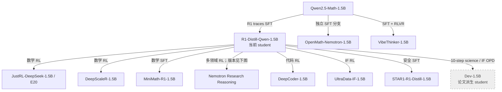

**怎么用：**先固定 R1-1.5B，比较 JustRL、MiniMath、Nemotron，再按任务补 DeepCoder/UltraData/STAR-1。这样可以先问“相同初始化，不同训练内容，跨 batch 可迁移性是否不同”。OpenMath/Vibe 是更早分叉的补充，但目前各有 7 个共享 ID 语义冲突，不能未经接口处理直接作为同协议教师。

这里的 Dev-1.5B 是论文构造的短程 OPD 学生，不是另一个可以直接下载的公开基座。它适合借鉴为“轻度改变 student 后再测同一个 teacher”的实验 recipe；本次没有确认其独立权重。

### 2.2 Nemotron 必须固定 revision

这是此次最建议补的低成本组。三种发布版本都在同一个 HF repo，裸 repo 名不足以指定实验。当前 main 的模型卡介绍 v2，不能把它自动当作 2608.16647 使用的原始 Nemotron。该论文没有提供足够信息把 teacher 绑定到这三个版本中的某个精确 SHA。[^prorl][^brorl][^nemotron]

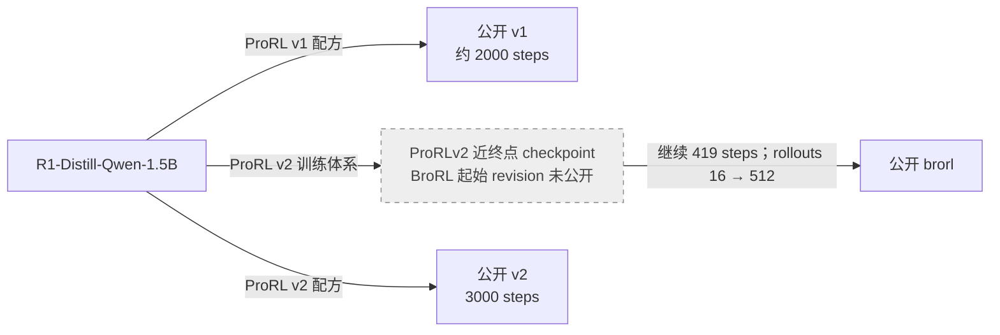

上图只表示论文所述的训练阶段关系；**没有声称公开 v2 最终权重就是 BroRL 的初始化**。v1/v2 还改变了优化配方，BroRL 同时涉及采样宽度、上下文和优化设置，因此它们不是“只增加 RL 步数”的严格消融。

| 版本 | 固定 revision SHA | 实验价值 |
| --- | --- | --- |
| v1 | `b89048893f95246c6b5749b287f0049e6df42ee9` | 原始 ProRL 终点，和 JustRL 比较不同 RL 路径 |
| v2 | `a8e647c7a46f04e84ce732d6fa3fa627ba343b8d` | 更长且配方改变的 RL，检查同源 teacher 是否随训练距离增加而更难迁移 |
| brorl | `3441fcdf8c6e81a2959e6352ff50122e3c677d72` | 增大探索宽度后的 teacher，检查更强教师的额外能力是否可被小学生回收 |

此次实际核对，三个版本与 R1-1.5B 的 token-ID 定义没有冲突或增补，权重文件均存在；仍需在真正运行前检查停止协议和上下文。记录见 [revision 表](../../literature/teacher-transfer/sources/nemotron-revisions.json)与[新增 token 映射核对](../../literature/teacher-transfer/sources/additional-tokenizer-audit.json)。

**能否证伪 filter 假说：**如果 v2/BroRL 自身更强，但学生在相近训练 KL 下降量下的留出收益反而更低，且 teacher 残差在学生可学习方向上的投影更小，说明“直接同源”也不保证可迁移。反过来，若差异主要被初始能力差、输出长度或格式解释，就不能把现象归因于谱滤波。公开终点只能给出关联；严格训练距离结论还需要同 run 的中间 checkpoint。

## 3. R1-7B/14B：补齐大教师起点和领域分支

Light-R1-7B 是 SFT，Light-R1-14B 是 RL；名字相近不代表阶段相同。DeepCoder-14B 与 Light-R1-14B 都从 R1-Distill-Qwen-14B 出发，提供同尺寸、同初始化、不同后训练领域的配对。[^coin][^deepcoder14]

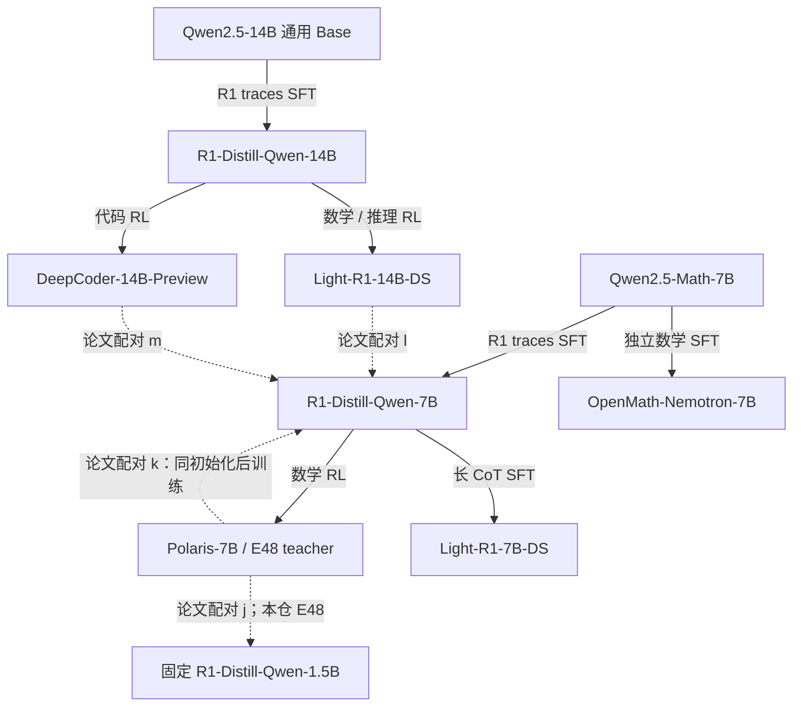

**优先用途：**

1. 固定当前 R1-1.5B，比较 R1-7B、Polaris-7B、Light-R1-7B。拆开“大底座差距”和“额外 RL/SFT 增量”。
2. 若加入 7B student，比较 R1-14B、Light-R1-14B、DeepCoder-14B。先测大底座，再问数学/代码 RL 的增量如何迁移。仅比较后两个终点仍混有训练预算和数据难度。
3. 固定同一个 Polaris teacher，比较 R1-1.5B 与 R1-7B。教师质量不变，但学生容量和初始化都变化；这是必要的两学生对照，不是只改变“同源性”的因果实验。

代码教师需要代码及数学双域评测。只看到 DeepCoder 让 MATH 降分，不能推出它的代码能力不可学。教师和学生必须用本仓相同评测协议重新评分，论文 MATH 值只提供背景。

## 4. Qwen2.5：同数据 SFT、直接 RL 和大规模 CPT

该组沿用原报告的 B 设置。其优势是 1.5B 成本低、数据相同的 SFT 尺寸对照可取得实际权重；Qwen2.5-Coder 仍共享初始化，不能充当独立随机预训练。[^rethink][^simple][^coder]

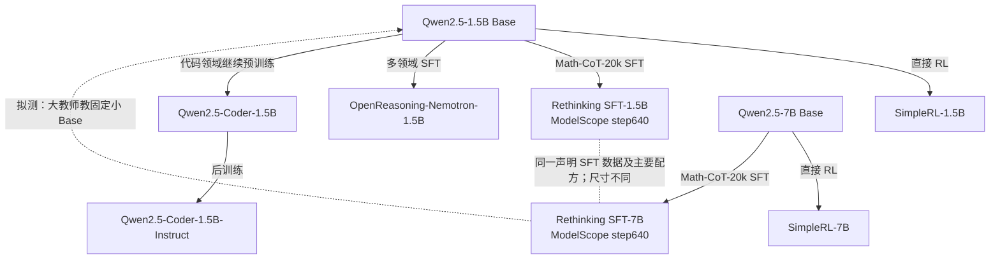

SimpleRL 不同尺寸使用的数据难度档可能不同，不能贴“同数据”标签。Rethinking 的这两个 Qwen2.5 HF repo 是占位入口，实际权重在 ModelScope 的 `step640`；路径见原报告与 CSV。OpenReasoning 和 OpenMath 也不是同一个模型：前者从通用 Base 出发，后者从 Math Base 出发。

## 5. Qwen3：Base 后训练和官方后训练终点需要分支表示

### 5.1 可用的直接 RL、SFT 与蒸馏分支

此次补充 `Thinking-Space/Qwen3-4B-Base-GRPO`（旧地址 `lllyx/Qwen3-4B-Base-GRPO` 已重定向）、Polaris-4B 和 R1-0528-Qwen3-8B。它们分别填补新的直接 GRPO 数据分支、官方后训练终点继续 RL、不同 trace teacher 的 SFT 分支。[^grpo4][^polaris4][^r10528]

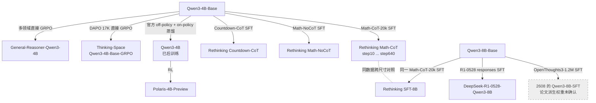

**解释边界：**

- Polaris-4B 初始化于 **Qwen3-4B**，不是 Qwen3-4B-Base。若用 Base student 去比较 General-Reasoner 与 Polaris，后者还包含官方蒸馏阶段；不能把差距全归于 RL 数据。
- `Thinking-Space/...-GRPO` 关联论文 2604.13016；不要把它自动等同于其他论文中仅写“Qwen3-GRPO”的作者自训权重。它也不是 General-Reasoner 的别名。
- 2608 的 Qwen3-8B-SFT、Rethinking-SFT-8B、官方 Qwen3-8B、R1-0528-Qwen3-8B 是四个不同模型。
- Qwen3 官方小模型不是纯 RL 终点；采用 strong-to-weak distillation。2608 表 3 的 `None` 是论文没有对该发布模型额外训练，不表示官方模型没有后训练。[^qwen3][^coin]

**接口核对：**Polaris-4B 与 Qwen3-4B 的 token-ID 定义一致。Thinking-Space GRPO 相对 Base 新增 4 个定义但共享 ID 无冲突。R1-0528-Qwen3-8B 相对 Qwen3-8B-Base 存在 **2 个共享 ID 冲突及 6 个新增定义**，其中开始/结束标记发生变化；不能直接对齐相同下标计算 full-vocab KL。其尺寸是 Qwen3 8B，不是 Qwen2.5 Math 7B。

### 5.2 2610.11291 已测的 Qwen3 配对

以下全部虚线都是 **teacher → student**，不是权重谱系。论文的 Qwen3-1.7B/4B/14B student 指官方已后训练模型，不能换成 Base。2507 版本也不画成 April 发布权重的确定后代：模型名相似不足以确认具体初始化。[^semi]

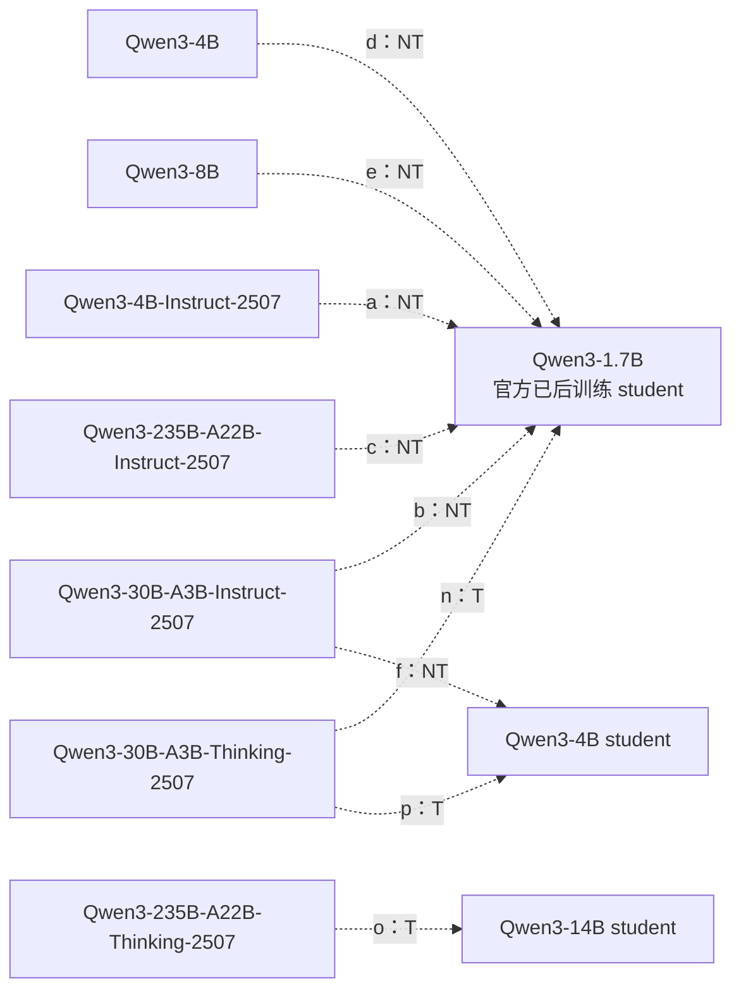

其中 T/NT 是论文的 thinking/non-thinking 运行模式；NT 行训练 response cap 为 4K，T 行为 16K。不同模式不是仅靠模型名称就完全确定的，需要保存 chat template、控制 token、停止条件与采样参数。

最值得复用的是小 student 的六教师矩阵：固定 Qwen3-1.7B，先测普通 4B/8B，再测 2507 的 4B-Instruct 与 30B MoE。它覆盖连续的实际分布差距，而不需要先跑 235B。30B-A3B 的激活参数小，并不意味着教师权重显存只按 3B 计算。

### 5.3 进一步找到的公开 SFT/OPD 学生终点

顺着 2604.13016 的模型卡又确认了两个公开权重：`Thinking-Space/Qwen3-1.7B-SFT` 和 `Thinking-Space/Qwen3-1.7B-Base-OPD`。它们都从 Qwen3-1.7B-Base 初始化，因此可以提供比“论文里有一个 SFT student，但权重未知”更具体的桥接候选。[^thinking-stages]

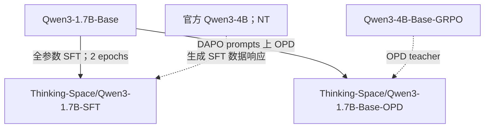

SFT 数据取 OpenThoughts3 的数学 prompts，由 Qwen3-4B 在 non-thinking 模式重新回答；不是直接使用原版 OpenThoughts3 全部 responses。OPD 分支使用 DAPO，teacher 为前面确认的 4B-Base-GRPO，模型卡注明 `k1` 且启用 policy-gradient 项，不能等同于本仓 full-vocab 目标。

**用途：**固定 Base-1.7B，可以把发布的 SFT/OPD 终点反过来作为同规模 teacher；也可以固定 4B-GRPO teacher，将 Base/SFT/OPD 三个 1.7B 终点作为不同 student，检查改变 student 是否比仅改变 teacher 更能恢复迁移。后一种设置需建立各自基线，不能把已蒸馏终点的提升全部归给新一轮 OPD。由于两个分支的 teacher、数据和 loss 都不同，它们不是单变量 SFT-vs-OPD 实验。

此次已核对权重和配置，SFT 的 `eos_token_id=151645`，Base/OPD 为 `151643`；tokenizer、模板和停止协议尚未做完整逐项验收。不要用这两个公开权重冒充 Semi-OPD g/h 的一轮 SFT student。

## 6. Semi-OPD 的 17 组配对能告诉我们什么

已将附录表 3 的全部 17 组转为[机器可读 CSV](../../literature/teacher-transfer/sources/semi-opd-17-pairs.csv)与 [JSON](../../literature/teacher-transfer/sources/semi-opd-17-pairs.json)，包括论文 ID、确切模型链接、模式、长度、初始 overlap、末步和 AUC 差值。完整数据比只摘“跨家族有效”更有用。成绩是四项 benchmark 的 avg@32 均值，不是单独 MATH；AUC 已按共同评测步数跨度归一化。除 q 使用 40,960-token 评测上限外，其余配对为 32,768；该评测上限与表中训练 cap 分开记录。[^semi]

| 配对 | 初始 top-64 overlap | Semi-OPD − OPD 末步 / AUC（百分点） | 对本问题的价值 |
| --- | --- | --- | --- |
| JustRL-1.5B → R1-1.5B（i） | 79.7% | +1.4 / −1.36 | 同源基准；末步与全过程结论不同 |
| Polaris-7B → R1-1.5B（j） | 69.7% | +0.1 / +0.24 | 与 E48 相同模型组合；论文没有显示很大的修复收益 |
| Polaris-7B → R1-7B（k） | 86.8% | −2.6 / −0.68 | 同一教师、直接祖先学生；教师质量可固定 |
| Light-R1-14B → R1-7B（l） | 72.0% | −1.7 / −0.30 | 大教师数学 RL 增量 |
| DeepCoder-14B → R1-7B（m） | 73.9% | +1.5 / +0.97 | 与上一行共同 14B 初始化，换后训练领域 |
| Qwen3-4B-Instruct-2507 → Qwen3-1.7B（a） | 62.5% | +9.5 / +7.09 | 小学生、明显分布差距的低成本补充 |
| Qwen3-30B-A3B-Thinking-2507 → Qwen3-1.7B（n） | 58.9% | +9.4 / +7.57 | 更大差距下的候选；同时改变 size、MoE、阶段 |
| Cascade-2 Math-Expert → Cascade-2（q） | 89.3% | −0.1 / +0.09 | 高 overlap 的参考；专家权重未确认公开 |

**这些差值是两种训练方法的差，不是“学生学会教师多少”的指标。**Overlap 是论文特定位置分布下的 top-64 集合重叠；2608 使用的 top-16 指标不能与之直接并列排名，更不能代替 full-vocab KL、teacher 残差投影或 Jacobian 谱。

本仓 E48 学不动，并不意味着加入 teacher rollouts 就会解决：对应论文 j 的收益很小。更合理的用途是借它的模型矩阵找“同一训练算法，在哪些实际差距下失效”，再用冻结前缀、局部更新和留出批次测量机制。

### 6.1 一轮 SFT 的桥接 student 不是已发布原始模型

论文 g/h 从官方 student 先在 teacher rollouts 上训练一轮，再比较 OPD/Semi-OPD。表中的 HF 链接仍指原始模型，不是这个派生 checkpoint。[^semi]

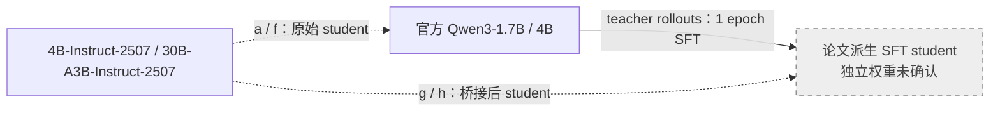

这可转化为我们的机制干预：固定同一个 teacher，轻量改变 student 后，重新测残差投影和跨 batch 改善。不过桥接同时改变能力、格式和 prefix 分布；需要在固定 S0 银行与新 student 自然 rollout 两套输入上分别评分。论文中一轮 SFT 虽提高 overlap，却常降低后续最终表现，因此不能把“更相似”直接当作“更好迁移”。

表 3 的每行两种方法训练 cap 匹配；其他速度表有 OPD 16K 对 Semi-OPD 4K 的比较，不能移用为等长度加速比。其 DAPO 预处理后为 14,116 条英文唯一题目，与本仓 17,917 条记录也不是同一个训练清单。

## 7. 独立预训练与架构：保留两个独立补充体系

### 7.1 Llama/Tulu 与 Marin

这张图刻意不给 Llama→Marin 画初始化箭头。Marin 是独立预训练，和 Coder 的共同初始化不同；Tulu 则提供 SFT→DPO→RLVR 的阶段链。[^marin][^tulu]

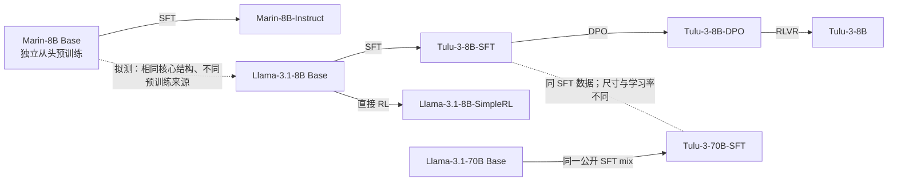

Marin 和 Llama 核心形状相符，但最大上下文配置不同；Tulu 的 head 扩词表也要处理。它们回答的是比 E20/E48 更一般的问题，建议保留作独立体系复核，不同时挤进第一轮。

### 7.2 Olmo dense 与 Hybrid

Olmo 的公开阶段有利于研究训练路径。Hybrid 的 Instruct-SFT 前面还有 Think-SFT 阶段，不能画成与 dense Instruct 完全相同的流水线。[^olmo][^hybrid]

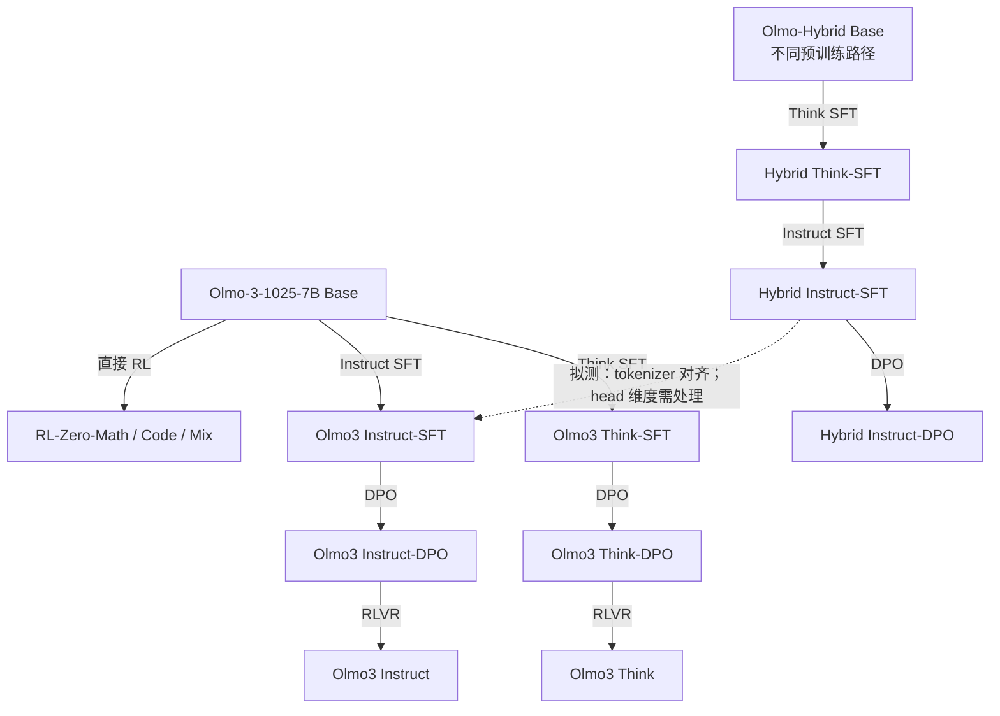

目前更合适的架构配对是 **Hybrid Instruct-SFT → dense Instruct-SFT**：tokenizer 实际一致，但 head 分别为 100352/100278；Think 与 Instruct 分支另有特殊 ID 冲突。模型卡可加载不等于本仓 teacher hidden/head 路径已支持 Hybrid；需要单独接入验收。

## 8. 一个可保留的非 Qwen 阶段对照：DeepSeekMath

DeepSeekMath 发布了 Base、Instruct、RL，论文明确给出 CPT、SFT、GRPO 的顺序，比只有最终 teacher 的项目更适合研究阶段变化。三者此次均核对到公开权重。它使用自己的 tokenizer，不加入现有 Qwen student 的逐 token KL；应单独固定 DeepSeekMath student。[^dsmath]

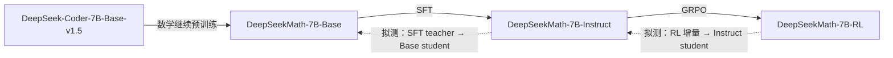

论文的 SFT 与 RL 数据存在明确关联，RL 训练题来自 SFT 数据中的 GSM8K/MATH 部分；但数据子集、监督形式与预算不同，不能声称是严格“同数据仅改算法”。若只要现阶段最省工程的实验，仍优先 R1/Qwen。

## 9. 怎么收敛为可讨论的实验方案

### 9.1 新增候选的优先级

| 优先级 | 固定 student 与新增 teacher | 真正回答的问题 | 必要配套 |
| --- | --- | --- | --- |
| P1 | R1-1.5B ← Nemotron v1/v2/brorl | 同源但训练路径更远，是否也发生迁移困难 | 同协议 teacher 成绩、初始 KL、长度、局部/留出收益；固定 revision |
| P1 | 原有 R1-1.5B ← MiniMath、R1-7B、Polaris、Light-R1-7B | SFT vs RL，以及跨尺寸底座与后训练增量 | 保留 E20，先测 R1-7B 这个起点 |
| P2 | Qwen3-1.7B ← 官方 4B/8B、4B-Instruct-2507 | 在小 student 上复核论文的不同分布距离 | 官方 post-trained student，NT 模式、共同 cap；先验收新增模型接口 |
| P2 | Qwen3-4B-Base ← General-Reasoner、Thinking-Space GRPO、Rethinking SFT | 同 Base 的 RL 数据分支与 SFT 分支 | 分开 RL 数据与算法，不把终点差异写成纯 RL/SFT 因果效应 |
| P2 | Qwen3-4B ← Polaris-4B | 官方已后训练 student 的直接 RL teacher | 与上一行分组，不能偷换 student |
| P3 | R1-7B ← R1-14B、Light-R1-14B、DeepCoder-14B | 相同大底座，数学/代码增量如何迁移 | 代码及数学双域测量，7B student 成本更高 |
| 扩展 | Marin/Tulu、Olmo Hybrid、DeepSeekMath | 独立预训练、架构差异、跨家族复核 | 单独学生体系与后端适配 |

新增设置已作为 F1–F18 写入 [settings.csv](settings.csv)。这份 CSV 是候选设计，不是可直接启动的脚本：没有把 teacher 路径、硬件与模板未经验收写进训练预设。

### 9.2 研究 filter 假说需要什么，而不是只增加模型数

“同源程度”使用三套独立标签：**训练谱系、结构差异、输入条件下的功能差距**。不要把它们加成一个未经校准的序号。固定 student 后，才有同一个学生局部核，可以比较不同 teacher 的目标残差是否投向快/慢学习方向。

建议先讨论一个小矩阵：R1-1.5B 固定 student，JustRL、MiniMath、Polaris、R1-7B、Nemotron 三版本作为 teacher；之后选一个 Qwen3 组复核。每个 teacher 测共同 S0 前缀上的初始分布、teacher 能力和训练长度，再按相同局部拟合改善程度比较 held-out batch 收益。若使用 loss-gradient Gram 而非完整输出 Jacobian，必须沿用[谱诊断文档](../../experiments/teacher-transfer/transfer-mechanism/spectral/README.md)的代理指标限定，不能称作完整 NTK 特征谱。

可判别的结果包括：①优化不下去且大部分残差落在慢方向；②当前 batch 优化得下去但其他 batch 不受益；③跨 batch KL 改善但任务能力不涨。这三种失败需要不同解释。模型族图只是帮助选择对照，不能单独证明 filter 机制。

KL 方向维持现有 full-vocab 设置，不作为这轮主要自变量。不同 teacher 的收益应相对各自同协议能力增量报告；不拿不同论文的 MATH 成绩直接排序，也不将小分母的能力回收率作为唯一结论。

## 10. 暂未使用的模型与配方参考池

下列候选收录以便后续研究引用；当前不进入首批训练。与其补齐一个名字，不如保留明确的“公开性/接口/控制不足”状态。

| 候选或配方 | 暂缓原因 | 后续可利用方式与来源 |
| --- | --- | --- |
| Qwen3-235B-A22B-Instruct-2507 / Thinking-2507 | 教师显存和推理成本大；多种因素同时变化 | Semi-OPD c/o 已测，作为低 overlap 的大规模外推组；[Instruct](https://huggingface.co/Qwen/Qwen3-235B-A22B-Instruct-2507)、[Thinking](https://huggingface.co/Qwen/Qwen3-235B-A22B-Thinking-2507) |
| Qwen3-30B-A3B-Instruct-2507 / Thinking-2507 | MoE 总权重约 30B，不能按 3B 估计部署成本 | 先复核 b/n，再考虑 235B；[Instruct](https://huggingface.co/Qwen/Qwen3-30B-A3B-Instruct-2507)、[Thinking](https://huggingface.co/Qwen/Qwen3-30B-A3B-Thinking-2507) |
| DeepSeek-R1-0528-Qwen3-8B | 相对 Qwen3 Base 的两个共享 token ID 冲突 | 不同 trace teacher 的 SFT 来源对照；[模型](https://huggingface.co/deepseek-ai/DeepSeek-R1-0528-Qwen3-8B) |
| Nemotron-Cascade-2-30B-A3B | `model_type=nemotron_h`，Hybrid 架构和不同 tokenizer；不是 Qwen MoE | 研究 SFT、CascadeRL、多领域 OPD 的组合；公开模型来自 Nemotron-3-Nano-30B-A3B-Base-BF16；[模型](https://huggingface.co/nvidia/Nemotron-Cascade-2-30B-A3B)、[论文](https://arxiv.org/abs/2603.19220) |
| Cascade-2 Math-Expert | Semi-OPD 表 3 没有精确 HF 链接，本次未确认独立公开 artifact | 借鉴共同 SFT 初始化、选中间领域专家的 recipe；不可用公开 Cascade-2 最终模型冒充专家。论文 q 的 89.3% overlap 仅作背景 |
| Dev-1.5B、2608 Qwen3-8B-SFT | 论文派生 checkpoint 未确认独立发布 | 分别复用短程 OPD 改变 student、OpenThoughts3 SFT 改变 student 的设计；见 2608 表 3 |
| Semi-OPD 的 Qwen3-1.7B/4B `(SFT)` | 原始模型链接不是一轮 SFT 后的权重 | 保留 g/h 的桥接对照配方，不登记为另一个可下载 repo |
| 其他论文中未给出精确发布链接的 Qwen3-GRPO | 名称不足以和 Thinking-Space、General-Reasoner 对号入座 | 如 2607.13399 的相关设置，需先追到训练 recipe/作者 artifact；[论文](https://arxiv.org/abs/2607.13399) |
| OpenMath-Nemotron-7B | 与 R1-7B 同 Math 基座的较早分叉，仍需接口验收 | 为 2608 的同规模分支对照补齐；[模型](https://huggingface.co/nvidia/OpenMath-Nemotron-7B) |
| OpenThinker / OpenThinker2 7B、32B | 更大成本，不与前两代数据混成一组 | 同一公开 SFT 数据配对；[数据论文](https://arxiv.org/abs/2506.04178)、[OpenThinker2-7B](https://huggingface.co/open-thoughts/OpenThinker2-7B)、[32B](https://huggingface.co/open-thoughts/OpenThinker2-32B) |
| Tulu3-70B、Marin-8B、Olmo/Hybrid | 独立学生体系；成本、上下文和接口控制更多 | 独立预训练/公开阶段/Hybrid 结构复核；见本篇第 7 节与原报告 |
| Llama3.1-Mamba2-8B-distill、Llamba-8B | 自定义加载器，不能仅看 config 中的 llama 标签 | 跨架构蒸馏；不是独立初始化对照；[Mamba-in-Llama](https://arxiv.org/abs/2408.15237)、[Llamba](https://arxiv.org/abs/2502.14458) |
| DeepSeekMath Base/Instruct/RL | 新 tokenizer 与 teacher 后端路径需验证 | 完整 CPT→SFT→GRPO 阶段复核；[Base](https://huggingface.co/deepseek-ai/deepseek-math-7b-base)、[Instruct](https://huggingface.co/deepseek-ai/deepseek-math-7b-instruct)、[RL](https://huggingface.co/deepseek-ai/deepseek-math-7b-rl) |
| Falcon-H1 | 未满足现有 Qwen 的同 tokenizer 条件 | Hybrid 架构文献参考，不强行列为同接口教师；[论文](https://arxiv.org/abs/2507.22448) |

核对范围：保留 2608 表 3 的 [17 条模型角色记录](../../literature/teacher-transfer/sources/coin-paper-lineages.json)、2610 表 3 的 17 个配对，以及当前 92 个仓库的配置与元数据。新增模型仅按实际核对范围报告 token 映射，不把“有 config 和权重”写成“已跑通”。旧失败复现文档中 Qwen3/MoE 尚未支持的说明是当时的工程状态；当前 `hidden.py` 已包含 qwen3/qwen3_moe 路径，但具体配置仍需 smoke test。

原始检索输出见[本轮完整记录](../../literature/teacher-transfer/sources/2026-10-28-图谱扩展完整检索记录.md)，包含 21 条去重检索结果，本轮检索无错误诊断。该检索记录不是人工推荐表，也不以搜索未命中证明权重不存在。

## 参考文献与模型来源

[^coin]: Li et al. *Every Coin Has Two Sides: On the Dual Nature of Generalization in On-Policy Distillation of Large Language Models*. [2608.16647v3](https://arxiv.org/abs/2608.16647v3)，表 3、模型谱系与附录实验；[既有精读笔记](../../literature/teacher-transfer/2026-10-26-策略蒸馏泛化的双重性实验与设置.md)。
[^semi]: *When Do We Need On-Policy Distillation? Distilling on Offline Student Rollouts Is Often Better*（Semi-OPD）. [2610.11291v1](https://arxiv.org/abs/2610.11291v1)，[附录表 3](https://arxiv.org/html/2610.11291v1#A1.T3)、SFT warm-start 与速度比较部分。数值均来自表 3，正号表示 Semi-OPD 高于 OPD。
[^minimath]: Oumi AI. [MiniMath-R1-1.5B 模型卡](https://huggingface.co/oumi-ai/MiniMath-R1-1.5B)。
[^deepcoder15]: Agentica. [DeepCoder-1.5B 模型卡](https://huggingface.co/agentica-org/DeepCoder-1.5B-Preview)。
[^star]: *STAR-1: Safer Alignment of Reasoning LLMs with 1K Data*. [2504.01903](https://arxiv.org/abs/2504.01903)。
[^prorl]: *ProRL: Prolonged Reinforcement Learning Expands Reasoning Boundaries in Large Language Models*. [2505.24864](https://arxiv.org/abs/2505.24864)。
[^brorl]: *BroRL: Scaling Reinforcement Learning via Broadened Exploration*. [2510.01180](https://arxiv.org/abs/2510.01180)。
[^nemotron]: NVIDIA. [Nemotron-Research-Reasoning-Qwen-1.5B 模型卡](https://huggingface.co/nvidia/Nemotron-Research-Reasoning-Qwen-1.5B)；[v1](https://huggingface.co/nvidia/Nemotron-Research-Reasoning-Qwen-1.5B/tree/v1)、[v2](https://huggingface.co/nvidia/Nemotron-Research-Reasoning-Qwen-1.5B/tree/v2)、[brorl](https://huggingface.co/nvidia/Nemotron-Research-Reasoning-Qwen-1.5B/tree/brorl)；[ProRL v2 技术说明](https://research.nvidia.com/labs/lpr/prorlv2/)。
[^deepcoder14]: Agentica. [DeepCoder-14B-Preview 模型卡](https://huggingface.co/agentica-org/DeepCoder-14B-Preview)，base_model、RL 数据与发布配方。
[^rethink]: Ren et al. *Rethinking Generalization in Reasoning SFT*. [2604.06628](https://arxiv.org/abs/2604.06628)；[作者 artifacts 索引](https://github.com/Nebularaid2000/rethink_sft_generalization)。
[^simple]: *SimpleRL-Zoo*. [2503.18892](https://arxiv.org/abs/2503.18892)。
[^coder]: *Qwen2.5-Coder Technical Report*. [2409.12186](https://arxiv.org/abs/2409.12186)。
[^grpo4]: [2604.13016](https://arxiv.org/abs/2604.13016)；[Thinking-Space/Qwen3-4B-Base-GRPO](https://huggingface.co/Thinking-Space/Qwen3-4B-Base-GRPO)，原 lllyx 地址重定向后的 canonical repo。
[^polaris4]: Polaris. [Polaris-4B-Preview](https://huggingface.co/POLARIS-Project/Polaris-4B-Preview)，base_model 为 Qwen/Qwen3-4B。
[^r10528]: DeepSeek. [DeepSeek-R1-0528-Qwen3-8B](https://huggingface.co/deepseek-ai/DeepSeek-R1-0528-Qwen3-8B)，Qwen3-8B-Base 初始化、R1-0528 数据蒸馏。
[^qwen3]: *Qwen3 Technical Report*. [2505.09388](https://arxiv.org/abs/2505.09388)，strong-to-weak distillation。
[^marin]: Marin. [训练复盘](https://github.com/marin-community/marin/blob/main/docs/reports/marin-8b-retro.md)；[Marin-8B Base](https://huggingface.co/marin-community/marin-8b-base)。
[^tulu]: *Tulu 3: Pushing Frontiers in Open Language Model Post-Training*. [2411.15124](https://arxiv.org/abs/2411.15124)。
[^olmo]: *Olmo 3*. [2512.13961](https://arxiv.org/abs/2512.13961)。
[^hybrid]: *Olmo Hybrid: From Theory to Practice and Back*. [2604.03444](https://arxiv.org/abs/2604.03444)。
[^dsmath]: *DeepSeekMath: Pushing the Limits of Mathematical Reasoning in Open Language Models*. [2402.03300](https://arxiv.org/abs/2402.03300)，第 2–4 节。

[^ultra]: Thinking Space. [UltraData-IF-1.5B](https://huggingface.co/Thinking-Space/UltraData-IF-1.5B)；关联论文 [2609.04172](https://arxiv.org/abs/2609.04172)。

[^thinking-stages]: Thinking Space. [Qwen3-1.7B-SFT](https://huggingface.co/Thinking-Space/Qwen3-1.7B-SFT)；[Qwen3-1.7B-Base-OPD](https://huggingface.co/Thinking-Space/Qwen3-1.7B-Base-OPD)，来源、训练配方与公开权重。
