# 模型来源、训练阶段与师生配对

本页统一说明模型从哪些权重初始化、经历哪些训练阶段，以及在 MirrorOPD 中的用途。先查[家族总览](#families)和[登记覆盖表](#inventory)，再按家族查看训练链；按 SFT、RL、SFT＋RL 等方式查询前后模型，见[训练方式附录](#training-methods)。模型来源与本项目的蒸馏实验分开记录：教师原来经过 RL，不表示本项目对学生采用了同一种 RL 算法。

精确资产身份由[模型注册表](../../assets/model_registry.json)维护；身份包含 repo、revision 和必要的 subfolder。实际 run 使用的权重、输入模式与预算仍由自己的配置和报告固定。本文中的公开父型号关系不等于父权重 SHA 已逐字节核实。

## 家族与训练阶段总览

| 家族                                       | 主要训练链                                                        | 本项目的使用入口                                                                                                                                                              |
| ------------------------------------------ | ----------------------------------------------------------------- | ----------------------------------------------------------------------------------------------------------------------------------------------------------------------------- |
| [R1／Qwen2.5-Math](#r1)                    | Math Base → R1 轨迹 SFT；之后分叉为数学／代码／指令 RL 或追加 SFT | [R1 固定状态实验](../experiments/teacher-transfer/protocols/fixed-state.md#r1)、[正式训练](../experiments/运行记录.md)                                                        |
| [Qwen3](#qwen3)                            | Base → 官方后训练；从 Base 或官方后训练终点分别做 SFT、RL、OPD    | [Qwen 输入协议](../experiments/teacher-transfer/protocols/fixed-state.md#qwen)、[历史实验](../experiments/teacher-transfer/appendix/qwen-lineage-evidence.md)                 |
| [Llama／Tulu](#llama)                      | Instruct → 数学 SFT／RL；另一条 Base → Tulu SFT → DPO → RLVR      | [Llama 实验](../experiments/teacher-transfer/protocols/fixed-state.md#llama-llama-固定学生0320-教师比较)、[阶段对照](../experiments/teacher-transfer/post-training-stages.md) |
| [MiMo](#mimo)                              | Base → SFT → RL；另有 Base → RL-Zero                              | [E71–E73 阶段对照](../experiments/teacher-transfer/post-training-stages.md#mimo)                                                                                              |
| [Olmo3／BayesRL](#olmo3)                   | Base → IVON-SFT → C3PO；与官方 SFT → DPO → RLVR 分支区分          | [阶段对照](../experiments/teacher-transfer/post-training-stages.md)、[接入验收](../infra/model-compatibility/stage-chains/2026-11-01-Olmo3与LightR1阶段链接入验收.md)         |
| [Qwen2.5／Light-R1-14B](#light-r1-lineage) | Base → R1 SFT → 额外 3K SFT → GRPO；中间 SFT2 权重未确认公开      | [E76／E77 对照边界](../experiments/teacher-transfer/post-training-stages.md)                                                                                                  |
| [DeepSeekMath](#deepseekmath)              | Coder → 数学继续预训练 → SFT → GRPO                               | 已登记资产；E69／E70 方案已撤销，见[阶段研究](../experiments/teacher-transfer/post-training-stages.md#mimo)                                                                   |

### 阶段与箭头的含义

监督微调（SFT）从给定回答学习；回答来自另一模型时也可构成离线蒸馏。强化学习（RL）按奖励优化，RLVR 表示使用可验证奖励，GRPO 是具体优化方法；DPO 是直接偏好优化，单独标注。OPD 表示在线策略蒸馏，CPT 表示继续预训练。阶段名描述训练方式，不自动说明全参数或 LoRA、数据集、训练预算及效果。

谱系图同时包含实验输入、祖先与公开候选；实际登记身份和使用证据见覆盖表。每条关系分别记录直接父模型、追加训练及累计训练链。例如 JustRL 的追加阶段是数学 RL，累计链为 Math Base → R1 蒸馏 SFT → 数学 RL。模型名中的 R1 不足以证明蒸馏学生自己经过了 RL。

- **实线箭头**表示公开声明的权重初始化与后续训练，边上标训练阶段；缺少精确父版本时保留该限制。
- **虚线箭头**必须标明“数据教师”或“实验配对”，分别表示生成训练回答和本项目／论文的 teacher→student 关系。
- **无箭头虚线**表示比较关系，不主张权重继承。不同尺寸不能因为同一家族就画成连续训练链。
- **灰色节点**表示未确认公开权重的中间阶段或论文派生 checkpoint；原始 Base 链接不能代替它。

### 同源、分支与异源

- **直接同源**：teacher 由实验 student 的初始化 checkpoint 继续训练得到，或有可核实的直接继承关系。若只知道父型号，明确写为“公开型号直接后训练，精确父 revision 未确认”。
- **共同祖先、不同分支**：双方共享更早初始化，但各自经历后训练；注明分叉点。
- **跨底座或跨尺寸**：分别说明底座、规模与共同训练来源。同 tokenizer 或使用同一数据项目不足以证明直接继承。
- **来源未确认**：保留未知，不根据名字、性能或实验结果反推来源。

异源程度分别记录训练谱系、结构规模，以及共同输入下的分布距离、熵、overlap 和同协议准确率。三者不合成统一分数，不预设固定难度排序；迁移结果用于检验这些差异与学习行为的关系。不同项目的 SFT／RL 对照还可能改变数据、预算及输入模式，具体条件在原报告中保留。[配对设计](../experiments/teacher-transfer/appendix/pair-design.md)讨论这些控制边界。

## R1 与 Qwen2.5-Math

### 1.5B 的 SFT 起点与后训练分支

2608.16647 表 3 给出了这组谱系；MiniMath、STAR-1、DeepCoder 等由作者模型卡补充。注意两个不同的“同源”：直接在学生上继续训练，与只共享更早的 Math 基座，控制力度不同。[^coin][^minimath][^deepcoder15][^star][^ultra]

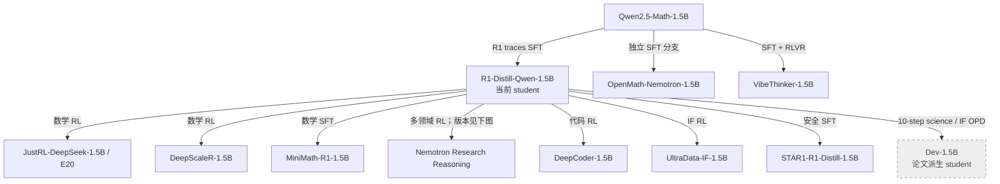

JustRL、MiniMath、Nemotron、DeepScaleR 和 DeepCoder 已进入[固定状态实验](../experiments/teacher-transfer/protocols/fixed-state.md#r1)。STAR-1 仍作为安全 SFT 候选。相同初始化下的不同训练内容可用于比较跨 batch 迁移。OpenMath/Vibe 是更早分叉的补充，但目前各有 7 个共享 ID 语义冲突，不能未经接口处理直接作为同协议教师。

这里的 Dev-1.5B 是论文构造的短程 OPD 学生，不是另一个可以直接下载的公开基座。它适合借鉴为“轻度改变 student 后再测同一个 teacher”的实验 recipe；尚未确认其独立权重。

### Nemotron 的三个发布版本

本项目注册并使用 v1 与 brorl；v2 在这里保留为来源与训练路径参照，不据公开权重存在推断本地实验完成。

三种发布版本都在同一个 HF repo，裸 repo 名不足以指定实验。2026-10-28 核查时 main 的模型卡介绍 v2，不能把它自动当作 2608.16647 使用的原始 Nemotron。该论文没有提供足够信息把 teacher 绑定到这三个版本中的某个精确 SHA。[^prorl][^brorl][^nemotron]

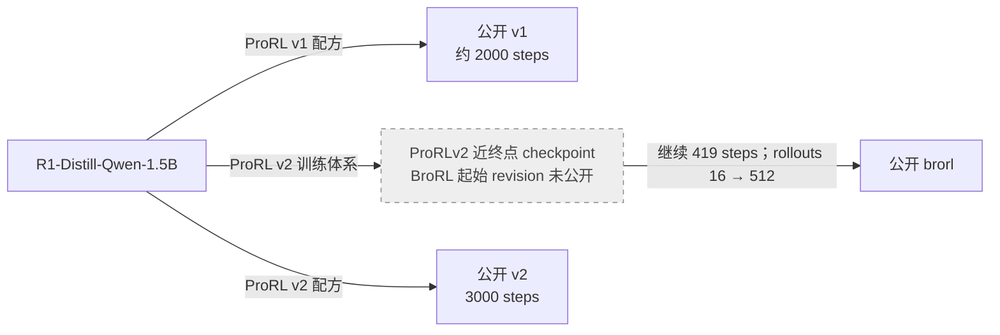

上图只表示论文所述的训练阶段关系；**没有声称公开 v2 最终权重就是 BroRL 的初始化**。v1/v2 还改变了优化配方，BroRL 同时涉及采样宽度、上下文和优化设置，因此它们不是“只增加 RL 步数”的严格消融。

| 版本  | 固定 revision SHA                          | 实验价值                                                           |
| ----- | ------------------------------------------ | ------------------------------------------------------------------ |
| v1    | `b89048893f95246c6b5749b287f0049e6df42ee9` | 原始 ProRL 终点，和 JustRL 比较不同 RL 路径                        |
| v2    | `a8e647c7a46f04e84ce732d6fa3fa627ba343b8d` | 更长且配方改变的 RL，检查同源 teacher 是否随训练距离增加而更难迁移 |
| brorl | `3441fcdf8c6e81a2959e6352ff50122e3c677d72` | 增大探索宽度后的 teacher，检查更强教师的额外能力是否可被小学生回收 |

2026-10-28 的来源核对中，三个版本与 R1-1.5B 的 token-ID 定义没有冲突或增补，权重文件均存在；仍需在真正运行前检查停止协议和上下文。记录见 [revision 表](../literature/teacher-transfer/sources/nemotron-revisions.json)与[新增 token 映射核对](../literature/teacher-transfer/sources/additional-tokenizer-audit.json)。

**迁移解释边界：**如果 v2/BroRL 自身更强，但学生在相近训练 KL 下降量下的留出收益反而更低，且 teacher 残差在学生可学习方向上的投影更小，说明“直接同源”也不保证可迁移。反过来，若差异主要被初始能力差、输出长度或格式解释，就不能把现象归因于谱滤波。公开终点只能给出关联；严格训练距离结论还需要同 run 的中间 checkpoint。

### 7B／14B 的起点与领域分支

Light-R1-7B-DS 从 DeepSeek-R1-Distill-Qwen-7B 追加约 3K 数据的 SFT；R1-Distill-Qwen-7B 本身由 Qwen2.5-Math-7B 进行 R1 回答上的蒸馏 SFT 得到。因此从 Math-7B 起的已披露权重链是 SFT→SFT，7B 发布版本没有追加 RL。[^light-7b][^r1-distill-7b] Light-R1-14B 则在追加 SFT 后再做 GRPO，名字相近不代表阶段相同。DeepCoder-14B 与 Light-R1-14B 具有共同的 R1-Distill-Qwen-14B 祖先，但 Light 在 RL 前另做了 3K SFT，不能标为两个 RL 分支具有相同的直接初始化。[^coin][^deepcoder14][^light-stage-audit]

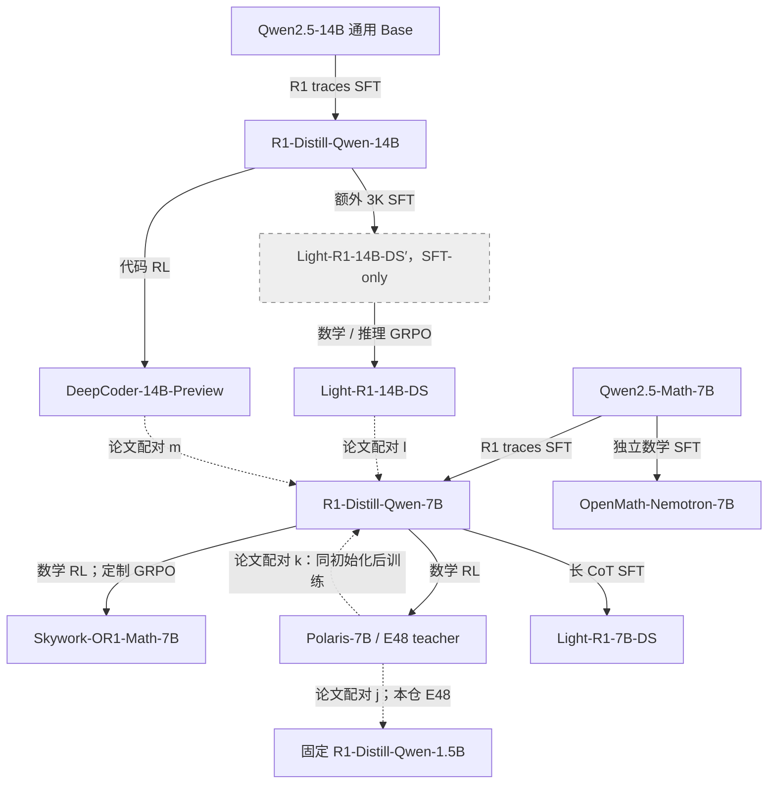

**配对解释：**

1. 固定 R1-1.5B，比较 R1-7B、Polaris-7B、Light-R1-7B。拆开“大底座差距”和“额外 RL/SFT 增量”。
2. 用 7B student 比较 R1-14B、Light-R1-14B、DeepCoder-14B。先测大底座，再问数学/代码 RL 的增量如何迁移。仅比较后两个终点仍混有训练预算和数据难度。
3. 固定同一个 Polaris teacher，比较 R1-1.5B 与 R1-7B。教师质量不变，但学生容量和初始化都变化；这是必要的两学生对照，不是只改变“同源性”的因果实验。

代码教师需要代码及数学双域评测。只看到 DeepCoder 让 MATH 降分，不能推出它的代码能力不可学。教师和学生必须用本仓相同评测协议重新评分，论文 MATH 值只提供背景。

Skywork-OR1-Math-7B 的固定模型卡声明从 R1-Distill-Qwen-7B 出发，使用 Skywork-OR1-RL-Data 和定制 GRPO；配方包含难度筛选、拒绝采样、多阶段训练与自适应熵控制。累计链为 Qwen2.5-Math-7B → R1 蒸馏 SFT → 数学 RL。系列模型卡同时介绍数学与代码数据，不能把系列数据总量直接当作这个 Math checkpoint 的确切训练清单。它已用于 TB1-S，见[版本与配对](../../research/studies/boundary/common.py)及[结果总览](../experiments/teacher-transfer/fixed-state-results/README.md)。[^skywork]

JustRL 和 DeepScaleR 追加数学 RL，Nemotron 追加多领域 RL，DeepCoder 追加代码 RL，UltraData 追加指令跟随 RL；MiniMath 和 Light-R1-7B 追加 SFT。它们与学生的关系应按直接父 checkpoint 判断，不能仅用“R1 系”归成同一种训练。DeepCoder 注册表同时保留公开 revision 与本地内容身份，后者的来源匹配限制见[覆盖表](#inventory)。

### Light-R1-14B 的追加 SFT 与 RL

R1-Distill-Qwen-14B 从 Qwen2.5-14B 进行 SFT 蒸馏。Light-R1 论文§3.4、表 3／4 及附录 A 明确记录：先在 R1-Distill 上追加 3K SFT stage2，再做 GRPO；RL 紧邻的 SFT 起点是文中的 `Light-R1-14B-DS′`，不是原版 R1-Distill。[^r1][^light-paper]

| 角色              | 仓库                                       | 固定 revision                              |
| ----------------- | ------------------------------------------ | ------------------------------------------ |
| Base              | `Qwen/Qwen2.5-14B`                         | `97e1e76335b7017d8f67c08a19d103c0504298c9` |
| SFT1              | `deepseek-ai/DeepSeek-R1-Distill-Qwen-14B` | `1df8507178afcc1bef68cd8c393f61a886323761` |
| SFT2／RL 直接起点 | 论文中的 `Light-R1-14B-DS′`                | 尚未找到官方公开 checkpoint                |
| SFT1+SFT2+RL      | `qihoo360/Light-R1-14B-DS`                 | `a69e32b88daa855ae068ca8601f3ec4085e96086` |

截至 2026-11-01，在官方模型列表及该仓库历史中未找到 SFT-only 中间权重；公开 issue #34 也在请求这份模型，尚无回复。[^light-sft-issue] 当前 E76／E77 实际比较较早的 SFT1 与 SFT1+SFT2+RL，不能将差异归因于单独追加 RL。模型卡的 `base_model` 声明只能支持祖先来源，不能替代紧邻阶段的核查。[^light]

三者主要配置均为 Qwen2、48 层、hidden5120、152064 维 head、不绑定 embedding/head、RoPE theta1000000、模型总上下文 131072。现有 Qwen2 后端可复用，但输入有明确差异：Base 到 R1 的 151643–151649 共 7 个特殊 token 名称／解码语义变化；R1 tokenizer 声明 16384、Light-R1 声明 20000，均小于模型配置 131072；模板也不同。统一输入、停止协议、token 语义和长度元数据后仍需长序列验收，不能只看模型配置 128K 就当作已可运行。

这条链接入时固定共同 R1-Distill tokenizer 与模板，Base 的七个特殊 ID 明确采用 R1 标签，原始权重不改变；定义与验收见[接入记录](../infra/model-compatibility/stage-chains/2026-11-01-Olmo3与LightR1阶段链接入验收.md)。该输入条件下的 Base 需与原生 Qwen 聊天协议分别解释。实际训练完成范围见阶段研究及其运行回执。MiMo 主实验之外的阶段增量、其他学生初始化和跨尺寸比较分别设计，不将不同目标的终点 KL 之差当作可相加的 SFT／RL 内容。

## Qwen3：Base 分叉与官方后训练终点

### 1.7B 的 SFT、RL 与 OPD 分支

Qwen3-1.7B-Base 与 Qwen3-1.7B 是不同初始化。官方小模型使用 strong-to-weak distillation；官方终点不能简单标成“Base 直接 RL”。e3、GRPO-KL 和 Samsung Math 从官方后训练终点继续训练，Thinking-Space、GT 与 Co-rewarding 从 Base 分叉。[^qwen3][^e3][^grpo][^samsung][^sft][^opd][^gt-math][^coreward-i][^coreward-ii]

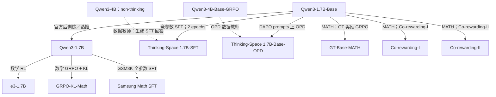

| 分支                         | 直接父型号      | 追加训练与累计路径         | 数据／证据边界                                                                  |
| ---------------------------- | --------------- | -------------------------- | ------------------------------------------------------------------------------- |
| e3-1.7B                      | Qwen3-1.7B      | 官方后训练 → 数学 RL       | 作者模型与项目支持该路径；精确父 revision 未公开                                |
| GRPO-KL-Math                 | Qwen3-1.7B      | 官方后训练 → 数学 GRPO＋KL | 按作者模型卡记录，不以模型卡分数替代本地评测                                    |
| Samsung Qwen3-1.7B-Math      | Qwen3-1.7B      | 官方后训练 → 全参数 SFT    | GSM8K；模型卡给出 full-rank SFT 命令                                            |
| Thinking-Space 1.7B-SFT      | Qwen3-1.7B-Base | Base → SFT                 | OpenThoughts3 数学 prompts，经 Qwen3-4B non-thinking 重新回答；全参数、2 epochs |
| Thinking-Space 1.7B-Base-OPD | Qwen3-1.7B-Base | Base → OPD                 | DAPO prompts；teacher 为 4B-Base-GRPO，模型卡注明 k1 与 policy-gradient 项      |
| GT-Base-MATH                 | Qwen3-1.7B-Base | Base → RL                  | MATH train，ground-truth reward GRPO                                            |
| Co-rewarding-I／II           | Qwen3-1.7B-Base | Base → 各自 RL 分支        | 同一公开父型号与 MATH 数据集名称；精确父 commit、子集和预算并未证明一致         |

Thinking-Space SFT 的固定模型卡明确给出 `lllyx/OpenThought3-Qwen3-4B`，训练关闭 thinking、cutoff_len=20480、学习率 1e-5。历史结果把该模型简称为“DeepMath SFT”，该简称不表示它使用 DeepMath 数据集；历史配置键 `sft-deepmath` 仍指同一份固定权重。[^thinking-sft-fixed]

这些模型在本项目被用作教师时，原来的 SFT／RL／OPD 路径保持不变；我们再训练学生的损失和模式由[实验协议](../experiments/teacher-transfer/protocols/fixed-state.md#qwen)定义。旧共同 thinking 与后续匹配 non-thinking 结果分别解释。

### Co-rewarding 的原训练证据

Co-rewarding 是自监督 RL 方法，本文使用的 I／II 版本新增训练均归为 RL。Qwen3-1.7B-Base-MATH 两个版本公开声明从 Qwen3-1.7B-Base 出发，没有另列 SFT 中间阶段；Llama 的 Co-rewarding-I 版本从 Llama-3.2-3B-Instruct 出发，只能称为已有 Instruct 后训练之后再追加 RL。Co-rewarding-II 的伪标签／self-distillation 用于该 RL 方法，不表示先做一次独立 SFT。这里的“直接 RL”描述从指定起点新增的训练，不表示没有题目改写、伪标签、参考教师或 KL 正则。[^coreward-code][^coreward-i][^coreward-ii][^coreward-llama]

作者实现进一步区分了两条路径：Co-rewarding-I 对原题和语义相近的改写题构造对照奖励；Co-rewarding-II 使用缓慢更新的参考教师及伪标签。因此，这组比较还包含数据视角和参考模型更新方式的差别，不能称为只改变奖励公式。[^coreward-code]

公开启动脚本均设 train batch128、rollout n8、学习率 3e-6、最大回答 3072、3 epochs，但 I 的 actor KL 系数为 0.005，II 为 0.001；II 另启用参考参数滑动更新。I 脚本默认指向 MATH 原题与 Qwen3-32B 改写题，II 脚本默认指向 DAPO。后者是通用启动模板，不能据此否定已发布 checkpoint 的 MATH 模型卡，也不能据此认定该 MATH checkpoint 的全部超参。两个脚本均未给出我们所下载权重对应的确切执行日志。[^coreward-launch-i][^coreward-launch-ii]
启动脚本原文与 Git blob 摘要见[来源快照](../literature/teacher-transfer/sources/qwen3-lineage-20261029/coreward-launchers/manifest.json)。这些公开教师的训练设置不代入本项目蒸馏实验的预算。

### 4B／8B 的直接 RL、SFT 与蒸馏分支

已核查 `Thinking-Space/Qwen3-4B-Base-GRPO`（旧地址 `lllyx/Qwen3-4B-Base-GRPO` 已重定向）、Polaris-4B 和 R1-0528-Qwen3-8B。它们分别填补新的直接 GRPO 数据分支、官方后训练终点继续 RL、不同 trace teacher 的 SFT 分支。[^grpo4][^polaris4][^r10528]

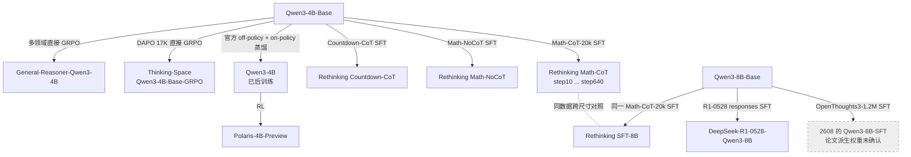

**解释边界：**

- Polaris-4B 初始化于 **Qwen3-4B**，不是 Qwen3-4B-Base。若用 Base student 去比较 General-Reasoner 与 Polaris，后者还包含官方蒸馏阶段；不能把差距全归于 RL 数据。
- `Thinking-Space/...-GRPO` 关联论文 2604.13016；不要把它自动等同于其他论文中仅写“Qwen3-GRPO”的作者自训权重。它也不是 General-Reasoner 的别名。
- 2608 的 Qwen3-8B-SFT、Rethinking-SFT-8B、官方 Qwen3-8B、R1-0528-Qwen3-8B 是四个不同模型。
- Qwen3 官方小模型不是纯 RL 终点；采用 strong-to-weak distillation。2608 表 3 的 `None` 是论文没有对该发布模型额外训练，不表示官方模型没有后训练。[^qwen3][^coin]

**接口核对：**Polaris-4B 与 Qwen3-4B 的 token-ID 定义一致。Thinking-Space GRPO 相对 Base 新增 4 个定义但共享 ID 无冲突。R1-0528-Qwen3-8B 相对 Qwen3-8B-Base 存在 **2 个共享 ID 冲突及 6 个新增定义**，其中开始/结束标记发生变化；不能直接对齐相同下标计算 full-vocab KL。其尺寸是 Qwen3 8B，不是 Qwen2.5 Math 7B。

本项目还使用 `jasonrqh/Qwen3-4B_Math-CoT-20k_lr5e-5_ep8_bs256` 的 `step80` 与 `step640`，两者来自同一个 SFT run，subfolder 是身份的一部分。作者脚本从 Qwen3-4B-Base 出发，用 Math-CoT-20k、学习率 5e-5、8 epochs、batch256；未披露精确父 revision。它们是教师训练过程的早晚 checkpoint，不能把 80／640 解释成我们的学生更新数。[^qwen-sft-stages]

官方 Qwen3-0.6B、1.7B、4B、8B 在各自尺寸上分别初始化，跨尺寸虚线仅表示实验比较。Qwen3-4B-Thinking-2507、4B-Instruct-2507、30B-A3B-Instruct-2507 是独立固定发布身份；不能由名称推断其与 April 终点的确切直接继承。4B-Thinking-2507 的 RoPE theta 为 5M，原组其他模型为 1M；30B-A3B 是 MoE，激活参数 3B 不代表只需存放 3B 权重。各模型在本项目使用的模式与上下文见[Qwen 协议](../experiments/teacher-transfer/protocols/fixed-state.md#qwen)和[正式训练设置](训练设置.md)。

### Thinking-Space 的输入与对照边界

固定 Base-1.7B，可以把发布的 SFT/OPD 终点反过来作为同规模 teacher；也可以固定 4B-GRPO teacher，将 Base/SFT/OPD 三个 1.7B 终点作为不同 student，检查改变 student 是否比仅改变 teacher 更能恢复迁移。后一种设置需建立各自基线，不能把已蒸馏终点的提升全部归给新一轮 OPD。由于两个分支的 teacher、数据和 loss 都不同，它们不是单变量 SFT-vs-OPD 实验。

SFT 的 `eos_token_id=151645`，Base/OPD 为 `151643`；本项目的停止集合、模板与逐 ID 核对见[原实验接口](../experiments/teacher-transfer/appendix/qwen-lineage-evidence.md#接口与评测条件)。Semi-OPD g/h 的一轮 SFT student 需单独确认权重身份，这两个公开权重不满足该对应关系。
RLVR-GSM8K 按既有研究边界仅保留在[附录](../experiments/teacher-transfer/appendix/qwen3-rlvr-gsm8k.md)，其 LoRA RLVR 来源、近同权重诊断与已完成实验仍可检索；不加入上面的主谱系图或主比较计数。

## Llama：Instruct 分支与 Tulu 阶段链

本项目实际加载 `unsloth/Llama-3.2-3B-Instruct`，另用 Unsloth 的 1B／8B 版本做跨尺寸比较。[固定配置](../../research/studies/fixed_transfer/plans/llama-lineage-protocol.json)同时记录 Meta 原始发布来源和 Unsloth revision。使用的是 BF16 镜像，不能在没有核对时声称它与某个 Meta revision 逐字节一致。下面 3B 分支的父型号为作者声明的 Llama-3.2-3B-Instruct，不据此证明作者从我们加载的 Unsloth commit 初始化。

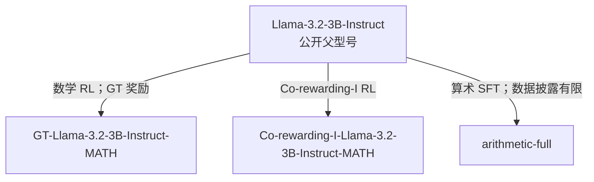

| 模型／分支                                       | 训练阶段与来源                                                   | 解释限制                                                               |
| ------------------------------------------------ | ---------------------------------------------------------------- | ---------------------------------------------------------------------- |
| Llama-3.2-1B／3B-Instruct、Llama-3.1-8B-Instruct | 官方 Instruct 发布身份；本地使用 Unsloth BF16 版本               | 不由 Instruct 名称补造逐阶段父 checkpoint；不同尺寸没有直接继承箭头    |
| GT-Llama-3.2-3B-Instruct-MATH                    | 从公开 3B Instruct 型号追加数学 RL，使用 ground-truth 奖励       | 父型号与实验 student 的精确镜像身份分开核实                            |
| Co-rewarding-I-Llama-3.2-3B-Instruct-MATH        | 从公开 3B Instruct 型号追加 Co-rewarding-I RL                    | 数据与预算不能由 Qwen 同名分支推断                                     |
| Llama-3.2-3B-Instruct-arithmetic-full            | 模型卡声明全参数微调，配置保留 candidate_full_parameter_sft 标签 | 模型卡声明 20000 个样本、学习率 1e-4；数据集字段为占位，确切数据未披露 |
| Llama-3.1-Nemotron-Nano-8B-v1                    | 从 Llama-3.1-8B-Instruct 追加 SFT、多阶段 RL，再合并 checkpoint  | 原配置记为 sft_rl_checkpoint_merge；不能画成单一 SFT→RL 终点并省略合并 |

Nemotron-Nano-8B-v1 的固定模型卡列出数学、代码、推理与工具调用 SFT，以及 REINFORCE（RLOO）和 Online RPO 的多个 RL 阶段；最终发布权重由 SFT 终点与 Online RPO 终点合并。该来源只支持已披露的多阶段与合并关系，不补画未给出的逐阶段精确初始化。[^nemotron-nano]

arithmetic-full 的固定模型卡明确声明 Full fine-tuning，但 Dataset 字段仍为占位。表中的全参数和样本量是作者声明，数据配方没有据此补齐。[^llama-arithmetic]

上述来源与模型卡链接保存在[固定配置](../../research/studies/fixed_transfer/plans/llama-lineage-protocol.json)，实际输入与结果见[Llama 协议](../experiments/teacher-transfer/protocols/fixed-state.md#llama-llama-固定学生0320-教师比较)。未披露的细节保持未知。

### Tulu：SFT → DPO → RLVR；Marin 为独立预训练候选

这张图刻意不给 Llama→Marin 画初始化箭头。Marin 是独立预训练，和 Coder 的共同初始化不同；Tulu 则提供 SFT→DPO→RLVR 的阶段链。[^marin][^tulu]

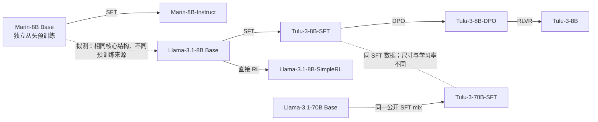

Tulu-3-8B-SFT、DPO、最终 RLVR 与 Llama-3.1-8B-SimpleRL-Zoo 已进入[阶段实验](../experiments/teacher-transfer/post-training-stages.md#fixed-stage)。SimpleRL 从 Base 直接 RL；Tulu 三阶段有连续前序。Marin 和 Llama 核心形状相符，但最大上下文配置不同，Marin 仍作独立预训练候选。Tulu teacher 输出头 128264，实验 student 为 128256；额外输出支持与 SimpleRL 输入不匹配条件留在原报告中。

## MiMo-7B：SFT、直接 RL 与 SFT 后 RL

MiMo 公开 Base、SFT、Base 直接 RL 和 SFT 后继续 RL 四份权重，可由同一个 Base student 分别学习三个教师。[^mimo]

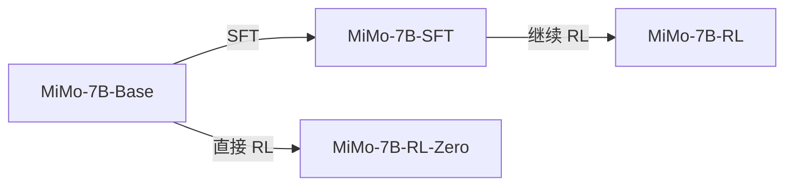

RL-Zero 与 RL 是不同训练路径；本项目三个学生分支各自从 Base 独立初始化。教师原训练的数据、监督与预算不同，实际比较三个目标，不声称只有算法一个因素变化。

| 角色    | 仓库                         | 固定 revision                              |
| ------- | ---------------------------- | ------------------------------------------ |
| Base    | `XiaomiMiMo/MiMo-7B-Base`    | `d892dcc601b8a242e7b3e7d3bb9f55abbe72c0ad` |
| SFT     | `XiaomiMiMo/MiMo-7B-SFT`     | `0a9f1180d99e686ce56b75fee637db62407ceb1b` |
| Base→RL | `XiaomiMiMo/MiMo-7B-RL-Zero` | `da0bde6fbbc8d1cb9afad15fab947db628a22014` |
| SFT→RL  | `XiaomiMiMo/MiMo-7B-RL`      | `7c7707596b0ef1032ef82970d7a4a484ca457c4d` |

四份配置均为`model_type=mimo`、36 层、hidden4096、intermediate11008、32 个 Q heads／8 个 KV heads、151680 维 head、不绑定 embedding/head、RoPE theta640000、总上下文 32768。Tokenizer 有 151665 个已定义 token，四份词表及 token-ID 映射一致。Base／RL-Zero 默认 EOS 为 151643，SFT／RL 为 151645；共同停止协议须显式记录。

Tokenizer 的`model_max_length=131072`大于模型配置 32768，不能据此将模型标为 128K。原定公共 prompt8192＋response32768 需要 40960 总上下文；阶段实验减小公共回答 cap，具体值见[MiMo 实验设置](../experiments/teacher-transfer/post-training-stages.md#mimo)。

公开 HF 实现继承 Qwen2 的下一 token 主干，另有 MTP 模块。本研究关闭 MTP 推测解码与辅助训练：原生配置将 MTP 层数设为 0，直接 HF 适配保留模块时冻结参数。原生 HF／vLLM、梯度和导出需要独立验收，不以架构继承关系代替数值检查。

## BayesRL／Olmo3-7B

这条独立分支从 Olmo3 Base 做 IVON-SFT，再以该 checkpoint 做 3PO 系列 RLVR，没有 DPO 中间阶段。SFT 使用 Llama-Nemotron 数据子集，RL 使用 DAPO-Math-17k。[^bayes-sft][^bayes-rl] C3PO 是 GRPO 加参数扰动探索与 Seq-MIS 修正，不能标成 vanilla GRPO。

C3PO 模型卡的 warm-start 明确指向 `BayesRL/Olmo3-IVON-SFT-7B`，公开脚本的 `olmo3_nmtron` 分支也从这个仓库加载模型。[^bayes-code] 论文§4.1 的主结果重置 IVON Hessian，保留 SFT 权重作为起点；这不是另训一份 SFT。[^bayes-paper] 因此公开训练声明支持 E74／E75 的同一 SFT 前序，尚未取得 RL step0 参数哈希做独立逐字节核验。

| 角色   | 仓库                        | 固定 revision                              |
| ------ | --------------------------- | ------------------------------------------ |
| Base   | `allenai/Olmo-3-1025-7B`    | `a81bae42db3975be1671e27b9c9a56da1a9f980f` |
| SFT    | `BayesRL/Olmo3-IVON-SFT-7B` | `4022ca655a865d859ddb8ecb92f008cb130a5542` |
| SFT+RL | `BayesRL/Olmo3-C3PO-7B`     | `c223ee93e7344487f74fdd5767a42318ca6525af` |

三份模型和 tokenizer 的上下文声明均为 65536，能容纳 40960 公共预算。主要结构为 32 层、hidden4096、32 个 Q/KV heads、100278 维 head；词表和 token ID 一致，YaRN 配置一致（原始 8192、factor8、theta500000）。SFT 与 C3PO 的独立`chat_template.jinja`逐字节一致；Base 采用共同 SFT 输入协议时须显式固定模板。

这条链通过独立的共同 SFT tokenizer 协议目录接入 `olmo3` 完整词表适配，具体输入条件、长序列和原生验收见[接入记录](../infra/model-compatibility/stage-chains/2026-11-01-Olmo3与LightR1阶段链接入验收.md)。32 层中每四层的前三层使用 4096 滑窗，第四层使用全注意力，运行须保留该结构。实际训练完成范围见阶段研究及其运行回执。官方 Olmo3-Think 的 SFT→DPO→RLVR 链与这条 BayesRL 分支分别解释。

### 官方 Olmo3 与 Hybrid：独立候选分支

Olmo 的公开阶段有利于研究训练路径。Hybrid 的 Instruct-SFT 前面还有 Think-SFT 阶段，不能画成与 dense Instruct 完全相同的流水线。[^olmo][^hybrid]

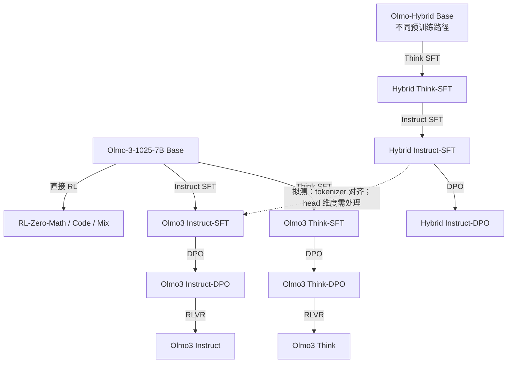

目前更合适的架构配对是 **Hybrid Instruct-SFT → dense Instruct-SFT**：tokenizer 实际一致，但 head 分别为 100352/100278；Think 与 Instruct 分支另有特殊 ID 冲突。模型卡可加载不等于本仓 teacher hidden/head 路径已支持 Hybrid；需要单独接入验收。

## DeepSeekMath：CPT → SFT → GRPO

DeepSeekMath 发布了 Base、Instruct、RL，论文明确给出 CPT、SFT、GRPO 的顺序，比只有最终 teacher 的项目更适合研究阶段变化。三者均已登记固定公开权重；E69／E70 方案已撤销，由 MiMo 阶段实验替代。它使用自己的 tokenizer，不加入现有 Qwen student 的逐 token KL；应单独固定 DeepSeekMath student。[^dsmath]

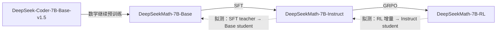

论文的 SFT 与 RL 数据存在明确关联，RL 训练题来自 SFT 数据中的 GSM8K/MATH 部分；但数据子集、监督形式与预算不同，不能声称是严格“同数据仅改算法”。撤销方案不删除来源资料，也不计为已完成训练。

## 登记覆盖、用途与未知项

2026-11-01 核对[资产注册表](../../assets/model_registry.json)，共 67 个固定身份条目：58 个公开版本、6 个共同 tokenizer 协议适配、3 个本地内容身份。下表逐项对应这些条目；短版本仅用于阅读区分，完整 SHA、子目录与本地路径以注册表及原实验配置为准。登记、准备、接入、评测、训练是不同状态，表中的实验链接指明可核实的用途，不将仅有资产登记算作训练完成。

公开来源 58 个条目也包含同仓库不同版本与同版本不同 subfolder。研究产生的学生 step064／step320 等输出归各 run 的 checkpoint 和结果记录，不把每个输出另列为公开预训练模型。复算仍必须绑定原 run 的输入与导出身份。

| 注册模型                                                  | 版本区分             | 训练来源说明                | 本项目用途／证据                                                                                                     |
| --------------------------------------------------------- | -------------------- | --------------------------- | -------------------------------------------------------------------------------------------------------------------- |
| `deepseek-ai/deepseek-math-7b-base`                       | `036a8c61`           | [来源链](#deepseekmath)     | 已登记；[E69／E70 撤销](../experiments/teacher-transfer/post-training-stages.md#mimo)                                |
| `deepseek-ai/deepseek-math-7b-instruct`                   | `0a5828f8`           | [来源链](#deepseekmath)     | 已登记；[E69／E70 撤销](../experiments/teacher-transfer/post-training-stages.md#mimo)                                |
| `deepseek-ai/deepseek-math-7b-rl`                         | `f3cd419a`           | [来源链](#deepseekmath)     | 已登记；[E69／E70 撤销](../experiments/teacher-transfer/post-training-stages.md#mimo)                                |
| `deepseek-ai/DeepSeek-R1-Distill-Qwen-1.5B`               | `ad9f0ae0`           | [来源链](#r1)               | [R1 配对／版本](../../research/studies/boundary/common.py)、[扩展](../../research/studies/boundary/round2_common.py) |
| `deepseek-ai/DeepSeek-R1-Distill-Qwen-7B`                 | `916b56a4`           | [来源链](#r1)               | [R1 配对／版本](../../research/studies/boundary/common.py)、[扩展](../../research/studies/boundary/round2_common.py) |
| `hbx/JustRL-DeepSeek-1.5B`                                | `0637e409`           | [来源链](#r1)               | [R1 配对／版本](../../research/studies/boundary/common.py)、[扩展](../../research/studies/boundary/round2_common.py) |
| `POLARIS-Project/Polaris-7B-Preview`                      | `faea72cf`           | [来源链](#r1)               | [R1 配对／版本](../../research/studies/boundary/common.py)、[扩展](../../research/studies/boundary/round2_common.py) |
| `Qwen/Qwen3-1.7B`                                         | `70d244cc`           | [来源链](#qwen3)            | [Qwen 分支](../experiments/teacher-transfer/protocols/fixed-state.md#qwen)                                           |
| `Qwen/Qwen3-1.7B-Base`                                    | `ea980cb0`           | [来源链](#qwen3)            | [Qwen 分支](../experiments/teacher-transfer/protocols/fixed-state.md#qwen)                                           |
| `Qwen/Qwen3-30B-A3B-Instruct-2507`                        | `0d7cf239`           | [来源链](#qwen3)            | [E54–E57](训练设置.md)                                                                                               |
| `Qwen/Qwen3-4B`                                           | `1cfa9a72`           | [来源链](#qwen3)            | [Qwen 分支](../experiments/teacher-transfer/protocols/fixed-state.md#qwen)                                           |
| `Qwen/Qwen3-4B-Instruct-2507`                             | `cdbee75f`           | [来源链](#qwen3)            | [Qwen 分支](../experiments/teacher-transfer/protocols/fixed-state.md#qwen)                                           |
| `Qwen/Qwen3-8B`                                           | `b968826d`           | [来源链](#qwen3)            | [Qwen 分支](../experiments/teacher-transfer/protocols/fixed-state.md#qwen)                                           |
| `nvidia/Nemotron-Research-Reasoning-Qwen-1.5B`            | `3441fcdf`           | [来源链](#r1)               | [R1 配对／版本](../../research/studies/boundary/common.py)、[扩展](../../research/studies/boundary/round2_common.py) |
| `agentica-org/DeepCoder-1.5B-Preview`                     | `103033da`           | [来源链](#r1)               | [R1 配对／版本](../../research/studies/boundary/common.py)、[扩展](../../research/studies/boundary/round2_common.py) |
| `agentica-org/DeepScaleR-1.5B-Preview`                    | `e3f524ce`           | [来源链](#r1)               | [R1 配对／版本](../../research/studies/boundary/common.py)、[扩展](../../research/studies/boundary/round2_common.py) |
| `qihoo360/Light-R1-7B-DS`                                 | `06c9338c`           | [来源链](#r1)               | [R1 配对／版本](../../research/studies/boundary/common.py)、[扩展](../../research/studies/boundary/round2_common.py) |
| `Qwen/Qwen2.5-Math-1.5B`                                  | `4a83ca6e`           | [来源链](#r1)               | [R1 配对／版本](../../research/studies/boundary/common.py)、[扩展](../../research/studies/boundary/round2_common.py) |
| `oumi-ai/MiniMath-R1-1.5B`                                | `9fcff43e`           | [来源链](#r1)               | [R1 配对／版本](../../research/studies/boundary/common.py)、[扩展](../../research/studies/boundary/round2_common.py) |
| `nvidia/Nemotron-Research-Reasoning-Qwen-1.5B`            | `b8904889`           | [来源链](#r1)               | [R1 配对／版本](../../research/studies/boundary/common.py)、[扩展](../../research/studies/boundary/round2_common.py) |
| `Skywork/Skywork-OR1-Math-7B`                             | `fcef970f`           | [来源链](#r1)               | [R1 配对／版本](../../research/studies/boundary/common.py)、[扩展](../../research/studies/boundary/round2_common.py) |
| `CMU-AIRe/e3-1.7B`                                        | `6db1b2fe`           | [来源链](#qwen3)            | [Qwen 分支](../experiments/teacher-transfer/protocols/fixed-state.md#qwen)                                           |
| `POLARIS-Project/Polaris-4B-Preview`                      | `dcab7472`           | [来源链](#qwen3)            | [Qwen 分支](../experiments/teacher-transfer/protocols/fixed-state.md#qwen)                                           |
| `Qwen/Qwen3-0.6B`                                         | `c1899de2`           | [来源链](#qwen3)            | [Qwen 分支](../experiments/teacher-transfer/protocols/fixed-state.md#qwen)                                           |
| `Qwen/Qwen3-4B-Thinking-2507`                             | `768f209d`           | [来源链](#qwen3)            | [Qwen 分支](../experiments/teacher-transfer/protocols/fixed-state.md#qwen)                                           |
| `Raghav-Singhal/Llama-3.2-3B-Instruct-arithmetic-full`    | `66feb54e`           | [来源链](#llama)            | [Llama／Tulu 对照](../experiments/teacher-transfer/protocols/fixed-state.md#llama-llama-固定学生0320-教师比较)       |
| `SamsungSAILMontreal/Qwen3-1.7B-Math`                     | `6c0e18a8`           | [来源链](#qwen3)            | [Qwen 分支](../experiments/teacher-transfer/protocols/fixed-state.md#qwen)                                           |
| `TMLR-Group-HF/Co-rewarding-I-Llama-3.2-3B-Instruct-MATH` | `0d1e2f5c`           | [来源链](#llama)            | [Llama／Tulu 对照](../experiments/teacher-transfer/protocols/fixed-state.md#llama-llama-固定学生0320-教师比较)       |
| `TMLR-Group-HF/Co-rewarding-I-Qwen3-1.7B-Base-MATH`       | `5d3c87b8`           | [来源链](#qwen3)            | [Qwen 分支](../experiments/teacher-transfer/protocols/fixed-state.md#qwen)                                           |
| `TMLR-Group-HF/Co-rewarding-II-Qwen3-1.7B-Base-MATH`      | `381b2748`           | [来源链](#qwen3)            | [Qwen 分支](../experiments/teacher-transfer/protocols/fixed-state.md#qwen)                                           |
| `TMLR-Group-HF/GT-Llama-3.2-3B-Instruct-MATH`             | `b6a0ab79`           | [来源链](#llama)            | [Llama／Tulu 对照](../experiments/teacher-transfer/protocols/fixed-state.md#llama-llama-固定学生0320-教师比较)       |
| `TMLR-Group-HF/GT-Qwen3-1.7B-Base-MATH`                   | `679b8b3a`           | [来源链](#qwen3)            | [Qwen 分支](../experiments/teacher-transfer/protocols/fixed-state.md#qwen)                                           |
| `Thinking-Space/Qwen3-1.7B-Base-OPD`                      | `4ad29453`           | [来源链](#qwen3)            | [Qwen 分支](../experiments/teacher-transfer/protocols/fixed-state.md#qwen)                                           |
| `Thinking-Space/Qwen3-1.7B-SFT`                           | `f0065bab`           | [来源链](#qwen3)            | [Qwen 分支](../experiments/teacher-transfer/protocols/fixed-state.md#qwen)                                           |
| `Thinking-Space/Qwen3-4B-Base-GRPO`                       | `1f3b2966`           | [来源链](#qwen3)            | [Qwen 分支](../experiments/teacher-transfer/protocols/fixed-state.md#qwen)                                           |
| `allenai/Llama-3.1-Tulu-3-8B`                             | `66694379`           | [来源链](#llama)            | [Llama／Tulu 对照](../experiments/teacher-transfer/protocols/fixed-state.md#llama-llama-固定学生0320-教师比较)       |
| `allenai/Llama-3.1-Tulu-3-8B-DPO`                         | `a7beb67e`           | [来源链](#llama)            | [Llama／Tulu 对照](../experiments/teacher-transfer/protocols/fixed-state.md#llama-llama-固定学生0320-教师比较)       |
| `allenai/Llama-3.1-Tulu-3-8B-SFT`                         | `f2a0b46b`           | [来源链](#llama)            | [Llama／Tulu 对照](../experiments/teacher-transfer/protocols/fixed-state.md#llama-llama-固定学生0320-教师比较)       |
| `hkust-nlp/Llama-3.1-8B-SimpleRL-Zoo`                     | `d6e668fc`           | [来源链](#llama)            | [Llama／Tulu 对照](../experiments/teacher-transfer/protocols/fixed-state.md#llama-llama-固定学生0320-教师比较)       |
| `jasonrqh/Qwen3-4B_Math-CoT-20k_lr5e-5_ep8_bs256`         | `aaf1c51a / step640` | [来源链](#qwen3)            | [Qwen 分支](../experiments/teacher-transfer/protocols/fixed-state.md#qwen)                                           |
| `jasonrqh/Qwen3-4B_Math-CoT-20k_lr5e-5_ep8_bs256`         | `aaf1c51a / step80`  | [来源链](#qwen3)            | [Qwen 分支](../experiments/teacher-transfer/protocols/fixed-state.md#qwen)                                           |
| `jaygala24/Qwen3-1.7B-GRPO-KL-math-reasoning`             | `851ee853`           | [来源链](#qwen3)            | [Qwen 分支](../experiments/teacher-transfer/protocols/fixed-state.md#qwen)                                           |
| `nvidia/Llama-3.1-Nemotron-Nano-8B-v1`                    | `54641c16`           | [来源链](#llama)            | [Llama／Tulu 对照](../experiments/teacher-transfer/protocols/fixed-state.md#llama-llama-固定学生0320-教师比较)       |
| `tocsa/qwen3-1.7b-rlvr-gsm8k`                             | `64c6aeec`           | [来源链](#qwen3)            | [仅附录](../experiments/teacher-transfer/appendix/qwen3-rlvr-gsm8k.md)，不计主比较                                   |
| `unsloth/Llama-3.1-8B-Instruct`                           | `4699cc75`           | [来源链](#llama)            | [Llama／Tulu 对照](../experiments/teacher-transfer/protocols/fixed-state.md#llama-llama-固定学生0320-教师比较)       |
| `unsloth/Llama-3.2-1B-Instruct`                           | `5a8abab4`           | [来源链](#llama)            | [Llama／Tulu 对照](../experiments/teacher-transfer/protocols/fixed-state.md#llama-llama-固定学生0320-教师比较)       |
| `unsloth/Llama-3.2-3B-Instruct`                           | `006f5dcd`           | [来源链](#llama)            | [Llama／Tulu 对照](../experiments/teacher-transfer/protocols/fixed-state.md#llama-llama-固定学生0320-教师比较)       |
| `agentica-org/DeepCoder-1.5B-Preview`                     | `content-6ef80da3`   | [来源链](#local-assets)     | [本地来源限制](#local-assets)；不据登记推断使用                                                                      |
| `local/Qwen3.5-27B`                                       | `content-098862dc`   | [来源链](#local-assets)     | [本地来源限制](#local-assets)；不据登记推断使用                                                                      |
| `local/Qwen3.8-27B`                                       | `content-0806f076`   | [来源链](#local-assets)     | [本地来源限制](#local-assets)；不据登记推断使用                                                                      |
| `Thinking-Space/UltraData-IF-1.5B`                        | `be67d8ba`           | [来源链](#r1)               | 已登记；[IF 资产来源](../../assets/model_registry.json)，不据登记推断完成                                            |
| `XiaomiMiMo/MiMo-7B-Base`                                 | `d892dcc6`           | [来源链](#mimo)             | [E71–E73](../experiments/teacher-transfer/post-training-stages.md#mimo)                                              |
| `XiaomiMiMo/MiMo-7B-SFT`                                  | `0a9f1180`           | [来源链](#mimo)             | [E71–E73](../experiments/teacher-transfer/post-training-stages.md#mimo)                                              |
| `XiaomiMiMo/MiMo-7B-RL`                                   | `7c770759`           | [来源链](#mimo)             | [E71–E73](../experiments/teacher-transfer/post-training-stages.md#mimo)                                              |
| `XiaomiMiMo/MiMo-7B-RL-Zero`                              | `da0bde6f`           | [来源链](#mimo)             | [E71–E73](../experiments/teacher-transfer/post-training-stages.md#mimo)                                              |
| `allenai/Olmo-3-1025-7B`                                  | `a81bae42`           | [来源链](#olmo3)            | [阶段研究与验收](../experiments/teacher-transfer/post-training-stages.md)                                            |
| `BayesRL/Olmo3-IVON-SFT-7B`                               | `4022ca65`           | [来源链](#olmo3)            | [阶段研究与验收](../experiments/teacher-transfer/post-training-stages.md)                                            |
| `BayesRL/Olmo3-C3PO-7B`                                   | `c223ee93`           | [来源链](#olmo3)            | [阶段研究与验收](../experiments/teacher-transfer/post-training-stages.md)                                            |
| `Qwen/Qwen2.5-14B`                                        | `97e1e763`           | [来源链](#light-r1-lineage) | [E76／E77](../experiments/teacher-transfer/post-training-stages.md)；SFT2 缺失                                       |
| `deepseek-ai/DeepSeek-R1-Distill-Qwen-14B`                | `1df85071`           | [来源链](#light-r1-lineage) | [E76／E77](../experiments/teacher-transfer/post-training-stages.md)；SFT2 缺失                                       |
| `qihoo360/Light-R1-14B-DS`                                | `a69e32b8`           | [来源链](#light-r1-lineage) | [E76／E77](../experiments/teacher-transfer/post-training-stages.md)；SFT2 缺失                                       |
| `MirrorOPD/Olmo3-Base-BayesProtocol`                      | `content-96d8a4ec`   | [来源链](#protocol-assets)  | [协议定义](#protocol-assets)；接入版本，不是新训练阶段                                                               |
| `MirrorOPD/Olmo3-SFT-BayesProtocol`                       | `content-f34966ba`   | [来源链](#protocol-assets)  | [协议定义](#protocol-assets)；接入版本，不是新训练阶段                                                               |
| `MirrorOPD/Olmo3-C3PO-BayesProtocol`                      | `content-596b1b46`   | [来源链](#protocol-assets)  | [协议定义](#protocol-assets)；接入版本，不是新训练阶段                                                               |
| `MirrorOPD/Qwen2.5-14B-R1Protocol`                        | `content-3d14a02c`   | [来源链](#protocol-assets)  | [协议定义](#protocol-assets)；接入版本，不是新训练阶段                                                               |
| `MirrorOPD/R1-Distill-14B-R1Protocol`                     | `content-eb8424ea`   | [来源链](#protocol-assets)  | [协议定义](#protocol-assets)；接入版本，不是新训练阶段                                                               |
| `MirrorOPD/Light-R1-14B-R1Protocol`                       | `content-14b1d33c`   | [来源链](#protocol-assets)  | [协议定义](#protocol-assets)；接入版本，不是新训练阶段                                                               |

### 协议适配资产

六个 `MirrorOPD/*Protocol` 身份分别对应 Olmo3 Base／IVON-SFT／C3PO 与 Qwen2.5-14B／R1-Distill-14B／Light-R1-14B。注册表的 `origin.specification` 将原始权重和共用 tokenizer 分开记录，均声明 `weight_edit=none`；这些名字表示输入协议适配，没有新增 SFT 或 RL。

Olmo3 三个版本使用 BayesRL SFT tokenizer；14B 三个版本使用 R1-Distill tokenizer，Base 的七个特殊 ID 采用 R1 标签。共同输入协议、special-ID 元数据和验收见[接入记录](../infra/model-compatibility/stage-chains/2026-11-01-Olmo3与LightR1阶段链接入验收.md)。适配后的输入条件不能替代原生模板条件，也不能据工程验收证明 RL 的直接父权重相等。

### 本地内容身份与来源缺口

三个 `local-content` 条目包括 DeepCoder-1.5B 的本地内容版本，以及 `local/Qwen3.5-27B`、`local/Qwen3.8-27B`。DeepCoder 本地版本的来源记录指向固定 One-Shot 数据准备配方关联的 ModelScope 镜像，以内容哈希标识，与公开 DeepCoder revision 分别登记；后两者保留 repo_hint，但未取得固定 provider／revision 元数据。内容哈希确定本地资产身份，不能证明上游版本或 SFT／RL 来源。这里不根据目录名给两份 27B 资产画训练链，也不把它们列为已完成实验。

父型号已知但精确父 revision 未披露的模型，只能支持型号层面的继承。Light-R1 的 SFT2、BroRL 的近终点初始化、论文派生 Dev／桥接 SFT 权重分别保留缺口。Unsloth 与 Meta 的镜像关系也需与字节相等区分。完整身份、方法和来源证据齐备后再收紧这些标签。

### 覆盖维护

新增实验模型时，从实际运行配置和研究 plans 取得 repo、revision、subfolder 与角色，对照本表和注册表；仅有祖先／模型卡引用的型号不计作实验输入。每个新输入至少有来源链或明确未知项，并链接实际使用证据。维护时分别核对公开输入模型、协议适配、候选和实验导出，不能以当前资产数量代替历史运行盘点。

现有入口覆盖[正式运行记录](../experiments/运行记录.md)、[固定状态配对](../experiments/teacher-transfer/protocols/fixed-state.md)、[阶段实验](../experiments/teacher-transfer/post-training-stages.md)与对应版本配置。原始日志有证据不足状态的运行保持原标记，不用已登记身份补写完成状态。

模型目录、下载与 CPU 检查见[资产准备](../infra/training/资产准备.md)，模型执行与验收见[兼容性](../infra/model-compatibility/README.md)。来源证据和原始模型卡保持冻结，接口支持状态不等于科学实验完成。

## 候选模型与论文配对

下面的 Qwen2.5 通用 Base 分支保留模型来源信息；本项目已登记模型以覆盖表为准。其他候选的公开性、接口限制、Semi-OPD 的 17 组论文配对以及 2026-10-28 的优先级统一见[论文配对证据与历史选型](../literature/teacher-transfer/model-pairing-reference.md)。历史优先级不构成当前排期。

### Qwen2.5 通用 Base、SFT、直接 RL 与 Coder CPT 候选

该组沿用[历史候选设计](../archive/experiments/teacher-transfer/2026-10-28-候选模型与对照设计.md)的 B 设置。其优势是 1.5B 成本低、数据相同的 SFT 尺寸对照可取得实际权重；Qwen2.5-Coder 仍共享初始化，不能充当独立随机预训练。[^rethink][^simple][^coder]

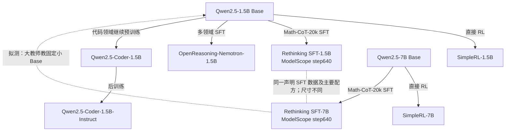

SimpleRL 不同尺寸使用的数据难度档可能不同，不能贴“同数据”标签。Rethinking 的这两个 Qwen2.5 HF repo 是占位入口，实际权重在 ModelScope 的 `step640`；路径见原报告与 CSV。OpenReasoning 和 OpenMath 也不是同一个模型：前者从通用 Base 出发，后者从 Math Base 出发。

## 附录：按训练方式检索前后模型

本附录记录发布模型自己的训练过程。每一项都从明确的前模型出发，说明新增训练怎样得到后模型；本项目后来如何使用这些模型做蒸馏，仍见各实验报告。完整仓库与版本见[登记覆盖表](#inventory)。公开父型号关系与精确父权重一致分别核实。

按需要选择表格：

| 想查的内容             | 表格                                  | 阅读重点                                                  |
| ---------------------- | ------------------------------------- | --------------------------------------------------------- |
| SFT 的数据与示范回答   | [A. SFT](#training-sft)               | 题目来源、回答作者／生成模型、样本量与筛选、训练方式      |
| RL 的任务与奖励        | [B. RL](#training-rl)                 | 任务输入、模型如何作答、评分依据、reward 取值、额外训练项 |
| DPO、OPD、CPT 与合并   | [C. 其他训练方式](#training-other)    | 分别看偏好标签、教师分布、预训练语料或权重合并            |
| SFT＋RL 等连续阶段     | [D. 累计路径](#training-paths)        | 按时间顺序串起各阶段，再回到 A／B／C 查对应设置           |
| 协议适配与来源不明资产 | [E. 特殊条目](#training-unclassified) | 区分训练、输入协议变更和未确认来源                        |

SFT 学习预先准备的“题目＋示范回答”；表里需交代这两部分分别从哪里来。RL 也使用题库，但训练回答由当前策略采样产生，再由评分器给 reward；题库中的标准答案可供评分器使用，不等于拿该答案做 SFT。两种训练分别用各自的表头，不共用“回答标签／reward”一列。

论文、模型卡或固定代码没有披露的部分直接标为“未披露／未确认”。方法说明不代表已取得发布权重对应的完整运行日志；不同项目的数据、预算和输入条件仍须分别比较。

### A. SFT：题目、示范回答和筛选过程

下表只列新增的 SFT 阶段。默认学习目标是在题目条件下预测示范回答的 token；具体样本量、回答来源和筛选方式按模型分别列出。以 Light-R1-7B 为例：初始化是 R1-Distill-7B，题目取 Light 的 3K 难题，示范回答是 R1 生成并经答案核验的长 CoT，训练结果才是 Light-R1-7B-DS。

| 前模型 → SFT 后模型                                                                | 题目／指令来源                                                               | 示范回答由谁提供                                                                 | 样本量与筛选                                                                     | 训练方式、阶段与证据                                                                                                          |
| ---------------------------------------------------------------------------------- | ---------------------------------------------------------------------------- | -------------------------------------------------------------------------------- | -------------------------------------------------------------------------------- | ----------------------------------------------------------------------------------------------------------------------------- |
| Qwen2.5-Math-1.5B → DeepSeek-R1-Distill-Qwen-1.5B                                  | DeepSeek-R1 自建的推理／非推理任务混合；完整题目清单未公开。                 | 推理部分来自 R1 阶段模型生成的正确轨迹；非推理部分沿用 DeepSeek-V3 的数据流程。  | 约 800K：600K 推理＋200K 非推理；推理回答经拒绝采样筛选。                        | 离线蒸馏 SFT；数据教师与权重初始化区分。[^data-r1][^r1]                                                                       |
| Qwen2.5-Math-7B → DeepSeek-R1-Distill-Qwen-7B                                      | DeepSeek-R1 自建的推理／非推理任务混合；完整题目清单未公开。                 | R1 阶段模型生成推理轨迹；非推理部分沿用 DeepSeek-V3 数据流程。                   | 约 800K：600K 推理＋200K 非推理；推理回答经拒绝采样筛选。                        | 7B 从 Math-7B 做蒸馏 SFT；数据教师 R1 的训练历史不计作学生权重阶段。[^data-r1][^r1-distill-7b]                                |
| Qwen2.5-14B → DeepSeek-R1-Distill-Qwen-14B                                         | DeepSeek-R1 自建的推理／非推理任务混合；完整题目清单未公开。                 | R1 阶段模型生成推理轨迹；非推理部分沿用 DeepSeek-V3 数据流程。                   | 约 800K：600K 推理＋200K 非推理；推理回答经拒绝采样筛选。                        | 14B 从通用 Qwen2.5-14B 出发，与 1.5B／7B 的 Math Base 区分。[^data-r1][^r1]                                                   |
| DeepSeek-R1-Distill-Qwen-7B → Light-R1-7B-DS                                       | qihoo360/Light-R1-SFTData 的 stage2；从多源数学题池筛选难题。                | DeepSeek-R1 生成长 CoT 和最终答案。                                              | 约 3K；题目去污染、按难度筛选，回答与标准答案核验后保留正确样本。                | 在已蒸馏的 7B 上再 SFT；从 Math Base 起累计为 SFT→SFT。[^data-light][^light-7b][^light-paper]                                 |
| DeepSeek-R1-Distill-Qwen-1.5B → MiniMath-R1-1.5B                                   | oumi-ai/MetaMathQA-R1；题目来自 MetaMathQA，即 GSM8K／MATH train 的扩增题。  | DeepSeek-R1 为这些题重新生成含思考过程的回答。                                   | 数据卡未声称所有回答都经过正确性过滤；本条不另推断该 checkpoint 实际使用的行数。 | 数学 SFT；从 Math Base 起累计为 R1 蒸馏 SFT→数学 SFT。[^data-minimath][^minimath]                                             |
| DeepSeek-R1-Distill-Qwen-14B → Light-R1-14B-DS′（论文 SFT2）                       | qihoo360/Light-R1-SFTData 的 stage2 难数学题。                               | DeepSeek-R1 生成的正确长 CoT。                                                   | 约 3K；去污染、难度筛选、核验最终答案。                                          | 这是 14B 的第二个 SFT 阶段，也是后续 GRPO 的直接起点；该中间权重未确认官方公开。[^data-light][^light-paper][^light-sft-issue] |
| Qwen3-1.7B-Base → Thinking-Space/Qwen3-1.7B-SFT                                    | lllyx/OpenThought3-Qwen3-4B；prompts 从 OpenThoughts3-1.2M 的数学部分选取。  | Qwen3-4B 在 non-thinking 模式重新回答；不直接使用原 OpenThoughts3 的 responses。 | 去重，清理重复／退化输出；精确样本量未在本条核定。                               | 全参数 SFT，2 epochs；历史简称“DeepMath SFT”不代表使用 DeepMath 数据集。[^thinking-sft-fixed]                                 |
| Qwen3-1.7B（官方后训练） → SamsungSAILMontreal/Qwen3-1.7B-Math                     | openai/gsm8k，main 配置的 train split。                                      | 直接使用 GSM8K 训练集提供的解题回答／答案字段；未声明另由大模型重写。            | 使用 train split；模型卡未另列重采样或筛选子集。                                 | 全参数、completion-only SFT；父模型为官方 Qwen3-1.7B。[^samsung]                                                              |
| Qwen3-4B-Base → jasonrqh/Qwen3-4B_Math-CoT-20k_lr5e-5_ep8_bs256 的 step80／step640 | jasonrqh/Math-CoT-20k；题目采自 OpenR1-Math-220k 的 default 子集。           | Qwen3-32B 开启 thinking 生成长 CoT。                                             | 20,480 条；Math-Verify 筛正确答案，每题保留一条正确回答。                        | step80／step640 是同一 SFT run 的早晚 checkpoint，不是本项目的学生更新数。[^data-mathcot][^qwen-sft-stages]                   |
| Llama-3.2-3B-Instruct（公开父型号） → Llama-3.2-3B-Instruct-arithmetic-full        | 算术任务；模型卡的 Dataset 字段仍是占位，原始题库／生成器／版本未披露。      | 未披露由人工还是模型生成，也未披露解答核验方法。                                 | 模型卡声明 20000 条样本。                                                        | 模型卡声明全参数微调；作者的公开 Llama 父型号与本项目实际 Unsloth 镜像分别核实。[^llama-arithmetic]                           |
| Llama-3.1-8B Base → Llama-3.1-Tulu-3-8B-SFT                                        | allenai/tulu-3-sft-mixture；一般对话、数学、代码、安全、多语和精确指令混合。 | 沿用各子集的人工或模型回答；不存在统一的单一数据教师。                           | 公开、人类标注和合成数据按最终 SFT mixture 混合；完整组成见数据集与论文。        | Tulu 链第一步；后面的 DPO 偏好优化单独列在 C1。[^data-tulu-sft][^tulu]                                                        |
| MiMo-7B-Base → MiMo-7B-SFT                                                         | 原版 MiMo 的开源＋私有蒸馏数据；逐子集清单未完整披露。                       | 蒸馏产生的回答；具体数据教师未完整披露，不能全部归为 R1。                        | 约 500K；过滤 benchmark 重叠、混语和不完整回答；不混入后续 0530 的 6M 版本。     | 从 MiMo Base 做 SFT；与同 Base 的 RL-Zero 是不同分支。[^mimo]                                                                 |
| Olmo-3-1025-7B → BayesRL/Olmo3-IVON-SFT-7B                                         | nvidia/Llama-Nemotron-Post-Training-Dataset 的 SFT 子集。                    | 使用该子集已有的监督回答。                                                       | 精确子集行清单未在模型卡给出。                                                   | 使用 IVON 优化 SFT loss；该终点作为后续 C3PO 的 warm start。[^bayes-sft]                                                      |
| deepseek-math-7b-base → deepseek-math-7b-instruct                                  | 中英文数学：GSM8K、MATH、MathInstruct 子集、Lila-OOD 与中文 K-12 等题目。    | 配套 CoT、PoT 和工具推理解答；GSM8K／MATH 额外标注工具推理解答。                 | 总计约 776K；不同任务的解答形式分别保留。                                        | Base 此前已做数学 CPT；本项目该阶段链的资产仍登记，原 E69／E70 方案已撤销。[^data-dsmath][^dsmath]                            |

### B. RL：任务、作答过程和 reward

这里的每条训练通常先从题库取一个任务，让当前策略生成回答，再评分并更新参数。数学任务主要抽取最终答案后判分；代码任务还会在隔离执行环境运行测试；指令任务检查生成文本是否满足约束。“环境”包括这些输入和反馈过程，不一概指多轮交互模拟器。

下表把**任务 reward**与**优化设置**分列。GRPO、PPO、RLOO 是优化方法；KL 和熵项是额外的优化项；长度奖励则会改变任务得分。已公开的取值写明，例如正确得 1、错误得 0；没有公开评分函数时保留未知。

#### B1. 数学任务：用标准答案或规则判分

模型自己生成解答，评分器用题库标准答案检查最终结果。标准答案在这里供评分使用，与 A 表中被模型逐 token 学习的示范回答用途不同。

| 前模型 → RL 后模型                                                  | 训练题目来源与作答环境                                                                                                                           | reward：依据、计算规则与取值                                                                                                               | 优化设置、阶段与证据限制                                                                                                                           |
| ------------------------------------------------------------------- | ------------------------------------------------------------------------------------------------------------------------------------------------ | ------------------------------------------------------------------------------------------------------------------------------------------ | -------------------------------------------------------------------------------------------------------------------------------------------------- |
| Qwen3-1.7B-Base → GT-Qwen3-1.7B-Base-MATH                           | MATH train；输入一道数学题，模型生成完整解答，再抽取最终答案。[^gt-math]                                                                         | 提取最终答案，与 MATH ground truth 数学答案比较：正确得 1，错误得 0。[^data-coreward]                                                      | GRPO 的 GT 基线；从 Qwen3 Base 直接训练。[^gt-math]                                                                                                |
| Qwen3-4B-Base → Thinking-Space/Qwen3-4B-Base-GRPO                   | DAPO-Math-17k-Processed 的数学 prompts；单轮解题，没有外部交互式模拟器。[^grpo4]                                                                 | 自定义规则数学正确性评分；模型卡没有公开完整 verifier 函数，不能据 GRPO 名称补写具体取值。[^grpo4]                                         | 直接 GRPO；禁用 learned RM、独立格式奖励与 KL loss。[^grpo4]                                                                                       |
| Llama-3.1-8B Base → Llama-3.1-8B-SimpleRL-Zoo                       | hkust-nlp/SimpleRL-Zoo-Data，来源为 GSM8K／MATH train；论文分 easy／medium／hard，每档约 8K，当前 Llama 权重卡未绑定确切难度档。[^data-simplerl] | 最终答案正确得 +1，错误得 0。[^data-simplerl]                                                                                              | GRPO；主配方不加格式奖励。数据难度档未绑定该 Llama 权重，不能从其他尺寸推断。[^simple][^data-simplerl]                                             |
| DeepSeek-R1-Distill-Qwen-1.5B → JustRL-DeepSeek-1.5B                | BytedTsinghua-SIA/DAPO-Math-17k；数学题→完整回答→最终答案核验，无离线难度过滤或动态重采样。[^data-justrl]                                        | DAPO 字符串匹配 verifier：最终答案正确得 1，否则 0；不用 SymPy。[^data-justrl]                                                             | 标准 GRPO；没有显式长度惩罚，不做离线难度过滤或动态重采样。父模型已经做过 R1 蒸馏 SFT。[^data-justrl]                                              |
| DeepSeek-R1-Distill-Qwen-1.5B → DeepScaleR-1.5B-Preview             | 约 40K 数学 problem–answer 对：AIME 1984–2023、2023 年前 AMC、Omni-MATH、STILL；公开 DeepScaleR-Preview-Dataset。[^data-deepscaler]              | 最终答案通过 LaTeX／SymPy 检查得 1；错误或格式不合要求得 0。不使用中间步骤／PRM 部分奖励。[^data-deepscaler]                               | 数学 RL；与 JustRL 是不同分支，不能互换判分器。[^data-deepscaler]                                                                                  |
| DeepSeek-R1-Distill-Qwen-7B → Polaris-7B-Preview                    | 公开 Polaris-Dataset-53K，从 DeepScaleR-40K 与 AReaL-106K 筛选；仓库明确提供 4B parquet，7B 的精确清单仍待核对。[^data-polaris]                  | 模型卡声明沿用 DeepScaleR 数学评分，按最终答案正确性反馈；发布 checkpoint 对应的 verifier revision 与额外奖励项未单独披露。[^data-polaris] | 数学 RL；父模型为 R1-Distill-7B，见[实际配对](../../research/studies/boundary/common.py)。                                                         |
| DeepSeek-R1-Distill-Qwen-7B → Skywork-OR1-Math-7B                   | Skywork-OR1-RL-Data 的数学任务；项目系列数据池含约 110K 数学＋14K 代码题，但不能将系列总量等同于 Math-7B 的实际清单。[^skywork]                  | 二元正确性分（1/0）。抽取推理后的答案，先比较 Math-Verify 解析出的字符串，再回退到数学等价验证。[^data-skywork-reward]                     | 定制 GRPO；熵控制是独立优化项。父模型为 R1-Distill-7B，未从 Math Base 直接 RL。[^skywork]                                                          |
| Light-R1-14B-DS′（论文 SFT2） → Light-R1-14B-DS                     | 去重 Big-Math；用 Light-R1-7B-DS 离线估计难度，过滤过易、过难或无法可靠验证的题。[^light-paper]                                                  | 规则最终答案分＋修改后的长度奖励。对正确答案的缩短奖励作截断，避免训练初期回答长度塌缩；因此总 reward 不只是答案正确性。[^light-paper]     | GRPO；直接父权重是追加 3K SFT 后的 DS′，不是原版 R1-Distill-14B。[^light-paper]                                                                    |
| BayesRL/Olmo3-IVON-SFT-7B → BayesRL/Olmo3-C3PO-7B                   | BytedTsinghua-SIA/DAPO-Math-17k；数学单轮生成后核验答案。[^bayes-rl]                                                                             | 固定 math_dapo 代码分支抽取答案并规则验证：正确得 1，错误得 0。该函数关闭独立格式罚分。[^data-c3po-reward]                                 | C3PO 含参数扰动探索与 Seq-MIS。数据标签对应的评分分支需随执行配置核对；公开来源支持此 SFT 前序，未逐字节核验 RL step0。[^bayes-code][^bayes-paper] |
| Qwen3-1.7B → e3-1.7B                                                | DeepScaleR 数学题按难度划分；公开 CMU-AIRe/e3-math-easy 与 e3-math-medhard 两阶段数据；HMMT／AIME-2025 是测试集。[^data-e3]                      | 按最终解答正确性给 outcome reward：正确 1、错误 0。[^e3]                                                                                   | e3 联合调整题目难度与输出预算；其合成任务分析不全部属于发布数学模型的训练集。父模型为官方后训练 Qwen3。[^e3]                                       |
| Qwen3-1.7B → Qwen3-1.7B-GRPO-KL-math-reasoning                      | 模型卡列 gsm8k_train＋math_train；数学单轮生成。gsm8k_test 与 math_500 是评测集。[^grpo]                                                         | 未披露该 checkpoint 的具体评分函数、reward 取值或格式项。模型卡只明确数学 GRPO＋KL penalty；KL 不构成评分规则。[^grpo]                     | GRPO＋KL penalty；具体任务 reward 未披露，不能用算法或正则项补写。[^grpo]                                                                          |
| Qwen3-4B → Polaris-4B-Preview                                       | 公开 Polaris-Dataset-53K，从 DeepScaleR-40K 与 AReaL-106K 筛选；仓库明确提供 4B parquet，7B 的精确清单仍待核对。[^data-polaris]                  | 沿用 DeepScaleR 数学评分，按最终答案正确性反馈；该发布 checkpoint 的 verifier revision 和额外奖励项未单独披露。[^data-polaris]             | 从官方已后训练的 Qwen3-4B 继续 RL，初始化不是 Qwen3-4B-Base。[^polaris4]                                                                           |
| Llama-3.2-3B-Instruct（公开父型号） → GT-Llama-3.2-3B-Instruct-MATH | MATH train；同 Qwen GT 系列的数学问答任务，但父模型是 Llama Instruct。[^data-coreward]                                                           | 对最终答案与 MATH ground truth 作数学判等：正确 1、错误 0。[^data-coreward]                                                                | GT 奖励 RL；父型号为 Llama Instruct，精确父权重与本项目 Unsloth 镜像分别核实。                                                                     |

#### B2. 自监督数学 RL：用伪标签评分

GT 基线用题库标准答案评分；Co-rewarding 用训练中产生的伪标签评分。I 的伪标签来自另一种题面，II 的伪标签来自慢更新的参考教师。下表将“谁提供标签”和“如何打分”写在同一 reward 单元格中。

| 前模型 → RL 后模型                                                              | 训练题目来源与作答环境                                                                                     | reward：依据、计算规则与取值                                                                                                                               | 优化设置、阶段与证据限制                                                                                                                                   |
| ------------------------------------------------------------------------------- | ---------------------------------------------------------------------------------------------------------- | ---------------------------------------------------------------------------------------------------------------------------------------------------------- | ---------------------------------------------------------------------------------------------------------------------------------------------------------- |
| Qwen3-1.7B-Base → Co-rewarding-I-Qwen3-1.7B-Base-MATH                           | MATH train＋语义等价改写题；公开 Co-rewarding-RephrasedMATH，主配方用 Qwen3-32B 改写题面。[^data-coreward] | 原题与改写题分别采样并多数投票。原题回答匹配改写题的多数答案得 1，否则 0；改写题反过来用原题的多数答案评分。训练不以 GT 作为 reward 标签。[^data-coreward] | Co-rewarding-I 自监督 RL；没有另列 SFT 中间阶段。改写题数据流程与精确执行超参分别核实。[^coreward-i][^coreward-code]                                       |
| Qwen3-1.7B-Base → Co-rewarding-II-Qwen3-1.7B-Base-MATH                          | MATH train；同题上由慢更新参考教师和学生分别采样，不要求另一份改写题。[^coreward-ii]                       | 慢更新参考教师在同题上采样、多数投票形成伪标签。学生最终答案匹配该伪标签得 1，否则 0；不是用教师的整段回答做 SFT。[^data-coreward]                         | Co-rewarding-II 自监督 RL；慢教师和伪标签用于 reward，不是新增 SFT 阶段。公开通用启动脚本不替代 MATH checkpoint 的执行日志。[^coreward-ii][^coreward-code] |
| Llama-3.2-3B-Instruct（公开父型号） → Co-rewarding-I-Llama-3.2-3B-Instruct-MATH | MATH train＋改写题；沿用 Co-rewarding-I 跨题面视角监督。[^coreward-llama]                                  | 原题和语义等价改写题互相提供多数投票伪标签：与另一视角的多数答案一致得 1，否则 0；不以 GT 作为训练 reward。[^data-coreward]                                | Co-rewarding-I RL；父型号为 Llama Instruct，保留其已有后训练历史。[^coreward-llama]                                                                        |

#### B3. 代码、指令和多领域 RL

代码通过测试、满足部分指令约束与数学最终答案正确是不同的评分对象。同一模型覆盖多个领域时，分别保留各领域的计分规则。

| 前模型 → RL 后模型                                                       | 训练题目来源与作答环境                                                                                                                                                           | reward：依据、计算规则与取值                                                                                                                                                          | 优化设置、阶段与证据限制                                                                                                         |
| ------------------------------------------------------------------------ | -------------------------------------------------------------------------------------------------------------------------------------------------------------------------------- | ------------------------------------------------------------------------------------------------------------------------------------------------------------------------------------- | -------------------------------------------------------------------------------------------------------------------------------- |
| MiMo-7B-Base → MiMo-7B-RL-Zero                                           | 数学与代码单轮生成：约 100K 数学题＋30K 带测试代码题，来自开源及自采集题池；代码用 online judge 执行。[^mimo]                                                                    | 数学：Math-Verify 判断最终答案。代码：按测试难度分组给分；论文列出 strict（需通过该组及更简单组全部测试）和 soft（按通过测试累加分数）两种方案，未将此发布分支绑定到其中一种。[^mimo] | 修改版 GRPO；主配方无额外格式奖励或长度惩罚。从 Base 直接 RL，未经过公开 MiMo-SFT 阶段。[^mimo]                                  |
| DeepSeek-R1-Distill-Qwen-1.5B → Nemotron-Research-Reasoning-Qwen-1.5B v1 | 五域：DeepScaleR 数学、Eurus-2-RL-Data 代码、SCP-116K 筛选 STEM、Reasoning Gym 逻辑题、Llama-Nemotron 指令约束。[^prorl]                                                         | 数学：DeepScaleR／Math-Verify 二元分；代码：通过测试比例；STEM：二元答案分；逻辑：Reasoning Gym 任务 verifier；指令：约束满足分。五域的计分方式不同。[^prorl]                         | ProRL／GRPO 配方；必须固定 v1 revision，与后来的 brorl 区分。[^prorl][^nemotron]                                                 |
| ProRLv2 近终点 checkpoint → Nemotron-Research-Reasoning-Qwen-1.5B brorl  | 沿用 ProRLv2 的数学、代码、science、IFEval、Reasoning Gym 五类任务；精确混合比例／行清单未独立给出。[^brorl]                                                                     | 继续使用可验证任务反馈；具体 verifier 参数及各项奖励系数未独立确认，不能直接套用 v1 的全部设置。[^brorl]                                                                              | BroRL 扩大每题采样数并继续 419 steps；精确起始 revision 未公开，不能把公开 v2 最终权重当作已核实的直接父模型。[^brorl]           |
| DeepSeek-R1-Distill-Qwen-1.5B → DeepCoder-1.5B-Preview                   | 约 24K 编程题–测试对：TACO-Verified、PrimeIntellect SYNTHETIC-1、LiveCodeBench v5 的 2023-05 至 2024-07 子集。[^deepcoder15]模型生成代码后，在隔离执行环境中运行题目对应的测试。 | 作者项目配方为：通过全部抽样测试得 1，任一失败或代码格式错误得 0；不按通过测试比例给部分分。[^data-deepcoder-reward]                                                                  | 代码 RL；1.5B 的测试抽样数／超时是否完全等同于 14B 配方未单独披露。公开与本地内容版本见[资产区别](#local-assets)。[^deepcoder15] |
| DeepSeek-R1-Distill-Qwen-1.5B → UltraData-IF-1.5B                        | openbmb/UltraData-SFT-2605 的 instruction-following 子集；任务是生成满足若干可验证约束的文本。[^ultra]模型生成文本后，由约束检查器逐项检验。                                     | 得分＝满足的指令约束数／总约束数；这是连续的约束满足比例。[^ultra]                                                                                                                    | GRPO；无 KL 正则、无 entropy bonus。数据集名称含 SFT，但本阶段用指令约束反馈更新；登记不代表已完成本项目实验。[^ultra]           |
| MiMo-7B-SFT → MiMo-7B-RL                                                 | 数学与代码单轮生成：约 100K 数学题＋30K 带测试代码题，来自开源及自采集题池；代码用 online judge 执行。[^mimo]                                                                    | 数学用 Math-Verify；代码按测试难度分组给分。strict 方案要求通过当前及更简单组的全部测试，soft 方案按通过测试累加；该发布分支对应哪种方案未独立确认。[^mimo]                           | 主配方无额外格式奖励或长度惩罚；从 SFT 终点继续 RL，与 RL-Zero 的初始化不同。[^mimo]                                             |
| Llama-3.1-Tulu-3-8B-DPO → Llama-3.1-Tulu-3-8B                            | GSM8K train、MATH train 与合成指令约束 prompts，合计约 30K；数学答案和约束都有可执行检查器。[^tulu]                                                                              | 可验证目标 v：通过检查得 10，否则 0。GSM8K 检查最终数字，MATH 用 flex 判分，指令任务逐项检查约束。[^tulu]                                                                             | PPO 的 RLVR 阶段；最终 8B 的一般 RM 权重为 0，KL 单列为正则。前序为 Tulu SFT→DPO。[^tulu]                                        |

#### B4. 使用学得的 reward model

该类训练由另一个学习得到的模型给分。表中区分 reward model 的训练与被优化策略的训练，不将它写成固定答案判等函数。

| 前模型 → RL 后模型                              | 训练题目来源与作答环境                                                             | reward：依据、计算规则与取值                                                                                                                                           | 优化设置、阶段与证据限制                                          |
| ----------------------------------------------- | ---------------------------------------------------------------------------------- | ---------------------------------------------------------------------------------------------------------------------------------------------------------------------- | ----------------------------------------------------------------- |
| deepseek-math-7b-instruct → deepseek-math-7b-rl | 从 SFT 集抽出的 GSM8K／MATH CoT 题，约 144K；不包含 SFT 的全部领域。[^data-dsmath] | 由训练出的 reward model 评分；论文§4.2 从 DeepSeekMath-Base-7B 初始化该 RM。不能将它等同于规则 0/1 verifier；论文另讨论 outcome／process／迭代 RM 方案。[^data-dsmath] | GRPO；RM 训练与策略更新是不同环节。累计链是 CPT→SFT→RL。[^dsmath] |

#### B5. 仅保留在实验附录中的 RLVR 模型

| 前模型 → RL 后模型                       | 训练题目来源与作答环境                                                                    | reward：依据、计算规则与取值                                                               | 优化设置、阶段与证据限制                                                                                                                                 |
| ---------------------------------------- | ----------------------------------------------------------------------------------------- | ------------------------------------------------------------------------------------------ | -------------------------------------------------------------------------------------------------------------------------------------------------------- |
| Qwen3-1.7B → tocsa/qwen3-1.7b-rlvr-gsm8k | openai/gsm8k train 的 200 条样本；小学数学文字题，SageMaker 上做 LoRA RLVR。[^data-tocsa] | 模型卡仅声明 verifiable rewards；判分代码、正确／错误取值和格式权重均未披露。[^data-tocsa] | LoRA rank32／alpha64，2 epochs；完整权重的合并过程未独立核验。仅作[附录诊断](../experiments/teacher-transfer/appendix/qwen3-rlvr-gsm8k.md)，不计主比较。 |

### C. 其他训练方式：分别列出训练材料和目标

以下方法各有自己的监督材料。DPO 使用偏好对，OPD 使用教师分布，CPT 使用连续文本；多阶段发布模型则逐步注明已经披露的操作。

#### C1. DPO：偏好对

| 前模型 → 后模型                                   | 偏好数据来源                                                                         | 偏好标签由谁确定                                                  | 训练目标与阶段                                                              |
| ------------------------------------------------- | ------------------------------------------------------------------------------------ | ----------------------------------------------------------------- | --------------------------------------------------------------------------- |
| Llama-3.1-Tulu-3-8B-SFT → Llama-3.1-Tulu-3-8B-DPO | allenai/llama-3.1-tulu-3-8b-preference-mixture；多模型生成候选回答。[^data-tulu-dpo] | LLM judge 评分，主实验使用 GPT-4o，组成 chosen／rejected 回答对。 | 直接优化 DPO 偏好目标；评分在离线构建数据时完成，后续 RLVR 另见 B3。[^tulu] |

#### C2. OPD：学生轨迹上的教师分布

| 前模型 → 后模型                                      | 训练题目和轨迹                       | 教师是谁、提供什么                                     | 训练目标与阶段                                                                                                                             |
| ---------------------------------------------------- | ------------------------------------ | ------------------------------------------------------ | ------------------------------------------------------------------------------------------------------------------------------------------ |
| Qwen3-1.7B-Base → Thinking-Space/Qwen3-1.7B-Base-OPD | DAPO prompts；学生自己采样生成轨迹。 | Qwen3-4B-Base-GRPO 在相同前缀提供教师 log-prob／分布。 | 模型卡注明 k1 与 policy-gradient 项；学习信号来自教师分布，不使用数学 GT 正确性作为此步任务 reward。教师自身的 RL 不计入学生权重链。[^opd] |

#### C3. 官方小模型的离线与在线蒸馏

| 前模型 → 后模型                              | 离线阶段                               | 在线阶段                           | 公开信息范围                                                                                                                        |
| -------------------------------------------- | -------------------------------------- | ---------------------------------- | ----------------------------------------------------------------------------------------------------------------------------------- |
| 各尺寸 Qwen3 Base → Qwen3-0.6B／1.7B／4B／8B | 使用大教师生成的多任务回答做离线蒸馏。 | 使用小模型自己的轨迹匹配教师分布。 | 各尺寸分别初始化；官方 strong-to-weak distillation，逐数据集与行清单未完整公开。小模型不直接继承大教师训练时的环境 reward。[^qwen3] |

#### C4. CPT：继续预训练语料

| 前模型 → 后模型                                     | 语料来源                          | 语料规模与混合                                                  | 训练目标与后续阶段                                                                   |
| --------------------------------------------------- | --------------------------------- | --------------------------------------------------------------- | ------------------------------------------------------------------------------------ |
| DeepSeek-Coder-7B-Base-v1.5 → deepseek-math-7b-base | Common Crawl 迭代筛选的数学文本。 | 数学语料约 120B token；继续预训练还混合代码、arXiv 与通用文本。 | 自回归 next-token 预测；其后的问答 SFT 与 RL 分别见 A 和 B4。[^data-dsmath][^dsmath] |

#### C5. SFT、RL 与权重合并组合发布

前模型为 Llama-3.1-8B-Instruct，最终模型为 **Llama-3.1-Nemotron-Nano-8B-v1**。公开模型卡支持以下阶段，但没有给出所有中间 checkpoint 的精确初始化链。[^nemotron-nano]

| 阶段 | 该阶段使用的材料                                       | 训练／处理方式                    | 已知信息与缺口                                                        |
| ---- | ------------------------------------------------------ | --------------------------------- | --------------------------------------------------------------------- |
| SFT  | 多源人工标注和合成回答，覆盖数学、代码、推理、工具等。 | 学习配套的监督回答。              | 逐数据集及样本清单未披露。                                            |
| RL   | 聊天／指令等任务中由策略产生的回答。                   | 公开方法包含 RLOO 与 Online RPO。 | 每个 RL 阶段的 reward 函数、取值和权重未披露，不能由算法名推断。      |
| 合并 | SFT 终点与 Online RPO 终点权重。                       | 合并得到最终 Nano 发布权重。      | 合并操作本身不新增训练数据或 reward，不能省略这一步。[^nemotron-nano] |

### D. 累计路径：按时间顺序连接训练阶段

累计路径从表中指定的比较起点开始。SFT→RL 表示先得到 SFT checkpoint，再用该权重初始化 RL；它不表示同一步混合两种 loss。每个阶段的详细设置分别位于 A／B／C，下面只负责把前后模型串起来，避免再次混合数据来源和 reward 字段。

例如：Light-R1-7B 的两步都是 SFT，分别查 A 表的 R1-Distill-7B 与 Light-R1-7B 两行；MiMo-7B-RL 先查 A 表的 MiMo-SFT，再查 B3 的 MiMo-RL；MiMo-RL-Zero 则直接从 Base 进入 B3 的 RL，不经过 SFT 行。

| 累计训练方式         | 比较起点                                  | 中间阶段或模型                              | 最终模型                                                      | 阶段详情与解释限制                                                                                                            |
| -------------------- | ----------------------------------------- | ------------------------------------------- | ------------------------------------------------------------- | ----------------------------------------------------------------------------------------------------------------------------- |
| SFT                  | 对应的 Qwen2.5-Math-1.5B／7B、Qwen2.5-14B | R1 回答上的蒸馏 SFT                         | 对应尺寸 R1-Distill-Qwen                                      | [SFT 数据与回答](#training-sft)。1.5B／7B 从 Math Base 出发，14B 从通用 Base 出发                                             |
| SFT                  | Qwen3-1.7B-Base                           | 全参数 SFT                                  | Thinking-Space/Qwen3-1.7B-SFT                                 | [SFT 数据与回答](#training-sft)。数据来自 Qwen3-4B non-thinking 回答                                                          |
| SFT                  | Qwen3-4B-Base                             | Math-CoT-20k SFT                            | jasonrqh Math-CoT 4B step80／step640                          | [SFT 数据与回答](#training-sft)。同一 SFT run 的两个 checkpoint                                                               |
| SFT                  | MiMo-7B-Base                              | SFT                                         | MiMo-7B-SFT                                                   | [SFT 数据与回答](#training-sft)。与 RL-Zero 分支区分                                                                          |
| SFT                  | Olmo-3-1025-7B                            | IVON-SFT                                    | BayesRL/Olmo3-IVON-SFT-7B                                     | [SFT 数据与回答](#training-sft)。之后可继续 C3PO RL                                                                           |
| SFT                  | Llama-3.1-8B Base                         | Tulu SFT                                    | Llama-3.1-Tulu-3-8B-SFT                                       | [SFT 数据与回答](#training-sft)。之后可继续 DPO 与 RLVR                                                                       |
| SFT→SFT              | Qwen2.5-Math-7B                           | R1-Distill-Qwen-7B → 3K SFT                 | Light-R1-7B-DS                                                | [SFT 数据与回答](#training-sft)。7B 发布版本是两次 SFT，没有追加 RL                                                           |
| SFT→SFT              | Qwen2.5-Math-1.5B                         | R1-Distill-Qwen-1.5B → 数学 SFT             | MiniMath-R1-1.5B                                              | [SFT 数据与回答](#training-sft)。追加阶段仍是 SFT                                                                             |
| 直接 RL              | Qwen3-1.7B-Base                           | 各自 GT／Co-rewarding-I／Co-rewarding-II RL | GT-Base-MATH、Co-rewarding-I／II-Qwen3-1.7B-Base-MATH         | [RL 环境与奖励](#training-rl)。三个独立 RL 分支，不是 I→II 的连续训练                                                         |
| 直接 RL              | Qwen3-4B-Base                             | DAPO 17K 上 GRPO                            | Thinking-Space/Qwen3-4B-Base-GRPO                             | [RL 环境与奖励](#training-rl)。与 Math-CoT SFT 分支的数据和方法不同                                                           |
| 直接 RL              | MiMo-7B-Base                              | RL                                          | MiMo-7B-RL-Zero                                               | [RL 环境与奖励](#training-rl)。未经过公开 MiMo-SFT 阶段                                                                       |
| 直接 RL              | Llama-3.1-8B Base                         | SimpleRL                                    | Llama-3.1-8B-SimpleRL-Zoo                                     | [RL 环境与奖励](#training-rl)。与 Tulu 阶段链区分                                                                             |
| SFT→RL               | Qwen2.5-Math-1.5B                         | R1-Distill-Qwen-1.5B → 各自 RL              | JustRL、DeepScaleR、Nemotron v1、DeepCoder-1.5B、UltraData-IF | [SFT 数据与回答](#training-sft)；[RL 环境与奖励](#training-rl)。每个终点都是独立后训练分支                                    |
| SFT→RL               | Qwen2.5-Math-7B                           | R1-Distill-Qwen-7B → 各自数学 RL            | Polaris-7B、Skywork-OR1-Math-7B                               | [SFT 数据与回答](#training-sft)；[RL 环境与奖励](#training-rl)。与 Light-R1-7B 的 SFT→SFT 路径区分                            |
| SFT→RL               | MiMo-7B-Base                              | MiMo-7B-SFT                                 | MiMo-7B-RL                                                    | [SFT 数据与回答](#training-sft)；[RL 环境与奖励](#training-rl)。RL-Zero 走另一条 Base→RL 分支                                 |
| SFT→RL               | Olmo-3-1025-7B                            | BayesRL/Olmo3-IVON-SFT-7B                   | BayesRL/Olmo3-C3PO-7B                                         | [SFT 数据与回答](#training-sft)；[RL 环境与奖励](#training-rl)。这条 BayesRL 链没有 DPO 中间阶段                              |
| SFT→SFT→RL           | Qwen2.5-14B                               | R1-Distill-14B → Light-R1-14B-DS′           | Light-R1-14B-DS                                               | [SFT 数据与回答](#training-sft)；[RL 环境与奖励](#training-rl)。RL 的直接起点是 SFT2，其公开权重缺失；SFT1 是更早阶段         |
| SFT→RL→继续 RL       | Qwen2.5-Math-1.5B                         | R1-Distill → ProRLv2 近终点                 | Nemotron brorl                                                | [SFT 数据与回答](#training-sft)；[RL 环境与奖励](#training-rl)。精确 ProRLv2 起始 revision 未公开                             |
| SFT→DPO              | Llama-3.1-8B Base                         | Tulu-3-8B-SFT                               | Tulu-3-8B-DPO                                                 | [SFT 数据与回答](#training-sft)；[其他阶段](#training-other)。DPO 单列，避免隐藏偏好训练阶段                                  |
| SFT→DPO→RLVR         | Llama-3.1-8B Base                         | Tulu-SFT → Tulu-DPO                         | Llama-3.1-Tulu-3-8B                                           | [SFT 数据与回答](#training-sft)；[RL 环境与奖励](#training-rl)；[其他阶段](#training-other)。完整三阶段链                     |
| CPT→SFT→RL           | DeepSeek-Coder-7B-Base-v1.5               | DeepSeekMath-Base → Instruct                | deepseek-math-7b-rl                                           | [SFT 数据与回答](#training-sft)；[RL 环境与奖励](#training-rl)；[其他阶段](#training-other)。若从 Math Base 起计，则是 SFT→RL |
| 官方后训练／蒸馏→RL  | 对应尺寸 Qwen3 Base                       | 官方 Qwen3-1.7B／4B                         | e3、GRPO-KL（1.7B）；Polaris-4B（4B）                         | [RL 环境与奖励](#training-rl)；[其他阶段](#training-other)。官方父模型的阶段不压缩为“纯 SFT”                                  |
| 官方后训练／蒸馏→SFT | Qwen3-1.7B-Base                           | 官方 Qwen3-1.7B                             | Samsung Qwen3-1.7B-Math                                       | [SFT 数据与回答](#training-sft)；[其他阶段](#training-other)。新增的是 GSM8K SFT；不等于 Base 直接 SFT                        |
| Instruct→SFT／RL     | Llama-3.2-3B-Instruct                     | 各自算术 SFT、GT RL 或 Co-rewarding RL      | arithmetic-full、GT-MATH、Co-rewarding-I-MATH                 | [SFT 数据与回答](#training-sft)；[RL 环境与奖励](#training-rl)。从已有 Instruct 终点起计，保留此前官方后训练历史              |
| OPD                  | Qwen3-1.7B-Base                           | 4B-Base-GRPO 提供教师分布                   | Thinking-Space 1.7B-Base-OPD                                  | [其他阶段](#training-other)。教师的 RL 阶段不计入学生的权重训练链                                                             |
| 多阶段＋合并         | Llama-3.1-8B-Instruct                     | SFT、多个 RL 阶段；SFT／Online RPO 终点合并 | Nemotron-Nano-8B-v1                                           | [其他阶段](#training-other)。保留合并操作，不画成单一路径终点                                                                 |

### E. 起点、身份适配与来源未完整披露的条目

| 类别                         | 前后模型／身份                                                                                                         | 处理方式                                                                                             |
| ---------------------------- | ---------------------------------------------------------------------------------------------------------------------- | ---------------------------------------------------------------------------------------------------- |
| 作为比较起点的 Base          | Qwen2.5-Math-1.5B／7B、Qwen2.5-14B、Qwen3 各尺寸 Base、MiMo-7B-Base、Olmo-3-1025-7B、Llama-3.1-8B Base                 | 作为上述转换的起点；未在本文确认的更早预训练过程不补画为 SFT 或 RL。部分祖先未在本项目下载           |
| 官方 Instruct 发布身份／镜像 | Meta Llama-3.2-1B／3B-Instruct、Llama-3.1-8B-Instruct → 本地使用的 Unsloth BF16 镜像                                   | 镜像来源关系不代表新增训练；未逐字节核实 Meta 与 Unsloth 权重相等                                    |
| 官方 2507 发布终点           | 前序精确 checkpoint 未确认 → Qwen3-4B-Thinking-2507、4B-Instruct-2507、30B-A3B-Instruct-2507                           | 保留官方后训练标签；不根据名称从 April 权重补造 SFT／RL 箭头                                         |
| 共同 tokenizer 协议适配      | Olmo3 Base／IVON-SFT／C3PO → 三个 BayesProtocol 身份；Qwen2.5-14B／R1-Distill-14B／Light-R1-14B → 三个 R1Protocol 身份 | 注册表声明 weight_edit=none，原权重不变；不使用新的训练数据或 reward，见[协议资产](#protocol-assets) |
| 同型号的本地内容身份         | DeepCoder-1.5B-Preview 公开型号 ↔ 本地 ModelScope 镜像内容身份                                                         | 来源关系与内容哈希分别保存，不据镜像名称推断精确发布 SHA 或新增训练                                  |
| 来源未知                     | 未确认的上游 → local/Qwen3.5-27B、local/Qwen3.8-27B                                                                    | 仅有本地内容身份，暂不分类为 SFT、RL 或 SFT＋RL                                                      |
| 仅附录的 LoRA RLVR           | Qwen3-1.7B → tocsa/qwen3-1.7b-rlvr-gsm8k                                                                               | B5 表可检索，但不加入主比较图、主谱系图或主比较计数                                                  |

仅在文献调研中出现的 Qwen2.5 通用 SFT／SimpleRL／Coder CPT、Marin、官方 Olmo3／Hybrid、DeepCoder-14B 等候选仍见[候选模型](#候选模型与论文配对)及各家族说明；本附录不把它们列成本项目已完成训练。训练终点的本地存在也不证明其直接父 revision 已核实。

### 参考文献

[^coin]: Li et al. _Every Coin Has Two Sides: On the Dual Nature of Generalization in On-Policy Distillation of Large Language Models_. [2608.16647v3](https://arxiv.org/abs/2608.16647v3)，表 3、模型谱系与附录实验；[既有精读笔记](../literature/teacher-transfer/2026-10-26-策略蒸馏泛化的双重性实验与设置.md)。

[^minimath]: Oumi AI. [MiniMath-R1-1.5B 模型卡](https://huggingface.co/oumi-ai/MiniMath-R1-1.5B)。

[^deepcoder15]: Agentica. [DeepCoder-1.5B 模型卡](https://huggingface.co/agentica-org/DeepCoder-1.5B-Preview)。

[^star]: _STAR-1: Safer Alignment of Reasoning LLMs with 1K Data_. [2504.01903](https://arxiv.org/abs/2504.01903)。

[^prorl]: _ProRL: Prolonged Reinforcement Learning Expands Reasoning Boundaries in Large Language Models_. [2505.24864](https://arxiv.org/abs/2505.24864)。

[^brorl]: _BroRL: Scaling Reinforcement Learning via Broadened Exploration_. [2510.01180](https://arxiv.org/abs/2510.01180)。

[^nemotron]: NVIDIA. [Nemotron-Research-Reasoning-Qwen-1.5B 模型卡](https://huggingface.co/nvidia/Nemotron-Research-Reasoning-Qwen-1.5B)；[v1](https://huggingface.co/nvidia/Nemotron-Research-Reasoning-Qwen-1.5B/tree/v1)、[v2](https://huggingface.co/nvidia/Nemotron-Research-Reasoning-Qwen-1.5B/tree/v2)、[brorl](https://huggingface.co/nvidia/Nemotron-Research-Reasoning-Qwen-1.5B/tree/brorl)；[ProRL v2 技术说明](https://research.nvidia.com/labs/lpr/prorlv2/)。

[^deepcoder14]: Agentica. [DeepCoder-14B-Preview 模型卡](https://huggingface.co/agentica-org/DeepCoder-14B-Preview)，base_model、RL 数据与发布配方。

[^rethink]: Ren et al. _Rethinking Generalization in Reasoning SFT_. [2604.06628](https://arxiv.org/abs/2604.06628)；[作者 artifacts 索引](https://github.com/Nebularaid2000/rethink_sft_generalization)。

[^simple]: _SimpleRL-Zoo_. [2503.18892](https://arxiv.org/abs/2503.18892)。

[^coder]: _Qwen2.5-Coder Technical Report_. [2409.12186](https://arxiv.org/abs/2409.12186)。

[^grpo4]: [2604.13016](https://arxiv.org/abs/2604.13016)；[Thinking-Space/Qwen3-4B-Base-GRPO](https://huggingface.co/Thinking-Space/Qwen3-4B-Base-GRPO)，原 lllyx 地址重定向后的 canonical repo。

[^polaris4]: Polaris. [Polaris-4B-Preview](https://huggingface.co/POLARIS-Project/Polaris-4B-Preview)，base_model 为 Qwen/Qwen3-4B。

[^r10528]: DeepSeek. [DeepSeek-R1-0528-Qwen3-8B](https://huggingface.co/deepseek-ai/DeepSeek-R1-0528-Qwen3-8B)，Qwen3-8B-Base 初始化、R1-0528 数据蒸馏。

[^qwen3]: _Qwen3 Technical Report_. [2505.09388](https://arxiv.org/abs/2505.09388)，strong-to-weak distillation。

[^marin]: Marin. [训练复盘](https://github.com/marin-community/marin/blob/main/docs/reports/marin-8b-retro.md)；[Marin-8B Base](https://huggingface.co/marin-community/marin-8b-base)。

[^tulu]: _Tulu 3: Pushing Frontiers in Open Language Model Post-Training_. [2411.15124](https://arxiv.org/abs/2411.15124)。

[^olmo]: _Olmo 3_. [2512.13961](https://arxiv.org/abs/2512.13961)。

[^hybrid]: _Olmo Hybrid: From Theory to Practice and Back_. [2604.03444](https://arxiv.org/abs/2604.03444)。

[^dsmath]: _DeepSeekMath: Pushing the Limits of Mathematical Reasoning in Open Language Models_. [2402.03300](https://arxiv.org/abs/2402.03300)，第 2–4 节。

[^ultra]: Thinking Space. [UltraData-IF-1.5B](https://huggingface.co/Thinking-Space/UltraData-IF-1.5B)；关联论文 [2609.04172](https://arxiv.org/abs/2609.04172)。

[^light-stage-audit]: Wen et al. Light-R1: Curriculum SFT, DPO and RL for Long COT from Scratch and Beyond. 2025. [论文表 3／4 与附录 A](https://arxiv.org/html/2503.10460v4)。

[^mimo]: Xiaomi. MiMo: Unlocking the Reasoning Potential of Language Model – From Pretraining to Posttraining. 2025. [论文](https://arxiv.org/html/2505.07608)、[官方模型阶段表](https://huggingface.co/XiaomiMiMo/MiMo-7B-SFT#ii-model-details)。

[^bayes-sft]: BayesRL. Olmo3-IVON-SFT-7B. 2026. [SFT 模型卡](https://huggingface.co/BayesRL/Olmo3-IVON-SFT-7B)。

[^bayes-rl]: BayesRL. Parameter Exploration for RLVR via Variational Learning. 2026. [C3PO 模型卡](https://huggingface.co/BayesRL/Olmo3-C3PO-7B)、[训练代码](https://github.com/insait-institute/c3po)。

[^bayes-code]: INSAIT. C3PO RL 启动脚本，固定代码版本 `82671b0`，`olmo3_nmtron` 模型路径。2026. [run_rl.sh](https://github.com/insait-institute/C3PO/blob/82671b011815d0024009f701c52a939edcab60b9/verl/recipes/run_rl.sh#L30-L32)。

[^bayes-paper]: Venkatkrishna et al. Parameter Exploration for RLVR via Variational Learning. 2026. [论文§4.1、§5.4](https://arxiv.org/html/2608.09805)。

[^r1]: DeepSeek-AI. DeepSeek-R1. 2025. [蒸馏模型与 Base 对应关系](https://huggingface.co/deepseek-ai/DeepSeek-R1-Distill-Qwen-14B)。

[^light]: Qihoo360. Light-R1-14B-DS. 2025. [模型卡](https://huggingface.co/qihoo360/Light-R1-14B-DS)。

[^light-paper]: Wen et al. Light-R1: Curriculum SFT, DPO and RL for Long COT from Scratch and Beyond. 2025. [论文 v4，§3.4、表 3／4 及附录 A](https://arxiv.org/html/2503.10460v4)。

[^light-sft-issue]: Qihoo360/Light-R1. 14B SFT Model and question about dataset. 2025. [issue #34](https://github.com/Qihoo360/Light-R1/issues/34)。

[^e3]: Setlur et al. e3: Learning to Explore Enables Extrapolation of Test-Time Compute for LLMs. [论文 v2](https://arxiv.org/abs/2506.09026v2)、[作者项目](https://matthewyryang.com/e3/)、[模型](https://huggingface.co/CMU-AIRe/e3-1.7B)。

[^grpo]: [GRPO-KL-Math 模型卡](https://huggingface.co/jaygala24/Qwen3-1.7B-GRPO-KL-math-reasoning)。来源、算法与数据按作者声明记录，实际分数由本地评测确定。

[^samsung]: [SamsungSAILMontreal/Qwen3-1.7B-Math](https://huggingface.co/SamsungSAILMontreal/Qwen3-1.7B-Math)。模型卡给出从 Qwen3-1.7B 进行 GSM8K full-rank SFT 的命令。

[^sft]: [Thinking-Space/Qwen3-1.7B-SFT](https://huggingface.co/Thinking-Space/Qwen3-1.7B-SFT)。从 Qwen3-1.7B-Base 进行数学 SFT；论文把该权重用于 cold start，本轮将它作为早分叉 teacher 对照，不能称为论文已报告的同一配对。

[^opd]: [Thinking-Space/Qwen3-1.7B-Base-OPD](https://huggingface.co/Thinking-Space/Qwen3-1.7B-Base-OPD)。从 Base 进行 OPD，公开教师为 Qwen3-4B-Base-GRPO。

[^gt-math]: TMLR-Group-HF. GT-Qwen3-1.7B-Base-MATH 模型卡。[固定版本](https://huggingface.co/TMLR-Group-HF/GT-Qwen3-1.7B-Base-MATH/blob/679b8b3a531200f6748eb782c265c83a58b1417d/README.md)。

[^coreward-i]: TMLR-Group-HF. Co-rewarding-I-Qwen3-1.7B-Base-MATH 模型卡。[固定版本](https://huggingface.co/TMLR-Group-HF/Co-rewarding-I-Qwen3-1.7B-Base-MATH/blob/5d3c87b84144073a4552d786d3d97288d6c7abec/README.md)。

[^coreward-ii]: TMLR-Group-HF. Co-rewarding-II-Qwen3-1.7B-Base-MATH 模型卡。[固定版本](https://huggingface.co/TMLR-Group-HF/Co-rewarding-II-Qwen3-1.7B-Base-MATH/blob/381b27483332657dfae6f82ecfaa5fb7ddfb2d82/README.md)。

[^coreward-code]: TMLR Group. Co-rewarding 官方实现说明。[项目 README](https://github.com/tmlr-group/Co-rewarding)。

[^coreward-launch-i]: TMLR Group. Co-rewarding-I 公开启动脚本。[源码](https://github.com/tmlr-group/Co-rewarding/blob/main/Co-rewarding-I/run_corewarding-I.sh)，本地快照 Git blob `37ee16ccd2cfe33e9123e13875b8e777a3373a17`。

[^coreward-launch-ii]: TMLR Group. Co-rewarding-II 公开启动脚本。[源码](https://github.com/tmlr-group/Co-rewarding/blob/main/Co-rewarding-II/run_corewarding-II.sh)，本地快照 Git blob `2cc001aefa6913206c66abe1f01e57dccbab282f`。

[^skywork]: Skywork. Skywork-OR1-Math-7B，固定模型卡。2025. [fcef970f](https://huggingface.co/Skywork/Skywork-OR1-Math-7B/blob/fcef970f1d10682f13c182b280146a194ed57d1e/README.md)。

[^thinking-sft-fixed]: Thinking Space. Qwen3-1.7B-SFT，固定模型卡的 Training Details／Dataset。2026. [f0065bab](https://huggingface.co/Thinking-Space/Qwen3-1.7B-SFT/blob/f0065babe7440257d7db331a5aa442ef7c3cf266/README.md)。

[^qwen-sft-stages]: Rethinking Generalization in Reasoning SFT. Qwen3-4B Math-CoT-20k 训练脚本与 checkpoint。2026. [作者脚本](https://github.com/Nebularaid2000/rethink_sft_generalization/blob/main/training_scripts/Qwen3-4B_Math-CoT-20k_lr5e-5_ep8_bs256.sh)、[固定权重](https://huggingface.co/jasonrqh/Qwen3-4B_Math-CoT-20k_lr5e-5_ep8_bs256/tree/aaf1c51a6a2ee319750cafbd7cb8be0df10018b8)。

[^nemotron-nano]: NVIDIA. Llama-3.1-Nemotron-Nano-8B-v1，固定模型卡 Model Overview。2025. [54641c16](https://huggingface.co/nvidia/Llama-3.1-Nemotron-Nano-8B-v1/blob/54641c1611fcff44fa4865626462445e0a153fc7/README.md)。

[^llama-arithmetic]: Raghav Singhal. Llama-3.2-3B-Instruct-arithmetic-full，固定模型卡 Model Details。2025. [66feb54e](https://huggingface.co/Raghav-Singhal/Llama-3.2-3B-Instruct-arithmetic-full/blob/66feb54e931c27285afc344645bf0961053ea29b/README.md)。

[^light-7b]: Qihoo360. Light-R1-7B-DS，固定模型卡的 Trained From 与 3K SFT 说明。2025. [06c9338c](https://huggingface.co/qihoo360/Light-R1-7B-DS/blob/06c9338cdbec28416e15f28a325b1439729ec237/README.md)。

[^r1-distill-7b]: DeepSeek-AI. DeepSeek-R1-Distill-Qwen-7B，固定模型卡 Distillation 与模型底座对应表。2025. [916b56a4](https://huggingface.co/deepseek-ai/DeepSeek-R1-Distill-Qwen-7B/blob/916b56a44061fd5cd7d6a8fb632557ed4f724f60/README.md)。

[^coreward-llama]: TMLR Group. Co-rewarding-I-Llama-3.2-3B-Instruct-MATH，固定模型卡的初始化与 MATH 训练声明。2025. [0d1e2f5c](https://huggingface.co/TMLR-Group-HF/Co-rewarding-I-Llama-3.2-3B-Instruct-MATH/blob/0d1e2f5ca0f62c670853c59b97650abde3608437/README.md)。

[^data-r1]: DeepSeek-AI. DeepSeek-R1，蒸馏训练数据与 800K 监督样本的推理／非推理来源。2025. [技术报告](https://arxiv.org/html/2501.12948)。

[^data-light]: Qihoo360. Light-R1-SFTData 与数据筛选流程。2025. [公开数据](https://huggingface.co/datasets/qihoo360/Light-R1-SFTData)、[论文§3.1–3.4](https://arxiv.org/html/2503.10460v4)。

[^data-minimath]: Oumi AI. MetaMathQA-R1 数据卡，题目与回答生成来源。2025. [数据卡](https://huggingface.co/datasets/oumi-ai/MetaMathQA-R1)。

[^data-mathcot]: Ren et al. Rethinking Generalization in Reasoning SFT，默认数据与附录 B.1。2026. [论文](https://arxiv.org/html/2604.06628)、[Math-CoT-20k](https://huggingface.co/datasets/jasonrqh/Math-CoT-20k)。

[^data-tulu-sft]: Allen AI. Tulu 3 SFT mixture，完整混合数据。2024. [数据集](https://huggingface.co/datasets/allenai/tulu-3-sft-mixture)。

[^data-tulu-dpo]: Allen AI. Llama-3.1-Tulu-3-8B Preference Mixture。2024. [偏好数据](https://huggingface.co/datasets/allenai/llama-3.1-tulu-3-8b-preference-mixture)。

[^data-dsmath]: Shao et al. DeepSeekMath，§2 预训练、§3 SFT 数据、§4.2 reward model 与 RL 数据。2024. [技术报告](https://arxiv.org/html/2402.03300)。

[^data-coreward]: Zhang et al. Co-rewarding，§2 的答案 reward、§3 的跨视角／慢教师伪标签及§4 数据设置。2026. [论文 v3](https://arxiv.org/html/2508.00410v3)、[改写 MATH 数据](https://huggingface.co/datasets/TMLR-Group-HF/Co-rewarding-RephrasedMATH)。

[^data-polaris]: Polaris Project. 数据准备与 reward 来源，公开 README 与固定模型卡。2025. [项目](https://github.com/ChenxinAn-fdu/POLARIS)、[Polaris-Dataset-53K](https://huggingface.co/datasets/POLARIS-Project/Polaris-Dataset-53K)、[7B 固定卡](https://huggingface.co/POLARIS-Project/Polaris-7B-Preview/blob/faea72cf7123681069668e8da45c1c074e378830/README.md)。

[^data-simplerl]: Zeng et al. SimpleRL-Zoo，§2.1 数据分档和 reward；当前权重卡未绑定具体数据档。2025. [论文](https://arxiv.org/html/2503.18892)、[公开数据](https://huggingface.co/datasets/hkust-nlp/SimpleRL-Zoo-Data)。

[^data-justrl]: hbx. JustRL-DeepSeek-1.5B，固定模型卡 Training Details 与 Training Data。 [0637e409](https://huggingface.co/hbx/JustRL-DeepSeek-1.5B/blob/0637e4096c789c67f9eecbe8355e0bdeddede1c2/README.md)。

[^data-deepscaler]: Agentica. DeepScaleR-1.5B-Preview，固定模型卡 Data 与 Reward Function。2025. [e3f524ce](https://huggingface.co/agentica-org/DeepScaleR-1.5B-Preview/blob/e3f524ce413a296b4d388e7560dd5c82c1c56725/README.md)、[公开训练集](https://huggingface.co/datasets/agentica-org/DeepScaleR-Preview-Dataset)。

[^data-c3po-reward]: INSAIT. C3PO 固定源码的 reward 分派与 math_dapo.compute_score。2026. [分派](https://github.com/insait-institute/C3PO/blob/82671b011815d0024009f701c52a939edcab60b9/verl/verl/utils/reward_score/__init__.py)、[评分函数](https://github.com/insait-institute/C3PO/blob/82671b011815d0024009f701c52a939edcab60b9/verl/verl/utils/reward_score/math_dapo.py)。

[^data-e3]: CMU-AIRe. e3-1.7B 固定模型卡与发布数据。2025. [6db1b2fe](https://huggingface.co/CMU-AIRe/e3-1.7B/blob/6db1b2fed3cd8d6cd2cd6270807a45f1e22925df/README.md)、[阶段一](https://huggingface.co/datasets/CMU-AIRe/e3-math-easy)、[阶段二](https://huggingface.co/datasets/CMU-AIRe/e3-math-medhard)。

[^data-tocsa]: tocsa. Qwen3-1.7B RLVR GSM8K，固定模型卡；未公开具体 reward 函数。 [64c6aeec](https://huggingface.co/tocsa/qwen3-1.7b-rlvr-gsm8k/blob/64c6aeecce36cf445d496ef0cc86d6164c52aec7/README.md)。

[^data-deepcoder-reward]: Agentica／Together AI. DeepCoder，Code Sandbox Environment、Reward Function 与 1.5B 发布说明。2025. [作者技术文章](https://www.together.ai/blog/deepcoder)。

[^data-skywork-reward]: He et al. Skywork Open Reasoner 1，§2 二元 reward 与§7.1 数学 verifier。2025. [技术报告](https://arxiv.org/html/2505.22312v2)。
