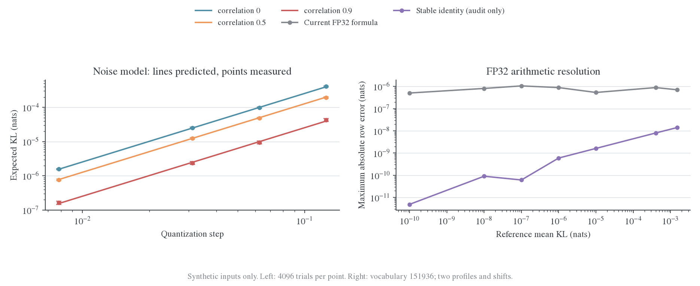
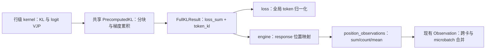

# KL 精度误差模型与诊断接口走读

> 本文的推导与实验保留原口径，第 5 节记录当时的结构改进。当前生产计算和诊断接口见[Full-vocab](../../infra/architecture/full-vocab.md)及[指标系统](../../infra/architecture/metrics.md)。

日期：2026-10-24。目标：给出带假设的精度量级估计、可复算的小实验，并审查和简化 Full-KL 位置诊断。本文区分**目标分布被量化改变**、**KL 数值计算误差**和**优化未收敛**。dtype 本身不能决定一个统一的正 KL 下限；当前 E16/E17 使用的同架构、同支持集模型存在分布完全相同的可表示解。

## 1. 从 Logit 扰动推导 KL

### 1.1 精确表达式、局部近似与上界

固定前缀，令教师 $p=\operatorname{softmax}(z)$，受扰动后的学生 $q=\operatorname{softmax}(z+\delta)$。这里 $\delta$ 可以表示模型本身的差异，也可以表示两种精度的计算误差差。定义：

$$
A(t)=\log\sum_v p_v\exp(t\delta_v),\qquad
p_t(v)=\frac{p_v\exp(t\delta_v)}{\sum_u p_u\exp(t\delta_u)}.
$$

则 $A(0)=0$、$A'(t)=\mathbb E_{p_t}\delta$、$A''(t)=\operatorname{Var}_{p_t}(\delta)$，且 $q=p_1$。将 $\log(q_v/p_v)=\delta_v-A(1)$ 代入 KL，积分分部得到：

$$
\begin{aligned}
K&=D_{\mathrm{KL}}(q\Vert p)=A'(1)-A(1)\\
 &=A'(1)-\int_0^1 A'(t)\,dt
 =\int_0^1t\,\operatorname{Var}_{p_t}(\delta)\,dt.
\end{aligned}
$$

如果扰动幅度足够小，$p_t$ 与 $p$ 接近：

$$
K\approx\frac12\operatorname{Var}_{p}(\delta)
=\frac12\delta^\top F(p)\delta,
\qquad F(p)=\operatorname{diag}(p)-pp^\top.
$$

令 $R=\max_v\delta_v-\min_v\delta_v$。任意支撑在长度为 $R$ 的区间上的随机变量都满足方差不超过 $R^2/4$，因此精确有：

$$
0\leq K\leq\frac{R^2}{8}.
$$

此外 $A'''(t)=\mathbb E_{p_t}[(\delta-\mathbb E_{p_t}\delta)^3]$，绝对值不超过 $R^3$，所以：

$$
\left|K-\frac12\operatorname{Var}_{p}(\delta)\right|
\leq\int_0^1t(tR^3)\,dt=\frac{R^3}{3}.
$$

这是保守余项界；实际小扰动下通常更紧。共同 logit 平移被方差消去：$\delta_v$ 对所有词元相同，KL 精确为零。有效误差是概率加权、去掉共同平移后的误差，不是原始 logit 最大绝对值。

### 1.2 由随机误差预测期望 KL

假设理想师生已匹配，两边实现误差之差为 $\delta=\epsilon_S-\epsilon_T$，均值 $b$、协方差 $\Sigma$。由二次型期望：

$$
\mathbb E K\approx\frac12\left[b^\top F(p)b+\operatorname{tr}(F(p)\Sigma)\right].
$$

若进一步假设误差零均值、不同词元坐标独立且同方差 $\sigma_\delta^2$：

$$
\mathbb E K\approx\frac{\sigma_\delta^2}{2}
\left(1-\sum_v p_v^2\right).
$$

记 $C(p)=1-\sum_vp_v^2$。它表示本地分布对独立 logit 误差的敏感程度：高置信、接近单点的分布通常 $C$ 较小。该结论依赖误差协方差假设，不表示低熵对所有结构化扰动都稳健。

如果还存在未学完的确定性差异 $d$，把 $\delta$ 换成 $d+\epsilon$ 即可。零均值噪声下，二阶期望由 $\frac12d^\top Fd$ 与 $\frac12\operatorname{tr}(F\Sigma)$ 相加。只有假定这份随机误差在优化中持续存在且无法被学习或抵消，后者才具有“预期噪声底”的解释。

## 2. BF16 能对应多大的分布误差

### 2.1 均匀舍入近似与误差相关性

BF16 有7位显式尾数。round-to-nearest 的 unit roundoff 为 $u_b=2^{-8}$；FP32 对应 $u_f=2^{-24}$。它们是相对误差量级，不是 KL 的绝对下限；`torch.finfo.eps` 则分别是 $2^{-7}$、$2^{-23}$，两者相差一倍。[^dtype]

在一个固定指数区间内，设有效量化步长为 $\Delta$，单边舍入误差近似均匀分布在 $[-\Delta/2,\Delta/2]$，方差 $\Delta^2/12$。两边同方差，相关系数为 $\rho$，不同词元误差独立，则：

$$
\operatorname{Var}(\epsilon_S-\epsilon_T)
=\frac{\Delta^2}{6}(1-\rho),
\qquad
\boxed{\mathbb E K\approx\frac{\Delta^2}{12}(1-\rho)C(p)}.
$$

只有一边有量化误差、另一边是理想参考时，系数改为 $\Delta^2C(p)/24$。两边误差完全相同则 $\rho=1$，KL 为零，而不是一个固定正数。

若**直接把 logits 舍入为 BF16**，指数区间给出的示例为：

| Logit 绝对值区间 | 步长 $\Delta$ | 两边独立误差、$C\approx1$ 时的期望 KL |
| --- | ---: | ---: |
| [1,2) | 0.0078125 | $5.09\times10^{-6}$ |
| [4,8) | 0.03125 | $8.14\times10^{-5}$ |
| [8,16) | 0.0625 | $3.26\times10^{-4}$ |
| [16,32) | 0.125 | $1.30\times10^{-3}$ |

**这张表不能直接套到我们的 loss 上。** 当前 CUDA 输出头保留 FP32 logits，不做这一步 BF16 logit 舍入。表格只是展示：在指定误差模型下，精度的影响如何随尺度和相关性变化。

### 2.2 当前 BF16 输入、FP32 输出的 Head

对于 $z=Wh$，将权重和 hidden 的量化误差记为 $E_W,e_h$：

$$
\widehat z-z=W e_h+E_W h+E_W e_h+e_{\rm GEMM}.
$$

保留一阶项，并假设权重误差逐元素独立、hidden误差逐坐标独立、二者互相独立且零均值。设它们方差为 $s^2_{W,vj}$、$s^2_{h,j}$，则：

$$
\Sigma_z=W\operatorname{diag}(s_h^2)W^\top+
\operatorname{diag}\left(\sum_jh_j^2s^2_{W,vj}\right).
$$

代入 $\frac12\operatorname{tr}(F\Sigma_z)$，得到无需构建词表平方协方差矩阵的计算式：

$$
\begin{aligned}
\mathbb E K\approx\frac12\Bigg[
&\sum_j s_{h,j}^2\left(\sum_vp_vW_{vj}^2-
\left(\sum_vp_vW_{vj}\right)^2\right)\\
+&\sum_v p_v(1-p_v)\sum_jh_j^2s^2_{W,vj}
\Bigg].
\end{aligned}
$$

这里保留了共享 hidden 误差造成的词元间相关性，不能把全部 logit 误差简单当作独立噪声。小实验使用各输入所在指数区间的实际 BF16 步长估计 $s^2=\Delta^2/12$。

真实 Transformer 还包含前面各层的误差传播。若各层误差为 $e_\ell$，一阶近似为 $\delta z\approx\sum_\ell J_\ell e_\ell$；协方差需要 Jacobian 及跨层相关项。只有额外假设“映射到输出的噪声独立、每层贡献相同”，才可把期望 KL 近似相加；不能拿 head 的误差直接乘28当作1.5B模型的误差预测。

### 2.3 精度噪声模型不等于训练收敛定理

真实舍入通常是参数和输入的确定性函数，学习可能让两边误差变得相关，也可能放大差异。E16/E17 的 student/teacher 架构相同、支持集相同；如果参数及执行路径相同，BF16 条件分布也可以相同。因此不存在仅由“BF16”三个字决定的不可突破正 KL 下限。

额外词表支持则是另一类真实下界。若学生只能在 $S$ 上分配概率，教师在 $S$ 外仍有质量：

$$
D_{\mathrm{KL}}(q\Vert p)=D_{\mathrm{KL}}(q\Vert p(\cdot\mid S))-\log p(S)
\geq-\log p(S).
$$

这属于支持集限制，不属于精度限制；现有额外教师词表行修正正是在保留这项量。

## 3. FP32 KL 计算的分辨能力

### 3.1 为什么残差小于中间项时容易受误差影响

当前公式为 $K=\sum_vq_v(\log q_v-\log p_v)$。在接近匹配时，正负项相互抵消，最终 KL 是二阶小量。设 log-softmax 误差分别为 $a_v,b_v$，满足绝对值不超过 $\varepsilon$；暂时忽略 exp 和求和的舍入，则计算相当于：

$$
\widehat K=\sum_v q_v e^{a_v}(r_v+a_v-b_v),
\qquad r_v=\log(q_v/p_v).
$$

直接减去 $K$ 并用三角不等式可得：

$$
|\widehat K-K|
\leq(e^\varepsilon-1)\mathbb E_q|r|
+2\varepsilon e^\varepsilon+\eta,
$$

其中 $\eta$ 汇总实际 exp、乘法和归约的额外误差。这个界很保守，但显示了问题：KL 变小时，绝对误差项未必同比例下降。GPU归约顺序、输入尺度和后端会影响误差，FP32标量本身的相邻数间隔不足以预测整个计算。[^numerical]

对完全相同的两份计算，$a=b$ 且 $r=0$，直接相减仍可以精确得到零。因此也不存在 FP32 必然输出某个正 loss 的结论。

### 3.2 如何把数值实验转为工作阈值

在指定输入和实现下，以高精度参考测得误差包络 $B$。如果希望 KL 的相对计算误差不超过 $\tau$，可把 $K\gtrsim B/\tau$ 作为**经验诊断阈值**。

本次合成输入的普通 FP32 公式，最大逐位置误差约 $10^{-7}$–$10^{-6}$。若要求约1%误差，需要把 $10^{-5}$–$10^{-4}$ 视为需要关注的量级；在 $10^{-6}$ 附近，部分 token 的正负号已经不可靠。这个包络来自有限输入，不是对所有 logits 的严格误差保证。跨 token 的平均可能抵消部分误差，也可能保留归一化偏差；不能默认除以 $\sqrt N$。

当前 E16/E17 的 $4\times10^{-4}$–$1.5\times10^{-3}$ 总体 KL 高于该量级，尚无证据说明被**损失算术**卡住。但某些位置桶可能已显著更低，且这个判断不涵盖完整模型的 BF16 前向误差。

### 3.3 一个能进一步改善数值测量的恒等式

在相同完整支持、两份分布严格归一化时，$\mathbb E_qe^{-r}=1$，所以：

$$
K=\mathbb E_q\left[e^{-r}-1+r\right].
$$

括号内非负，且在零附近：

$$
e^{-r}-1+r=\frac{r^2}{2}-\frac{r^3}{6}+\frac{r^4}{24}-\cdots.
$$

实验在 $|r|<0.01$ 使用到六阶的多项式，其余用 `expm1(-r)+r`，显著减少一阶项相消带来的误差。它仍无法恢复 BF16 前向已损失的信息。未经处理的极端 log-ratio 可能使指数溢出，支持集不一致时也需单独保留归一化修正。

该公式当前仅用于数值审计，**没有替换训练 kernel 的 loss 或 VJP**。生产替换还需验证长尾、不同后端及 loss/梯度的一致性。

## 4. 小实验的结果

左图为均匀舍入模型，实线是推导、点是Monte Carlo均值、误差棒是均值的95%区间；右图为两种合成分布和共同logit平移下的最大逐位置绝对误差。所有输入均为合成，不是模型准确率实验。

### 4.1 相关舍入误差

每组4096个独立样本、64分类，比较不同 $\Delta$ 和 $\rho$。下表选峰值分布 $C(p)=0.30593$、$\Delta=0.0625$：

| 师生误差相关系数 | 理论期望 KL | 实测均值 | Monte Carlo 标准误 |
| --- | ---: | ---: | ---: |
| 0 | $9.9587\times10^{-5}$ | $9.7964\times10^{-5}$ | $1.9804\times10^{-6}$ |
| 0.5 | $4.9794\times10^{-5}$ | $4.8870\times10^{-5}$ | $1.2813\times10^{-6}$ |
| 0.9 | $9.9587\times10^{-6}$ | $9.5311\times10^{-6}$ | $5.2959\times10^{-7}$ |
| 1 | 0 | 0 | 0 |

全部非零实验点的实测/理论比值在0.957–1.084之间，理论均值偏差均小于1.65个Monte Carlo标准误。逐样本同时验证了 $K\leq R^2/8$。二阶近似与逐样本实际误差方差的计算也一致。

### 4.2 Head 输入量化

随机128维hidden、1024输出词表、128个位置，用每个输入坐标的BF16步长估计舍入方差：

| 量 | KL |
| --- | ---: |
| 独立输入舍入模型预测 | $2.7779\times10^{-6}$ |
| 实际 BF16 输入与原 FP64 输入的分布差异 | $2.7650\times10^{-6}$ |
| 用实际 logit 误差作二阶预测 | $2.7650\times10^{-6}$ |
| 两边都使用同一份 BF16 输入 | 0 |

这验证了head层模型，不能直接外推到28层Transformer，也不能把“BF16对FP64”的差异当作“BF16学生对BF16教师”的不可消除差异。

### 4.3 小 KL 的数值测量

词表151936、每组8个位置，使用峰值分布和较分散分布，并比较共同logit平移0／16。以下摘取较分散分布、平移0的逐位置最大绝对误差：

| 参考 KL 均值 | 普通 FP32 公式误差 | 稳定恒等式 FP32 误差 |
| ---: | ---: | ---: |
| $4\times10^{-4}$ | $4.73\times10^{-7}$ | $3.20\times10^{-10}$ |
| $10^{-5}$ | $3.16\times10^{-7}$ | $2.04\times10^{-11}$ |
| $10^{-6}$ | $3.87\times10^{-7}$ | $7.34\times10^{-12}$ |
| $10^{-8}$ | $3.30\times10^{-7}$ | $5.89\times10^{-13}$ |

稳定公式的效果依赖本组受控log-ratio，不能当作任意输入的保证。两种公式在完全相同的输入上都返回零。

### 4.4 真实 R1-Distill-1.5B 初始权重的短前缀检查

从本机公开初始checkpoint构造两道固定数学问答的teacher-forced前缀，共126个response位置，不做优化或生成评测。FP32参考使用eager attention；另测BF16 eager与BF16 FlashAttention2，head都输出FP32 logits，最终KL用FP64计算。保留RoPE频率buffer的FP32 dtype，关闭TF32和BF16低精度GEMM归约。FlashAttention2更贴近当前训练内核，但这个普通未padding前向不是完整的packed FSDP运行，也不是末期checkpoint或长rollout。

| Probe | 位置数 | BF16 FlashAttention2 对 FP32 的 KL 均值 | 中位数 | p95 | 仅量化head输入的均值 |
| --- | ---: | ---: | ---: | ---: | ---: |
| 一元一次方程 | 55 | 0.00017805 | 0.00001260 | 0.00104530 | 0.000001272 |
| 两颗骰子的概率 | 71 | 0.00030004 | 0.00000727 | 0.00099552 | 0.000001578 |

两题按token加权平均约为 **0.00024679**，误差高度不均匀。将同一批量化参数转回FP32计算后，两个probe的logits都与初次FP32结果完全相同；本checkpoint参数本身可被BF16表示，这组差异主要来自前向计算路径。仅head输入量化远小于完整前向差异，不能只用head小实验推断Transformer。

BF16 eager对FP32 eager的KL均值分别约0.00627、0.17640，比FlashAttention2路径大得多；第二题少量位置的大偏差已经超出小扰动近似。因此不能把eager BF16的数值当作当前FlashAttention2训练的误差估计。这也实证了attention内核需要纳入精度条件。

**这不是0.00024679的训练loss下限。** 测量的是同一checkpoint在两种执行精度下的差异；E16/E17实际比较的是BF16学生与BF16教师，且前缀和权重都不同。

在近匹配、共同参考分布的局部模型下，设两边单独相对高精度的误差KL为 $\kappa_S,\kappa_T$，用共同 $F(p)$ 定义 $\kappa_i=\frac12\mathbb E[\epsilon_i^\top F\epsilon_i]$，以及加权相关项 $\rho_F=\mathbb E[\epsilon_S^\top F\epsilon_T]/(2\sqrt{\kappa_S\kappa_T})$。对误差差的二次型展开：

$$
\mathbb E K_{\rm error}\approx
\kappa_S+\kappa_T-2\rho_F\sqrt{\kappa_S\kappa_T}.
$$

若**额外假设**教师误差与上述初始学生probe同量级，且两边 $\kappa\approx2.47\times10^{-4}$，则：

| 假设的加权误差相关性 | 误差差所对应的期望 KL |
| --- | ---: |
| $\rho_F=0$ | 约 $4.94\times10^{-4}$ |
| $\rho_F=0.9$ | 约 $4.94\times10^{-5}$ |
| $\rho_F=1$ | 0 |

上表用实测KL粗略代替二阶 $\kappa$；教师的该量级和师生相关性均未在这里测量，因此表格是条件估计，不是对E17的诊断结论。它说明当前 $4\times10^{-4}$ loss附近，模型前向精度有可能产生相关影响，不能仅凭FP32损失公式准确就排除。

未来可对同一组代表性前缀保存师生BF16和高精度logits，逐位置计算两边的误差、$F(p)$加权方差与协方差，再按相对位置十分桶汇总。用实际 $\kappa_S,\kappa_T,\rho_F$ 替换上述假设，才得到与具体checkpoint、前缀长度、内核配置对应的估计。它仍然不自动成为训练收敛下界。

## 5. 代码走读与结构改进

### 5.1 上一版可以简化的地方

上一版的位置统计数值与梯度验证通过，但接口存在三处不必要的复杂度：`return_token_kl` 开关穿透多个kernel，使返回类型随开关变化；engine直接判断 `backend != liger`，耦合了后端能力；普通／fused precompute重复实现了分块循环、梯度累积与backward。位置桶数量和字段命名也分别出现在统计与loss层。

### 5.2 当前数据流

1. [full_vocab.py](../../../../../verl/trainer/distillation/full_vocab.py) 定义固定结构 `FullKLResult(loss_sum, token_kl)`。标量 `full_reverse_kl()` 保持既有调用语义；需要诊断的engine调用 `full_reverse_kl_result()`。不支持逐token诊断的后端返回 `token_kl=None`，能力表达停留在kernel边界。
2. 普通 `precompute_kl_rows()` 与 [fused_kl_rows()](../../../../../verl/trainer/distillation/full_vocab_triton.py) 只负责一个block的数值计算。共同的 `PrecomputedKL` 统一遍历、累积hidden/head梯度、保存backward缓存并返回固定两个输出；移除了bool输出开关和按输入数切片返回梯度的逻辑。
3. [FSDP engine](../../../../../verl/workers/engine/fsdp/transformer_impl.py) 保留通过wrapped head调用以维护FSDP hooks，读取具名结果；仅在 `token_kl` 存在时作位置统计，不再判断后端名称。
4. 公共 [utils/metric/position.py](../../../../../verl/utils/metric/position.py) 负责通用相对位置映射与充分统计，业务namespace由调用方指定；response预测下标换算由engine负责。[losses.py](../../../../../verl/trainer/distillation/losses.py) 消费统计并复用现有 `Observation` 聚合。模块已从distillation目录移出，当前完整路径见[KL计算与位置指标分层](../../infra/architecture/metrics.md#相对位置统计)。

逐token行明确为 detached，只用于诊断；不能拿它作可反传的分桶加权loss。如果将来改变位置权重，必须相应改变VJP，不能只改日志向量。新增归一化修正仍同时进入标量和逐token诊断，确保教师额外词表行没有被统计遗漏。

### 5.3 复杂度与扩展边界

时间上，位置统计为 $O(T)$，没有新增模型forward或词表投影。空间上额外保留 $O(T)$ 的标量与索引；没有引入新的 $T\times V$ 缓存。为保持固定kernel结果接口，precompute的标量调用也临时生成逐token行：FP32时每7168个token约28KiB，此行不会进入backward缓存。

指标保持10组sum/count/mean，没有新增注册中心、动态schema或配置开关。后续增加别的位置统计只改统计模块；增加同类precompute数值算法只需提供行级kernel。当前没有改动训练KL公式、梯度目标、精度配置或公开日志字段含义。

## 6. 验证与交付

重构后CPU验收合计50个不同用例通过，覆盖标量接口、逐token值与VJP、额外教师词表支持、空输入、mask位置、分区合并和Qwen输出适配。两卡FSDP2分别检查普通precompute＋额外教师词表行，以及Qwen3 tied-head＋fused路径；真实跨卡sum/count可重建总KL，包含一个rank无有效token的情况。

脚本、原始数值、图和测试结果见[数据与复现入口](../../archive/evidence/root-data/precision-model-20261024/README.md)。代码未提交或部署；已有训练日志不发生追溯变化。

### 参考文献

[^dtype]: PyTorch 2.11。Type Info，浮点epsilon与数值范围。[官方文档](https://docs.pytorch.org/docs/2.11/type_info.html)。
[^numerical]: PyTorch 2.11。Numerical accuracy，归约次序与低精度矩阵乘法的影响。[官方文档](https://docs.pytorch.org/docs/2.11/notes/numerical_accuracy.html)。
