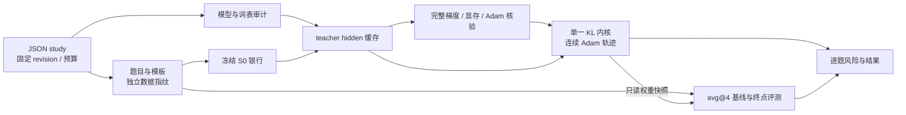

# 固定状态教师迁移实验引擎

此包把模型身份、数据、训练和评测组织为一份声明式 study，新增配对通过 JSON 计划描述。当前服务于小学生、单卡全参数训练、共享 token 语义的原生 full-vocab reverse KL；不支持的接口由审计拒绝。历史 R1 入口保留在 [boundary](../boundary/README.md)，已完成结果不随新默认改写。

Qwen3 的配置与研究问题见[谱系报告](../../../docs/experiments/teacher-transfer/transfer-mechanism/qwen3/2026-10-29-Qwen3谱系与同构教师吸收.md)。当前 GPU 基线已运行；完整训练路径还需真实模型的数值 gate 放行。CPU 测试不能代替该 gate。

## 架构与身份



| 模块                                 | 职责                                                                  |
| ------------------------------------ | --------------------------------------------------------------------- |
| `spec.py`                            | 固定模型 SHA、科学参数、执行参数和配对预算；要求显式 EOS 集合和 avg@4 |
| `core/artifacts.py`                  | 原子写入、内容指纹、完成回执与中断尾行恢复                            |
| `models.py`                          | 权重校验/复用、词表和配置审计、HF 原生模型接口与精度约束              |
| `data.py`                            | 冻结题目、family 模板、无训练/评测重合检查、独立 RNG 的 S0 轨迹       |
| `backends/hf_rkl.py`                 | full-vocab RKL、解析 head VJP、tied/untied 参数反向、固定状态评分     |
| `training.py`                        | 共享 teacher 缓存、连续更新、权重读出与训练任务依赖                   |
| `validation.py`                      | S0/teacher-copy 的完整梯度比较、最坏长度批的执行调优、真实 Adam 检查  |
| `evaluation.py`                      | 参数化 vLLM 服务、统一判分、同请求重试、已有答案复用                  |
| `runner.py` / `runtime/resources.py` | 依赖队列、完成身份核验、有限重试与 GPU 归属/恢复                      |

模型身份由 repo 与不可变 commit 定义。银行和评测各自使用输入内容指纹；teacher 缓存还绑定实际银行内容与后端版本。评测缓存绑定模型或实际 checkpoint 权重、prompt、采样参数和判分契约，不绑定 teacher 的人类别名。队列与 worker 共用评测身份构造，训练完成回执和中间读出另核对教师、数据及 step。

## 固定科学条件与可优化部分

Qwen3 计划沿用 batch16、reuse16、H1024、LR1e-6、AdamW β=(0.9,0.999)、ε=1e-8、weight decay=0.01、clip1。参数、梯度、Adam 与输出 head 为 FP32，backbone 使用 BF16 autocast，RoPE buffers 保持 FP32，TF32 关闭。所有训练状态来自冻结 S0 银行。

有效 batch、归一化、优化器与词表支持集属于科学协议。microbatch、激活重算和 token chunk 属于执行配置，必须通过同一个参考反向的完整参数梯度比较。head VJP 显式累积输出投影梯度，再对 backbone 反传；若 head 与 embedding 共享参数，两部分梯度累积到同一参数，而不是保存两份独立权重。

teacher 的完整 FP32 log-prob 仅为当前 batch 驻留 GPU，并在 reuse 内复用；磁盘保留较小的 teacher hidden 与原生 head。评分默认计算 RKL、JS、TV、双侧熵和额外支持质量，省去并非主分析所需的 top-k 排序及条件 FKL。

保存阶段交由 HF 识别 tied 参数别名，避免逐项复制 state dict 后把共享矩阵重复写盘。长分支在同一进程中连续更新 Adam；中间权重用于独立任务读出，最终权重保留。当前不导出 optimizer state；中断后的科学训练不会悄悄用 fresh Adam 接着旧权重训练。

## 使用

从仓库根目录，在已具备 PyTorch、Transformers、FlashAttention2、vLLM 与项目数学判分依赖的环境运行：

```bash
python -m examples.mirroropd.research.studies.fixed_transfer assets --plan examples/mirroropd/research/studies/fixed_transfer/plans/qwen3-lineage.json
python -m examples.mirroropd.research.studies.fixed_transfer prepare --plan examples/mirroropd/research/studies/fixed_transfer/plans/qwen3-lineage.json
python -m examples.mirroropd.research.studies.fixed_transfer run --phase baselines --plan examples/mirroropd/research/studies/fixed_transfer/plans/qwen3-lineage.json
python -m examples.mirroropd.research.studies.fixed_transfer run --phase full --plan examples/mirroropd/research/studies/fixed_transfer/plans/qwen3-lineage.json
```

`baselines` 生成银行并评测所有原始模型。`full` 复用已完成且身份相符的银行/基线，随后执行缓存、数值验证、训练、读出评测和 teacher-copy。即使直接运行完整队列，训练也要等待对应基线和数值检查。每次运行冻结计划、研究包和依赖的 verl 源码，worker 与 guard 从冻结目录启动；数据与资源通过原工作区定位。阶段间修改原计划不会改写已启动 worker 的计划。

工作目录由计划的 `output` 与 `cache` 指定。`control/latest.json` 指向当前队列，但判断进程是否存活还要核对 PID 与启动身份。`complete.json` 的存在只对匹配的输入指纹有效。

## 失败、恢复和资源

请求发生传输失败时最多尝试三次，prompt、seed 和采样设置保持不变。完整任务失败后最多重试两次，已评分的回答按题目/采样槽位复用；恢复时核对 seed、题目、答案、响应长度和身份。只修复最后一条未完成的追加写入，完整行损坏会报错。若所有回答已经齐全，只缺汇总，可以离线完成，不重启模型服务。

科学训练不自动重试覆盖旧轨迹。失败后需保留 attempt，明确选择从初始模型重跑；现有中间权重没有 Adam，不能充当连续恢复状态。每个完成的 readout 保存实际权重摘要，评测前校验其内容，避免评到另一个 step 或教师分支。

本机只授权 GPU4–7。资源 ledger 位于仓库同级 `wandb-logs/locks/<hostname>/teacher-studies.json`，与旧 R1 队列共享同一个锁 inode；worker 只收到单张物理卡的可见设备配置。独立 guard 以 PID 和启动时间识别 owner，清理本队列标签下的进程，并恢复后四卡的独立 gpu occupy。前四卡不属于此管理范围。

## 验证

```bash
python -m pytest -q tests/examples/research
```

CPU 回归覆盖不可变模型身份、缓存错配、损坏尾行、真实 HTTP 中断重试及续接、tied/untied 全梯度 VJP、原生支持指标、任务依赖和 FP32 tied-weight 保存/重载。GPU gate 另比较 S0 与 teacher-copy 两个参数点，检验全部参数梯度、候选 microbatch、稳态 Adam 显存和实际参数变化；通过后才发布训练执行配置。
