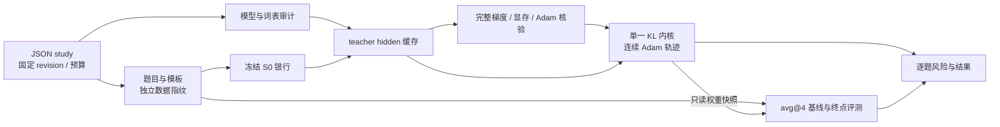

# 固定状态教师迁移实验引擎

此包把模型身份、数据、训练和评测组织为一份声明式 study，新增配对通过 JSON 计划描述。当前服务于小学生、单卡全参数训练、共享 token 语义的原生 full-vocab reverse KL；不支持的接口由审计拒绝。历史 R1 入口保留在 [boundary](../boundary/README.md)，已完成结果不随新默认改写。

Qwen3 的配置与研究问题见[谱系报告](../../../docs/experiments/teacher-transfer/transfer-mechanism/qwen3/2026-10-29-Qwen3谱系与同构教师吸收.md)。当前 Qwen3 真实模型数值 gate 已通过，六个同尺寸分支已完成 320 步训练，任务准确率评测仍在运行。实际执行为 microbatch4、关闭激活重算；科学设置与其他模型的验证状态以各自回执为准。CPU 测试不能代替 GPU gate。

## 架构与身份



共享的 `core`、`backends` 和 `runtime` 位于研究包根目录；本目录负责固定状态实验的配置与编排。新增模型通常只修改计划，不复制训练内核。

| 归属                                                                                   | 职责                                                          |
| -------------------------------------------------------------------------------------- | ------------------------------------------------------------- |
| [spec.py](spec.py)                                                                     | 模型 SHA、科学参数、执行参数和配对预算；显式 EOS 集合与 avg@4 |
| [core/artifacts.py](../../core/artifacts.py)、[core/io.py](../../core/io.py)           | 内容身份、完成回执、尾行恢复与原子文件写入                    |
| [models.py](models.py)                                                                 | 权重下载与复用、词表、配置及共享权重审计                      |
| [backends/hf_models.py](../../backends/hf_models.py)                                   | HF 模型加载、共享 head、训练模式与精度约束                    |
| [data.py](data.py)                                                                     | 题目、模板、训练/评测去重及独立 RNG 的冻结 S0 轨迹            |
| [backends/hf_rkl.py](../../backends/hf_rkl.py)                                         | full-vocab RKL、解析 head VJP、共享参数反向与固定状态评分     |
| [training.py](training.py)、[validation.py](validation.py)                             | teacher 缓存、连续 Adam、权重读出与真实模型数值验证           |
| [evaluation.py](evaluation.py)、[core/math_grading.py](../../core/math_grading.py)     | vLLM 服务、固定采样协议、判分、请求重试与答案续接             |
| [runner.py](runner.py)、[runtime/resources.py](../../runtime/resources.py)             | 依赖队列、完成身份核验、状态查询、资源互斥与恢复              |
| [analysis.py](analysis.py)、[core/transfer_metrics.py](../../core/transfer_metrics.py) | 完整结果核验、准确率、GapRecovery 和风险统计                  |
| [continuation.py](continuation.py)、[plot_endpoints.py](plot_endpoints.py)             | 续训的配对风险变化与每个 student 的最终端点图                 |
| [retention.py](retention.py)                                                           | 完整核验后的中间权重预览与清理                                |

模型身份由 repo 与不可变 commit 定义。对于声明共享 embedding/head 的模型，资产审计逐个检查 safetensors 中的共享参数：只保存一个别名可接受；同时保存两个别名时按行分块比较，形状或数值不同则拒绝加载，避免 HF 加载时覆盖其中一个目标。银行和评测各自使用输入内容指纹；teacher 缓存还绑定实际银行内容与后端版本。评测缓存绑定模型或实际 checkpoint 权重、prompt、采样参数和判分契约，不绑定 teacher 的人类别名。队列与 worker 共用评测身份构造，训练完成回执和中间读出另核对教师、数据及 step。

## 固定科学条件与可优化部分

Qwen3 计划沿用 batch16、reuse16、H1024、LR1e-6、AdamW β=(0.9,0.999)、ε=1e-8、weight decay=0.01、clip1。参数、梯度、Adam 与输出 head 为 FP32，backbone 使用 BF16 autocast，RoPE buffers 保持 FP32，TF32 关闭。所有训练状态来自冻结 S0 银行。

有效 batch、归一化、优化器与词表支持集属于科学协议。microbatch、激活重算和 token chunk 属于执行配置，必须通过同一个参考反向的完整参数梯度比较。head VJP 显式累积输出投影梯度，再对 backbone 反传；若 head 与 embedding 共享参数，两部分梯度累积到同一参数，而不是保存两份独立权重。

teacher 的完整 FP32 log-prob 仅为当前 batch 驻留 GPU，并在 reuse 内复用；磁盘保留较小的 teacher hidden 与原生 head。评分默认计算 RKL、JS、TV、双侧熵和额外支持质量，省去并非主分析所需的 top-k 排序及条件 FKL。

保存阶段交由 HF 识别 tied 参数别名，避免逐项复制 state dict 后把共享矩阵重复写盘。长分支在同一进程中连续更新 Adam；中间权重用于独立任务读出，最终权重保留。旧协议仍不导出 optimizer state；新的分阶段配置在阶段终点保留 Adam 与 RNG 恢复点，中断后的科学训练不会悄悄用 fresh Adam 接着旧权重训练。

## 使用

从仓库根目录，在已具备 PyTorch、Transformers、FlashAttention2、vLLM 与项目数学判分依赖的环境运行：

```bash
python -m examples.mirroropd.research.studies.fixed_transfer assets --plan examples/mirroropd/research/studies/fixed_transfer/plans/qwen3-lineage.json
python -m examples.mirroropd.research.studies.fixed_transfer prepare --plan examples/mirroropd/research/studies/fixed_transfer/plans/qwen3-lineage.json
python -m examples.mirroropd.research.studies.fixed_transfer run --phase baselines --plan examples/mirroropd/research/studies/fixed_transfer/plans/qwen3-lineage.json
python -m examples.mirroropd.research.studies.fixed_transfer run --phase full --plan examples/mirroropd/research/studies/fixed_transfer/plans/qwen3-lineage.json
```

`endpoints` 只调度已有权重的任务评测，启动前逐一核对 checkpoint 回执；复用既有回答，不创建银行、teacher 缓存或数值训练任务，可将长回答 avg@4 独立放到专用设备。

`training` 复用由另一队列生成的银行和基线，只等待其匹配身份的完成回执，不重复调度这些外部任务；该模式要求外部基线队列持续运行。`run --wait-resource` 在分配的 GPU 锁上等待当前 owner 释放，拿到锁前不停止占卡、不启动 GPU worker；控制目录记录等待和取得锁的回执。默认仍在锁被占用时立即失败。等待模式使用显式票据队列：`MIRROROPD_QUEUE_PRIORITY` 越小越优先，同级按注册时间 FIFO；默认值为 100。票据绑定 PID／启动时间，失效进程会被清出等待队列，获取锁后删除自身票据。该排序只影响尚未取得资源的任务，不抢占运行任务；直接非等待获取保持原语义。`banks` 只生成冻结 S0 银行，不创建准确率任务。`fit` 与 `targets` 遇到缺失银行时先执行这一阶段，再按真实银行内容构造 teacher 缓存身份，避免新 student 的空银行导致任务构建失败。`targets` 仅执行银行与教师缓存，供模板／输出验收；不会启动训练或准确率任务。`baselines` 生成银行并评测所有原始模型。`full` 复用已完成且身份相符的银行/基线，随后执行缓存、数值验证、训练、读出评测和 teacher-copy。即使直接运行完整队列，训练也要等待对应基线和数值检查。每次运行冻结计划、研究包和依赖的 verl 源码，worker 与 guard 从冻结目录启动；数据与资源通过原工作区定位。阶段间修改原计划不会改写已启动 worker 的计划。

使用 `status --plan <plan.json>` 查看所有控制进程与各评测进度。状态同时核对 PID 和启动时间，区分资源等待、运行、恢复、失败与停止；旧 `queue.json` 中的 running 列表不会被误认为活进程。原始模型基线按固定权重、题目和评测协议直接查共享缓存，即使当前研究目录没有本地别名也会显示；完成回执的身份不匹配则报错。查询保持只读。评测完成量来自周期写出的 `progress.json`，可能略落后于逐题文件，只有完成回执才表示最终结果已就绪。

工作目录由计划的 `output` 与 `cache` 指定。`control/latest.json` 指向最近启动的队列；并行运行时需分别查看各控制目录的 `queue.json`，但判断进程是否存活还要核对 PID 与启动身份。`complete.json` 的存在只对匹配的输入指纹有效。

## 独立模式输出验收

`run --phase probes --plan <plan.json>` 只读取准备好的题目与消息，不依赖 S0 回答银行，也不创建训练或准确率任务。每位 teacher 固定取 A、M01、Code01、IF01 各一题；普通 Qwen3 分别渲染 thinking/non-thinking 的 student 共享前缀，其他架构使用配置的模式及 system 条件。显式模板专用对照只检查配置的原生模式，并额外检查 student 本身。原生 teacher 前缀不一致时额外生成原生前缀对照，二者不会被合并。

[mode_probe.py](mode_probe.py) 使用原生 BF16 backbone、FP32 输出投影、greedy、最多 256 个新 token，逐条保存 prompt/response token、输出文本、EOS 与前缀匹配状态。回执绑定模型、student、消息、模板参数、停止集合和实现身份。输出证据写在 `mode-probes/<teacher>/`；短输出探针不代替 avg@4，也不自动将 teacher 归为模式专家。验收人员须结合训练来源及完整实验前缀判断，失败任务不放行科学训练。

`prompt_policy.template_model` 可指定计划内的固定模型作为模板来源，用于明确标记的模板对照。加载器保留 student 的 tokenizer 编码规则，只替换聊天模板；词表映射不同或任一题编码与原生模板不一致时拒绝准备。准备回执绑定模板来源权重身份与模板摘要，银行仍按真实输入 token 和 student 权重去重；相同银行不能因不同条件名称被重新命名为另一种行为模式。未声明该字段的既有实验输入身份不变。

## 固定留出的长前缀诊断

`run --phase long-panel --plan <source-plan.json>` 对已完成的 H1024 分支生成独立 H4096 诊断，不执行训练或准确率评测。源计划只保留要检查的代表 arm，完整保留原 checkpoint 的科学字段。当前代表为 [e3 thinking](plans/qwen3-longpanel-e3.json) 和 [SFT non-thinking](plans/qwen3-longpanel-sft.json)。

[long_panel.py](long_panel.py) 复用原 640 题清单，但仅生成 Math64、Code32、IF32 对应的 8 个原始批；保持每题 seed、原 batch 组成及 padding 次序。部分银行使用独立 panel-shard 回执，不能被识别为完整 640 题银行。生成后逐题要求 prompt 和原 H1024 回答前缀完全一致；不一致则保存失败清单并停止评分，不能把新 S0 当作旧轨迹的延长。

初始 student 与指定最终 checkpoint 使用同一长前缀评分，保存逐题原生 RKL／JS 和有效 token 数，按 0–1024、1024–2048、2048–4096、整体四段分别统计。每段使用其固定预算归一化，早停题的后续位置不补损失；初始风险为零时不强行给出降幅。模型加载、hidden 提取和评分复用统一后端，不导出新模型或 optimizer。输出位于源研究目录加 `-h4096-heldout` 后缀的独立目录，完成回执明确记录科学更新数为零。

## 固定题池的阶段训练

新配置通过可选`continuation`字段启用固定池循环，不改变未设置该字段的历史实验身份。`pool_batches=20`表示始终循环 A–T；step321 回到 A，step641 再次回到 A。`evaluate_at=[]`只关闭任务准确率读出，固定风险仍按`risk_readouts`和 reuse 边界保存，最终权重照常导出。

`run --phase fit`要求显式`accuracy_gate=false`，只调度银行、teacher 缓存、数值检查、拟合和 teacher-copy，不等待准确率。已启动的匹配模式配置见[qwen3-nonthinking-stage320.json](plans/qwen3-nonthinking-stage320.json)。需要的 avg@4 基线和终点评测仍可独立调度，不能用缺失 acc 冒充整体研究完成。

`save_resume=true`在阶段终点保存一次 optimizer/RNG 状态，并绑定实际权重摘要、科学参数、固定银行与参数顺序。下一阶段使用新的输出目录，`resume_from`将 arm 名映射到上一阶段 arm 目录；加载原 FP32 权重、Adam、Python/NumPy/Torch/CUDA 随机状态，接续原 step 和批次顺序，旧评分与历史保留。新阶段成功保存并验证后，清理上一阶段 optimizer 文件，保留其回执和替代路径；任务读出权重按消费者需要单独管理。

CPU 随机网络测试已经确认，带 dropout 的恢复轨迹与连续 Adam 训练逐参数完全一致。Qwen3 non-thinking 的 SFT/Base-OPD 已完成真实 GPU 跨进程恢复验收：全参数、930 个 Adam 状态张量及各随机状态完全一致，正式续训首步与探针 loss 一致。其他恢复点仍须独立验收，训练入口核对对应 step、权重身份与兼容签名。

## 结果复算

`analyze --risk-only` 对固定风险执行完整核验：训练身份、连续历史与换批 loss、全部计划风险读出、数值参考、同构 teacher-copy 和最终权重清单。产物写入独立的 `analysis/risk-only/`，回执标记 `scope=fixed-risk`、`accuracy_verified=false`；不会覆盖全实验验证，也不改变清理入口的全量验收要求。缺少任务准确率不阻止这一风险验收。

`analyze --partial` 只汇总已完成证据，缺失任务明确列出；去掉 `--partial` 后要求所有基线、训练、读出与数值参考齐全，才写完整验证回执。分析同时输出训练终点相对 teacher-copy 可行参考的逐题配对差值，保留绝对残差及其题目 bootstrap 区间；该参考不是理论下界。`continuation` 对相同题目和冻结轨迹比较绝对风险变化，两者复用 [core/statistics.py](../../core/statistics.py) 的配对统计实现。`continuation --window 64` 另生成 `analysis/continuation-windows.csv`，比较最近两个等长窗口、阶段起点到终点及初始到终点，增加 Math64＋Code32＋IF32 的整体面板；按 H1024 预算归一化，与当前主图一致。原不带 `--window` 的历史比较保持有效 token 均值口径，两者不可混用。窗口比较逐题核对来源、长度、分组及 ID；bootstrap 只反映固定题目的变化，不包含训练 seed 不确定性。最终端点图从分析 CSV 读取已完成结果，每行标出实际更新步数，不连接中间动态，也不把 KL 降幅当成任务准确率。

```bash
python -m examples.mirroropd.research.studies.fixed_transfer analyze --partial --plan examples/mirroropd/research/studies/fixed_transfer/plans/qwen3-lineage.json
python -m examples.mirroropd.research.studies.fixed_transfer.continuation --plan examples/mirroropd/research/studies/fixed_transfer/plans/qwen3-lineage.json
python -m examples.mirroropd.research.studies.fixed_transfer.plot_endpoints --plan examples/mirroropd/research/studies/fixed_transfer/plans/qwen3-lineage.json --output examples/mirroropd/docs/experiments/teacher-transfer/transfer-mechanism/qwen3/figures
```

绘图前需将 `FIGURE_VIZ_MPL` 指向 figure-viz 的 `assets/mpl` 目录，并使用安装了 matplotlib 的环境。分析 CSV 保留每个面板的初始值、最终值和降幅；图旁另存实际绘制的数据与审计记录。跨研究计划复用缓存只减少重复执行，不合并不同采样协议、轨迹来源或更新预算的科学含义。

## 失败、恢复和资源

请求发生传输失败时最多尝试三次，prompt、seed 和采样设置保持不变。完整任务失败后最多重试两次，已评分的回答按题目/采样槽位复用；恢复时核对 seed、题目、答案、响应长度和身份。只修复最后一条未完成的追加写入，完整行损坏会报错。若所有回答已经齐全，只缺汇总，可以离线完成，不重启模型服务。

科学训练不自动重试覆盖旧轨迹。失败后需保留 attempt，明确选择从初始模型重跑；现有中间权重没有 Adam，不能充当连续恢复状态。每个完成的 readout 保存实际权重摘要，评测前校验其内容，避免评到另一个 step 或教师分支。离线分析核对回执身份、配置摘要、权重清单、文件存在性和大小，不反复读取全部大权重文件；新任务评测前仍逐文件核验 SHA256。中间权重只有带明确清理标记时才允许缺失；最终权重不允许使用清理标记跳过核验。

本机当前仅授权物理 GPU0–5，GPU6、GPU7 不参与实验或占卡。默认资源 ledger 位于仓库同级 `wandb-logs/locks/<hostname>/teacher-studies.json`，管理 GPU4–5，并与旧 R1 队列共享锁 inode。通过 `MIRROROPD_RESOURCE_CONFIG` 可选择独立 ledger；当前 GPU0–1 使用 `teacher-studies-front2.json` 执行辅助任务评测，GPU2–3 使用 `teacher-studies-middle2.json` 推进银行与 RKL 验收，分别有独立锁与占卡状态目录。原 GPU0–3 的 front4 控制进程已退出并回收，旧 ledger 仅保留历史记录，不与新分区同时启用。计划设备必须与所选 ledger 一致，不允许两个活动队列管理重叠设备。默认后端 ledger 的锁文件保留历史路径以维持互斥；实际设备以 ledger 的 `gpus` 为准，恢复占卡也严格使用该列表。worker 只收到单张物理卡的可见设备配置。独立 guard 以 PID 和启动时间识别 owner，只清理本队列标签下的进程，并恢复所分配设备的 gpu occupy。

## 中间权重清理

所有配对的训练、终点评测与数值参考完成后，可运行 `prune --plan <plan.json>` 预览待清理字节数；确认后使用 `prune --apply --plan <plan.json>` 删除中间读出权重。入口先运行完整分析核验，任何缺失或不匹配结果都会阻止清理，再逐一检查权重摘要。它只删除标记为 transient 的 safetensors，保留最终权重、配置、完成回执、逐题回答和风险统计。

清理前先记录操作意图，中断后可按原清单继续。完成回执保留 `weights_pruned` 标记；已有评测仍可复算，但新评测协议需要重新生成相应中间权重。活动队列使用启动时冻结的源码，新增清理入口不会自动介入正在运行的评测。

## 验证

```bash
python -m pytest -q tests/examples/research
```

CPU 回归覆盖不可变模型身份、缓存错配、损坏尾行、真实 HTTP 中断重试及续接、tied/untied 全梯度 VJP、原生支持指标、任务依赖和 FP32 tied-weight 保存/重载。GPU gate 另比较 S0 与 teacher-copy 两个参数点，检验全部参数梯度、候选 microbatch、稳态 Adam 显存和实际参数变化；通过后才发布训练执行配置。

## 续训固定数值执行配置

续训在申请 GPU 前核对原阶段的数值验证输入、实际执行配置和 Adam 签名，继承原来的 microbatch、token chunk、activation checkpointing 与精度设置。新的测速结果即使通过梯度检查，也不能自行改变已保存 Adam 轨迹的执行条件。

若新输出目录已生成另一份测速配置且尚未发生科学更新，系统将其完整归档为 `*-retuning-*`，再复制原数值证据，并写入 `inheritance.json` 的来源和 SHA256。若已经发生科学更新、多个恢复来源使用不同执行配置、训练签名变化或 teacher head 显存预留不足，则拒绝覆盖，要求单列条件或研究配置。继承的是原验收证据，不宣称重新跑过 GPU 梯度验证。

## 每个 run 的图谱构建

[figure_pipeline.py](figure_pipeline.py) 从总览来源清单构建 0–320 更新诊断，使用 [figure_data.py](figure_data.py) 统一验证和统计，由 [figure_render.py](figure_render.py) 渲染。CPU 并行、单 run 重画、来源和产物哈希、失败回执及增量复用均由统一入口管理。命令与指标解释见[重绘流程](../../../docs/experiments/teacher-transfer/transfer-mechanism/appendix/figure-plan.md)。此入口不加载模型或启动训练。
